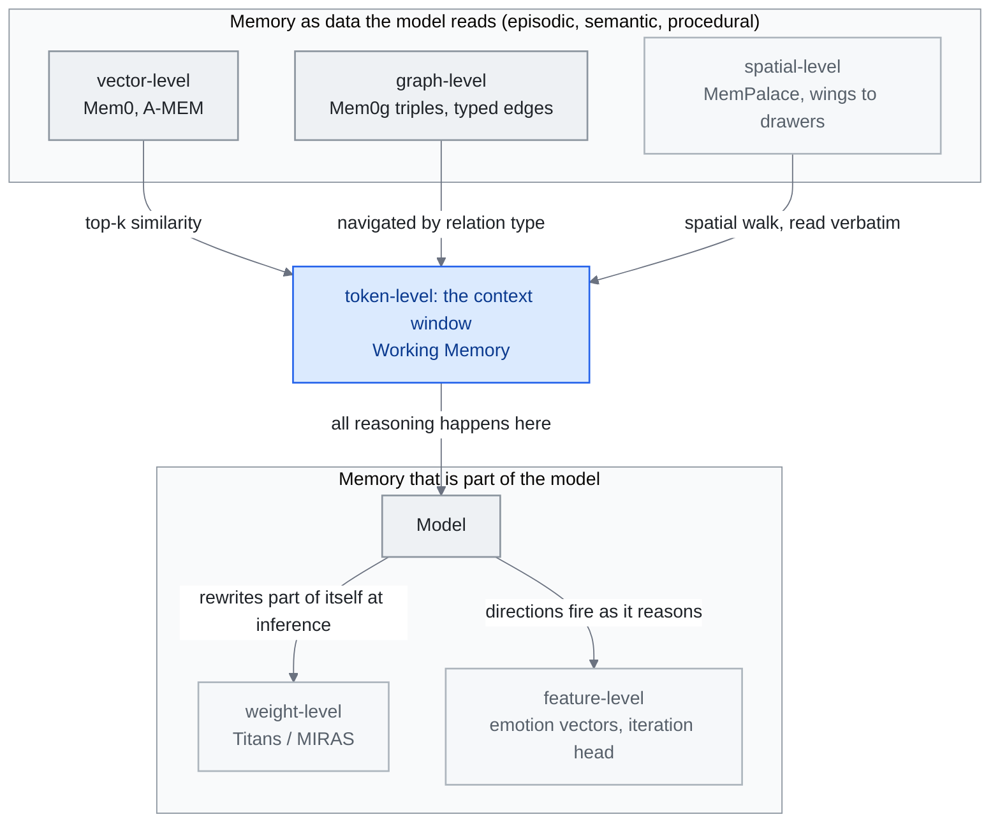

<!-- translation-sync:start -->
> 与 2026-10-31 英文版同步的机器辅助译文，已作结构与内容复核。代码和图中标签保留原文；阅读时间按英文原文估算。
> [English source](../../../chapters/06-agent-memory.md) · [Sync record](../../SYNC.md)
<!-- translation-sync:end -->

<!-- i18n-anchor -->

# 第 6 章：Agent Memory —— 缺失的层

> **一句话总结：** 记忆系统让 AI agent 跨对话记住事情——你的偏好、过去决策、项目 context。
>
> **为什么重要：** 没有记忆, 每次 AI 对话都从零开始。记忆让 AI 感觉像同事而非陌生人。
>
> **阅读时间：** ~30 分钟（按英文原文估算：6,772 个单词 / 230 wpm）

*图："Feature-Level Memory Research (2026)" 命名的六个层次，按记忆所在位置排列：顶部是模型通过接口读取的内容，底部是模型本身的组成；"Memory Taxonomy" 的四类记忆映射其上，工作记忆就是窗口，情景、语义与程序性记录则位于存储。各层检索机制来自 "Major Frameworks"，权重层条目来自 "Architectural Patterns"。通往上下文窗口的连线承载论点：外部层无论如何索引，都必须先检索入窗口，模型才能对其推理；权重层、特征层则已在模型内部。截至 2026 年，生产栈仍主要位于前三层。*

<!-- i18n-anchor -->

## 为什么记忆重要

每次你与 LLM 开新对话, 你从零开始。模型没有你之前互动的回忆, 没有你的偏好, 没有你花数小时对话辛苦建立的 context。这不是小麻烦——这是侵蚀 AI 作为持续协作者承诺的根本架构差距。

记忆把 AI agent 从无状态回应者转化为会学、适应、随时间累积理解的系统。没有记忆, 一个 AI 助手不能记得你偏好简洁答覆、你的项目用 TypeScript 配特定 ORM、或上周二你在认证流程中识别到关键 bug。每个 session 变成冷启动。每次互动都需要从头重建 context。

这个差距的成本不只用户挫折。它显化为浪费 token（重新解释 context）、退化输出质量（错过个人化）、断裂工作流程（在多 session 任务上失去连续性）。当 AI agent 从聊天玩具移到生产基础设施, 记忆已成为原始模型能力与真实有用之间的关键缺失层。

<!-- i18n-anchor -->

## 记忆分类

agent 记忆研究已收敛到一个受人类认知科学启发的分类, 区分四种基本类型:

**情节记忆（Episodic Memory）** 存储基于经验的纪录——特定互动、事件与其结果。当 agent 记得"last week, the user asked me to refactor the payment module and preferred extracting a service class over using mixins,", 那是情节记忆。它为个人化与从过去成败学习提供经验基础。

**语意记忆（Semantic Memory）** 装事实知识与结构化信息——用户的技术堆叠、团队成员的角色、项目架构决策、API schema。与情节记忆不同, 语意记忆从特定事件抽象出来。它代表蒸馏的理解, 非原始经验。

**程序记忆（Procedural Memory）** 编码 how-to 知识——工作流程、标准操作程序、学到的动作序列。当 agent 知道部署这个特定项目需要跑测试、构建 Docker 映像、推到 registry、然后触发 Kubernetes rollout, 那是程序记忆。它让 agent 不必每次重新推导过程就能执行复杂多步任务。

**工作记忆（Working Memory）** 代表主动推理 context——当下被操纵与综合的信息。这映射到模型的 context window 与任何主动检索状态。这是最受限也最关键的层, 因为它决定 agent 在任何给定时刻实际能推理什么。

这四种类型之间的相互作用定义 agent 记忆系统的精致度。一个朴素实现可能只存对话日志（粗的情节记忆）。一个成熟系统分离、索引、交叉参照所有四种类型, 在对的时间检索对的信息。

<!-- i18n-anchor -->

## 主要框架

### Mem0

[Mem0](https://mem0.ai) 浮现为 AI 应用的领先通用记忆层。Apache 2.0 授权, 它提供跨用户、session、agent 添加、搜寻、管理记忆的统一 API。

效能数字惊人: 相对基线系统在 LLM 评判评估上 26% 改善、相对全 context 做法 91% 较低 p95 latency, 透过仅检索相关记忆而非重播整个对话历史达到 90%+ token 成本减少。Mem0 透过结合向量存储、基于图的关系、智能记忆固化的混合架构达成这。

2025 年, Mem0 与 AWS 取得伙伴关系, 整合进 Amazon Bedrock 生态系, 把自己定位为企业 AI 部署的默认记忆层。该平台支援多租户记忆隔离, 适合服务数千用户、各有自己持续记忆空间的应用。

**Mem0ᵍ（2026）：图作为一等公民。** 有向标签图变体 **Mem0ᵍ** 在 2026 年初进入生产, 把早期混合向量+图设计取代为知识图优先架构。管线从**实体提取器** 流向**关系生成器**, 产生形如 `(source, relation, destination)` 的标签三元组——配 `lives_in`、`prefers`、`owns` 等类型化边而非无类型相似度链接。**冲突侦测器** 配上 **LLM 驱动的更新解决器** 处理新事实到来时的矛盾: 当新三元组与现存的不一致, 解决器决定覆写、合并、或带溯源保留两者。Mem0ᵍ 透过给记忆一个可查询的语意结构, 关闭长久以来全 context 做法（"dump everything into the window"）与选择性检索（"find the top-k similar chunks"）之间的差距, 该结构能按关系类型导航, 不只按向量距离。

### A-MEM

[A-MEM](https://github.com/agiresearch/A-mem) 采取根本不同做法, 灵感来自 Zettelkasten 方法——社会学家 Niklas Luhmann 用来产出跨多元领域 70+ 本书的著名笔记系统。

A-MEM 把每个记忆视为有动态索引、链接、演化的原子笔记。记忆不只被存储与检索; 它们透过浮现链接连到相关记忆、沿多个维度索引、随新信息到来允许演化。当新记忆被加, 系统识别到现存记忆的连结, 可能合并、拆分、或更新它们。

这个做法产生有机成长的记忆结构, 形成相关知识的群集, 镜映人类专家如何建心智模型。Zettelkasten 灵感对知识工程特别合适——它本质上是个让知识随时间复利的系统。

### ByteRover

[ByteRover CLI](https://github.com/campfirein/byterover-cli) 前称 Cipher，以上下文树组织项目知识。仓库于 September 27, 2026 归档。October 31 检查的文档描述了本地操作、可选云同步、整理审核，以及类似 Git 的分支与合并。代码采用 Elastic License 2.0，属于源码可见。这一历史案例展示了面向文件系统的记忆组织方式；它既不能证明检索整体更优，也不会消除模型与维护成本。

该模式首次在 2026 年七月 29 日 上得到学术研究。**"Filesystem-Based Memory for LLM Agents: Organization, Evolution, and Sustainability"**（arXiv 2607.26637；Sizhe Zhou 和来自 UIUC、UCSD 和 Adobe Research 的十位合著者）描述自己是第一个对 markdown 文件目录树方法的系统研究，智能体通过通用文件工具读取、写入和重新组织的记忆，作为通用模式而非任何单一供应商的产品进行研究。该论文围绕单一共享内存文件系统定义了三个角色：一个管理智能体，用于组织传入内容；一个搜索智能体，用于通过引用来源回答查询；一个执行智能体，用于将任务轨迹提炼为可重用的技能。其主要发现对选择此模式而非向量存储的任何人来说都至关重要：一旦存储变大，保持存储有序可将检索成本减少约一半。这衡量的是通用组织模式，而非 ByteRover 的实现。在增长研究中，除了最强的管理智能体外，所有智能体的组织性都会下降，且其测量的智能体均未将组织性转化为更好的答案。更便宜的搜索，而非更好的答案，是整洁树带来的好处。该研究未被复制，但它将文件系统记忆从一种已交付的惯例转变为一种可测量的惯例。

### Cognee

[Cognee 1.0](https://www.cognee.ai/cognee-1-0-announcement)，发布于 2026 年六月 26 日，暴露了 `remember`、`recall`、`forget` 和 `improve`，而不仅仅是摄入和搜索阶段。供应商描述了单个 Postgres 部署、托管云和 COGX 导出。其以反馈驱动的改进操作使记忆维护成为接口的一部分。这些是产品功能；它们的存在并不独立确立记忆质量或可靠的遗忘。

### Nemori

[Nemori](https://github.com/nemori-ai/nemori) 聚焦在一个特定但关键的问题: 如何把连续对话流分段成有意义的记忆单元。

不是把每个讯息或每个对话当记忆单元, Nemori 把对话分成语意对齐的情节——代表一个完整想法、决策、工作流程的协调互动块。这个分段关键, 因为"relevant past context"与"noise"之间的边界常落在对话中间, 不在端点。

透过产生干净的情节段, Nemori 给下游记忆系统提供更高质量输入, 无论那些用向量检索、图结构、或阶层组织。

### MemPalace

[MemPalace](https://github.com/MemPalace/mempalace) 回归比向量检索或知识图古老得多的想法: **memory of loci**, 古代与中世纪学者用来记得大量目录的空间-记忆术技巧, 透过心理走过熟悉建筑物。2026 年 四 月 5 日 MIT 授权发布, MemPalace 把记忆库组织为四层空间阶层——**Wings → Rooms → Closets → Drawers**——每个叶节点"drawer"存一个原文文字片段, 而透过阶层导航本身担任索引。

因此检索 primitive 不是 embedding 相似度也不是图遍历, 而是 **空间走读**: agent 推理哪个 wing 可能含相关记忆, 下到 rooms 与 closets, 原文读 drawers 而非从压缩 embedding 复原。"verbatim-first"存储哲学是把 MemPalace 与在存储前总结或切块的系统区别开来的设计选择——它主张对许多任务（法律、科学、对话）, 存储时有损压缩的成本超过检索时稍慢空间走读的成本。

基准数字是这个做法突破的原因。MemPalace 报告 **96.6% Recall@5 on LongMemEval**, agent 记忆已发表的最长 context 召回基准——在同一评估中领先仅向量与仅图做法。社群反响一样惊人: 项目在前三周累积约 **49,000 GitHub stars**, 是 2026 年成长最快的记忆项目, 领先一个数量级。月底前已有学术评论（arXiv 2604.21284, *"Spatial Metaphors for LLM Memory: A Critical Analysis of the MemPalace Architecture"*）在流通——本身就是项目多快进入领域中心对话的信号。

<!-- i18n-anchor -->

## 架构 Pattern

随着领域成熟, 几个跨多个框架出现的架构 pattern:

**多类型阶层。** MIRIX 框架（Wang and Chen, "MIRIX: Multi-Agent Memory System for LLM-Based Agents,", arXiv 2507.07957, 2025 年 七 月 10 日）以 **六种独立记忆类型** 例示这个 pattern——Core Memory、Episodic Memory、Semantic Memory、Procedural Memory、Resource Memory、Knowledge Vault——由含六个每类 Memory Manager 与一个处理任务路由的 Meta Memory Manager 的多 agent 框架协调。每种类型有不同更新频率、保留政策、检索机制。这种分离防止灾难性遗忘同时允许快速适应。参考应用即时监控屏幕活动以建个人化记忆库; 在 ScreenshotVQA 多模态基准上, MIRIX 报告比 RAG 基线 35% 更高准确度, 储存需求 99.9% 较低; 在 LOCOMO 长篇对话基准上 85.4%。

**Git 式版本控制。** 几个系统现在像版本控制代码那样版本化记忆, 维护历史, 支援分支（用于推测推理）, 并启用记忆更新被证明错误时的 rollback。这在多 agent 系统特别重要, 不同 agent 可能并发更新共享记忆。

版本控制模式获得了一个事务边界（2026 年七月）。Git风格的历史记录是一种惯例；**MemTxn**（"MemTxn: A Transaction Boundary for Source-Supported Updates and Complete-State Recovery in Agent Memory," arXiv 2607.27834, 2026 年七月 30 日；Hanshuai Cui 和五位合著者）将其作为保证提出。该层位于回答模型之外，包含三个部分：*Ordered PatchTest* 检查所提议的更新是否确实得到其引用来源的支持，*Temporal Resolver* 决定在事实冲突时哪个版本是可见的，而持久快照日志可以在发生故障后恢复应用程序可见状态，而无需知道物理写入集。在作者自己的验证集上，它接受所有 60 来源支持的更新，并拒绝所有 179 构造的硬负样本，并且在 LongMemEval-S 和 LoCoMo 派生状态上注入持久多键故障时，它能够完全恢复声明的活动内存映射。该验证集较小，结果未被复制，因此这只是一个提议，而不是经过生产验证的保证。它对本章的贡献是一个契约：它将 Mem0ᵍ 非正式指定的冲突检测器和更新解析器转化为一个可以失败的接受/拒绝测试，并添加了一个恢复故事，而上述框架均未提供。另一组团队在三天前就达成了相同的框架，并且根据作者列表，是独立完成的 --- **MemTX**（"MemTX: Transactional Belief Commit for Stateful Agent Memory," arXiv 2607.23929, 2026 年七月 27 日）在快照隔离事务中安排写入，通过尚未提交的信念状态对不可逆的工具调用进行门控，并在信念被撤回时通过派生记录和工具副作用进行修复。两个不相关的团队在同一周内都试图采用数据库事务语义本身就是一个信号：内存写入已经变得足够重要，需要提交纪律。

**认知启发分离。** 不是单一记忆存储, 领先架构在快速存取工作记忆、中期情节缓冲、长期固化知识之间维持明确分离。记忆固化过程——类比生物系统的睡眠——周期性压缩、去重、把情节记忆重组为语意知识。

**可训练记忆模块。** 第四个 pattern 在 2026 年 四 月与 Google Research 的 **Titans + MIRAS** 浮现, 它把记忆完全重构为*可训练神经模块*而非外部存储。不是把事实写到向量数据库、图、或 markdown 档, Titans 在推论时透过梯度下降更新专用记忆模块的权重——模型字面上在处理文件时重写自己的部分。MIRAS 是配套训练框架, 提供让推论时学习率不发散的配方与稳定性保证。在参数量相当的情况下, Google Research 博客报告 Titans 在长距离回忆与多跳推理上优于 **Mamba-2**、**Gated DeltaNet**、**Transformer++**。这个 pattern 在概念上与前三个不同: Mem0、A-MEM、ByteRover、MIRIX 都把记忆当作模型透过接口读的数据; Titans 把记忆变成模型本身的一部分, 透过和 attention 一样的电路读, 但透过和训练一样的机器写。对知识工程师, 它提出新设计问题: 你的记忆什么时候值得烧进权重, 什么时候应保持作为可查询数据？

在 **2026 年五月 6 日** 上，Anthropic 的 **Dreaming**（研究预览）出现了第二个商业方向：而不是在推理时将内存训练到权重中，Dreaming 运行一个计划的会话间任务，读取最近的会话，识别重复的错误和收敛的工作流程，并 **以明文形式重写智能体的持久内存**。Titans 将内存作为模型本身的一部分（通过梯度下降更新），而 Dreaming 保持内存为系统编排层读取的数据（通过 LLM 的整理过程更新）。现在，这两种方法成为长期智能体记忆的两种对比商业模板：**可训练内存**（推理时梯度更新，模型内部）与 **整理内存**（LLM 重写明文，运行底座外部）。对于知识工程师来说，设计问题变得更加尖锐 --- 在什么情况下，内存值得烧录到权重中（Titans），在什么情况下，内存值得作为模型可以读取的存储进行查询（Mem0, A-MEM, ByteRover, MemPalace），以及在什么情况下，内存值得作为明文进行编辑，以便整理过程可以修改（Dreaming）？

三个月后，该问题中可训练记忆分支首次获得了其重要的扩展数值。**"Memory Decoder at Scale: A Pretrained, Parametric Long-Term Memory"**（arXiv 2607.27919, 2026 年七月 30 日；Rubin Wei 等，与 Qipeng Guo、Bowen Zhou 和 Zhouhan Lin 合作）预训练了一个参数化记忆模块，以 6.9B 参数在 300B 个标记上进行训练，其理由是仅解码器的大型语言模型（LLM）将记忆和推理纠缠在一个参数集中，而单独扩展记忆是更好的权衡。使这一过程可行是一个基础设施问题，而不是目标函数问题：一个分布式 Faiss 索引和检索管道，具有稀疏的批量 kNN 加载。在 17 个基准测试中，将 6.9B 记忆模块与 410M 参数的 Pythia 基础模型配对，使该基础模型的平均值从 29.86 提高到 37.34 —— 超过 Pythia-12B 的 37.24，使用 39% 更少的总参数。这些数字是自我报告的，这是在现有线（原始、较小的 Memory Decoder 是 arXiv 2508.09874）上的扩展结果，而不是新的基础能力。但它是对 Titans 模式开启并悬而未决的设计问题的第一个参数效率答案：写入权重的记忆不必写入 *相同* 的权重，将两者分开可以让 410M 基础模型与专用记忆模块配对，胜过 12B 的单一模型。

<!-- i18n-anchor -->

## 演化阶段

agent 记忆的发展遵循清晰轨迹:

**阶段 1: 工程整合（2023-2024）。** 记忆被当工程问题对待——如何持久化与检索对话状态。解法主要是向量数据库配上 RAG 管线。功能但粗糙, 没有有原则的做法决定记什么、何时忘、如何组织。

**阶段 2: 结构化与知识图做法（2024 - 2025 H1）。** 领域移向结构化记忆配明确知识图、类型化记忆存储、有原则的检索策略。Mem0 与 A-MEM 等框架在这段期间浮现, 示范结构戏剧性改善记忆质量。

**阶段 3: 认知架构（2025 H2 - 现在）。** 当前工作高度借自认知科学, 实现生物启发的记忆固化、干扰管理、多系统架构。在受控基准上接近人类级 90% 效能的系统已被示范, 不过真实世界效能仍有变化。

**阶段 4: 特征级、可训练、空间隐喻记忆（2026 年 四 月 - 浮现中）。** 2026 年 四 月加上三条不干净适合阶段 1-3 的线。第一是**可训练记忆**（Titans + MIRAS）: 记忆变成在推论时更新的神经模块, 不是模型外的可查询存储。第二是**特征级记忆**, 由同周 Anthropic 可解释性披露开启——情绪向量与迭代头确立特定行为与推理 pattern 对应模型内可识别特征方向, 这意味"what the model remembers about how to reason"原则上可在激活级别而非 token 级别读取与导引。第三是**空间隐喻记忆**（MemPalace）: 回归数字前认知人机工程学, 检索 primitive 是走过阶层空间结构, 存储哲学是原文而非压缩。在生产堆叠中这些不会取代 Mem0、A-MEM、阶层 context tree; 它们与之共存。但它们把设计空间从"where do I store memory and how do I retrieve it"扩大到"at what level of the stack does this memory live --- token, vector, graph, weight, feature, or spatial walk."。

<!-- i18n-anchor -->

## 社群与研究

ICLR 2026 MemAgents Workshop 代表领域的里程碑, 把来自 AI、认知科学、系统工程的研究者聚在一起处理 agent 记忆中的开放问题。关键主题包括记忆可扩展性、遗忘策略、多 agent 共享记忆。

<!-- i18n-anchor -->

## 特征级记忆研究（2026）

整个 2025 年,"agent memory"几乎都意味 agent 能读的数据——一个向量索引、一个知识图、一个阶层 markdown 树、一个情节日志。2026 年 四 月强迫一个更广定义。Anthropic 可解释性披露在 MIT Technology Review 突破认可的同周——**情绪向量** 与**迭代头**——显示前沿模型中一些最重要的"memory"住在没有任何外部存储而是在可识别内部特征中。

**情绪向量** 是 Claude 残差流中的线性特征方向, 当被放大时, 能稳定使模型偏向情绪化行为——包括最广引用的例子, 勒索式输出。对记忆系统设计的相关重点不是安全含义（虽然那是真的）而是架构含义: 模型中有一个特征方向*记得如何威胁*, 而它能独立于任何 prompt 或检索 context 被开大或关小。**迭代头** 是在思维链推理中浮现的注意力头, 持续关注前一推理步骤的输出。它实际上是在 attention 权重而非程序记忆存储中实现的*程序记忆*——模型已学到"how to keep going"的电路, 而该电路是让 CoT 运作的东西。

对记忆系统设计的启示是，"where the memory lives" 现在比 2025 时更是一个更丰富的问题。现代堆栈可能需要在六个不同的层次上读取记忆：**标记级**（窗口中的转录片段）、**向量级**（Mem0、A-MEM 检索）、**图级**（Mem0ᵍ 三元组及其类型边）、**空间级**（MemPalace 的 Wings → Rooms → Closets → Drawers 路径）、**权重级**（Titans / MIRAS 模块在推理时更新）和 **特征级**（模型推理时哪些可解释的方向被激活）。文件系统上下文树是一种与向量检索不同的外部组织策略。到 2026 的生产系统将继续主要存在于前三个层次——这些层次的工具最成熟。但其余三个层次不再是假设，将记忆纯粹视为检索问题的系统编排工程师将越来越多地留下能力未被利用。

**记忆能否经受模型更换？（2026 年九月）** 选择层次有一个领域此前未测量的后果：记忆存储之下的模型会被替换，并非所有层次都能经受更换。Ankit Goyal、Jaideep Ray（arXiv 2609.05339，September 4, 2026）在 48 个合成案例上，对比原始历史、RAG、压缩笔记、结构化知识图谱四种存储。固定模式图记忆几乎不变，准确率变化 +0.0004 ± 0.0020；压缩笔记强烈依赖模型，按迁移方向波动 +9.91 或 -13.28 个百分点。RAG 部分重新嵌入恢复 4.96 个点，完整重新嵌入恢复 11.90 个点。更可推广的是提出的机制：约 80% 笔记退化来自记忆*写入*时丢失的信息，而非读取时，所以只修存储，在全部 48 案例中均未达到 90% 恢复；保留压缩记忆对应的原始历史，则在两个受测迁移方向之一成功修复 34 个。设计规则直接得出：若记忆须跨越模型迁移，应偏向结构化存储而非压缩文字，并保留压缩形式的原始来源。48 个合成案例、两位作者意味着早期结果而非定论，但这是首次把模型更换可移植性视为*存储格式*的性质，而非上层智能体的性质。

<!-- i18n-anchor -->

## 2026：评估与治理控制

截至 H1 2026，记忆讨论主要围绕*架构*，即记忆存放及检索方式。2026 年中，前沿转向*治理*：一组基准不再只问 "can the system recall the right fact"，而问 "does it recall safely, forget on request, resist manipulation, and stay auditable."。其中五项结果突出。

**GateMem**（"GateMem: Benchmarking Memory Governance in Multi-Principal Shared-Memory Agents,"，arXiv 2606.18829，June 17, 2026）首次*联合*评价共享机构记忆的效用、访问控制与主动遗忘，涵盖医疗、办公、教育、家庭等多个主体向同一存储写入的场景。主要结果是未达标：**没有受测方法同时满足三个维度**，尤其检索／外部记忆方案会跨主体边界泄漏信息。治理并非当前任何记忆框架天然具备的性质。

**MemSyco-Bench** ("MemSyco-Bench: Benchmarking Sycophancy in Agent Memory," arXiv 2607.01071, 2026 年七月 1 日) 识别出架构优先框架从未测量的一种失败模式：记忆诱导的谄媚行为。注入错误记忆会使谄媚率从 **18.67% 提高到 32.67%**（DeepSeek-V4-Flash，完整对话条件）以及从 **27.4% 提高到 44.7%**（Qwen3-8B），而外部记忆在客观事实判断上使事实准确性下降 **11-23 分**，与无记忆基线相比。由于该基准测试针对 **Mem0、A-MEM 和 LightMem**——本章已涵盖的框架——结果直接发出警告：一个提高回忆能力的记忆层可能会同时使智能体对被要求记住的内容更加轻信。

**Decision-Aware Memory Cards** ("Decision-Aware Memory Cards: Counterfactual-Inspired Context Selection and Compression for Tool-Using LLM Agents," arXiv 2606.08151, 2026 年六月 6 日) 从另一侧攻击检索。它不是根据查询的语义相似性对记忆进行排序，而是根据*决策导向*、反事实启发的实用性——给定记忆对下一步行动的影响程度——并以类型化、可审计的记忆卡形式存储结果。在 SWE-bench 文件检索（50 验证实例，Qwen3.6-Plus 重新排序 BM25 top-50）中，Hit@1 提高 **0.58 → 0.78**，MRR@10 **0.634 → 0.790**，每查询大约 **45 个标记**。这种重新表述呼应了 CATTS（第 4 章）：下一个决策的实用性，而不是原始相似性，才是值得优化的信号。

**"Are We Ready For An Agent-Native Memory System?"** (arXiv 2606.24775, 2026 年六月 23 日, SJTU / Tsinghua / MemTensor) 为该领域提供了一个共享的词汇表——将系统分解为四个模块：*表示与存储*、*提取*、*检索与路由* 和 *维护*——并发现 **没有单一架构占据主导地位**：**Zep** 在跨会话推理中表现最佳（48.0 LLM-Judge 准确率在 LongMemEval 上），**MemOS** 在 **8.9 EM 上的 LoCoMo** 中精确锚定表现最佳，而一个长上下文基线在状态执行上表现最佳（48.20 EM 在 DB-Bench 上）。结论与 GateMem 从架构角度的结论一致：记忆不是一个只有一个胜者的单一问题，而是一组具有不同领先者子问题的组合。

**StateMemBench／StateMem**（arXiv 2608.19652，August 20, 2026，UIUC 团队）在访问控制与迎合之外增加第三个治理维度：**时效性**。其 234 个跨会话场景在长交互中途修改事实、约束和决策，再检查记忆层返回当前有效值还是被取代的旧值；通过封闭候选池评分，将状态追踪失效与普通检索错误分离。它不同于 GateMem，不止报告未达标结果，还提出 **StateMem**，一种明确追踪替代关系与关系依赖的状态优先方法。论文报告，DeepSeek-V4-Flash 的当前状态准确率提高 1.8x（0.205 至 0.363），Qwen-3.5-9B 提高 1.6x（0.149 至 0.233），分别对比同一主干下最强基线和最强记忆系统；作为六个现有后端的包装层时，提升 +32 至 +67 个点，其中在控制包装层自身新增上下文 token 后，仍保留 +15 至 +32 个点。这一控制区分了"the method works"与"more context helps."。数字均为论文自报，尚未复现。值得单独命名这一维度，因为领域通用、侧重召回的基准在结构上看不见新值替代旧值：一个自信返回你*过去*相信的事实的存储，仍会被记为命中。

另一项较早的单作者结果值得作为研究方向标记，而非已确立结论：arXiv 2606.15903（June 14, 2026）主张，*LLM 在记忆流水线中的位置*决定哪些删除真正有效。在修改时设置钩子，可恢复事后过滤遗漏的意图感知删除，目标类别为 78-85%，总体覆盖率 91.7-93.2%。这是早期工作，但指向与上述基准相同的治理空白：遗忘是架构位置的选择，不是一个删除按钮。

**TencentDB Agent Memory v2.0 的 Team Memory** 从厂商而非基准侧回应治理空白。Tencent 的 MIT 许可、自托管记忆框架，仓库创建于 April 7, 2026，截至 August 24, 2026 约有 24,000 GitHub stars；于 August 3, 2026 发布 v2.0.0，八月 13 日再独立公布团队协作功能。主要新增的 Team Memory 是跨智能体共享的治理层：在 Chat Memory、Skill、Wiki、CodeGraph 四类带版本的记忆资产之上，提供私有／团队／受限／智能体可见性层级；前端 Memory Proxy 兼容 Anthropic 与 OpenAI 协议，并在预算上限内执行 L0-L3 分层蒸馏与 BM25+vector+RRF 检索。对照上文 GateMem 的未达标结果，Team Memory 是首个已发布、尝试解决 GateMem 所发现没有框架满足访问控制维度的生产方案。但这里每项治理机制主张，都是 Tencent 对自身产品的描述。不同于 GateMem 的第三方对抗评估，尚无独立基准检验 Team Memory 的可见性层级能否在多主体负载下真正成立。本章"evaluation grows governance axes"的线索，如今同时有测量空白的基准，以及声称弥合空白的已发布基础能力，两者之间的评估缺口仍未填补。

**托管记忆成为云产品类别（2026 年七月至八月）。** Tencent 并非唯一参与者，第二个实例使它成为一个类别，而非单一产品。**July 30, 2026**，Google 公布一组 Gemini Enterprise Agent Platform 能力正式发布，其中包括 **Agent Memory Bank**：依据模式定义，从对话上下文提取结构化内容，面向低延迟个性化，让智能体接续未完成的长期任务。这是更名后平台的正式发布里程碑，不能与七月 2025、旧 Agent Engine 品牌下 Vertex AI Memory Bank 的公开预览混为一谈。这里的每项能力描述都来自 Google 公告博客，尚无独立基准评价 Memory Bank 的模式提取质量。它比上述 TencentDB v2.0 发布早四天，二者合看才是重点：两家大型云厂商把托管智能体记忆作为单独治理的平台基础能力发布，而非智能体框架内的功能；此前，本章虽追踪 Mem0、A-MEM、ByteRover、Nemori、MemPalace 与 Dreaming，却尚未点名任何 Google 托管记忆服务。Memory Bank 周边公告也从基础设施侧推动相同方向：Agent Runtime 支持智能体连续运行最长七天，Agent Identity 则作为原生 IAM 类型，支持最小权限访问与缓解 token 窃取风险。第 4 章在编排层讨论的持久会话与权限问题，在这里变为可配置开通的服务。

**持久化冲突审核成为 API（October 29, 2026）。** [Cognee v1.6.6](https://github.com/topoteretes/cognee/releases/tag/v1.6.6) 增加持久保存的事实冲突处理结果，并默认启用审核。发布说明描述，在支撑文本块变化、连接器删除或遗忘数据集后，将旧处理结果作废，并在解决冲突时只引用仍然有效的文本块。被治理的对象如今包括此前决定的有效性，而不仅是已存储的事实。这些都是厂商描述的软件行为，尚无独立的可靠性结果，也未展示事务保证。

<!-- i18n-anchor -->

## 2026 年七月下旬：参数化原生记忆的主张

2026 年中的治理基准仍假设，记忆是*通过接口读取*的，例如向量索引、图或整理过程。July 29, 2026，上海 **MemTensor** 将分类法推向另一方向。这也是上文六月 23 日智能体原生记忆综述背后的实验室，此次是横跨中国人民大学、NUS、SJTU 与同济大学、共 17 位作者的合作。**Metis**（"Metis: Memory Foundation Model,"，arXiv 2607.26760）提出**记忆基础模型**：让智能体记忆作为持久、动态演进的状态存在于 *transformer 主干内部*，采用参数化方式，而非外部存储。上文四模块综述假设智能体通过位于模型外部的表示与存储／提取／检索与路由／维护模块读取记忆；Metis 原型则冻结主干，只训练 **hyper memory block** 和 **local memory block**，明确受 Fast Weight Programming（FWP）启发，并在 Qwen3.5 主干的 4B、9B 与 27B 规模上评估。

其机制应与本章已有的两种贴近模型的记忆模式区分。上文阶段 4 的 Titans + MIRAS 在*推理时*通过梯度下降更新可训练神经模块，即模型边读取边改写自身权重。Metis 的推理阶段不使用梯度：以 EMA 式前向计算更新记忆，把历史上下文压缩为固定大小的状态，无需反向传播，也不把压缩历史重新作为文本重放。自阶段 4 以来，本章追踪的"where does memory live"光谱由此增加第三个位置：既非向量存储查询，也非梯度下降更新权重，而是冻结主干的模块按固定算术规则将状态向前传递。

论文对方法目前何处失效坦率得少见，这些限定应与架构一同保留：固定大小压缩会丢失信息，导致长期任务表现下降；作者还明确报告"information confusion in some cases, possibly caused by the blending of semantics within the latent space."。对照上述治理基准，它们已表明没有单一架构能同时在效用、安全与可审计性上领先，因此更适合将 Metis 理解为进入已有争议领域的第四个候选，而非争议的解决方案。这是一项研究预览，为记忆提出新的存放位置；其自身失效模式又提出新问题：将记忆挤进固定大小的潜在状态，而非可检查的存储，究竟会丢失什么？

<!-- i18n-anchor -->

## 关键资源

- **[Awesome-AI-Memory](https://github.com/IAAR-Shanghai/Awesome-AI-Memory)**（IAAR-Shanghai）——综合调查与论文收集, 涵盖记忆架构、基准、应用。
- **[Agent-Memory-Paper-List](https://github.com/nuster1128/Agent-Memory-Paper-List)** ——按主题与做法组织的 agent 记忆系统研究论文精选清单。
- **[Awesome-Memory-for-Agents](https://github.com/TsinghuaC3I/Awesome-Memory-for-Agents)**（TsinghuaC3I）——清华大学综述, 涵盖记忆分类、架构、评估方法。

---

<!-- i18n-anchor -->

## 三个要点

- **"Where does the memory live"如今是六个问题，而非一个。** token、向量、图、空间、权重与特征层都已出现，而截至 2026 年的生产栈仍主要位于前三层。
- **没有记忆框架天然具备完整治理。** GateMem 同时衡量效用、访问控制与主动遗忘，发现没有受测方法满足全部三项，检索及外部记忆方案还会跨主体边界泄漏信息。
- **在一项含 48 个合成案例的研究中，存储格式决定记忆能否经受模型更换。** 固定模式的图记忆几乎不变，压缩笔记却波动高达 13 个点；作者将约 80% 的退化归因于笔记写入时、而非读取时丢失的信息。

---

<!-- i18n-anchor -->

## 来源

1. Mem0 文档与基准。https://mem0.ai
2. A-MEM: Agentic Memory with Zettelkasten-Inspired Organization. https://github.com/agiresearch/A-mem
3. ByteRover CLI。[已归档仓库](https://github.com/campfirein/byterover-cli)，September 27, 2026 归档；October 31, 2026 检查文档。Elastic License 2.0。
4. Nemori: Semantic Episode Segmentation for Agent Memory. https://github.com/nemori-ai/nemori
5. Wang, Yu and Chen, Xi. "MIRIX: Multi-Agent Memory System for LLM-Based Agents." arXiv 2507.07957, 2025 年 七 月 10 日。https://arxiv.org/abs/2507.07957.。配套 repo: https://github.com/Mirix-AI/MIRIX
6. ICLR 2026 MemAgents Workshop. https://iclr.cc/virtual/2026/workshop/MemAgents
7. IAAR-Shanghai. Awesome-AI-Memory. https://github.com/IAAR-Shanghai/Awesome-AI-Memory
8. TsinghuaC3I. Awesome-Memory-for-Agents. https://github.com/TsinghuaC3I/Awesome-Memory-for-Agents
9. nuster1128. Agent-Memory-Paper-List. https://github.com/nuster1128/Agent-Memory-Paper-List
10. Google Research. "Titans + MIRAS: Helping AI Have Long-Term Memory"（2026 年 四 月）。https://research.google/blog/titans-miras-helping-ai-have-long-term-memory/
11. Anthropic Interpretability Team. Emotion Vectors 与 Iteration Head 披露（2026 年 四 月）。MIT Technology Review 2026 年 一 月把 mechanistic interpretability 认作 Breakthrough Technology 的配套。
12. MIT Technology Review. "10 Breakthrough Technologies of 2026: Mechanistic Interpretability"（2026 年 一 月 12 日）。https://www.technologyreview.com/2026/01/12/1130003/mechanistic-interpretability-ai-research-models-2026-breakthrough-technologies/
13. MemPalace GitHub Repository. https://github.com/MemPalace/mempalace ——MIT 授权空间隐喻记忆系统, 首次 commit 2026 年 四 月 5 日。
14. "Spatial Metaphors for LLM Memory: A Critical Analysis of the MemPalace Architecture," arXiv 2604.21284（2026 年 四 月）。https://arxiv.org/abs/2604.21284
15. Anthropic。"New in Claude Managed Agents: dreaming, outcomes, and multiagent orchestration"（May 6, 2026）。https://claude.com/blog/new-in-claude-managed-agents ：Dreaming 是可训练记忆 Titans 的整理式记忆对应物。
16. Simon Willison。Code w/ Claude 2026 SF 现场博客（May 6, 2026）。https://simonwillison.net/2026/May/6/code-w-claude-2026/
17. "GateMem: Benchmarking Memory Governance in Multi-Principal Shared-Memory Agents." arXiv 2606.18829（June 17, 2026）。https://arxiv.org/abs/2606.18829 ：联合评价效用／访问控制／主动遗忘；没有受测方法满足全部三项。
18. "MemSyco-Bench: Benchmarking Sycophancy in Agent Memory." arXiv 2607.01071（July 1, 2026）。https://arxiv.org/abs/2607.01071 ：记忆引发迎合，DeepSeek-V4-Flash 全对话为 18.67%→32.67%，Qwen3-8B 为 27.4%→44.7%；事实准确率下降 11-23 个点；评估包括 Mem0、A-MEM 与 LightMem。
19. "Decision-Aware Memory Cards: Counterfactual-Inspired Context Selection and Compression for Tool-Using LLM Agents." arXiv 2606.08151（June 6, 2026）。https://arxiv.org/abs/2606.08151 ：面向决策排序、带类型且可审计的卡片；SWE-bench 文件检索 Hit@1 0.58→0.78、MRR@10 0.634→0.790，每查询约 ~45 token。
20. "Are We Ready For An Agent-Native Memory System?" arXiv 2606.24775（June 23, 2026；SJTU／清华／MemTensor）。https://arxiv.org/abs/2606.24775 ：四模块分解；没有单一架构领先，Zep 的 LongMemEval 为 48.0，MemOS 的 LoCoMo EM 为 8.9，长上下文的 DB-Bench EM 为 48.20。
21. arXiv 2606.15903（June 14, 2026）：单作者研究，讨论意图感知删除的控制平面位置；修改时钩子在目标类别恢复 78-85%，总体覆盖率 91.7-93.2%。https://arxiv.org/abs/2606.15903
22. "Metis: Memory Foundation Model." arXiv 2607.26760（July 29, 2026 提交；MemTensor／中国人民大学／NUS／SJTU／同济大学，共 17 位作者）。https://arxiv.org/abs/2607.26760 ：冻结 transformer 主干内的参数化原生记忆，基于 Qwen3.5 的 4B/9B/27B；受 FWP 启发的 hyper memory block + local memory block；推理时通过无梯度 EMA 式过程更新；自报局限包括固定大小压缩下的长期信息丢失，以及潜在空间中的语义混合。
23. TencentCloud。TencentDB-Agent-Memory。https://github.com/TencentCloud/TencentDB-Agent-Memory ：MIT 许可、自托管；仓库创建于 April 7, 2026；v2.0.0 于 August 3, 2026 发布（GitHub releases API）；约 ~24K stars（August 24, 2026 检查）。MarkTechPost，"Tencent Cloud Open-Sources TencentDB Agent Memory v2.0"（August 7, 2026），https://www.marktechpost.com/2026/08/07/tencent-cloud-open-sources-tencentdb-agent-memory-v2-0/; ；PRNewswire 团队协作公告（August 13, 2026），https://www.prnewswire.com/apac/news-releases/tencentdb-agent-memory-tops-20-000-github-stars-in-90-days-launches-team-memory-for-multi-agent-collaboration-302850576.html ：Team Memory 治理层，在 Chat Memory、Skill、Wiki、CodeGraph 之上提供私有／团队／受限／智能体可见性层级；治理机制主张均来自 Tencent，尚无独立基准。
24. "Filesystem-Based Memory for LLM Agents: Organization, Evolution, and Sustainability." arXiv 2607.26637（July 29, 2026；Sizhe Zhou 与十位合作者，UIUC／UCSD／Adobe Research）。https://arxiv.org/abs/2607.26637 ：首个系统研究 Markdown 目录树记忆模式的工作；在一个共享记忆文件系统上，区分管理／搜索／执行三类智能体；存储规模扩大后，有序组织让检索成本大致减半，但除最强管理智能体外，组织都会退化，所有受测智能体也都未能把组织有序转化为更好的答案。尚未复现。
25. "MemTxn: A Transaction Boundary for Source-Supported Updates and Complete-State Recovery in Agent Memory." arXiv 2607.27834（July 30, 2026；Hanshuai Cui 与五位合作者）。https://arxiv.org/abs/2607.27834 ：Ordered PatchTest、Temporal Resolver 与持久快照日志；在作者自建的小型验证集上接受 60/60 个有来源支持的更新，拒绝 179/179 个困难负例；在 LongMemEval-S 和 LoCoMo 派生状态上注入多键故障后可恢复状态。独立并行提案："MemTX: Transactional Belief Commit for Stateful Agent Memory,"，arXiv 2607.23929（July 27, 2026），https://arxiv.org/abs/2607.23929 ：快照隔离写入、按尚未提交的信念状态限制动作，以及撤回时的级联修复；与 MemTxn 没有作者重合。
26. "Memory Decoder at Scale: A Pretrained, Parametric Long-Term Memory." arXiv 2607.27919（July 30, 2026；Rubin Wei 等）。https://arxiv.org/abs/2607.27919 ：在 300B token 上预训练的 6.9B 记忆模块；分布式 Faiss 流水线，按批次稀疏加载 kNN；17 项基准上，410M Pythia 基础模型的平均成绩由 29.86 提升至 37.34，相比 Pythia-12B 的 37.24，总参数减少 39%。结果为自报；这是较早 Memory Decoder 的规模化版本，arXiv 2508.09874，https://arxiv.org/abs/2508.09874
27. Goyal, Ankit 与 Ray, Jaideep。"Does Your Agent's Memory Survive a Model Upgrade? A Controlled Study of Memory Portability." arXiv 2609.05339（September 4, 2026）。https://arxiv.org/abs/2609.05339 ：48 个合成案例、四种存储方法；图记忆几乎不变（+0.0004 ± 0.0020），压缩笔记波动 +9.91 / -13.28 个点；部分重新嵌入恢复 4.96 个点，完整重嵌入恢复 11.90；笔记退化的 ~80% 归因于构建时信息丢失；只修复存储始终无法达到 90% 恢复率，保留原始来源则在两个受测迁移方向之一修复 34/48 个案例。合成样本量小、两位作者、尚未复现。
28. "Can Agent Memory Systems Track Evolving State?"（StateMemBench／StateMem）。arXiv 2608.19652（August 20, 2026；UIUC）。https://arxiv.org/abs/2608.19652 ：234 场景的跨会话基准，以封闭候选池评分衡量时效／替代关系，并提出状态优先包装方法 StateMem；报告 DeepSeek-V4-Flash 当前状态准确率相对同主干最强基线达 1.8x（0.205 至 0.363），Qwen-3.5-9B 相对最强记忆系统达 1.6x（0.149 至 0.233）；作为六个后端的包装层，提升 +32 至 +67 个点，控制上下文 token 后保留 +15 至 +32 个点。均为论文自报，尚未复现。
29. Google Cloud。Gemini Enterprise Agent Platform 正式发布公告（July 30, 2026）。https://cloud.google.com/blog/products/ai-machine-learning/whats-new-in-gemini-enterprise-agent-platform ：Agent Memory Bank 正式发布，按模式定义从对话上下文提取结构化内容；Agent Runtime 支持智能体连续运行最长 7 天；Agent Identity 是原生 IAM 类型；另有 Agent Gateway、Agent Registry，共五项能力。不同于七月 2025 的 Vertex AI Memory Bank 公开预览。所有能力主张均为 Google 自报，未找到独立基准。产品文档：https://docs.cloud.google.com/gemini-enterprise-agent-platform/scale/memory-bank

30. Cognee。"cognee 1.0"（June 26, 2026）。[公告](https://www.cognee.ai/cognee-1-0-announcement)。
31. Cognee。"v1.6.6"（October 29, 2026）。[发布说明](https://github.com/topoteretes/cognee/releases/tag/v1.6.6)。

---

*下一章：[第 7 章：MCP，胜出的标准](07-mcp.md)*
