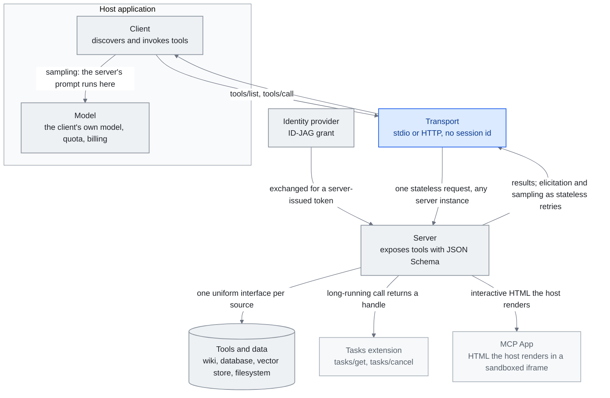

<!-- translation-sync:start -->
> 与 2026-10-31 英文版同步的机器辅助译文，已作结构与内容复核。代码和图中标签保留原文；阅读时间按英文原文估算。
> [English source](../../../chapters/07-mcp.md) · [Sync record](../../SYNC.md)
<!-- translation-sync:end -->

<!-- i18n-anchor -->

# 第 7 章：MCP —— 胜出的标准

> **一句话总结：** MCP 是一个通用标准, 让 AI 透过单一协议连接到任何外部工具或数据源。
>
> **为什么重要：** 把 MCP 想成 AI 的 USB——之前每个工具都需要自己的客制连接。现在有一个插头到处通用。
>
> **阅读时间：** ~24 分钟（按英文原文估算：5,386 个单词 / 230 wpm）

*图："Why It Won"一节的三个核心概念，即客户端、服务器与传输。客户端与其所属模型同处宿主应用内部，传输与服务器位于外部；周边还加入 2026 规范新增的界面：作为扩展的 Tasks、渲染 UI 的 MCP Apps，以及通过 IdP 配置的授权。Tasks 与 MCP Apps 来自"2026-05-21: The 2026-07-28 Release Candidate"一节，ID-JAG token 交换来自"2026-06-18: Enterprise-Managed Authorization"，无会话核心来自"2026-07-28: The Specification Ships Final"。从服务器返回的连线承载"The Stateful MCP Transition"的论点：服务器不再只回答，也能征求结构化输入并请求采样；最终的无状态核心通过普通重试传递这些交互，而非维持一条持续连接。*

<!-- i18n-anchor -->

## 什么是 MCP？

Model Context Protocol（MCP）是 Anthropic 创造的开放协议, 标准化 AI 模型如何连接到外部工具、数据源、服务。MCP 之前, 每个 AI 整合都是客制——客制函数定义、专有工具格式、手写认证、脆弱粘合代码。MCP 用通用接口取代这碎片: 任何模型都能用单一协议发现、认证、调用任何工具。

把 MCP 想成 AI 的 USB。USB 之前, 每个外设需要自己的连接器、驱动、协议。USB 没让外设更强大——它让它们可互操作。MCP 对 AI 工具生态系做同样的事。一个 MCP 服务器实现能服务 Claude、GPT、Gemini, 或任何讲该协议的模型。一个 MCP 客户端能连到数千服务器而不需客制整合代码。

<!-- i18n-anchor -->

## 时间线：从推出到 Linux Foundation

**2024 年 十一 月。** Anthropic 把 MCP 作为开源规格发布, 配 Python 与 TypeScript 的参考实现。初次发布含一些参考服务器（filesystem、GitHub、Slack）与建客制服务器的 SDK 支援。反响审慎乐观——AI 社群之前看过被提议的可互操作性标准。

**2025 年四月。** 推出六个月后，MCP 的 SDK 累计下载超过 8 百万，社区已构建超过 5,800 个服务器。生态增长比任何人预期都快。关键在于，竞争的 AI 实验室开始采用该协议，而非另建替代方案。

**2025 年底。** MCP 被捐给 Agentic AI Foundation, Linux Foundation 旗下的新实体, 由 Anthropic、Block、OpenAI 联合治理。这个动作中和"Anthropic controls the standard"的关切, 把 MCP 确立为真正行业标准而非供应商专属协议。

**2026。** 截至 Q1 2026，MCP SDK 在全部包注册站的每月下载量超过 97 million。生态包含由基金会维护的 75+ 个官方连接器，以及数千个社区服务器。协议已成为 AI 应用的默认集成层，正如 REST 成为网页 API 的默认方案。

协议的整合时刻出现在 **May 6, 2026**，AWS 将 **AWS MCP Server** 正式发布：这是首个由超大规模云厂商托管的远程 MCP 端点，通过一个认证服务器开放 15,000+ 项 AWS API 操作，以 IAM 上下文键实现细粒度访问，并提供沙箱化 `run_script` 工具，在服务器端执行 Python。2025 年十二月捐赠 Linux Foundation，以及 Q1 2026 的 97M 下载量，使 MCP 成为标准；AWS 正式发布则标志着标准成为基础设施。这类似 S3 对对象存储的整合：大量自托管服务器不会消失，但重心转向"one managed endpoint at the cloud boundary."。

Skills 随 MCP 一同进入 AAIF；参见[第 5 章十月更新](05-skill-systems.md#52-the-anthropic-skills-ecosystem)。

<!-- i18n-anchor -->

## 为什么它胜出

几个因素解释 MCP 的快速主导:

**第一天就开放标准。** MCP 在宽松授权下发布, 含完整规格而非只 SDK。这意味竞争者能实现它而不依赖 Anthropic 的代码或善意。

**简单架构。** 协议有三个核心概念: 客户端（AI 模型一侧）、服务器（工具/数据一侧）、传输层（它们如何沟通）。服务器用 JSON Schema 描述暴露工具。客户端发现并调用。传输层处理沟通层（stdio、HTTP+SSE、WebSocket）。这个简单让采纳琐碎——一位胜任开发者能在一小时内建好 MCP 服务器。

**供应商中立治理。** 捐给 Linux Foundation, 配 OpenAI 作为联合治理成员, 消除了最后可信反对。当你的主要竞争者联合治理标准, 标准是真正中立的。

**网络效应。** 每个新 MCP 服务器让协议对每个客户端更有价值, 反之亦然。一旦生态系跨过有用服务器的临界质量, 不支援 MCP 的成本变得高于采纳它的成本。

<!-- i18n-anchor -->

## 关键采用者

MCP 采纳的广度说明它的主导:

- **OpenAI** 把 MCP 支援整合进 ChatGPT 平台与 Agents SDK, 让 GPT 模型能用任何 MCP 服务器。
- **Google DeepMind** 给 Gemini 加了 MCP 客户端支援, 引用生态系兼容性为主要动机。
- **Microsoft** 走最远, 在 Windows 的 OS 层级建 MCP 支援, 跨 Azure AI 服务、Copilot、GitHub Copilot 整合。
- **Amazon / AWS** 在 2026 年 四 月出货 **Bedrock AgentCore Runtime**, 第一个生产级双向 MCP runtime, 在标准协议上加 elicitation 与 sampling（见下方"The Stateful MCP Transition"）。
- **GitHub** 把 Copilot extensions 系统重建在 MCP 上, 取代它们的专有工具格式。
- **Figma、Slack、Block、Notion** 全部出货官方 MCP 服务器, 让它们的平台成为任何 AI 工作流中的一等公民。
- **Hugging Face** 在它的模型 hub 旁边托管社群 MCP 服务器的 registry。
- **LangChain** 与其他编排框架提供原生 MCP 客户端支援, 让它成为默认工具整合方法。

**MCP 作为合成维度。** 一个微妙的 2026 年发展: MCP 工具选择开始作为自动 harness 合成系统中的*变量*之一出现, 而非固定基底。AgentFlow 论文（arXiv 2604.20801, 2026 年 四 月）把 agent 角色、prompt、*工具*、通讯拓扑、协调协议视为它合成回路搜寻的类型化图 DSL 的五个维度。对 MCP 觉知的 harness 设计者这是双面刃。MCP 的标准化让工具维度真正可搜寻——合成回路能用一个 MCP 服务器换另一个而不重写整合层。但同样的标准化让 MCP 服务器本身变成选择候选: 问题不再是"which servers do I install"而是"which servers does my harness *evolve into using* under observability pressure."。

**MCP 负责工具，x402 负责价值。** **May 7, 2026**，AWS 公布 **AgentCore Payments** 预览，这是首个托管的自主智能体支付基础能力，与 Coinbase、Stripe 合作，基于 **x402** 开放协议，重新启用 HTTP 状态码 402（"Payment Required"），让机器进行带内稳定币支付。Coinbase 此前的 x402 进展，包括截至 2026 年四月下旬的 69,000 个活跃智能体、165M 笔交易与约 ~$50M 累计交易量，表明协议在云厂商支持之前已具规模。MCP 承载工具调用层，x402 承载价值转移层，智能体由此获得跨协议技术栈：MCP 统一如何访问 API，x402 统一如何向 API 付款。这对知识工程很重要，因为付费资源，例如优质数据、授权内容和受限 API，成为智能体动作空间的一等成员，预算则由协议层确定性执行，而非交给 LLM 判断规则。

<!-- i18n-anchor -->

## 与知识工程的连结

MCP 本身不是知识工程技术——它是让知识工程可扩展的基础设施层。本报告讨论的每个做法——RAG 管线、知识图、记忆系统、context engineering pattern——都需要把外部知识喂给模型。MCP 标准化这个喂法。

考虑一个实务例子: 一个增强了知识的 AI agent 需要存取公司 wiki、查询数据库、搜寻向量存储、读文件系统。没有 MCP, 每个整合都需要客制代码、客制认证、客制错误处理。有 MCP, 每个都是一个 MCP 服务器, agent 透过统一接口连到它们全部。

这是 MCP 对知识工程生态系核心的原因。它不取代 RAG 或记忆——它提供让它们跨模型与平台可组合、可移植、可互操作的管线工事。

<!-- i18n-anchor -->

## Meta-Tool Pattern

MCP 采纳浮现的最重要架构 pattern 之一是 Meta-Tool Pattern, 也叫工具的渐进式揭露。

问题: 当 MCP 生态系成长, 一个 agent 可能有数十或数百工具的存取权。把它们的 schema 全加载到 context window 是浪费的——大多数工具对任何给定任务无关。加载 29 个工具 schema, 你在模型永不会用的工具描述上烧数千 token, 你增加模型选错工具的机会。

解法: 不是前置加载所有工具 schema, 加载两个 meta-tool: **发现工具**让 agent 按描述搜寻相关工具, **执行工具**透过参照调用已发现工具。Agent 先发现当下任务有什么工具可用, 然后只加载它需要的 schema。

该 pattern 在工具密集环境减少 context window 消耗 80-90%, 透过减少决策空间改善工具选择准确度。它已成为任何含 10-15 个以上可用工具部署的最佳实务。

<!-- i18n-anchor -->

## 2026 挑战

尽管成功, MCP 面对显著的开放挑战:

**稽核轨迹。** 在企业环境, 每次工具调用需要日志、归属、合规追踪。当前 MCP 规格不规定稽核轨迹格式, 导致不一致实现。

**SSO 整合认证。** MCP 的认证故事自推出以来显著改善, 但跨完整客户端-服务器-传输链整合企业 SSO 系统（SAML、OIDC）仍摩擦重。最近批准的 MCP OAuth 2.1 流程处理这一些, 但采纳还在 rollout。

**Gateway 行为。** 当组织规模化部署 MCP, 它们需要 gateway 层做 rate limiting、存取控制、请求路由、监控。生态系缺少标准 MCP gateway 规格, 导致专有解法。

**配置可移植性。** MCP 服务器配置（连哪些服务器、用什么凭证、按什么顺序）没有标准化。在机器、团队、组织间移动 MCP 设置需要手动重新配置。

**工具描述质量。** MCP 的有效性完全依赖工具描述质量。描述差的工具导致错误调用。没有工具描述质量的标准、没有 linting、没有认证。

**Schema 版本控制。** 当 MCP 服务器更新它的工具 schema, 现存客户端可能坏。该协议缺内建版本控制与兼容性协商机制。

**工具重叠。** 数千社群服务器中, 多个服务器常提供重叠功能。该协议没去重或偏好表达机制。

<!-- i18n-anchor -->

## 2026：有状态 MCP 转变

整个头 十八 个月, MCP 根本上是个 **无状态 RPC 协议**: 客户端调用服务器, 服务器返回结果, 对话继续。这模型对简单工具调用（读文件、查询 API、贴讯息）运作良好, 但对任何长期或互动东西挣扎。2026 年 四 月, 两个发展开始把 MCP 推向真正编排层。

**SEP-1686：Tasks Primitive。** 在 2026 年 四 月 MCP Dev Summit 引入, **SEP-1686** 给协议加了一个耐久任务状态机。每个长期工具调用变成一个有持续 ID 的 **task**, 状态有五种: `working`、`input_required`、`completed`、`failed`、`cancelled`。客户端能开始任务、断线、之后重连查状态或取结果——一个 **call-now / fetch-later** pattern。Task ID 与服务器送出的通知关联, 客户端能订阅进度事件而不必维持开放连线。该 primitive 直接瞄准 MCP 之前强迫客制 workaround 的工作流:

- 花数分钟到数小时完成的**数据管线**
- 跨大 repo 的**代码迁移**
- 完整 CI 套件的**测试执行**
- 衍生子 agent 与等外部 API 的**深度研究**
- 一个 agent 异步把工作交给另一个的**多 agent 系统**

SEP-1686 在 2026 年 四 月 MCP 规格中作为实验性出货。它是从无状态 RPC 迈向耐久、可恢复编排的第一个认真步骤。

**Amazon Bedrock AgentCore：第一个双向 runtime。** 也在 2026 年 四 月, AWS 出货 **Bedrock AgentCore Runtime**, 第一个实现 **双向** 沟通的生产 MCP runtime。标准 MCP 是客户端发起: 客户端调用工具, 服务器回应。AgentCore 加上两个服务器发起的能力:

- **Elicitation。** 执行中, 服务器能暂停并按 JSON schema 向用户请求结构化输入。这把先前需要客制 UI 层的多步工作流变成协议级互动。一个迁移工具能停下来问"which branch should I target?"配类型化回应。
- **Sampling。** 服务器能从客户端请求 LLM 生成完成, 而不必持有自己的模型凭证。服务器提供 prompt 与采样参数; 客户端跑自己的模型并返回完成。这让工具服务器做 LLM 驱动的工作（总结、分类、提取）, 同时用户的模型、配额、计费留在客户端。

一起, elicitation 与 sampling 完成 MCP 的双向协议表面。服务器现在能 **驱动** 部分对话, 不只对调用回应。

**含义。** 2025 年 MCP 的框架是"a uniform plug for stateless tools."。2026 年框架更广: MCP 正变成 **有状态、互动、双向 agent 编排** 的协议层。工具服务器不再被动——它们能持有耐久状态、暂停等用户输入、向客户端请求 LLM 工作。对知识工程, 这意味长期检索管线、分阶段数据丰富、人在回路工作流终于有原生协议跑在上面。

<!-- i18n-anchor -->

## 2026-05-21：2026-07-28 发布候选版

2026 年四月的"stateful MCP"故事，是更长演进过程的一步，而非终点。**May 21, 2026**，MCP Steering Committee 锁定 **2026-07-28 发布候选版**，即预定七月 28 日成为 2026 年最终基线的规范，为 SDK 维护者与宿主实现者开启十周验证窗口。三项变化重塑协议界面，第四组则强化基础。

**无状态协议核心。** 移除 `initialize`／`initialized` 握手及 `Mcp-Session-Id` 标头，每次请求都在 `_meta` 中携带客户端元数据，因此任何 MCP 请求均可落到任意服务器实例，无需粘性路由、共享会话存储或预热。这直接解除**负载均衡器后方水平扩展**的障碍，解决 2025 年下半年采用 Streamable HTTP 时暴露的最大生产缺口。协议最初十八个月走向*有状态*，例如 2026 年四月 SEP-1686 Tasks、AgentCore 双向运行时；2026-07-28 RC 则将核心本身*重新无状态化*，推动此前有状态转向的持久状态基础能力，改为在上层以扩展实现，不再嵌进每个请求。

**MCP Apps。** 服务器如今可提供交互式 HTML 界面，由宿主在沙箱 iframe 中渲染；UI 模板预先声明，以便安全审核与缓存。这是首个**不是工具调用**的 MCP 原生交付物。知识库服务器可提供自行处理防抖与分页的搜索框；研究服务器可提供结果比较视图；采购服务器可提供确认购买弹窗。协议获得 UI 界面，无需另外拼接一套规范。

**Tasks 从实验性核心移至扩展。** SEP-1686 的任务基础能力，将长时间调用变为可恢复状态机的现在调用、稍后取回模式，从协议核心移入 Extensions 框架，并重新设计为无状态生命周期：`tools/call` 返回任务句柄，客户端通过 `tasks/get`、`tasks/update` 与 `tasks/cancel` 推动进度，每次均是普通无状态请求。能力未变，形态则与无状态核心一致。

**强化基础。** 同一轮还引入 **Extensions 框架**，通过反向 DNS ID 标识能力，在正式 Standards Track 中协商，使规范获得独立于核心演进版本的机制；**OAuth 2.0／OIDC 授权强化**，六项 SEP 涵盖强制验证 `iss` 参数、客户端注册时声明应用类型，以及更紧密对齐当前 OAuth 最佳实践；另有首个**正式弃用策略**，Roots、Sampling 与 Logging 弃用后，至少保留 12 个月移除窗口，再发布破坏性变化。经历十八个月功能增长后，规范用一个发布周期强化底层基础。

**对知识工程的影响。** RC 在结构上同时是*收缩*，核心更小、更多能力移入扩展；也是*能力扩张*，新增 UI 界面。对知识编排设计者，有两个直接影响：**水平扩展从部署模式问题变为部署配置问题**，协议不再与负载均衡器对抗；其次，**"tool"与"interface"的边界开始模糊**，知识服务器可以通过工具调用回答查询，通过任务返回结果句柄，再用 MCP App 提出后续消歧问题，全部发生于同一对话。协议不再只是无状态 RPC 管道，而成为**有状态、多界面智能体交互的底座**；同时保持克制，让自身核心维持无状态，即使上方承载有状态工作。

**Beta SDK 与最终定稿窗口（六月 29 日）。** June 29, 2026，MCP 项目发布 Python、TypeScript、Go 与 C# 的 beta SDK，在 July 28, 2026 规范定稿前开启四周测试。TypeScript v2 SDK 将原先单一的大包拆成独立的 `@modelcontextprotocol/server` 与 `@modelcontextprotocol/client`。Beta 还包含 **Multi Round-Trip Requests（SEP-2322，状态 Final，创建于 2026-02-03）**，重新铺设服务器发起请求的传递方式，包括采样与输入征询：以*无状态重试*替代持续开放的 SSE 流及服务器端状态；工具返回 `InputRequiredResult`，客户端重新发起调用。采样与征询能做什么并未改变，SEP-2322 只改变运输方式，使双向能力符合无状态核心，无需长期连接。

<!-- i18n-anchor -->

## 2026-06-01：安全考量进入 IETF

RC 强化了*授权*：六项 SEP 涵盖强制验证 `iss`，以及 OAuth 2.0／OIDC 对齐。但它没有做、也明确不做的，是定义请求获得授权后服务器应如何行动。**June 1, 2026**，这个空白有了独立文档：首份面向 MCP 安全的 **IETF Internet-Draft**，由 Anas Mohiuddin Syed 撰写的 `draft-mohiuddin-mcp-security-considerations-00`。开篇第一句就是论点：*"The MCP specification does not define normative security requirements."*

草案列出六类已在实际发布的 MCP 服务器中公开报告的漏洞，读来仿佛遍历协议层留给实现者处理的各种问题：

- **SSRF**：服务器获取模型提供的 URL，却不验证解析后的 IP，智能体由此成为访问云元数据端点或私有网络的跳板。
- **工具权限过大**：服务器挂载的文件系统范围或开放的 API 范围，超过任何单个工具所需。
- **提示注入面暴露**：夹带在工具*输出*而非输入中的指令，劫持读取它们的模型。
- **MCP 生命周期绕过**：初始化握手尚未完成就处理工具调用，绕过本应由握手把关的限制。
- **信息泄漏**：错误消息与工具响应返回的内部状态，超过调用者应看见的范围。
- **认证执行空白**：服务器在 localhost 上运行，完全不认证，假设"local"就等于"trusted."。

草案为每类问题提出具体且可实现的缓解措施：连接时验证解析后的 IP，阻止 RFC 1918、环回与链路本地地址；执行操作系统级出站限制；默认禁用 HTTP 重定向，并重新验证每个重定向目标；将文件系统访问范围降到最低；握手完成前不处理任何工具调用；为每次工具调用输出结构化日志。分析还配有开源检测工具 **mcp-safeguard**，定位为 CI 流水线检查（`scan --target ./my-mcp-server/`），让审计在每次提交运行，而非只在评审时运行一次。

结构性变化不在具体发现，多数只是熟悉的 Web 安全失效模式换到智能体场景，而在于*文档放在哪里*。MCP 安全正从厂商博客进入独立、沿标准轨道开展的审视。当协议重要到维护组织之外的人认为其空白需要一份可定位、可引用的规范时，便会出现 IETF 安全考量草案。对将 MCP 服务器接入生产的知识编排设计者，六类漏洞同时是部署前检查表；对协议而言，草案是成熟标志，规范有意留下空白的安全 RFC 正在被撰写。

<!-- i18n-anchor -->

## 2026-06-18：企业托管授权

IETF 草案将认证执行空白与企业 SSO 摩擦列为未解问题；同月，MCP 维护者为企业部分给出稳定方案。核心维护者 **Paul Carleton** 于 June 18, 2026 公布的 **Enterprise-Managed Authorization（EMA）**，让组织通过身份提供商集中配置 MCP 服务器访问。用户登录一次，即可看到组织许可的服务器已连接，无需为每个应用、每台服务器分别面对 OAuth 同意屏幕。

机制是两步 token 交换。SSO 期间，客户端从 IdP 获得 **Identity Assertion JWT Authorization Grant（ID-JAG）**，再用该授权交换 MCP 服务器*自己的*授权服务器签发的访问 token。用户和客户端都无需执行传统逐服务器 OAuth 同意流程；IdP 为用户担保，各 MCP 服务器的授权服务器决定这份担保能换来什么权限。

值得注意的是首日覆盖范围，这也是实际标准与提案的区别：**Okta** 通过 Cross App Access 扩展担任 IdP；**Anthropic** 的 Claude、Claude Code、Cowork 与 **VS Code** 担任客户端；另有 Asana、Atlassian、Canva、Figma、Granola、Linear、Supabase 七个服务器，Slack 也在积极加入支持。对知识编排系统，EMA 弥合了本章 2026 Challenges 所指出的 *"SSO-integrated authentication remains friction-heavy"* 空白：企业 SSO 不再是逐服务器粘合工作，而成为在 IdP 一次作出的配置决定。

不过，配置时授权并非逐调用授权。**September 10, 2026**，Anthropic 以 Managed Agents 的 `auto` 权限策略回应后一半：由服务器而非客户端评估每次工具调用，然后执行、以客户端无法覆盖的错误拒绝，或暂停等待批准。按 Anthropic 文档，此策略适用于 MCP 工具集与内置智能体工具集，将单个 MCP 工具调用纳入平台治理，与[第 4 章](04-harness-engineering.md)的 AWS AgentCore 确定性 Temporal Policies 并列。

<!-- i18n-anchor -->

## 2026-07-28：最终规范发布

十周验证窗口如期结束。**July 28, 2026**，MCP 维护者 David Soria Parra 与 Den Delimarsky 发布最终 **2026-07-28 规范**，这是加入授权以来最大的修订，也证实本章从五月 21 日起追踪的候选版演进按设计落地。核心如今是**无状态请求／响应**：`initialize`／`initialized` 握手与 `Mcp-Session-Id` 标头永久移除；**Multi Round-Trip Requests**（SEP-2322）通过无状态重试承载服务器发起的交互；**扩展框架**正式确立，Tasks 现位于 `io.modelcontextprotocol/tasks`，而非协议核心。

授权比 RC 再强化一步。最终规范强制 **RFC 9207 签发者验证**，并以 **Client ID Metadata Documents（CIMD）**取代 Dynamic Client Registration：以托管的元数据文档识别客户端，替代逐服务器注册流程。Roots、Sampling、Logging 和原始 HTTP+SSE 传输弃用，至少保留 12 个月移除窗口。全部四个 Tier 1 SDK，即 Python、TypeScript、Go、C#，发布配套更新，并获 AWS、Google Cloud、Microsoft、Cloudflare 支持。

对知识工程，RC 承诺的两项实际后果如今已发布：远程 MCP 服务器可以放在普通负载均衡器之后，无需粘性路由；客户端可以缓存 `tools/list`，部署形态如普通无状态 Web 服务。协议的 2026 演进链由此完整：四月走向有状态，五月 RC 将核心重新无状态化，六月接受独立安全审视，最终规范刻意保持核心精简，把有状态、交互式或企业专属内容都推到扩展中。

<!-- i18n-anchor -->

## 2026-08-22：最终定稿之后

七月 28 日最终规范，结束了本章从 2026 年四月有状态转向以来追踪的演进。**August 22, 2026**，MCP 核心维护者发布最终定稿后的路线图，明确说明治理与重点，回答规范本身有意不回答的"what's next"问题。

**治理正式化。** 核心规范从移动目标变为固定点后，路线图将项目决策方式常规化：定义层级的 **Contributor Ladder**；将 SEP（规范增强提案）分流从中央瓶颈移到领域专属 **Working Groups**；正式功能生命周期与弃用策略，将七月 28 日规范为 Roots、Sampling、Logging 临时设置的移除窗口，推广为所有未来能力的常设流程。

**五个重点。** 维护者为下一轮基础能力列出五个方向：（1）**智能体消息**，服务器发起的 webhook、通道事件，并推动 Tasks 扩展成熟，重新全面纳入核心规范；（2）将七月 28 日规范的 HTTP 原生传输统一延伸到本地部署，弥合最终定稿后仍存在的 stdio／HTTP 分裂；（3）**智能体身份与企业安全**标准化，特别是 DPoP、Workload Identity Federation，将 EMA 在六月 18 日推出的 IdP 配置模型推向机器间身份；（4）改善工具结果处理，以及大型工具目录的渐进式发现，这也是维护者对本章前述 Meta-Tool Pattern 的认可；（5）SDK 开发体验及 Tier 1 SDK 一致性测试。文章同日在 Hacker News 获得 241 points、142 条评论，对治理文档而言反响很大；此处将其作为当日快照引用，而非长期指标。

对知识工程，重点（1）最值得关注：Tasks 若从扩展重新进入核心规范，将使持久、可恢复的检索与信息丰富流水线获得正式地位，而当前协议只暂时给予这种地位。

<!-- i18n-anchor -->

## 市场情境

行业分析师预测，2025 年 AI 工具集成市场为 $1.8 十亿，其中 MCP 是主导协议；随着企业加速采用，预计市场将显著增长。此数字涵盖 MCP 基础设施、服务器开发、网关服务及相关工具。

<!-- i18n-anchor -->

## 关键资源

- **[modelcontextprotocol.io](https://modelcontextprotocol.io)** ——官方规格、SDK、文档。
- **Anthropic MCP 课程** ——可在 [Skilljar](https://anthropic.skilljar.com) 与 [DeepLearning.AI](https://www.deeplearning.ai/short-courses/) 取得, 涵盖协议基础与服务器开发。
- **The New Stack** ——MCP 架构、采纳、挑战的持续技术报道。关于 meta-tool pattern 与企业部署 pattern 的著名文章。
- **MCP SDK 下载统计** ——npm（`@modelcontextprotocol/sdk`, [https://www.npmjs.com/package/@modelcontextprotocol/sdk](https://www.npmjs.com/package/@modelcontextprotocol/sdk)）与 PyPI（`mcp`, [https://pypi.org/project/mcp/](https://pypi.org/project/mcp/)）作为第一方采纳指标。

---

<!-- i18n-anchor -->

## 三个要点

- **三个概念加中立治理，是 MCP 胜出的原因。** 客户端、服务器与传输足够简单，合格开发者不到一小时便能发布服务器；将规范捐赠 Linux Foundation，并由 OpenAI 共同治理，移除了采用它的最后一个有说服力的反对理由。
- **2026 规范让核心回归无状态，使部署常规化。** 移除握手与 `Mcp-Session-Id` 标头后，请求可到达任意服务器实例，因此远程服务器可以使用普通负载均衡器，客户端也可以缓存 `tools/list`。
- **协议本身不定义规范性安全要求。** 2026 年六月 IETF 草案列出已在发布服务器中报告的六类漏洞：SSRF、工具权限过大、通过工具输出注入提示、生命周期绕过、信息泄漏与缺失认证，均留给实现者缓解。

---

<!-- i18n-anchor -->

## 来源

1. Anthropic. "Introducing the Model Context Protocol."（2024 年 十一 月）。https://www.anthropic.com/news/model-context-protocol
2. Model Context Protocol Specification. https://modelcontextprotocol.io
3. Linux Foundation. "Agentic AI Foundation Established."（2025）。https://www.linuxfoundation.org/press/agentic-ai-foundation
4. MCP SDK 下载统计，npm：[https://www.npmjs.com/package/@modelcontextprotocol/sdk](https://www.npmjs.com/package/@modelcontextprotocol/sdk)，PyPI：[https://pypi.org/project/mcp/](https://pypi.org/project/mcp/)（Q1 2026 累计约 ~97M 次下载，二手报道广泛引用）。
5. The New Stack. "The Meta-Tool Pattern: Progressive Disclosure for AI Tools."（2025）。
6. Anthropic. MCP Course. Skilljar. https://anthropic.skilljar.com
7. DeepLearning.AI. "Building MCP Servers." https://www.deeplearning.ai/short-courses/
8. Microsoft. "MCP Support in Windows and Azure."（2025）。https://devblogs.microsoft.com
9. OpenAI. "Agents SDK: MCP Integration."（2025）。https://openai.com/index/new-tools-for-building-agents
10. AgentFlow / "Synthesizing Multi-Agent Harnesses for Vulnerability Discovery." arXiv 2604.20801（2026 年 四 月）。[https://arxiv.org/abs/2604.20801](https://arxiv.org/abs/2604.20801)
11. AWS。"AWS MCP Server now generally available"（May 6, 2026）。[https://aws.amazon.com/about-aws/whats-new/2026/05/aws-mcp-server/](https://aws.amazon.com/about-aws/whats-new/2026/05/aws-mcp-server/) 与 [https://aws.amazon.com/blogs/aws/the-aws-mcp-server-is-now-generally-available/](https://aws.amazon.com/blogs/aws/the-aws-mcp-server-is-now-generally-available/)：首个正式发布、由超大规模云厂商托管的远程 MCP 端点；通过一个认证服务器开放 15,000+ 项 API 操作。
12. AWS。"Agents that transact: Amazon Bedrock AgentCore now includes Payments (preview)"（May 7, 2026）。[https://aws.amazon.com/about-aws/whats-new/2026/04/amazon-bedrock-agentcore-payments-preview/](https://aws.amazon.com/about-aws/whats-new/2026/04/amazon-bedrock-agentcore-payments-preview/) 与 [https://aws.amazon.com/blogs/machine-learning/agents-that-transact-introducing-amazon-bedrock-agentcore-payments-built-with-coinbase-and-stripe/](https://aws.amazon.com/blogs/machine-learning/agents-that-transact-introducing-amazon-bedrock-agentcore-payments-built-with-coinbase-and-stripe/)：URL 路径使用 `/04/`，但发布时间为 May 7, 2026。
13. x402 规范。[https://www.x402.org/](https://www.x402.org/) 与 Coinbase 参考实现 [https://github.com/coinbase/x402](https://github.com/coinbase/x402)。
14. Model Context Protocol 博客。"The 2026-07-28 MCP Specification Release Candidate"（May 21, 2026 锁定）。[https://blog.modelcontextprotocol.io/posts/2026-07-28-release-candidate/](https://blog.modelcontextprotocol.io/posts/2026-07-28-release-candidate/)：无状态协议核心、Extensions 框架、MCP Apps、Tasks 移到扩展、OAuth 2.0／OIDC 授权强化（六项 SEP）、正式弃用策略。最终规范于 July 28, 2026 发布。
15. The New Stack。"MCP's biggest growing pains for production use will soon be solved"（2026 年五月）。[https://thenewstack.io/model-context-protocol-roadmap-2026/](https://thenewstack.io/model-context-protocol-roadmap-2026/)：关于 2026-07-28 RC 重点的独立二手报道。
16. IETF Internet-Draft。"Security Considerations for Model Context Protocol (MCP) Implementations in AI Agent Systems,"，`draft-mohiuddin-mcp-security-considerations-00`（2026 年六月；December 3, 2026 到期）。[https://datatracker.ietf.org/doc/draft-mohiuddin-mcp-security-considerations/](https://datatracker.ietf.org/doc/draft-mohiuddin-mcp-security-considerations/)：作者 Anas Mohiuddin Syed；六类漏洞与开源 `mcp-safeguard` 检测工具。配套文章：[https://dev.to/syedanas01/i-built-the-first-security-scanner-for-mcp-servers-heres-what-i-found-2np2](https://dev.to/syedanas01/i-built-the-first-security-scanner-for-mcp-servers-heres-what-i-found-2np2)（撰写草稿时，文中 GitHub 仓库链接无法解析，已标记待验证）。
17. Model Context Protocol 博客。"Enterprise-Managed Authorization"（June 18, 2026）。[https://blog.modelcontextprotocol.io/posts/enterprise-managed-auth/](https://blog.modelcontextprotocol.io/posts/enterprise-managed-auth/) 及规范 [https://modelcontextprotocol.io/extensions/auth/enterprise-managed-authorization](https://modelcontextprotocol.io/extensions/auth/enterprise-managed-authorization)：核心维护者 Paul Carleton 公布；ID-JAG token 交换；首日支持 Okta（IdP）、Anthropic + VS Code（客户端）及七个服务器。
18. Model Context Protocol 博客。"MCP SDK betas ahead of the 2026-07-28 finalization"（June 29, 2026）。[https://blog.modelcontextprotocol.io/posts/sdk-betas-2026-07-28/](https://blog.modelcontextprotocol.io/posts/sdk-betas-2026-07-28/) 与 SEP-2322 [https://modelcontextprotocol.io/seps/2322-MRTR](https://modelcontextprotocol.io/seps/2322-MRTR)：Python／TypeScript／Go／C# beta；七月 28 日定稿前的四周测试；TypeScript v2 服务器／客户端包拆分；Multi Round-Trip Requests（SEP-2322，Final，创建于 2026-02-03）。
19. Model Context Protocol 博客。"The 2026-07-28 specification"（July 28, 2026）。[https://blog.modelcontextprotocol.io/posts/2026-07-28/](https://blog.modelcontextprotocol.io/posts/2026-07-28/)：最终规范含无状态核心、MRTR（SEP-2322）、RFC 9207 签发者验证、CIMD 取代 Dynamic Client Registration、扩展框架（`io.modelcontextprotocol/tasks`），以及 Roots／Sampling／Logging／HTTP+SSE 的 12 个月弃用窗口。
20. TechCrunch。"AI's most important protocol is getting a little bit easier to use"（July 20, 2026）。[https://techcrunch.com/2026/07/20/ais-most-important-protocol-is-getting-a-little-bit-easier-to-use/](https://techcrunch.com/2026/07/20/ais-most-important-protocol-is-getting-a-little-bit-easier-to-use/)：最终定稿前，关于无状态核心变化的二手报道。
21. The Register。"Model Context Protocol prepares to break with its stateful past"（July 23, 2026）。[https://www.theregister.com/devops/2026/07/23/model-context-protocol-prepares-to-break-with-its-stateful-past/5276722](https://www.theregister.com/devops/2026/07/23/model-context-protocol-prepares-to-break-with-its-stateful-past/5276722)
22. WorkOS。"MCP 2026 spec: agent authentication"（2026 年七月）。[https://workos.com/blog/mcp-2026-spec-agent-authentication](https://workos.com/blog/mcp-2026-spec-agent-authentication)：关于 CIMD 与授权强化的二手报道。
23. Model Context Protocol 博客。"The MCP Roadmap"（August 22, 2026）。[https://blog.modelcontextprotocol.io/posts/mcp-roadmap/](https://blog.modelcontextprotocol.io/posts/mcp-roadmap/)：最终定稿后的重点，含智能体消息（webhook／通道、Tasks 走向核心）、本地部署的 HTTP 原生传输、智能体身份／企业安全（DPoP、Workload Identity Federation）、工具结果处理／渐进式发现，以及 SDK 开发体验／一致性；治理包含 Contributor Ladder、Working Group SEP 分流、正式功能生命周期策略。同日 Hacker News 讨论为 241 points／142 条评论，属当日快照。
24. Anthropic。Managed Agents 文档的权限策略（按平台发布说明，`auto` 策略日期为 September 10, 2026）。[https://platform.claude.com/docs/en/managed-agents/permission-policies](https://platform.claude.com/docs/en/managed-agents/permission-policies) 与发布说明 [https://platform.claude.com/docs/en/release-notes/overview](https://platform.claude.com/docs/en/release-notes/overview)：服务器端逐调用评估，返回执行、拒绝或暂停等待批准；通过 `agent.tool_use` 与 `agent.mcp_tool_use` 事件的 `evaluation` 对象报告，原因码包括 `high_risk`、`indeterminate`；适用于 MCP 工具集，除非明确覆盖，策略默认 `always_ask`。仅依据 Anthropic 自身文档，未找到独立报道。

---

*上一章：[第 6 章：智能体记忆，缺失的一层](06-agent-memory.md) | 下一章：[第 8 章：工具全景，AI 原生知识管理](08-tools-landscape.md)*
