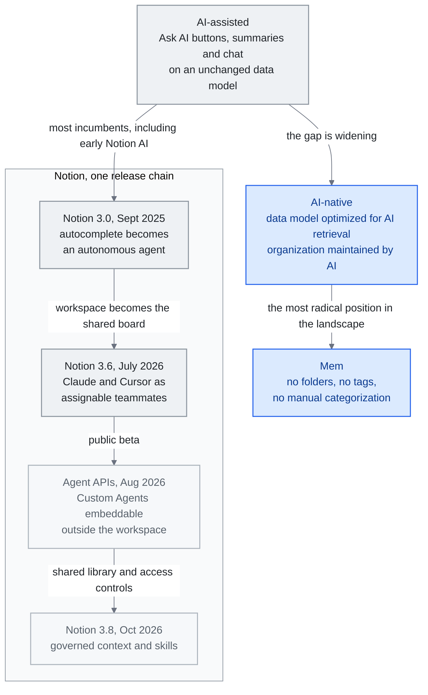

<!-- translation-sync:start -->
> 与 2026-10-31 英文版同步的机器辅助译文，已作结构与内容复核。代码和图中标签保留原文；阅读时间按英文原文估算。
> [English source](../../../chapters/08-tools-landscape.md) · [Sync record](../../SYNC.md)
<!-- translation-sync:end -->

<!-- i18n-anchor -->

# 第 8 章：工具地景 —— AI 原生知识管理

> **一句话总结：** AI 驱动知识管理的工具地景从 AI 增强的笔记应用一路到完全 AI 原生的平台。
>
> **为什么重要：** 如果你做笔记、管理知识、组织信息, AI 正在改变这个空间内每个工具的运作方式。
>
> **阅读时间：** ~13 分钟（按英文原文估算：2,912 个单词 / 230 wpm）

*图："The AI-Assisted vs. AI-Native Gap"一节的光谱，早期 Notion AI 位于辅助端，Mem 无需手动组织的设计位于原生端。Notion 的发布链遵循本章叙述：3.0 引入智能体，3.6 接纳外部队友，八月 Agent APIs 支持嵌入，十月 3.8 增加受治理的共享上下文与技能。当工具仍然绑定于为纯人工工作流设计的数据模型时，差距会扩大；共享库的连线则显示程序性知识如何进入工作区。*

<!-- i18n-anchor -->

## 地景

人们用来组织、检索、推理自己知识的工具正围绕 AI 重建。本章调查 AI 驱动知识管理的主要平台——不是产品评测, 而是本报告通篇讨论的知识工程原则的实现。每个工具对人类与 AI 应如何在知识工作上协作下不同的架构赌注。

## Notion AI

Notion 占协作知识管理市场约 25%, 让它的 AI 策略对整个空间有重大影响。

**Notion 3.0**（2025 年 九 月）标志根本转变: Notion 把 AI 层从自动完成功能重建为自主 agent。不是建议续写或回答关于你 workspace 的查询, Notion 的 AI agent 现在能独立导览你的 workspace、建并修改页面、更新数据库、执行多步工作流。它理解你的 workspace 结构、跨页面交叉参照信息、维持关于你组织 pattern 的 context。

2026 年 一 月, Notion 引入多模型支援, 让用户把不同任务路由到不同模型: GPT-5.2 用于创意写作、Claude Opus 4.6 用于分析任务、Gemini 3 用于多模态工作。这种模型路由做法反映成熟的理解: 没有单一模型在每件事上都顶尖, 知识管理层应该是模型无关的。

Notion 的强项是它结合结构化数据（数据库、关联、rollup）与非结构化内容（页面、block）。这种混合结构给 AI agent 丰富的元数据可用——不只是文字搜寻, 还有类型化属性、实体之间关联、明确阶层。

**Notion 3.6** (2026 年七月 1 日) 将工作空间转变为 *其他供应商* 智能体的协调运行底座。其 **外部智能体** 功能使 **Claude** 和 **Cursor** 成为首批在共享 Notion 任务看板上以可见、可分配队友身份运行的外部智能体——可在人类协作者使用的界面上进行 @ 提及、监视和问责。这与之前 **3.5 开发者平台** 的 2026 年五月 13 日 发布不同，后者将 Codex 和 Decagon 作为外部智能体 API 合作伙伴。同一版本还增加了 **Notion 工作者**（现在可以构建和部署自定义代码，包括在 Windows 上）、五个新的 MCP 连接器（Mercury、Mixpanel、Miro、Box、ClickHouse）、原生 PPTX / XLSX / DOCX 读写功能，以及自定义智能体操作的审计日志；Notion 报告其 MCP "usage has 10×'d in the past month." 节奏是反转：之前 Notion AI 是在 Notion 内部运行的智能体，现在 Notion 成为了其他智能体产品作为队友插入的共享看板。

在 **2026 年八月 20 日** 上，Notion 将基于会话的 **智能体 API**（与自定义智能体开始聊天、流式传输其回复、提交操作、浏览会话事件历史记录）从私有 alpha 阶段转为公开 beta。其目的是嵌入：现在自定义智能体可以嵌入在 Slack 机器人、内部工具或移动应用中，而不仅仅局限于 Notion 工作空间本身。所有使用 Alpha 路由集成的用户必须在 2026 年九月 30 日 之前迁移到新的会话/事件模型。参考 3.5 (五月 13 日, 外部智能体 API 合作伙伴) 和 3.6 (七月 1 日, Claude/Cursor 作为可分配看板队友)，这是同一弧线的第三步：向其他供应商的智能体开放工作空间，使 Notion 自己的自定义智能体成为可分配队友，然后通过公开的 API 接口使这些智能体可以嵌入到任何地方。

**Notion 3.8**（[October 13, 2026](https://www.notion.com/releases/2026-10-13)）将这一演进扩展到受治理的共享上下文。其 Skills API 通过 GitHub 发布由 Notion 管理的技能库。该版本增加按用户撤销 MCP 授权、带修改者归属且可恢复的修订历史，以及数据库属性权限。这些都是厂商描述的控制措施，尚无独立证据证明每个智能体都能正确保留这些控制。

## Obsidian

Obsidian 占整体知识管理市场约 8%, 但那个数字戏剧性低估它的影响力。在开发者、研究者、技术知识工作者——最积极实验 AI 增强知识系统的人口——Obsidian 主导个人知识管理（PKM）利基。

截至 2026 年二月，Obsidian 有超过 1.5 百万活跃用户，同比增长 22%，以及 2,700+ 个社区插件。其架构选择使它特别适合 AI 集成：

**本地优先 markdown。** 每个笔记是你文件系统上的一个纯文字 markdown 档。没有专有数据库、没有云端依赖、没有供应商锁定。这意味任何能读写文件的 AI 工具都能与 Obsidian vault 一起运作。无 API 金钥、无 OAuth 流程、无 rate limit——只有文件。

**双向链接。** Obsidian 的 `[[wikilink]]` 语法隐含创造一个知识图。每个链接是一个关系。结果的图结构正是增强 AI 检索与推理的那种结构化知识。

**插件可扩展性。** 插件生态系产生几个突出的 AI 整合:

- **[Copilot for Obsidian](https://github.com/logancyang/obsidian-copilot)**（6,500+ GitHub stars）——用任何 LLM 与你的 vault 聊天。为基于 RAG 的检索索引你的笔记, 支援多个 embedding 供应商, 跨 session 维持对话 context。

- **[Smart Connections](https://github.com/brianpetro/obsidian-smart-connections)**（4,700+ GitHub stars, $25/月 Pro 层）——AI 驱动的笔记发现, 你写作时浮现语意相关笔记。用本地 embedding 跨你的 vault 建相似度索引, 不送数据到外部服务。

- **[Claudian](https://github.com/claudian-ai/claudian)**（5,800+ GitHub stars）——Claude 与 Obsidian 之间的深度整合, 让 Claude 能读、写、推理 vault 内容, 配完整 context 觉知。

Obsidian 的本地优先架构让它对隐私意识用户、对知识库本身敏感（研究笔记、专有分析、个人日记）的工作流是天然适合。取舍是协作功能落后云端原生工具如 Notion。

## Mem

[Mem](https://mem.ai) 在地景中采取最激进立场: 知识管理应该需要零手动组织。没有资料夹、没有标签、没有手动分类。你写笔记, Mem 的 AI 处理其他一切——把相关内容群集、在你需要时浮现相关信息、维持连贯知识库而不需用户做任何组织劳动。

这个做法直接押注 AI 检索已变得够好可以取代人类策展。对觉得传统 PKM 系统太苛刻的用户, Mem 提供有说服力的替代。风险是没有人类可读组织, 用户失去稽核、debug、理解自己知识库的能力。

<!-- i18n-anchor -->

## 浮现平台

几个较新平台正探索替代做法:

**[Heptabase](https://heptabase.com)** 使用视觉画布模型，其中笔记以卡片的形式存在于无限空间表面上。用户可以视觉化地排列、连接和聚类笔记，创建补充文本链接的空间关系。这种空间维度增加了文本系统无法复制的组织层次。截至 **v1.98.0** (2026 年六月 2 日)，其 AI 智能体可以直接编辑标签数据库，并可通过快照撤销这些编辑。

**[Capacities](https://capacities.io)** 引入了基于对象的知识管理，其中每一块内容都是一个类型化的对象（人、项目、会议、概念），具有定义的属性和关系。这种强类型方法为 AI 提供了比自由形式笔记更干净的结构化数据。截至 **AI Chat Connectors 2.0** (2026 年六月)，外部 AI 应用（任何 MCP 客户端）可以对类型化对象图进行完整的 CRUD 操作（创建页面和任务、实例化类型化对象、更新属性）。

**[Tana Outliner](https://outliner.tana.inc)** 实现了超标签——一个系统，其中任何节点都可以用定义其结构、字段和行为的类型进行标记。超标签在大纲器上创建了一个用户定义的模式层，使结构化数据捕获不会牺牲自由形式笔记的灵活性。*命名说明：* 在 2026 年三月，Tana Inc. 将 **"Tana"** 品牌和 `tana.inc` 重新分配给一个新的智能体会议产品（在视频通话期间实时运行的 AI 智能体，填充一个持久的上下文图）；此处描述的超标签大纲器现在位于 **Tana Outliner** (`outliner.tana.inc`)。根据 Tana 自己的说明，"web content describing 'Tana' as a note-taking app, PKM, or outliner refers to this product, Tana Outliner."

<!-- i18n-anchor -->

## AI 辅助 vs. AI 原生差距

地景中浮现一个关键区分: 把 AI 功能栓在现有架构上的工具, 与从零围绕 AI 设计的工具之间的差异。

**AI 辅助工具** 在现存知识库上加"Ask AI"按钮、AI 生成总结、聊天接口等功能。底层数据模型、组织范式、用户体验根本不变。大多数现有者——包括早期版 Notion AI——属于这类。

**AI 原生工具** 把 AI 作为知识工作的一等参与者来设计核心架构。它们的数据模型为 AI 检索优化。组织结构被设计为由 AI 而非人类维护。用户体验假设 AI 处理知识管理的繁琐部分（分类、链接、浮现）, 人类聚焦在创造与决策。

这两种做法的差距在扩大。AI 辅助工具永远会被为只人类工作流设计的数据模型限制。AI 原生工具能为越来越定义知识工作的人类-AI 协作优化。

<!-- i18n-anchor -->

## 这些工具如何连到生态系

本章工具不与本报告描述的知识工程生态系分离——它们是它的消费者面实现。每个概念都直接映射:

**RAG** 是当你问 Copilot for Obsidian 一个问题, 它从你 vault 检索相关笔记时发生的事。第 3 章的切块策略、embedding 模型、检索算法在底下跑。

**第 6 章的记忆系统** 驱动 Notion AI 与 Mem 的个人化——学你的偏好、记你的项目、随时间适应的能力。

**第 5 章的 context engineering** 决定这些工具产生回应时如何决定包含什么信息。窗口管理、优先化、压缩技术让 AI 功能感觉智能而非通用。

**第 7 章的 MCP** 越来越是这些工具用来连到外部数据源的协议, 让你的知识库能透过标准化接口从 GitHub、Slack、email、数据库拉取。

这些工具是知识工程的抽象原则变成具体每日实务的地方。它们是个人为他们的个人与专业知识实现 RAG、记忆、context engineering 的 harness。

<!-- i18n-anchor -->

## AI 速度悖论

伴随 *个人* 知识管理的工具地景, 平行故事在开发者工具中上演——2026 年 四 月它产生年内最受讨论的数据点之一。Harness.io 与 Infosys 联合发表 **"State of DevOps 2026"** 报告, 头条发现变得叫做 **AI 速度悖论**:

> **69% 团队报告部署瓶颈, 即使 AI 辅助编码快了 45%。**

机制直接。AI 编程助手（Copilot、Cursor、Claude Code、Codex）让代码生成戏剧性更快。更多 PR 开、更多 diff 到、更多候选实现堆在审查与部署阶段。但生成下游的系统——代码审查、测试基础设施、安全扫描、合规检查、部署管线、事件回应——没以同样速度扩展。生成不再是约束。**评估与治理是新约束。**

报告给从业者私下叫了一打不同名字的 pattern 一个名字: **"Harness Fatigue."**。它描述团队试图为 AI 生成代码建自动化护栏, 速度跟生成本身一样的挣扎。每个新模型发布让问题更糟, 让产生需要审查的更多代码更容易。

这个框架从相反方向落到本报告从第 4 章起就在做的同一论点: 当行业整个 2025 年讲"the harness is the moat", 潜文是建好 harness 的工程团队会拉开领先。2026 年, 速度悖论把同观察转成警告: 不扩展评估与治理层就扩展生成的团队发现自己整体走得更慢, 不更快。瓶颈移了, 但总吞吐量未必改善。

对知识工程的实务收获:"harness"不再只是为生产用包模型的东西。它也是必须与生成速度同步扩展的东西——否则部署吞吐量沉默地饱和, 而每个人都坚称 AI 让他们更快。

**底座本身如今也可移植。** April 27, 2026，Microsoft 与 OpenAI 公布修订后的合作协议，结束 OpenAI 对 Azure 的云独占安排，OpenAI 如今可通过 AWS、Google Cloud 或任何提供商开放 API 访问；协议对收益分成设置不对称上限，并移除长期争议的 AGI 条款，后者原本允许 OpenAI 单方面宣布实现 AGI 后退出财务义务。对知识工程团队，这不是商业新闻，而是底座变化：最大的封闭权重前沿模型不再锁于单一云平台。"Which cloud do you run on"不再限制"which models do you have access to"，至少 GPT 家族如今获得开放权重生态早已享有的条件。结合 DeepSeek V4 发布首日的 Ascend-NPU 支持（第 11 章，四月 24 日），2026 年下半年开始，可移植底座成为默认预期，而非例外。

**托管底座如今也会学习与自我纠正。** **May 6, 2026**，Anthropic 为 Managed Agents 增加三项基础能力：**Dreaming**，定期在会话间整理记忆；**Outcomes**，按评分准则迭代、由独立评分器评估的循环；**Multiagent Orchestration**，主智能体扇出、共享文件系统。同日 AWS 的 **MCP Server** 正式发布，并首次提供超大规模云厂商认可的 **Skills** 部署。结合 Velocity Paradox，含义直接：报告指出的瓶颈是评估与治理，而非生成，新托管基础能力恰在这些界面竞争。2025 年扩展生成的自托管编排层，如今面对 2026 年扩展*学习与评分*的托管竞争者。Velocity Paradox 不是由更快代码生成解决，而由能学习自身错误反复出现位置的基础设施解决；这就是 Anthropic、AWS 刚发布的底座。

---

<!-- i18n-anchor -->

## 三个要点

- **差距在数据模型，而非功能。** AI 辅助工具仍受制于为纯人工工作流设计的数据模型，因此增加再多 Ask AI 按钮，也无法弥合差距。
- **Notion 不只成为智能体，也成为看板。** 到 3.6，它让 Claude、Cursor 等其他厂商智能体作为可分配、可观察的队友，与自家 Custom Agents 一同工作；2026 年八月 Agent APIs 又让这些自家智能体可嵌入工作区之外。
- **生成不再是瓶颈。** State of DevOps 2026 发现，尽管 AI 辅助编码速度提高 45%，69% 团队仍报告部署瓶颈；这意味着编排层必须与生成同步扩展，否则吞吐量会悄然达到上限。

---

<!-- i18n-anchor -->

## 来源

1. Notion. "Introducing Notion 3.0."（2025 年 九 月）。https://www.notion.so/blog
2. Notion. "Multi-Model AI."（2026 年 一 月）。https://www.notion.so/blog
3. Obsidian 使用统计（2026 年 二 月）。https://obsidian.md
4. Copilot for Obsidian. https://github.com/logancyang/obsidian-copilot
5. Smart Connections. https://github.com/brianpetro/obsidian-smart-connections
6. Claudian. https://github.com/claudian-ai/claudian
7. Mem. https://mem.ai
8. Heptabase。https://heptabase.com ：更新日志（v1.98.0，June 2, 2026）：https://wiki.heptabase.com/changelog （AI Agent 获得可通过快照撤销的标签数据库编辑访问）。
9. Capacities。https://capacities.io ："What's new: release 66"（2026 年六月）：https://capacities.io/whats-new/release-66 （AI Chat Connectors 2.0，MCP 客户端对带类型对象图执行 CRUD）。
10. Tana Outliner。https://outliner.tana.inc ：supertag 大纲工具；"Tana as it is now"（2026 年三月）：https://outliner.tana.inc/articles/tana-current-march-2026 ，以及 Tana Inc. 更新日志 https://tana.inc/changelog/2026-06-26-transcription-language （`tana.inc` 品牌在 2026 年三月被重新分配给一款新的智能体会议产品）。
11. Microsoft. "The next phase of the Microsoft-OpenAI partnership."（2026 年 四 月 27 日）。[https://blogs.microsoft.com/blog/2026/04/27/the-next-phase-of-the-microsoft-openai-partnership/](https://blogs.microsoft.com/blog/2026/04/27/the-next-phase-of-the-microsoft-openai-partnership/)
12. OpenAI. "The next phase of the Microsoft partnership."（2026 年 四 月 27 日）。[https://openai.com/index/next-phase-of-microsoft-partnership/](https://openai.com/index/next-phase-of-microsoft-partnership/)
13. Anthropic. "New in Claude Managed Agents: dreaming, outcomes, and multiagent orchestration." 2026 年五月 6 日. [https://claude.com/blog/new-in-claude-managed-agents](https://claude.com/blog/new-in-claude-managed-agents)
14. AWS. "The AWS MCP Server is now generally available." 2026 年五月 6 日. [https://aws.amazon.com/blogs/aws/the-aws-mcp-server-is-now-generally-available/](https://aws.amazon.com/blogs/aws/the-aws-mcp-server-is-now-generally-available/)
15. Notion. "Release notes"（2026 年七月 1 日)：[https://www.notion.com/releases/2026-07-01](https://www.notion.com/releases/2026-07-01) 和（2026 年五月 13 日)：[https://www.notion.com/releases/2026-05-13](https://www.notion.com/releases/2026-05-13)--- 3.6 外部智能体（Claude、Cursor）；3.5 开发者平台（Codex、Decagon 作为 API 合作伙伴）；Notion 工作者；五个新的 MCP 连接器；原生 PPTX/XLSX/DOCX；自定义智能体审计日志；MCP "usage has 10×'d in the past month."
16. Notion Developers。"Changelog"（August 20, 2026 条目）：[https://developers.notion.com/page/changelog](https://developers.notion.com/page/changelog)。基于会话的 Agent APIs，包括与 Custom Agent 开始聊天、流式接收回复、提交操作、分页浏览会话事件历史，从私有 alpha 转为公开 beta；alpha 路由集成须于 September 30, 2026 前迁移至 sessions/events 模型。

17. Notion。"Notion 3.8: Context for your agents"（October 13, 2026）。[发布说明](https://www.notion.com/releases/2026-10-13)。

---

*上一章：[第 7 章 -- MCP：赢得胜利的标准](07-mcp.md)*
