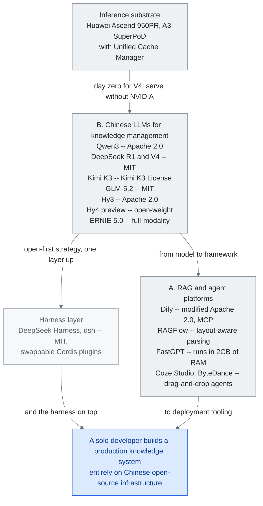

<!-- translation-sync:start -->
> 与 2026-10-31 英文版同步的机器辅助译文，已作结构与内容复核。代码和图中标签保留原文；阅读时间按英文原文估算。
> [English source](../../../chapters/09-china-ecosystem.md) · [Sync record](../../SYNC.md)
<!-- translation-sync:end -->

<!-- i18n-anchor -->

# 第 9 章：中国 AI 知识工程地景

> **一句话总结：** 中国建出一套平行 AI 生态系, 配自己的开源平台、模型、社群——常常朝与西方不同的方向创新。
>
> **为什么重要：** 全球一半的 AI 研究者在中国。忽略这个生态系意味错过一半的创新。
>
> **阅读时间：** ~27 分钟（按英文原文估算：6,092 个单词 / 230 wpm）

*图：A、B 两节描述的技术栈，自上而下阅读：国产推理芯片支撑中国模型家族，模型再进入两条并行分支，一条是运行于其上的已发布编排层，另一条是企业实际部署的可视化优先平台。许可证写在节点标签中，因为授权方式就是 C 节"Open-Source as Strategic Imperative"所说的战略。两组连线承载论点：发布首日适配 Ascend，支持的是"serve without NVIDIA"，而非"train without NVIDIA"；底部两条分支重新汇合，形成一个端到端建立在中国开源基础设施上的生产知识系统。*

关于 LLM 知识工程的全球对话, 不检视中国生态系就不完整。截至 2025 年 十二 月已向监管机构申报超过 748 项 AI 服务, 中国发展出一套平行——某些领域且发散——的方法来用大型语言模型建知识系统。本章绘制塑造中国开发者与企业如何处理知识工程的关键平台、模型、文化差异。

<!-- i18n-anchor -->

## A. 开源 RAG 与 Agent 平台

中国开源 AI 生态系产生几个在 GitHub 流行度上匹敌或超越西方对手的平台。这些项目的特征是它们对视觉化工作流、企业部署就绪度、深度文件理解的强调——反映中国企业客户的实务需求。

<!-- i18n-anchor -->

### Dify（136K+ GitHub Stars）

[Dify](https://github.com/langgenius/dify) 是全球 GitHub stars 最多的智能体 AI 平台，提供可视画布，用于构建 RAG 流水线、智能体工作流与多步推理链。自 1.0 版起，Dify 支持 Model Context Protocol（MCP），可无缝集成外部工具服务器。其优势在于连接两类用户：以可视方式设计工作流的无代码用户，以及需要程序化控制的开发者。企业可以自托管整个技术栈，这在中国市场尤为关键，因为数据主权要求经常排除仅提供云服务的方案。

Dify 采用**修改版 Apache 2.0**，对多租户运营、前端标志／版权修改附加条件。允许自托管不等于可以不受限制地以 SaaS 再分发；部署团队必须按自身场景检查实际许可证。这为本章的开放基础设施论点在平台层增加了限定。

<!-- i18n-anchor -->

### RAGFlow（62-75K+ GitHub Stars）

[RAGFlow](https://github.com/infiniflow/ragflow) 透过深度文件理解差异化。不是把文件当扁平文字处理, RAGFlow 跨 20+ 文件格式（包括扫描 PDF、试算表、投影片）应用版面感知解析、OCR、表格提取。它的"agentic RAG"做法意味系统能根据查询类型自主决定要应用哪种检索策略。对处理遗留文件库的企业——中国国营企业与制造公司常见的情境——这能力不是 nice-to-have 而是要求。

<!-- i18n-anchor -->

### FastGPT（27K+ GitHub Stars）

[FastGPT](https://github.com/labring/FastGPT) 瞄准企业知识库 Q&A, 聚焦在资源效率。它的 QA 对提取管线自动把文件转成 question-answer 对, 然后能用于检索与微调。该平台被设计成能在低至 2GB RAM 的机器上跑, 让请不起专用 GPU 基础设施的中小企业能存取。这个节俭反映中国生态系的更广 pattern: 在约束下的优化。

<!-- i18n-anchor -->

### MaxKB（18K+ GitHub Stars）

[MaxKB](https://github.com/1Panel-dev/MaxKB) 把自己定位为配一键部署的企业 agent 平台。它支援 MCP 做工具整合, 并为常见企业情境提供预建模板: 客服、内部知识检索、文件总结。它的吸引力在于把"we want an AI assistant"到"we have one running"的时间从数周缩到数小时。

<!-- i18n-anchor -->

### Coze Studio（15K+ GitHub Stars, ByteDance）

[Coze Studio](https://github.com/coze-dev/coze-studio) 是 ByteDance 的开源视觉 agent 开发平台。原本是闭源产品, ByteDance 在 2025 年 七 月开源它, 三天内累积 10,000 GitHub stars——既证明压抑需求也证明 ByteDance 的分发力。Coze Studio 提供拖放接口建 agent, 含内建记忆、工具使用、多轮对话管理。它与 ByteDance 的豆包模型家族整合给它在中文任务上原生优势。

这种独立产品定位正被整合。36kr 在 **August 24, 2026** 报道，字节跳动完成内部合并，将 TRAE 编码平台与 Coze 纳入豆包聊天机器人的办公工具组织。TRAE IDE 与 CLI 保持独立产品，TRAE Work、Coze 则与豆包办公功能合为即将推出的统一品牌"Doubao Work."。同一报道说，整合应用最快"as soon as this week"推出；字节跳动自身回应只涉及重组，因此日期属于媒体报道，未经公司确认。其方向与西方常见做法相反：不是将 IDE、智能体构建工具与消费者聊天产品分开，而是让开发工具被超级应用吸收，而非环绕其运行。

<!-- i18n-anchor -->

### DB-GPT（17K+ GitHub Stars）

[DB-GPT](https://github.com/eosphoros-ai/DB-GPT) 专精在 AI 原生数据互动。它的核心能力是自然语言转 SQL 转换, 让非技术用户能对话式查询数据库。它用视觉化生成与多 agent 数据分析管线延伸这。对坐拥大型结构化数据集的企业——这描述大多数中国金融、物流、制造公司——DB-GPT 提供 AI 增强分析的可亲入口。

<!-- i18n-anchor -->

## B. 中国 LLM 的知识管理

中国基础模型地景已快速成熟, 几个模型现在在特定基准上与西方对手竞争或胜过。

<!-- i18n-anchor -->

### Qwen3（阿里云）

Qwen3 是 Alibaba 的旗舰模型家族。最大变体是 235-billion-parameter 混合专家（MoE）模型，以 Apache 2.0 发布。专注编码的 Qwen3-Coder-480B 支持从 256K 到 1M token 的上下文窗口。Apache 2.0 许可具有战略意义：允许无限制商业使用，推动了无力承担专有 API 成本的中国初创企业采用。Qwen 在中文、日文与韩文上的多语言能力尤其强，而西方模型在这些语言上历史表现较弱。

<!-- i18n-anchor -->

### Qwen-Scope（Alibaba，2026 年五月）

Alibaba Qwen 团队将同样的开放发布立场，从权重延伸到可解释性工具。**Qwen-Scope**（arXiv 预印本于 **May 12, 2026** 提交）是一套开放的**稀疏自编码器，共 14 组**，在**七个 Qwen3、Qwen3.5 变体**上训练，涵盖稠密与 MoE，参数从 **1.7B 到 35B**，即 Qwen3-1.7B 至 Qwen3.5-35B-A3B；SAE 宽度与稀疏度按各主干列出，而非汇总成一个特征总数。它区别于普通研究产物的地方在于封装：论文将 SAE 特征作为四类开发工具，包括无需提示工程、通过操纵内部特征实现推理时引导；以激活特征反映基准冗余与能力覆盖的评估分析；数据分类与组织；以及监督微调、RL 的训练后支持。对本章而言，意义在于来源：训练前沿开放权重模型家族的实验室，自己开放发布其可解释性基础设施，说明中国生态也在贡献一个通常被描述为只消费成果的研究维度；这与下文 mHC 等架构主张不同，交付物是工具，而非结果。

### DeepSeek R1

DeepSeek R1 在数学与科学推理基准上匹敌 OpenAI o1，同时以 MIT 许可证发布。常被关联的低于 $6 million 数字，属于 **DeepSeek-V3**，而非 R1：技术报告以每 H800 GPU 小时 $2 为假设，估算正式训练成本 **$5.576 million**，不含前期研究与消融实验。这是厂商估算，不是 R1 的全部开发预算。R1 的架构意义在于让前沿推理以开放权重方式可用。

2026 年 四 月, DeepSeek 用 **流形受限超连接（mHC）** 延伸它的架构贡献, 这是 Transformer++ 风格模型用的残差连接的泛化。当标准残差流跨层向前携带单一通道信息, mHC 携带 **多个内部流**, 每个被约束在一个学到的低维流形上。这个构造被设计来给后期层更丰富存取早期表示, 而不受简单多流残差在规模上承受的维度崩塌。DeepSeek 的博客在参数量相当下报告长程推理基准上的增益, 在信息必须跨许多中间层携带的任务上有最大改进。截至 2026 年 四 月, 该结果应被 **标记为等独立复制**——这是单一实验室对单一实验室模型的披露, 而该领域在没经过第三方再现的架构主张上吃过亏。如果结果成立, mHC 加入 MoE、MLA、DeepSeek 早期 multi-token prediction 工作, 成为在中国开源权重生态系起源后跨入主流使用的第三或第四个架构 primitive。

<!-- i18n-anchor -->

### DeepSeek V4（2026 年 四 月）

DeepSeek **V4 预览**（April 24, 2026）在经济性、能力与**推理底座**三个维度同时延伸 R1 的故事。它在 Hugging Face 以 MIT 许可证发布两个开放权重混合专家模型：**V4-Pro 为 1.6 万亿总参数／49B 活跃**，**V4-Flash 为 284B／13B 活跃**，默认而非分档提供 1-million-token 上下文。API 定价是 2026 年前沿级模型中最激进的：**V4-Flash 每百万输出 token $0.28**，V4-Pro 为 $3.48，反映相对 V3 **每 token 推理 FLOPs 减少 73%**，由架构变化推动，而不只是硬件优化。在 R1 最初建立信誉的编码基准上，V4-Pro 登顶，**LiveCodeBench 为 93.5%**，高于 Gemini 3.1 Pro 的 91.7%、Claude Opus 4.6 的 88.8%；**Codeforces 评分 3206**，超过 GPT-5.4 的 3168。

但对本章最重要的结构细节, 不是定价或基准, 而是 **推论基底**。训练 V4 用了含 NVIDIA A100 与 H20 硬件的混合集群——前沿*训练*能否完全在 NVIDIA 堆叠外发生的问题仍困难。但模型 **day-zero 适配 Huawei Ascend 950PR**, DeepSeek 与 Huawei 联合报告在为模型生产服务上 Ascend NPU 与 NVIDIA H20 GPU 之间的 **推论对等——在这个架构上, 约 2.8 倍运算吞吐**。这是主权硅论点的微妙形式: 不是"we trained without NVIDIA"而是 **"we serve without NVIDIA."**。对面对美国出口管制的中国企业客户, V4 是首次有前沿级开源权重模型在 day-one 就有可信的国产硅服务路径——对本章一直在描述的部署重的中国生态系, 这比训练可选性更接近承重约束。读在 R1 2025 年 一 月拐点旁边, V4 关闭一个一年的故事弧线: 中国开源权重生态系现在能在同一天发布前沿编程模型 **与** 为它服务的基底。

**June 29-30, 2026**，DeepSeek 宣布 V4 预览将于 **2026 年七月中旬正式发布**，全系列具备 1M-token 上下文，并伴随结构性定价变化：**高峰时段 API 价格**，北京时间 9:00-12:00、14:00-18:00，为**非高峰价的 2x**，非高峰基线不变；V4-Pro 缓存未命中的每百万输入 token 为 $0.435、输出 $0.87，V4-Flash 为 $0.14 / $0.28。前沿开放权重推理 API 按需求与时段定价，让*价格成为调度基础能力*：运行批量智能体任务的中国企业，可将任务移到非高峰窗口，把推理成本减半，正如云现货市场十年来为算力提供的杠杆。

<!-- i18n-anchor -->

### 电信运营商规模的自主芯片（Huawei + 中国移动，2026 年六月）

"serve without NVIDIA"论点在六月首次获得电信行业验证。MWC 上海（June 24, 2026）上，**Huawei 与中国移动湖北**在中国首次对 Huawei **AI Inference Acceleration Solution** 进行现网验证：**Ascend A3 SuperPoD** 配合 **OceanStor A800** 存储，以及管理 PB 级 KV 缓存的 **Unified Cache Manager（UCM）**。结果是在*真实运营商商用网络上，以模拟的 8K-190K-token 长上下文工作负载验证*，不是实际电信业务流量：GLM-5.1 首 token 延迟减少 **51-93%**，128K 序列长度下吞吐量最高 **+372%**。对知识工程的意义在于，DeepSeek 在模型发布时展示的国产芯片服务路径，如今有基础设施厂商与运营商共同开展、独立于该模型发布的生产规模演示；KV-cache 管理层（第 3 章）成为自主芯片经济效益成败的战场。

同一论点背后可能正在形成更大规模的投入，但所有细节均未确认。Bloomberg 于 **September 4, 2026** 引述知情人士报道，DeepSeek 计划在内蒙古乌兰察布约 1GW 的数据中心部署至少 **160,000 个 Huawei Ascend 950DT 加速器**，目标是 2027 年末或 2028 年初部分投运。芯片用于推理，训练继续使用 DeepSeek 现有 NVIDIA 硬件；这是 V4 已在模型规模展示的"serve without NVIDIA, train with it"分工，如今拟议扩大至园区规模。交付可能超过一年：报道指内存组件供应将 Huawei 950DT 在 2026 全年的产量限制在数十万台较低区间。DeepSeek 与 Huawei 均未确认订单，报道依据匿名来源而非任何一方声明，因此本章将其列作表达出的意向，而非已部署容量。

<!-- i18n-anchor -->

### DeepSeek Harness（dsh）：开源智能体编排层（2026 年八月）

**August 13, 2026**，DeepSeek 以 MIT 许可证发布 **DeepSeek Harness（dsh）**开发者预览（github.com/deepseek-ai/deepseek-harness）。设计围绕 DeepSeek 所称的 **"Cordis"插件范式**，在配套白皮书"A Programming Paradigm for Spatiotemporal Composability"中说明：模型适配器、工具注册表、会话日志、沙箱、存储、调度循环与 UI 层，均为可替换插件，而非固定接入运行时的组件。仅追加会话日志记录智能体每次上下文注入，包括系统提示、推理轨迹、工具调用及结果，以及子智能体调度决策。在自身调度循环内，将 Claude Code 或 Codex 作为单次子智能体调用，是第一方功能，不是媒体说法：仓库提供专门的 `@deepseek-ai/dsh-subagent-claude-code` 与 `@deepseek-ai/dsh-subagent-codex` 包，调用官方 Claude Agent SDK 与 Codex `app-server`，按仓库 August 4, 2026 的设计说明实现，媒体报道再从代码中取得这一能力。仓库增长按任何标准都很快：发布 11 天内有 190,630 stars、21,319 forks，三周后达到 224,004 stars、26,637 forks，分别于 August 24、September 15, 2026 通过 GitHub API 验证。以后再引用前须重查，因为数字会变化；媒体定性描述其为开发工具有记录以来最快的采用曲线之一。

<!-- i18n-anchor -->

### Kimi K2.5（Moonshot AI）

Kimi K2.5 引入"Agent Swarm"能力，单次查询最多生成 100 个子智能体，通过约 1,500 次工具调用协调。这不是研究演示，而是用于复杂研究任务的生产功能；系统让数十个并发智能体并行开展网页搜索、文档分析与综合。更早时，Kimi 已达到 2-million 中文字符上下文窗口，约在 2025 年三月，成为专为中文优化的最长上下文模型。

<!-- i18n-anchor -->

### Kimi K3（Moonshot AI，2026 年七月）

**July 17, 2026**，Moonshot 发布 **Kimi K3**，**2.8 万亿参数**（MoE），是迄今发布过的最大开放权重模型，具备 1M-token 上下文与原生视觉。它以开放权重模型身份登顶 Arena 前端编码榜，在 Artificial Analysis Intelligence Index 的 189 个模型中位列第 4，分数 57，仅落后于 Fable 5 与 GPT-5.6 Sol 的若干配置。完整权重于 **七月 27 日**随后发布，适用 Moonshot 自订的 **Kimi K3 License**；公司自身说法是"open weight,"而非"open source,"，超过营收门槛的商业使用须另与公司订立协议，走在 Qwen 的 Apache 2.0 与封闭发布之间。Fortune 将其描述为市场的"new DeepSeek shock"，发布时间恰与 WAIC 2026 在上海开幕同周，成为生态七月浪潮的重心。从业者需注意一项限定：2.8T 参数的 K3 仅适合服务器级部署，向上扩大开放权重前沿的规模，却未改变本地部署情况。

<!-- i18n-anchor -->

### ERNIE 5.0（百度）

ERNIE 5.0 是百度的 2.4 万亿参数模型, 配原生全模态支援——单一模型内的文字、图像、声音、视频理解与生成。2026 年 一 月推出, 它代表百度的赌注: 知识系统的未来从地基起就是多模态, 不是把多模态附加到文字模型作为事后想法。

<!-- i18n-anchor -->

### GLM-4.5/5（Zhipu AI）

智谱 AI 的 GLM 系列，以 744-billion-parameter MoE GLM-5 为代表，专门面向智能体编排层。架构包含原生工具使用 token 与结构化输出保证，减少构建可靠智能体所需的支架代码。这种"agent-native"设计理念，让 GLM 接入生产流水线时减少提示工程与重试。**June 13, 2026**，智谱发布 **GLM-5.2**，在 Hugging Face 采用 MIT 许可证；其 **IndexShare** 让每四个稀疏注意力层共用同一索引器，在完整 **1M-token 上下文中将每 token FLOPs 降低 2.9x**，另有改进的多 token 预测层，将推测解码接受长度**提高最多 20%**。按 Hugging Face 模型卡，GLM-5.2 的 HLE 为 40.5，带工具 54.7；SWE-Bench Pro 62.1；AIME 2026 为 99.2。

<!-- i18n-anchor -->

### Hunyuan 3.0／Hy3（Tencent，2026 年七月）

**July 6, 2026**，Tencent 发布完整 **Hunyuan 3.0（"Hy3"）**，为 **295B 参数 MoE**，活跃参数 21B、192 个专家采用 top-8 路由，另有 3.8B 多 token 预测层，上下文 256K。对本章更重要的是，它从 2026 年四月预览的受限许可证改为**无限制 Apache 2.0**，取消此前对欧盟、英国及韩国的地域排除。Tencent 模型卡报告，相较预览版，幻觉率从 **12.5% 降至 5.4%**，专家盲评为 **2.67/4，对比 GLM-4 的 2.51/4**。战略解读与下文"open-source as strategic imperative"一致：Hy3 标志最后一家主要、原本封闭的中国前沿实验室，转向默认采用*全面无限制的开放权重*，完成跨厂商趋同，让开放权重从挑战者战术变为生态基线。

Tencent 在 **August 28, 2026** 以开放权重 **Hy4 预览**延续节奏，**770B 总参数、49B 活跃**，1M+ token 上下文，通过 Tencent Cloud TokenHub 与 OpenRouter 提供。按版本升级测试，它是 Hy3 的延伸，而非新基础能力，但有一项例外值得记录：Tencent 称 Hy4 参与自身开发，"participating for the first time in the automated optimization of training methods, data strategies, evaluation frameworks, and low-level operators,"，自主优化推理瓶颈，据报吞吐提升 **31.8%**。模型优化自己的训练、数据、评估与算子流水线，属于不同于基准分数的自我改进主张，与第 13 章循环工程落在同一领域。Tencent 自建专家盲评包含 163 位专家、203 项工程任务，Hy4 为 **2.99/4.00**，GLM-5.3 为 2.92，Kimi K3 为 2.94。全部数字，特别是自我优化主张，均为 Tencent 自报，适用本章对 DeepSeek mHC 的同样限定：单一实验室对自身单一模型的披露，等待独立复现。

<!-- i18n-anchor -->

## C. 与西方生态系的关键差异

理解中国知识工程地景需要不只编纂工具与模型。生态系在根本不同的约束与诱因下运作, 这些从第一天起就塑造架构决策。

<!-- i18n-anchor -->

### 工具偏好：视觉优先 vs. 代码优先

最受欢迎中国平台——Dify、Coze Studio、FastGPT——是视觉优先。用户透过在画布上拖放节点建知识管线。相反, 西方生态系的主导框架（LangChain、LlamaIndex、Haystack）是代码优先, 视觉工具是次要附加。这个发散反映不同用户人口统计: 中国 AI 采纳大量由企业 IT 部门与可能不写 Python 的"citizen developers"推动, 而西方早期采用者倾向是擅长代码的软件工程师。

<!-- i18n-anchor -->

### 部署：On-premise vs. API 优先

On-premise 部署在中国主导。这由两个相互加强因素驱动: 数据主权的监管要求（特别在金融、医疗、政府）和实务约束自美国晶片出口管制让大规模云端 GPU 存取更贵。结果是中国平台大量投资量化、蒸馏、效率——让模型在可用硬件上跑得好, 而非假设无限云端运算。西方平台相反默认 API 优先架构, 模型跑在供应商基础设施上。

<!-- i18n-anchor -->

### 监管架构

到 2025 年 十二 月, 已有 748 个 AI 服务在《生成式 AI 管理办法》下向中国监管机构申报。合规不是可选或抱负——它从设计阶段塑造技术架构。内容过滤、稽核日志、用户身分验证作为核心功能内建在平台中, 不是发布前栓上的。这个监管压力悖论地创造了更标准化架构: 当每个人都必须实现同样合规要求, 让合规容易的平台胜出。

**《人工智能拟人化互动服务管理暂行办法》**于 **April 10, 2026** 公布、**七月 15 日**施行，其边界比一般智能体监管更窄。第 2 条涵盖模拟人类特征、持续开展情感互动的服务，并明确排除不具备此类互动的知识问答、工作助手及类似服务。对涵盖的服务，第 16 条要求提供互动数据复制／删除选项，第 19 条要求提供便捷退出。因此，持久化陪伴记忆与普通企业知识助手有不同合规边界；后者仍受其他适用规则约束。

监管故事在 2026 年七月增加国际层面。**World AI Conference（WAIC）2026** 与全球人工智能治理高级别会议，于七月 17-20 日在上海举行，100+ 个国家参与，联合国秘书长古特雷斯出席，最终签署建立**世界人工智能合作组织（WAICO）**的协议。这是首个专门面向 AI 的政府间国际组织，总部设于上海。不论 WAICO 未来实际如何运作，其成立已将本节所述模式从国内备案制度扩展到国际机构建设，新机构仍设在中国。

<!-- i18n-anchor -->

### 社群与知识分享

中国开发者社群在根本不同平台上运作。微信群组（不是 Slack 或 Discord）是即时讨论的主要频道。知乎担任长技术 Q&A 的 Stack Overflow 角色。CSDN（中国软件开发网络）托管教程与博文。GitHub 用于代码, 但讨论在别处发生。这个碎片化意味西方开发者搜 GitHub Issues 或 Discord 求中国工具的帮助常找到稀疏的英文支援, 而中文社群充满活力——只是对非中文使用者不可见。

<!-- i18n-anchor -->

### 透过约束创新

美国芯片出口管制带来了意外的创新动力。中国 AI 实验室无法单纯扩大算力规模，因此对算法效率投入更大比重。DeepSeek-V3 自报的正式训练成本，在上文所述核算边界内展示这一模式。整个生态都有类似现象：更小模型配合更强推理优化、更激进的量化，以及以每 FLOP 能力最大化为目标的架构。西方生态拥有更多算力，往往通过规模创新。两条路线都产生前沿结果，但路径不同。

<!-- i18n-anchor -->

### 开源作为策略性必要

中国开源权重模型发布在数量上现已超越西方。这不是利他——是策略。开源建生态系锁定（开发者基于你的模型建）、吸引人才（研究者想做人们用的模型）、在全球开发者社群创造外交善意。Alibaba 的 Apache 2.0 授权 Qwen、DeepSeek 的 MIT 授权、ByteDance 的 Coze Studio 开源都遵循这 pattern。结果是任何地方的 solo 开发者现在能完全在中国开源基础设施上建生产知识系统, 从模型到框架到部署工具。

这一逻辑如今向上延伸一层，从权重到运行其上的编排层。上文 DeepSeek Harness（dsh）将同样的开放优先策略用于智能体运行时本身，而非模型。时间对比尤其鲜明：数天后，太平洋另一侧的 OpenAI 以 Apache 2.0 开源 Codex 背后的执行引擎（第 4 章），同时继续保持模型专有。两岸编排层相隔数天走向开源，尽管两项行动服务于不同战略目的。

**July 29, 2026** 出现最清晰的使用侧证据：中国开发的模型首次包揽 OpenRouter 全球每周 token 使用排名前五，小米 MiMo-V2.5 居首，随后是 DeepSeek、MiniMax、Alibaba Qwen 家族与 Moonshot Kimi；该路由平台当时每周处理超过 20 万亿 token。当周发布的分析将中国来源模型在转送流量中的比例列为超过 **60%**。领先地位延续至九月：2026 年九月初的另一组报道将中国来源实验室占 OpenRouter 每周转送 token 的比例列为 **46.4%**，美国来源模型为 **35.7%**。两组比例应分别阅读，不能连成趋势线：它们来自不同二手分析，对"Chinese-origin"及 token 总体的定义不同，也没有任何一组声明是对另一组的修订。OpenRouter 榜单是实时滚动视图，没有公开历史档案，因此两组数字均依据当时快照的二手报道，而非可引用的原始时间序列。

<!-- i18n-anchor -->

### 蒸馏争议

2026 年九月，这一战略解读出现对抗性的另一面。**September 10, 2026**，Anthropic 发布"Detecting and countering misuse of AI: September 2026,"，威胁情报报告涵盖其声称在 2025 年十二月至 2026 年八月阻断的七类滥用，其中包括非法蒸馏。Anthropic 指控 Moonshot AI 通过 **5,380 个被 Anthropic 标记为欺诈的账户**，将部分 Kimi 客户请求转送至 Claude，在一个十天集群中转送**约 300,000 次请求**，把 Claude 回答作为 Kimi 输出返回给用户，并保留交互作为训练数据；它将 2026 年五月至七月**超过 23 million 次 Claude 交互**归于 Moonshot。本节最大的数字属于另一家实验室：报告记录，同一五月至七月窗口观察到"over 151 million exchanges observed"，归于 **Alibaba**，约为 Moonshot 总量的六倍半。同一节还点名 **DeepSeek、Z.ai（智谱）、小米、MiniMax 与 SenseTime**，并描述 DeepSeek 采用跨会话重放技术提取 Claude 推理轨迹。

有一项限定决定这些数字能承担多大证据分量：以上全部都是 **Anthropic 的指控**，由具名实验室的商业竞争对手发布，未获任何第三方裁定；本章记录指控了什么，不判断是否确实发生。数字直接取自报告自身的蒸馏章节。不论最终哪方说法成立，争议都确立了一点："the weights are open"与"how the model behind them was trained"已是两个可分离的问题。上文生态锁定逻辑并不回答训练来源，而来源如今成为两大前沿生态公开争论的维度。

<!-- i18n-anchor -->

## D. 关于 Bilibili 内容的注记

Bilibili（B 站）托管大量 AI 教程, 但从业者应注意许多是英文 YouTube 内容的重新上传或翻译。Bilibili AI 内容的原创价值在于中文专属工具教程: Dify 步步部署指南、Qwen 整合走读、英文不存在的企业部署案例研究。在 Bilibili 上研究时, 永远把内容追溯到原始来源。如果一个教程示范英文叙述配中文配音的 LangChain, 原始 YouTube 版本可能更新。

---

<!-- i18n-anchor -->

## 三个要点

- **开放权重是一种战略，并非利他。** Qwen 的 Apache 2.0、DeepSeek 的 MIT，以及字节跳动开源 Coze Studio，都换取生态锁定、人才与好感；组合起来，让任何人都能端到端用中国基础设施构建生产系统。
- **自主芯片是服务推理的主张，不是训练主张。** V4 在混合 NVIDIA 集群训练，但首日已适配 Huawei Ascend 950PR；另一场 2026 年六月的 Huawei 与中国移动演示，在真实运营商网络上以模拟长上下文负载，使 GLM-5.1 首 token 延迟减少 51-93%。
- **来源如今是争议维度。** Anthropic 在 2026 年九月关于非法蒸馏的指控，不论最终哪方正确，都表明"the weights are open"与"how the model behind them was trained"是可以分开的两个问题。

---

<!-- i18n-anchor -->

## 来源

- Dify GitHub Repository: [https://github.com/langgenius/dify](https://github.com/langgenius/dify)
- Dify。许可证（2026 年十月 31 日 阅读）。[https://raw.githubusercontent.com/langgenius/dify/main/LICENSE](https://raw.githubusercontent.com/langgenius/dify/main/LICENSE)：修改版 Apache 2.0，对多租户及前端附加条件。
- DeepSeek-AI。"DeepSeek-V3 Technical Report"（2024 年十二月 27 日；2025 年二月 18 日 修订），引言与表 1。[https://arxiv.org/html/2412.19437v2](https://arxiv.org/html/2412.19437v2)：正式训练估算 $5.576M，不含前期研究与消融。这不是 R1 的全部开发成本。
- 中国国家互联网信息办公室及其他四部门。"Interim Measures for Anthropomorphic AI Interaction Services"（2026 年四月 10 日；2026 年七月 15 日 施行），第 2、16、19 条。[https://www.cac.gov.cn/2026-04/10/c_1777558395078289.htm](https://www.cac.gov.cn/2026-04/10/c_1777558395078289.htm)：范围为持续情感互动，排除不具备此类互动的其他服务。
- RAGFlow GitHub Repository: [https://github.com/infiniflow/ragflow](https://github.com/infiniflow/ragflow)
- FastGPT GitHub Repository: [https://github.com/labring/FastGPT](https://github.com/labring/FastGPT)
- MaxKB GitHub Repository: [https://github.com/1Panel-dev/MaxKB](https://github.com/1Panel-dev/MaxKB)
- Coze Studio GitHub Repository: [https://github.com/coze-dev/coze-studio](https://github.com/coze-dev/coze-studio)
- DB-GPT GitHub Repository: [https://github.com/eosphoros-ai/DB-GPT](https://github.com/eosphoros-ai/DB-GPT)
- Qwen3 技术报告与模型卡, 阿里云（2025）——主要入口: [https://huggingface.co/Qwen](https://huggingface.co/Qwen) 与 Qwen 团队的 Hugging Face 文章。Apache 2.0 授权细节透过仓库 LICENSE 档确认。
- DeepSeek R1 论文："DeepSeek-R1: Incentivizing Reasoning Capability in LLMs via Reinforcement Learning"（2025 年一月）。[https://github.com/deepseek-ai/DeepSeek-R1](https://github.com/deepseek-ai/DeepSeek-R1) 托管模型，并链接至技术报告 PDF。
- Moonshot AI. Kimi K2.5 Agent Swarm 报道在 2026 年初跨 Moonshot 博客与科技媒体流通; 这里引用的 100 子 agent / 约 1500 工具调用数字从次级科技媒体总结报告。主要存取透过 [https://platform.moonshot.ai](https://platform.moonshot.ai)。
- 百度. ERNIE 5.0 推出（2026 年 一 月）; 2.4T 参数 / 原生全模态主张透过百度官方频道与中国科技媒体流通。这里没引用单一主要 URL; 把模态与参数数字当作广为报告但次级。
- Zhipu AI. GLM-4/5 模型卡在 Hugging Face 与官方 ZhipuAI 博客;"744B MoE GLM-5"+ agent 原生工具 token 跨模型卡与博客报道报告。主要入口: [https://www.zhipuai.cn](https://www.zhipuai.cn)。
- Cyberspace Administration of China,"Generative AI Service Filing"披露（2025 年 十二 月）——748 服务数字在中国科技媒体广为复制; 底层 registry 透过 CAC 官方网站分批发布。
- 编辑说明：此前引用的 R1 后企业采用增长，没有锁定可验证的原始调查，因此本章不使用数值化采用主张。
- DeepSeek. "DeepSeek mHC: Manifold-Constrained Hyper-Connections"（2026 年 四 月）。[https://deepseek.ai/blog/deepseek-mhc-manifold-constrained-hyper-connections](https://deepseek.ai/blog/deepseek-mhc-manifold-constrained-hyper-connections) ——标记为等独立复制。
- DeepSeek。Hugging Face 的 V4 模型发布（2026 年四月 24 日）。MIT 许可证；V4-Pro 1.6T（49B 活跃）／V4-Flash 284B（13B 活跃）；默认 1M-token 上下文。
- Fortune。"DeepSeek unveils V4 model, with rock-bottom prices and close integration with Huawei's chips"（2026 年四月 24 日）。[https://fortune.com/2026/04/24/deepseek-v4-ai-model-price-performance-china-open-source/](https://fortune.com/2026/04/24/deepseek-v4-ai-model-price-performance-china-open-source/)
- South China Morning Post. "DeepSeek unveils next-gen AI model as Huawei vows 'full support' with new chips"（2026 年 四 月 24 日）。[https://www.scmp.com/tech/big-tech/article/3351239/deepseek-releases-next-gen-ai-model-world-leading-efficiency](https://www.scmp.com/tech/big-tech/article/3351239/deepseek-releases-next-gen-ai-model-world-leading-efficiency)
- Phemex News。"DeepSeek V4 Matches NVIDIA on Huawei Ascend, Dispels Rumors"（2026 年四月）。[https://phemex.com/news/article/deepseek-v4-matches-nvidia-performance-on-huawei-ascend-dispels-delay-rumors-75616](https://phemex.com/news/article/deepseek-v4-matches-nvidia-performance-on-huawei-ascend-dispels-delay-rumors-75616)：推理性能相当的主张；在 Ascend 950PR 上，计算吞吐约为 NVIDIA H20 的 ~2.8x。
- TechNode。"DeepSeek to launch V4 in mid-July with new peak-time API pricing"（2026 年六月 30 日）。[https://technode.com/2026/06/30/deepseek-to-launch-v4-in-mid-july-with-new-peak-time-api-pricing/](https://technode.com/2026/06/30/deepseek-to-launch-v4-in-mid-july-with-new-peak-time-api-pricing/) 与 ExplainX [https://explainx.ai/blog/deepseek-v4-official-release-peak-pricing-mid-july-2026](https://explainx.ai/blog/deepseek-v4-official-release-peak-pricing-mid-july-2026)：七月中旬正式发布；高峰价格为非高峰的 2x，公告日期六月 29-30 日。
- Zhipu AI。Hugging Face 的 GLM-5.2 模型卡（2026 年六月 13 日）。[https://huggingface.co/zai-org/GLM-5.2](https://huggingface.co/zai-org/GLM-5.2)：IndexShare 在 1M 上下文下将每 token FLOPs 降低 2.9x；MTP 接受长度最高 +20%；HLE 40.5，带工具 54.7；SWE-Bench Pro 62.1；AIME 2026 为 99.2。
- Tencent。Hugging Face 的 Hy3（Hunyuan 3.0）模型卡（2026 年七月 6 日）。[https://huggingface.co/tencent/Hy3](https://huggingface.co/tencent/Hy3)：295B MoE，21B 活跃，256K 上下文，Apache 2.0；幻觉率 12.5%→5.4%；专家盲评 2.67/4，对比 GLM-4 的 2.51/4。二手来源：LetsDataScience [https://letsdatascience.com/news/tencent-open-sources-hy3-295b-moe-model-c3d05258](https://letsdatascience.com/news/tencent-open-sources-hy3-295b-moe-model-c3d05258)。
- Huawei。"MWC Shanghai 2026: China Mobile and Huawei on the token economy"（2026 年六月 24 日）。[https://www.huawei.com/en/news/2026/6/mwcs-cmcc-token-economy](https://www.huawei.com/en/news/2026/6/mwcs-cmcc-token-economy)：Ascend A3 SuperPoD + OceanStor A800 + Unified Cache Manager；真实运营商网络，模拟 8K-190K-token 负载；GLM-5.1 首 token 延迟减少 51-93%，128K 下吞吐最高 +372%。
- PureAI。"China's Moonshot AI Releases Kimi K3"（2026 年七月 17 日）。[https://pureai.com/articles/2026/07/17/china-moonshot-ai-releases-kimi-k3.aspx](https://pureai.com/articles/2026/07/17/china-moonshot-ai-releases-kimi-k3.aspx)：2.8T MoE，1M 上下文，原生视觉；Artificial Analysis Intelligence Index 的 189 个模型中排第 4，分数 57；七月 27 日发布权重。
- The New Stack。"Kimi K3 tops Arena's coding leaderboard --- and it's open-weight"（2026 年七月）。[https://thenewstack.io/kimi-k3-open-weight-coding/](https://thenewstack.io/kimi-k3-open-weight-coding/)：开放权重模型登顶编码榜的结果。
- Reeve, Jonas（Unite.AI）。"Moonshot Opens Kimi K3 Weights Under a Revenue-Tiered License"（2026 年七月 27 日）。[https://www.unite.ai/moonshot-opens-kimi-k3-weights-under-a-revenue-tiered-license/](https://www.unite.ai/moonshot-opens-kimi-k3-weights-under-a-revenue-tiered-license/)；Willison, Simon。"moonshotai/Kimi-K3"（2026 年七月 27 日）。[https://simonwillison.net/2026/Jul/27/kimi-k3/](https://simonwillison.net/2026/Jul/27/kimi-k3/)：点名自订的"Kimi K3 License"、按营收门槛限制的商业条款，以及 Moonshot 自身"open weight"而非"open source"的定位。
- Bloomberg。"China's Powerful New Moonshot AI Model Closes Gap With US Rivals"（2026 年七月 17 日）。[https://www.bloomberg.com/news/articles/2026-07-17/china-s-powerful-new-moonshot-ai-model-closes-gap-with-us-rivals](https://www.bloomberg.com/news/articles/2026-07-17/china-s-powerful-new-moonshot-ai-model-closes-gap-with-us-rivals)
- Fortune。"China's Moonshot Kimi K3 and the markets"（2026 年七月 17 日）。[https://fortune.com/2026/07/17/china-moonshot-kimi-k3-markets-china-ai/](https://fortune.com/2026/07/17/china-moonshot-kimi-k3-markets-china-ai/)："new DeepSeek shock"的框架。
- Xinhua。"World AI Conference opens in Shanghai"（2026 年七月 17 日）。[https://english.news.cn/20260717/7691cc6c17d249089fdcd7afd840c3ba/c.html](https://english.news.cn/20260717/7691cc6c17d249089fdcd7afd840c3ba/c.html)：WAIC 2026／WAICO 成立协议；古特雷斯出席。
- 中国外交部。WAICO 成立情况通报（2026 年七月 17 日）。[https://www.mfa.gov.cn/mfa_eng/xw/zyxw/202607/t20260717_11984715.html](https://www.mfa.gov.cn/mfa_eng/xw/zyxw/202607/t20260717_11984715.html)
- DeepSeek。DeepSeek Harness（dsh）GitHub 仓库（开发者预览，2026 年八月 13 日）。[https://github.com/deepseek-ai/deepseek-harness](https://github.com/deepseek-ai/deepseek-harness) 与 [https://deepseek.com/harness/en/](https://deepseek.com/harness/en/)：MIT 许可证、"Cordis"插件范式、仅追加会话日志。通过 GitHub API 验证的 stars／forks：2026-08-24 为 190,630 stars／21,319 forks；2026-09-15 为 224,004 stars／26,637 forks。Claude Code／Codex 子智能体包 `@deepseek-ai/dsh-subagent-claude-code`、`@deepseek-ai/dsh-subagent-codex` 随仓库本身发布。二手报道的采用曲线框架：[https://cryptobriefing.com/deepseek-harness-open-source-developer-preview/](https://cryptobriefing.com/deepseek-harness-open-source-developer-preview/)；[https://www.mindstudio.ai/blog/deepseek-harness-agentic-coding](https://www.mindstudio.ai/blog/deepseek-harness-agentic-coding)；[https://www.digitalapplied.com/blog/deepseek-harness-open-source-agent-framework-2026](https://www.digitalapplied.com/blog/deepseek-harness-open-source-agent-framework-2026)；[https://flowtivity.ai/blog/deepseek-harness-open-source-agent-explained/](https://flowtivity.ai/blog/deepseek-harness-open-source-agent-explained/)。
- Deng, Boyi 等。"Qwen-Scope: Turning Sparse Features into Development Tools for Large Language Models,"，arXiv:2605.11887（2026 年五月 12 日 提交）。[https://arxiv.org/abs/2605.11887](https://arxiv.org/abs/2605.11887)：在七个 Qwen3／Qwen3.5 变体上提供 14 组 SAE，1.7B 至 35B、稠密与 MoE；按主干列出 SAE 宽度与稀疏度，而非特征总数；用于引导、评估分析、数据分类和训练后阶段。无法取得 Qwen 团队的 X 公告，因此唯一锁定日期是 arXiv 提交日期。
- Tencent。"Tencent releases and open-sources Tencent Hy4 preview"（2026 年八月 28 日）。[https://www.tencent.com/tencent-releases-and-open-sources-tencent-hy4-preview/](https://www.tencent.com/tencent-releases-and-open-sources-tencent-hy4-preview/)：770B 总参数／49B 活跃，1M+ 上下文；163 位专家、203 项工程任务盲评为 2.99/4.00，对比 GLM-5.3 的 2.92、Kimi K3 的 2.94；31.8% 吞吐提升及自我优化主张均来自 Tencent。二手来源：TechNode [https://technode.com/2026/08/28/tencent-open-sources-hy4-preview-with-770b-parameters-and-a-1m-token-context/](https://technode.com/2026/08/28/tencent-open-sources-hy4-preview-with-770b-parameters-and-a-1m-token-context/)。
- 36kr 英文版。"Exclusive ByteDance AI Productivity Integration: TRAE & Coze Merged into Doubao, Unified Office Brand 'Doubao Work' to Launch"（2026 年八月 24 日）。[https://eu.36kr.com/en/p/3953230805876099](https://eu.36kr.com/en/p/3953230805876099)：组织调整报道；文中称 Doubao Work 最快"as soon as this week"推出，属于报道时间窗口，非字节跳动确认日期。
- Bloomberg。"DeepSeek Plans Big Huawei AI Chip Order to Power New Data Center"（2026 年九月 4 日）。[https://www.bloomberg.com/news/articles/2026-09-04/deepseek-plans-big-huawei-ai-chip-order-to-power-new-data-center](https://www.bloomberg.com/news/articles/2026-09-04/deepseek-plans-big-huawei-ai-chip-order-to-power-new-data-center)：依据知情人士。原文有付费墙，本条目未独立取得，因此上述数字来自二手转述：TechPowerUp [https://www.techpowerup.com/352416/huawei-prepares-160-000-ascend-950dt-accelerators-for-deepseek-data-centar](https://www.techpowerup.com/352416/huawei-prepares-160-000-ascend-950dt-accelerators-for-deepseek-data-centar)；TFTC [https://www.tftc.io/deepseek-huawei-ascend-160000-chips-inner-mongolia-nvidia-sanctions](https://www.tftc.io/deepseek-huawei-ascend-160000-chips-inner-mongolia-nvidia-sanctions)。DeepSeek 与 Huawei 均未确认订单。
- Anthropic。"Detecting and countering misuse of AI: September 2026"（2026 年九月 10 日）。[https://www.anthropic.com/threat-intelligence-report-september-2026](https://www.anthropic.com/threat-intelligence-report-september-2026)：原始来源；蒸馏章节包含 Moonshot 的 5,380 账户、~300,000 请求、23M 交互数字，以及归于 Alibaba 的"over 151 million exchanges observed"，均直接读取原文。二手来源：CNBC [https://www.cnbc.com/2026/09/11/chinese-ai-labs-moonshot-deepseek-alibaba-anthropic.html](https://www.cnbc.com/2026/09/11/chinese-ai-labs-moonshot-deepseek-alibaba-anthropic.html)；Dealroom [https://dealroom.co/news/150366-anthropic-alleges-moonshot-routed-some-kimi-user-requests-to-claude-then/](https://dealroom.co/news/150366-anthropic-alleges-moonshot-routed-some-kimi-user-requests-to-claude-then/)；TechNode Global [https://technode.global/2026/09/11/anthropic-ai-orchestrated-cyberattacks-model-distillation/](https://technode.global/2026/09/11/anthropic-ai-orchestrated-cyberattacks-model-distillation/)。全部数字均为 Anthropic 自身的指控。
- OpenRouter 模型排名：[https://openrouter.ai/rankings](https://openrouter.ai/rankings)。这是实时滚动视图，没有公开历史档案，因此上文注明日期的数字依赖当时快照的二手报道。2026 年七月 29 日 中国模型包揽前五，以及"above 60% of routed traffic"的数字：Dataconomy [https://dataconomy.com/2026/07/29/chinese-ai-models-openrouter-top-five/](https://dataconomy.com/2026/07/29/chinese-ai-models-openrouter-top-five/)；TechBriefly [https://techbriefly.com/2026/07/29/chinese-ai-models-lead-openrouter-for-first-time/](https://techbriefly.com/2026/07/29/chinese-ai-models-lead-openrouter-for-first-time/)。九月初 46.4%／35.7% 分布：Yahoo Finance [https://finance.yahoo.com/technology/ai/articles/chinese-ai-models-now-capture-020440715.html](https://finance.yahoo.com/technology/ai/articles/chinese-ai-models-now-capture-020440715.html)。两组份额来自不同分析，并非同一种测量。

---

*下一章：[第 10 章：构建真实世界的知识编排系统](10-case-study.md)*
