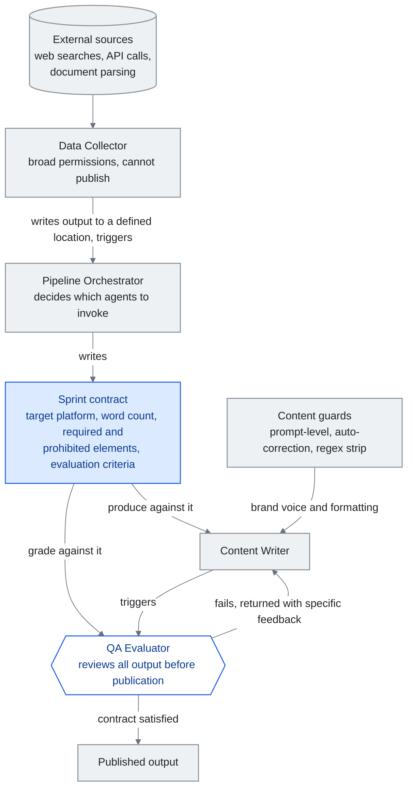

<!-- translation-sync:start -->
> 与 2026-10-31 英文版同步的机器辅助译文，已作结构与内容复核。代码和图中标签保留原文；阅读时间按英文原文估算。
> [English source](../../../chapters/10-case-study.md) · [Sync record](../../SYNC.md)
<!-- translation-sync:end -->

<!-- i18n-anchor -->

# 第 10 章：构建一个真实世界的知识 Harness

> **一句话总结：** 一位开发者用 4 个 agent 团队、渐进式揭露路由和自动化内容管线, 建出完整的 AI 知识系统。
>
> **为什么重要：** 这证明一个人配上对的架构, 就能做到过去要一个团队才能做的事。本指南里的概念不是理论。
>
> **阅读时间：** ~11 分钟（按英文原文估算：2,476 个单词 / 230 wpm）

*图：本章"Harness Engineering: The Agent Team"一节的四智能体团队，图中将冲刺契约画成其中三个智能体共享的一份文档。编排器编写契约，写作智能体按契约产出，质量评估器在任何内容发布之前依照同一标准评分。图中支撑论点的边，是从评估器返回写作智能体的路径：这不是一次重试，因此四个智能体构成的是循环，而非流水线。*

本章呈现一个匿名的 solo 开发者案例研究——下文称为"the builder"——他在数月迭代开发中, 构建了一个完整的知识 harness。这里描述的系统是真实的, 每天都在生产使用。它示范了前面章节讨论的概念——context engineering、渐进式揭露、技能系统、agent 编排——如何在实务中整合起来。

<!-- i18n-anchor -->

## 起点

构建者从一个简单的问题开始: 知识太多, 没有结构。一个个人知识 vault 累积超过 300 篇笔记, 涵盖在做的项目、技术参考、会议记录和散落的想法。标准做法——「需要时去搜」——随着 vault 变大就崩溃了。笔记被遗忘, 洞察被重新发现而非被检索, 工作 session 之间 context 流失。

最初的解法很朴素: 用 LLM 助手访问 vault。但对 300+ 笔记的原始访问意味着把 context window 灌满。真正的工程挑战不是"can the LLM read my notes", 而是"how do I give the LLM the right notes at the right time."。

<!-- i18n-anchor -->

## 知识层: Vault 作为隐式知识图

系统的基础是一个 Obsidian vault, 组织为刻意的资料夹层级:

- **Inbox** 用于捕捉（所有新笔记落在这里）
- **Active** 用于日常使用的笔记（保持 5-10 项）
- **Projects** 用于有截止期限的限期工作
- **Areas** 用于无截止期限的持续职责
- **Notes** 用于原子知识（每个笔记一个想法, 标题作为断言）
- **Daily** 用于日记和回顾报告
- **Archive** 用于完成或过时的材料

每个笔记都用 wikilink 连接到相关笔记, 不需要正式图数据库就能形成隐式知识图。链接惯例简单但严格: 如果笔记 A 提到笔记 B 详细阐述的概念, A 必须连结到 B。久了之后, 这产生一个可导航的知识网, 任何入口点都通往相关 context。

Vault 通过回顾循环来维护: 每日回顾处理 inbox 并分类新笔记; 每周回顾分析知识累积趋势, 重新浮现有价值的旧笔记; 每月回顾检查矛盾、合并重叠笔记、归档完成的项目。这个维护不是可选的。没有它, 知识层会在数周内退化, 笔记变得陈旧、重复或孤立。

<!-- i18n-anchor -->

## Context engineering: 系统 prompt 作为索引

构建者的 context engineering 把系统 prompt 当作**深层资源的索引**, 而不是单一的指令集。一个中央配置档（类比 AI 的 README）包含:

- **环境细节**: OS、shell、要避免的已知怪癖
- **语言偏好**: 构建者的工作语言和格式约定
- **路由表**: 一份按优先序排列的技能类别清单, 列出触发关键词与指向路由档的指针

这个配置档总是被加载。它很精简——少于 2,000 token——因为它只装指针, 不装载荷。当 LLM 收到用户请求, 它对照路由表匹配, 只加载相关的路由档, 路由档再指向所需的具体技能。

另有独立的记忆系统处理跨 session 持续。它存储:

- 在做项目的位置与结构
- 从用户回馈学到的偏好
- 各项目特有的技术 pattern 与约定
- 复杂主题的详细子档参照

记忆档有机增长。当构建者更正助手的行为, 那项更正被记录为偏好。当一个项目的结构被建立, 它被文档化一次, 之后就被引用。这消除了让无状态 LLM 互动饱受困扰的"let me re-explain my project"问题。

<!-- i18n-anchor -->

## Harness engineering: Agent 团队

系统采用四个 agent 团队, 每个有明确角色:

1. **Data Collector**: 从外部来源收集信息（网页搜寻、API 调用、文件解析）。拥有广泛权限但不能发布。
2. **Pipeline Orchestrator**: 协调工作流程, 决定调用哪些 agent, 管理顺序。撰写"sprint contracts"——为每个任务规定预期输出标准的文档。
3. **Content Writer**: 产出输出（报告、社群媒体贴文、技术文档）。在内容守卫之下运作, 强制品牌语调和格式标准。
4. **QA Evaluator**: 在内容能发布前对照 sprint 合约审查所有输出。检查事实准确度、格式合规、品牌对齐。

冲刺契约机制值得进一步说明。编排器启动内容任务时，不会只说"write a post about X."。它会编写一份契约，规定目标平台、字数范围、必需元素（例如必须包含一项统计数据，必须以行动号召结尾）、禁止元素（例如不得使用最高级形容词，不得作出未经验证的主张）和评估标准。内容写作智能体依照契约产出，质量评估智能体据此评分。如果输出未通过评估，就会附上引用契约标准的具体反馈退回写作智能体。这不是一次重试，循环会持续到满足契约或有人介入。

内容守卫在三个层级运作:

- **Prompt-level guards**: 嵌入系统 prompt 的指令, 定义 agent 必须做和不能做什么
- **Auto-correction**: 后置处理, 抓出并修复常见问题（例如移除不要的格式 pattern、强制一致术语）
- **Regex strip**: 最后一关, 移除特定不该出现在输出里的 pattern（例如某些会破坏下游系统的字符、模型外漏的元数据 token）

Agent 间通讯是触发式的。Agent 不互相轮询。Data collector 完成收集后, 把输出写到指定位置并触发 orchestrator。Writer 产出内容后, 触发 evaluator。这种事件驱动架构让系统反应迅速而不做不必要的计算。

<!-- i18n-anchor -->

## 技能系统的演化

技能系统经历了四个清晰的演化阶段, 每个都由生产中发现的实际限制驱动。

**阶段 1: 平面技能档。** 每项技能是一个含指令的独立 markdown 档。LLM 在 session 开始时加载所有技能档。在 5-10 项技能时还行, 但当库变大就难以为继。Context window 被技能定义灌满, 留给实际工作的空间所剩无几。

**阶段 2: 丰富的 YAML frontmatter。** 技能获得结构化元数据: 触发条件、所需 context、依赖、版本号。这让系统可以按相关性过滤技能, 但过滤逻辑本身消耗 token 又增加 latency。

**阶段 3: 技能间的 wikilink。** 技能开始互相链接, 形成技能图。一个"deploy"技能会连接到"run tests"作为前置条件。这使系统能加载技能链而非单个技能, 但导览这张图仍需要加载图索引。

**阶段 4: 路由档配渐进式揭露。** 最终架构使用一份在系统 prompt 中的精简索引（路由表）, 指向七个分类专属的路由档。每个路由档列出该类别的技能与触发条件。LLM 只加载匹配类别的路由档, 然后只加载所需的具体技能。任何时刻, 系统加载的是: 系统 prompt 索引（约 2K token）+ 一个路由档（约 500 token）+ 一个技能档（约 1-2K token）。无论系统中有多少技能, 总开销都在 4K token 以下。

构建者用 85 个测试查询测试这套路由架构, 涵盖所有类别, 达到 85/85 正确路由——100% 准确度。边角情境（可能匹配多个类别的模糊查询）由路由表中的明确消歧规则处理。

<!-- i18n-anchor -->

## 成果

这个架构可衡量的成果:

- **65% token 缩减**, 来自相对于平面档做法的渐进式揭露。同样的任务过去消耗 8-12K token 的技能 context, 现在不到 4K。
- **自动化内容管线** 在多个平台每日产出有一致质量的内容, 由一个人管理。
- **知识维护** 透过自动化 vault linting, 检测矛盾、孤立笔记和过时信息——这些过去需要手动回顾 session 处理。
- **跨 session 持续** 消除"cold start"问题。记忆系统让助手每次都从上次离开的地方接起。

<!-- i18n-anchor -->

## 学到的教训

**先简单, 再叠加复杂度。** 构建者第一天没有设计四 agent 加 sprint 合约系统。它从单个 agent 配一个指令文字档开始。每一层复杂度都是为回应特定故障模式而加的: agent 产生幻觉（加 QA evaluator）、输出不一致（加内容守卫）、context window 溢出（加渐进式揭露）。过早的架构会产生为想象问题优化、而非真问题优化的系统。

**渐进式揭露值得花的设置成本。** 建构与维护路由表、七个路由档以及个别技能档需要持续工夫。但 65% 的 token 缩减让它在每次互动中都付清自己。更重要的是, 系统可扩展: 加新技能意味着在一个路由档加一行, 不是重构整个 prompt。

**Less is more。** 压缩、精确的技能定义胜过冗长的。一个写"search the vault for notes matching the query, return file paths and relevant excerpts, suggest connections"的技能档, 比同样指令的 500 字阐释更好。LLM 不需要被牵着走; 它需要清晰意图。

**Harness 就是产品。** 构建者的竞争优势不是任何单一技能或 agent。是 harness——路由逻辑、sprint 合约、内容守卫、回顾循环、记忆系统。各别组件都很直接。整合才是价值所在。这呼应一个关于知识工程的更广真理: 模型在商品化, 但编排它们的系统不是。

<!-- i18n-anchor -->

## 边栏: Claude Code 作为参考实现

在构建者系统演化的大部分时期，Anthropic 自己的内部工具一直是黑盒。从业者可以从 Claude Code 的行为推断其运作方式，但 Anthropic 之外没人见过源代码。**March 31, 2026**，情况发生了变化：Anthropic 意外在 npm 包 `@anthropic-ai/claude-code` v2.1.88 中发布了一份 59.8MB 的源映射文件，约含 513,000 行未经混淆的 TypeScript，分布在 1,906 个文件中（完整经过见第 4 章）。这次泄露让社区首次得以实证观察前沿实验室的生产级系统编排层，其中数种模式与构建者独立摸索出的模式十分相似：

- **Self-Healing Memory, 不是一个大档。** Claude Code 外泄出来的架构组织成三层"Self-Healing Memory"系统, 层之间有明确的修复逻辑。构建者的 vault + 记忆档 + sprint 合约回路是同一概念的较粗版本: 短期工作状态（当前 session）、中期压缩状态（记忆档）、长期持久知识（vault）。两个系统中,"memory"都不是一个地点; 它是一组层加上层之间的转换。
- **MEMORY.md 是索引, 不是仓库。** Claude Code 内部的 `MEMORY.md` 是轻量级的指针式索引, 指向更详细的笔记——不是单一的 transcript。构建者的配置档扮演完全相同角色: 它装路由表与指针, 不装载荷, 这正是基线 context 保持在 2K token 以下的原因。
- **`KAIROS` 与自主 daemon 模式。** Claude Code 原始码中提到一个 `KAIROS` feature flag 超过 150 次。它把守一个自主 daemon 模式——一个无人看管的长时间执行回路, 远超大多数用户熟悉的互动 REPL。构建者的触发式、事件驱动 agent 间通讯是同一概念的手工版本: 在事件上唤醒、做工、传递, 不需要人类每步介入。

这个边栏的重点不是构建者的系统秘密就是 Claude Code。这两个系统在工程投入上差了几个数量级，构建者的版本用数百份 Markdown 文件完成了 Anthropic 用五十万行 TypeScript 完成的事。重点是**两个系统独立收敛到同一种形态**，即带索引的分层记忆、以路由替代直接加载全部内容、事件驱动的编排，这说明这些模式并非纯粹的风格选择。它们是生产级编排层经受真实工作负载考验并存活下来后呈现的形态。

<!-- i18n-anchor -->

## 对从业者的启示

这个案例研究说明, 一个 solo 开发者在数月迭代下, 可以建出两年前需要一个工程师团队才能建的知识 harness。关键启动条件是: 足以遵循复杂多步指令的 LLM、用于工具整合的开放协议（MCP）、提供这些系统设计 pattern 的新兴 context engineering 学科。

构建者的系统不是要被复制的模板。它是一个概念证明, 显示本指南中的原则——渐进式揭露、context engineering、技能图、agent 编排——在生产中产生可衡量的成果。你的 harness 看起来会不一样。架构应该一样。

---

<!-- i18n-anchor -->

## 三个要点

- **契约让写作智能体与评估器拥有共同目标。** 编排器预先规定目标平台、字数、必需和禁止元素，评估器依照同一份文档评分，直到满足要求或有人介入。
- **渐进式披露将上下文开销限制为常量。** 无论存在多少项技能，索引加上一个路由文件和一个技能文件始终低于 4K token，相比被替代的平面文件方案减少了 65%。
- **系统编排层就是产品。** 各个组件本身并不复杂；价值来自整合，包括路由逻辑、冲刺契约、内容防护、复查周期和记忆系统。

---

*下一章: [第 11 章 —— LLM 知识工程的关键时刻](11-timeline.md)*
