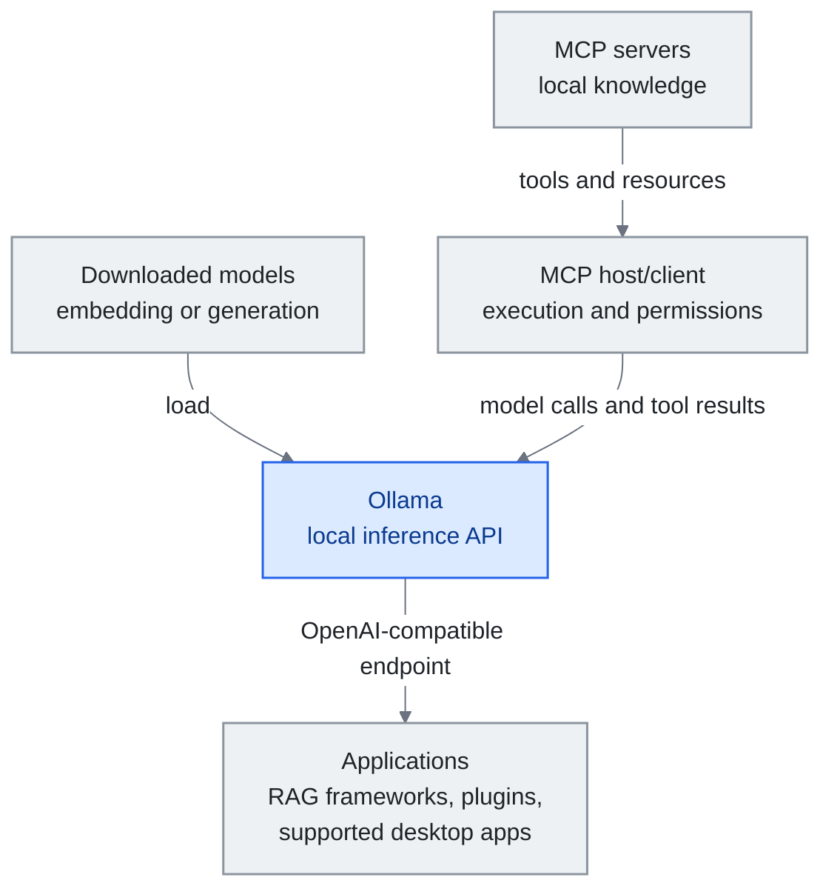

<!-- translation-sync:start -->
> 与 2026-10-31 英文版同步的机器辅助译文，已作结构与内容复核。代码和图中标签保留原文；阅读时间按英文原文估算。
> [English source](../../../chapters/12-local-models.md) · [Sync record](../../SYNC.md)
<!-- translation-sync:end -->

<a id="chapter-12-local-models-for-knowledge-engineering"></a><!-- i18n-anchor -->

# 第 12 章：本地模型与知识工程

> **一句话总结：** 本地模型把推理移到自己的硬件，降低对提供商的数据暴露及按 token 支付的 API 费用，同时增加本地运行成本。
>
> **为什么重要：** 敏感知识与个人微调，使推理边界成为架构选择；工具、日志及同步仍需各自的控制措施。
>
> **阅读时间：** ~14 分钟（按英文原文估算：3,052 个单词 / 230 wpm）

*图：Ollama 通过推理 API 向应用提供已下载的模型。MCP 宿主／客户端独立执行工具并强制落实权限，将模型调用与工具结果交给 Ollama。只有端点兼容性，并不等于提供 MCP 编排。具体模型与应用集成见下文。*

*窄屏下可横向滚动图表，以完整尺寸阅读。*



前几章描述的知识工程堆叠基本假设云端 API 存取——把你的 context window 送给 Anthropic、OpenAI 或 Google, 拿回回应。这对大多数用户运作良好。但有越来越多的从业者, 云端推论对他们要么不切实际, 要么不可取: 处理敏感企业数据的、所在司法管辖区有严格数据驻地要求的、以及想透过在自己编纂知识上微调模型来完全闭环的。

本章涵盖本地模型与知识工程的交集。它不涵盖 GPU 采购指南、基准比较、或量化技术——那些主题有其他资源专门处理。相反, 它聚焦于把模型带进你自己基础设施时真正重要的架构决策。

---

<a id="why-local-matters-for-knowledge-engineering"></a><!-- i18n-anchor -->

## 为什么本地对知识工程重要

三股力量推动本地模型在知识系统中的采用:

**隐私是一种架构，而非政策。** 云端 RAG 可以将检索到的文档片段发送给提供商。只有整条路径都留在本地时，本地推理才消除向模型提供商的这一传输。工具调用、遥测、日志和同步仍需审查。某些法律、医疗及政府工作负载要求这种边界，具体要求取决于部署。

**规模化成本。** 持续进行后台处理的知识系统，例如笔记库检查、自动笔记编译、定期重建索引，每天可产生数千次 API 调用。本地执行消除按 token 支付给提供商的账单，但电费、硬件容量与维护仍有成本。对持续运行的知识维护，即 Karpathy 架构中的 Lint 操作，应将这些成本与 API 使用费比较，而非假设推理免费。

**微调终局。** 这或许是最有说服力的理由。一旦你的知识库达到足够质量——透过数月 Ingest 操作累积数百份结构良好、互相链接的笔记——它变成原始合成数据集。你能在这个数据集上微调一个小本地模型, 产出一个内在"knows"你领域的模型, 不需在 runtime 检索。知识在权重里, 不在 context window。

---

<a id="architecture-where-local-models-fit"></a><!-- i18n-anchor -->

## 架构：本地模型适合哪里

不是知识 harness 的每个组件都同等受益于本地推论。这里是本地模型提供最大价值的地方:

<a id="embedding-models-high-value"></a><!-- i18n-anchor -->

### Embedding 模型（高价值）

Embedding 是任何 RAG 管线的基础。每次你加笔记到 vault, 它需要被转成向量做相似度搜寻。这是高量、低复杂度的操作——本地推论的完美对象。

热门选择:
- **nomic-embed-text**（137M 参数）: 强健的通用 embedding, 在 CPU 上跑
- **mxbai-embed-large**（335M）: 更高质量, 在普通硬件上仍可管理
- **bge-m3**（568M）: 多语言, 对混合语言内容的 vault 极佳

这些模型够小, 能在任何现代笔电跑而不需 GPU。本地与云端 embedding（OpenAI 的 text-embedding-3、Cohere 的 embed）之间的质量差距已显著缩窄——对大多数知识管理用例, 本地 embedding 够用。

透过 Ollama 在本地跑:
```
ollama pull nomic-embed-text
```

<a id="query-and-reasoning-medium-value"></a><!-- i18n-anchor -->

### 查询与推理（中等价值）

用本地模型回答关于你 vault 的问题——Query 操作——是取舍变得更微妙的地方。云端模型（Claude Opus、GPT-4o）在复杂推理、多步综合、微妙指令遵循上仍有意义地更好。但对直接的检索式 Q&A（"what did I write about X last month?"）, 7-14B 参数范围的本地模型表现良好。

实务选项:
- **Qwen3-14B**: 强健多语言效能, Apache 2.0 授权
- **Llama 3.1-8B-Instruct**：8B 指令微调选项；Llama 3.3 是另一个 70B 模型
- **DeepSeek-R1-Distill-Qwen-7B**：从完整 R1 蒸馏的推理能力，采用 MIT 许可证
- **Gemma 3-12B**: Google 的高效架构, 擅长结构化输出

最有效的 pattern 是 **分层做法**: 用本地模型处理日常查询与 vault 维护, 升级到云端 API 处理复杂综合与创意任务。这呼应渐进式揭露的 harness engineering 原则如何应用到模型选择——为每个任务用最低能干模型。

<a id="knowledge-compilation-high-value"></a><!-- i18n-anchor -->

### 知识编纂（高价值）

Ingest 操作——读原始来源并把它们编纂成结构化 wiki 页面——出乎意料地适合本地模型。这个任务定义良好: 读文章、提取关键点、生成含 wikilink 的结构化笔记。一个 14B 模型配良好指令遵循能可靠处理这个, 特别在系统 prompt 精确指定输出格式时。

这是经济性论据最强的场景。如果 Web Clipper 每天捕获 5-10 篇文章，本地编译可以在不产生按 token 计费 API 账单的情况下持续扩充知识库，但仍受可用算力与运行成本约束。

<a id="vault-maintenance-high-value"></a><!-- i18n-anchor -->

### Vault 维护（高价值）

Lint 操作扫描矛盾、过时内容与孤立笔记，是能从本地推理受益的批处理过程。它可以在机器算力预算内每小时、每天或持续运行。本地模型扫描笔记库并生成健康报告；要让这条工作流保持私密，还需要本地工具与存储。

---

<a id="the-fine-tuning-endgame"></a><!-- i18n-anchor -->

## 微调终局

Andrej Karpathy 概述了一个许多从业者现在在追求的愿景: 一旦你的 LLM 维护 wiki 达到足够质量, 用它微调一个个人小型语言模型（SLM）。

工作流程:

1. **编纂** 你的知识库, 透过数月 Ingest 操作。Wiki 成长到数百份结构良好、互相链接的笔记。
2. **提取** wiki 的训练对: 每份笔记变成一个（问题, 答覆）对, 或一个（context, 续写）对。
3. **微调** 一个小模型（1-3B 参数）在这个数据集上, 用 LoRA 或 QLoRA。
4. **部署** 微调后的模型在本地。它现在从权重回答关于你领域的问题, 不需检索。

这不会完全取代 RAG——微调后的模型对最近信息与具体细节仍受益于检索。但它戏剧性减少检索负担。模型"knows"你领域的基础概念、关系、pattern。RAG 只需补充新或高度特定的信息。

这个管线的工具已成熟:
- **Unsloth** 用于高效微调（快 2 倍, 记忆少 60%）
- **Axolotl** 用于托管训练配置
- **MLX**（Apple Silicon）或 **llama.cpp** 用于微调后模型的本地推论

---

<a id="integration-patterns"></a><!-- i18n-anchor -->

## 整合 Pattern

<a id="pattern-1-ollama-as-universal-backend"></a><!-- i18n-anchor -->

### Pattern 1: Ollama 作为通用后端

Ollama 提供一个用兼容 OpenAI API 跑本地模型的统一接口。这意味着任何与 OpenAI API 一起运作的工具能透过改 base URL 指向本地模型:

```
base_url: http://localhost:11434/v1
model: qwen3:14b
```

这与 LangChain、LlamaIndex、Dify、大多数 RAG 框架一起运作。对 Obsidian 用户, Smart Connections 等插件能配置成用本地 Ollama 模型而非云端 API。

到 2026 年下旬，这一模式出现反向形式：不再只是第三方工具指向 Ollama，封闭模型厂商自己的第一方桌面应用也开始指向它。Ollama **v0.33.0**（August 21, 2026）支持配置 Claude Desktop，将 Ollama 作为第三方网关提供商；**v0.34.0**（September 5, 2026）加入 ChatGPT Desktop 集成，可通过 Ollama macOS 应用配置，在 ChatGPT Desktop 内直接选择 Ollama 模型。同一 v0.34.0 还加入 OpenAI 兼容的客户端工具搜索、响应压缩及 Apple Silicon 上更快的结构化输出。对本地知识编排系统，后果有限却真实：消费者聊天客户端不再构成将查询送离机器的理由，因为客户端可以改指向机器上运行的模型。这是下文操作系统级 `LanguageModel` 协议在厂商应用侧的对应物，同样让本地后端成为一等支持对象，只是此次来自封闭模型厂商，而非平台所有者。

<a id="pattern-2-hybrid-cloud-local"></a><!-- i18n-anchor -->

### Pattern 2: 混合云端-本地

对大多数用户最实用的架构:
- **本地**: Embedding、vault 维护、日常查询、知识编纂
- **云端**: 复杂推理、创意综合、多步 agent 工作流

这给你高量操作的隐私与成本优势, 同时保留对真正需要的任务存取前沿模型能力。

<a id="pattern-3-mcp-with-local-models"></a><!-- i18n-anchor -->

### Pattern 3: MCP 配本地模型

如[第 7 章](07-mcp.md)所示，这种集成需要 **MCP 宿主／客户端**。宿主发现服务器工具，通过模型 API 传递工具定义和结果，执行获授权的调用，并落实权限。Ollama 提供推理，仅有兼容 OpenAI 的端点，并不是 MCP 宿主。只要宿主、服务器、模型与存储都在本地，编排层便可以保持本地运行。

---

<a id="2026-local-models-get-an-os-native-api-and-vendor-qat"></a><!-- i18n-anchor -->

## 2026：本地模型获得操作系统原生 API 与厂商 QAT

2026 年的三次发布，改变了本章所描述的本地推理格局。

**Apple 向任意提供商开放 Foundation Models（WWDC26，六月 8 日）。** Apple Foundation Models 框架，即支撑 Apple Intelligence、提供流式输出、工具调用与 `@Generable` 结构化输出的 Swift API，发布公共 **`LanguageModel`／`LanguageModelExecutor` 协议**；Apple 同时提供参考 **`MLXLanguageModel`** 后端，在运行时从 Hugging Face 加载任意 mlx-community 模型，并缓存到磁盘。对本地知识工程，这意味着本地开源模型成为*一等、操作系统原生后端*，而不只是第三方集成。macOS 或 iOS 知识应用可以对接一个 Swift API，在 Apple 设备端模型与下载的开放权重模型之间切换，无需重写推理层；Anthropic 与 Google 也在发布符合协议的 Swift 包。上文 Ollama 通用后端模式，由此获得 Apple 原生的对应方案。

**Gemma 4 QAT（六月 5 日）。** Google 为 Gemma 4 全部五种规模，即 E2B、E4B、12B、26B-A4B 与 31B，发布**量化感知训练检查点**，在训练*期间*模拟 4-bit 精度，让量化权重恢复大部分 BF16 质量，而非在事后压缩时损失质量。发布首日，**llama.cpp（GGUF）、Ollama、LM Studio、MLX 同时提供产物**；vLLM 首日支持 E2B、E4B、12B、31B。26B-A4B MoE 被排除在 vLLM w4a16-ct QAT 格式之外，因为其 704 宽的专家维度，在 4-bit 下质量损失过大。内存方面，Google 自身博客没有给出百分比；第三方分析估算，相比 BF16，**VRAM 减少约 72%**，Google 自报的数字只有 E2B 通过移动格式降至 1GB 以下。值得关注的是*发布模式本身*：厂商原生 QAT，加上多运行时首日同步分发，正在成为严肃开放权重发布的默认形态，降低本章所主张的"run it locally"决策摩擦。

**Meta 发布专为本地智能体构建的开放权重模型（Muse Glimmer，八月 10 日）。** Meta Superintelligence Labs 以 Apache 2.0 发布 **Muse Glimmer**，从封闭 Muse Spark 蒸馏而来的 30B 稠密模型，明确定位为设备端开放智能体模型，而非缩小的研究产物。4-bit 量化后低于 20GB，刻意适配单张消费级 GPU、Mac 或 PC 的 24-32GB 内存预算。Meta 自建基准报告，**DFlash** 推测解码在 **RTX 5090 上加速 3.1x**、**M5-Max 为 1.8x**、**M4-Max 为 1.5x**，基准也优于 Gemma4-31B 与 Qwen3.6-27B；这些均为 Meta 自报，未经独立复现。区别于普通权重发布的是分发：Hugging Face、Ollama、llama.cpp、MLX、ExecuTorch、LM Studio、Unsloth、vLLM、SGLang、Together AI、Fireworks AI 与 OpenRouter，几乎都在发布首日支持。本书此前在本地部署语境下讨论的开放权重模型，均只适合服务器级部署，例如第 9 章 2.8T 参数的 Kimi K3 明确不属于本地部署；Muse Glimmer 则是美国前沿实验室首个从设计和基准之初，便面向单张消费级 GPU 本地智能体的模型，并采用上文 Gemma 4 QAT 示范的厂商原生 QAT、多运行时首日同步模式。本章原先在 Google 身上标记的模式，不再是 Google 专属。（Meta 另称以后会发布 Muse Spark 1.2 权重，那是另一个未注明日期的事件，此处不涵盖。）

---

<a id="local-context-and-decision-services"></a><!-- i18n-anchor -->

## 本地上下文与决策服务

**设备上的共享上下文（September 23, 2026）。** Liquid AI 公布面向 Qualcomm Hexagon NPU 优化的 **Liquid Context**：在本地维护、具有权限控制的上下文层，可供嵌入式、云端和混合智能体使用。上下文维护与使用它的智能体成为两个独立组件，将[第 6 章的记忆架构](06-agent-memory.md)扩展到各智能体专属存储之外。公告面向 OEM，例子仅作说明，不能证明消费设备已广泛出货。本地记忆层也不会使连接的云端智能体变成本地智能体。

**带类型的本地决策（September 29, 2026）。** Ollama 0.35 引入 **`/v1/systemone`**，接收状态及具名、带类型的问题，并返回有界决策及概率。Nimble 9B 与实验性 Tev1 模型，使路由、分流和内容审核可通过本地决策接口完成，而非生成文字回答。架构上的变化在于接口，不是基准排名。概率仍需按实际工作负载验证；权限与升级规则应由确定性的宿主代码强制执行。

**October 1**，Cloudflare 公布 Apache 2.0 **Clef/Clef-flash**，支持兼容 Jev 的带类型输出，跨厂商趋同随之出现；Ollama 在 **October 19** 公布本地和云端 Clef 支持。这使同一套决策约定跨越不同部署位置。这些是厂商发布公告，不是决策已经校准、或自主执行安全的独立证据。

---

<a id="what-this-chapter-does-not-cover"></a><!-- i18n-anchor -->

## 本章不涵盖什么

本章刻意省略:
- **硬件建议**: GPU 选择、VRAM 要求、云端 GPU 租赁在 r/LocalLLaMA 的 wiki 与 Ollama 文档等资源中广泛涵盖。
- **模型基准**: 排名每月变。最新排名见 [Open LLM Leaderboard](https://huggingface.co/spaces/open-llm-leaderboard/open_llm_leaderboard)。
- **量化细节**: GGUF 格式、INT4 vs INT8、质量/速度取舍在 llama.cpp 与 Ollama 社群中有良好文档。
- **训练基础设施**: 多 GPU 设置、分布式训练、云端训练平台都在知识工程范围之外。

这里的焦点是架构问题: 本地模型在你的知识 harness 中适合哪里, 它们如何改变什么是可能的？

---

<a id="key-takeaways"></a><!-- i18n-anchor -->

## 关键要点

1. **本地嵌入是值得评估的有力默认方案。** 它减少对模型提供商的数据暴露与按 token 账单，但硬件及运行成本仍须计入预算。

2. **分层推论是务实选择。** 本地处理日常操作, 云端处理复杂推理。不要强迫 7B 模型做前沿模型做得更好的事。

3. **编译场景的重要性被低估。** 本地运行 Ingest，将重复工作从提供商账单移入自己的算力预算。

4. **微调是终局, 不是起点。** 先建 wiki。编纂数百份质量笔记。然后微调。训练数据的质量——你的 wiki——决定结果模型的质量。

5. **隐私是一项架构决定。** 敏感知识需要明确的推理、工具、存储与同步边界；本地推理只控制路径中的一部分。

---

<a id="three-things-to-take-away"></a><!-- i18n-anchor -->

## 三个要点

- **本地推理控制一条数据边界。** 只有工具、日志与同步也遵守预定边界时，它才会减少对提供商的数据暴露。
- **持续运行的工作会改变经济性。** 嵌入、知识编译与 Lint 检查，以本地硬件和运行成本，换掉按 token 支付的 API 账单。
- **本地服务如今也包括上下文与决策。** Liquid Context 公布的共享记忆层，以及 Ollama 带类型的决策端点，将重复上下文维护、有界判断，与一般文本生成分离。

---

<a id="sources"></a><!-- i18n-anchor -->

## 来源

- Ollama: [https://ollama.ai](https://ollama.ai)
- Ollama。FAQ（October 31, 2026 阅读）。[https://docs.ollama.com/faq](https://docs.ollama.com/faq)：本地与云端处理的区别；`OLLAMA_NO_CLOUD=1` 禁用云模型及网页搜索。
- Liquid AI。"Liquid AI, in Collaboration with Qualcomm Technologies, Brings Personal AI Context to Devices Powered by Snapdragon"（September 23, 2026）。[https://www.liquid.ai/blog/liquid-context-qualcomm](https://www.liquid.ai/blog/liquid-context-qualcomm)：厂商公布面向 OEM、有权限控制的本地上下文层；体验示例仅作说明，并非消费部署普查。
- Ollama。"Ollama now supports Jev-style decision models"（September 29, 2026）。[https://ollama.com/blog/ollama-now-supports-jev-style-decision-models](https://ollama.com/blog/ollama-now-supports-jev-style-decision-models)：Ollama 0.35 `/v1/systemone` 接口及首发本地模型。
- Cloudflare。"Introducing Clef: our open-source decision models, and new RL fine-tuning platform"（October 1, 2026）。[https://blog.cloudflare.com/clef-decision-models](https://blog.cloudflare.com/clef-decision-models)：Apache 2.0 权重与兼容 Jev 的决策 API；基准主张来自厂商。
- Ollama。"Clef is available on Ollama's cloud"（October 19, 2026）。[https://registry.ollama.com/blog/clef](https://registry.ollama.com/blog/clef)：厂商托管的文章也记录了本地执行支持。
- Meta。Llama 模型卡：[https://huggingface.co/meta-llama/Llama-3.1-8B-Instruct](https://huggingface.co/meta-llama/Llama-3.1-8B-Instruct)（July 23, 2024）与 [https://huggingface.co/meta-llama/Llama-3.3-70B-Instruct](https://huggingface.co/meta-llama/Llama-3.3-70B-Instruct)（December 6, 2024）：区分 8B 指令微调示例与 Llama 3.3 的 70B 发布。
- DeepSeek。DeepSeek-R1 仓库及蒸馏模型清单（2025 年一月）。[https://github.com/deepseek-ai/DeepSeek-R1](https://github.com/deepseek-ai/DeepSeek-R1)：精确模型标识为 `DeepSeek-R1-Distill-Qwen-7B`。
- Ollama。v0.33.0 发布（August 21, 2026）。[https://github.com/ollama/ollama/releases/tag/v0.33.0](https://github.com/ollama/ollama/releases/tag/v0.33.0)：Claude Desktop 可配置 Ollama 为第三方网关提供商。
- Ollama。v0.34.0 发布（September 5, 2026）。[https://github.com/ollama/ollama/releases/tag/v0.34.0](https://github.com/ollama/ollama/releases/tag/v0.34.0)：通过 Ollama macOS 应用集成 ChatGPT Desktop；兼容 OpenAI 的客户端工具搜索、响应压缩，以及 Apple Silicon 上更快的结构化输出。
- llama.cpp: [https://github.com/ggml-org/llama.cpp](https://github.com/ggml-org/llama.cpp)
- Unsloth: [https://github.com/unslothai/unsloth](https://github.com/unslothai/unsloth)
- Karpathy, Andrej. "LLM Wiki" pattern——本章引用的 raw → wiki → schema 分层架构与 Ingest / Compile / Lint / Query 操作所定义的 Gist。[https://gist.github.com/karpathy/442a6bf555914893e9891c11519de94f](https://gist.github.com/karpathy/442a6bf555914893e9891c11519de94f)
- Open LLM Leaderboard: [https://huggingface.co/spaces/open-llm-leaderboard](https://huggingface.co/spaces/open-llm-leaderboard)
- Nomic Embed: [https://huggingface.co/nomic-ai/nomic-embed-text-v1.5](https://huggingface.co/nomic-ai/nomic-embed-text-v1.5)
- r/LocalLLaMA: [https://reddit.com/r/LocalLLaMA](https://reddit.com/r/LocalLLaMA)
- Apple。"Bring an LLM provider to the Foundation Models framework,"，WWDC26 Session 339（June 8, 2026）。[https://developer.apple.com/videos/play/wwdc2026/339/](https://developer.apple.com/videos/play/wwdc2026/339/) 与 Session 241 [https://developer.apple.com/videos/play/wwdc2026/241/](https://developer.apple.com/videos/play/wwdc2026/241/)：公共 `LanguageModel`／`LanguageModelExecutor` Swift 协议；面向 Hugging Face mlx-community 模型的参考 `MLXLanguageModel` 后端。
- Google。"Quantization-Aware Training for Gemma 4"（June 5, 2026）。[https://blog.google/innovation-and-ai/technology/developers-tools/quantization-aware-training-gemma-4/](https://blog.google/innovation-and-ai/technology/developers-tools/quantization-aware-training-gemma-4/)：五种规模全有 QAT 检查点；llama.cpp／Ollama／LM Studio／MLX 首日支持；vLLM 首日支持除 26B-A4B MoE 以外的变体。第三方 VRAM 分析为相比 BF16 约减少 ~72%；Google 自报数字仅为 E2B 通过移动格式降至 1GB 以下：[https://runaihome.com/blog/gemma-4-qat-local-ai-hardware-update-2026/](https://runaihome.com/blog/gemma-4-qat-local-ai-hardware-update-2026/)。
- Meta Superintelligence Labs。"Introducing Muse Glimmer: an open agentic model"（August 10, 2026）。[https://research.meta.ai/blog/introducing-muse-glimmer-open-agentic-model](https://research.meta.ai/blog/introducing-muse-glimmer-open-agentic-model)：30B 稠密、Apache 2.0、从 Muse Spark 蒸馏；DFlash 加速与基准数字均为 Meta 自报。二手来源：Phoronix [https://phoronix.com/news/Meta-Muse-Glimmer](https://phoronix.com/news/Meta-Muse-Glimmer)；CNBC [https://www.cnbc.com/2026/08/10/meta-muse-glimmer-open-weight-ai.html](https://www.cnbc.com/2026/08/10/meta-muse-glimmer-open-weight-ai.html)；Ghacks（August 11, 2026）[https://www.ghacks.net/2026/08/11/meta-releases-muse-glimmer-a-30-billion-parameter-open-weight-ai-model-that-runs-on-a-single-consumer-gpu/](https://www.ghacks.net/2026/08/11/meta-releases-muse-glimmer-a-30-billion-parameter-open-weight-ai-model-that-runs-on-a-single-consumer-gpu/)。

---

*上一章：[第 11 章：LLM 知识工程的关键时刻](11-timeline.md)*

*下一章：[第 13 章：循环工程](13-loop-engineering.md)*
