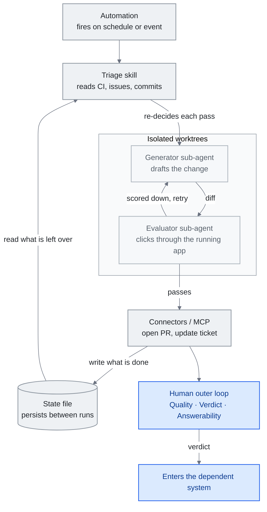

<!-- translation-sync:start -->
> 与 2026-10-31 英文版同步的机器辅助译文，已作结构与内容复核。代码和图中标签保留原文；阅读时间按英文原文估算。
> [English source](../../../chapters/13-loop-engineering.md) · [Sync record](../../SYNC.md)
<!-- translation-sync:end -->

<!-- i18n-anchor -->

# 第 13 章：Loop Engineering —— 设计提示 Agent 的系统

> **一句话总结：** Loop engineering 是建构那套替你提示 agent 的系统的实践——让你不再每一回合都亲手驾驶, 而是开始设计一个会自己运行、自我检查、自我喂养的 loop。
>
> **为什么重要：** 这是本指南演进故事里最新、也最未定型的一层, 也最可能在接下来一年里, 形塑自主 agent 工作实际上要怎么被排程、验证、审查。
>
> **阅读时间：** ~18 分钟（按英文原文估算：4,035 个单词 / 230 wpm）

*图：循环的一轮，由第 13.3 节的五个部分及第 13.3 节单独区分的外部状态组装，最终通向人的外循环与第 13.7 节的判断。两条连线承载论点：运行在作出任何决定之前先读状态文件（13.2）；负责草拟的智能体不是负责评分的智能体（13.4）。*

这是本指南目前寿命最短的一个概念。（它保住这个头衔只有六周：2026 年 七月下旬, 同一套剧本又产出了一个loop 之上还有更高一层的主张, 也就是 graph engineering, 详见[第 14 章](14-graph-engineering.md)。）"loop engineering"这个词在写作当下大约只有五周历史：它在 2026 年 六月初被命名, 几天内就透过从业者部落格、播客、X 传开, 目前背后还没有任何学术文献。以下内容刻意保持保留的态度。如果某个论述只靠一句被三种不同方式转录的播客口述引言撑住, 或者只靠一篇什么都没命名的病毒式贴文撑住, 本章会明写出来。目标是准确描述一个正在浮现的框架, 而不是把它认证成一个已经定型的世代。

这个框架值得描述, 因为它在从业者论述里确实起着作用：它替一个转变命了名——这个转变是 harness engineering（第 4 章）暗示过、但没有单独挑出来讲的——从*提示一个 agent*, 转移到*设计那个替你提示 agent 的系统*。这到底该不该算独立一层, 还是不过是「harness engineering 加一个排程器」, 正是本章刻意留白的开放问题。

本章涵盖这个词从哪里来、支持者怎么把它和 harness 连起来、一个 loop 由什么组成、让 loop 保持诚实的 generator-evaluator split、一个大型生产案例、堆叠 loop 的框架、人类被交代要保留的判断力, 以及早期的采用信号——争议的部分会全程标出。

---

<!-- i18n-anchor -->

## 13.1 得名的那一周（2026 年 六月）

催化剂是一篇贴文。2026 年 六月 7 日, **Peter Steinberger**（@steipete）——**OpenClaw** 的创造者, Y Combinator 形容它"from a weekend project to the most-starred software repo on GitHub in under 5 months, with 346k+ stars,", 超越 React, 他现在人在 OpenAI——写道：

> 这是你每个月的例行提醒：你不该再手动提示编程 agent 了。
>
> 你该做的是设计出会提示你的 agent 的 loop。

截至 2026 年 七月中, 这篇贴文已获得 **8.4M+ 曝光次数**。它什么都没命名：Steinberger 没有用"loop engineering,"这个说法, 这几个字在他的原文里完全没出现。命名是其他人在回应他所催化的想法时给出的。

同一天, **Addy Osmani**（Google）发表了那篇替这个实践命名的文章（《Loop Engineering》, addyosmani.com/blog/loop-engineering/, 六月 7 日; 六月 22 日在 O'Reilly Radar 转载）。他的定义, 就是后续论述里被反复引用的那个版本：

> Loop engineering is replacing yourself as the person who prompts the agent. You design the system that does it instead.

同一个转变, 也从一间前沿实验室内部冒出来。**Boris Cherny**, Claude Code 的创造者兼 Anthropic 的 Claude Code 负责人, 在 2026 年中的一次播客里, 用同样的说法框定了自己的工作流。根据 Lenny's Podcast 那场访谈被引用最多的转录版本：

> I don't prompt Claude anymore. I have loops running that prompt Claude and figuring out what to do. My job is to write loops.

这句引言需要一个但书, 而这正是本章存在的意义所在。这是一句*口述*的话, 不同媒体的转录版本并不一致（有些引用的是 Acquired 播客, 而不是 Lenny's）, 也没有权威的逐字文本或完整转录稿可查。但其*实质内容*——Cherny 不再亲手提示, 而是写会提示 Claude、决定下一步动作的 loop——在多个二手来源里都得到印证; 只是确切措辞没有定案。

合起来看, 六月 7 日那一周产出了一个催化剂（Steinberger）、一个名字和定义（Osmani）, 以及一个来自内部人士的回声（Cherny）。它没有产出的, 是共识。这个词在几周内就在从业者论述中结晶化, 但接受度是分裂的：一部分读者称它是真正的转变, 另一部分读者称它为时过早——不过是排程的改名, 或者"the harness with a cron job."。目前没有任何同行评审的著作使用这个词。本指南把 loop engineering 当作一个正在浮现、有争议的框架来处理（见第 1 章的第四代那一节）, 这也是为什么以下每一个有分量的论述都绑着一手来源, 而空白之处会被明写出来, 而不是被填满。

---

<!-- i18n-anchor -->

## 13.2 编排层之上的一层

倡导者最清晰的定义方式，是将循环直接放在第 4 章编排层上方。Osmani 明确指出这种关系：

> Loop engineering sits one floor above the harness.

在他关于循环*是什么*的心智模型中，编排层仍是构建基础：循环就是一个"runs on a timer, it spawns little helpers, and it feeds itself."的编排系统。他明确表示，这延伸而非取代此前工作，他"wrote before about the cousin of this, agent harness engineering, which is making the environment one single agent runs inside."。

中国开发者**程序员鱼皮**（liyupi）给出最具结构性的解释。在六月 16 日的 codefather.cn 指南中，他将提示技巧、上下文管理、编排构建与循环排为**層層包含**，即逐层嵌套：

> 这四者是层层包含的关系。提示词技巧、上下文管理、Harness 搭建，这些能力在 Loop 里面全都要用上。

（四者相互嵌套，提示技巧、上下文管理与编排构建，全都在循环*内部*使用。）这延续第 1 章将提示 → 上下文 → 编排层相互嵌套的逻辑，只增加一个外框。归属必须说清楚：鱼皮是为中国开发者受众重新包装、组织已有术语，并非创造它们；"harness engineering"与"loop engineering"可追溯至 Claude Code 与 Cherny 的相关讨论。

他的马匹比喻，将编排层与循环的界线划分得格外清晰：

> 如果把 AI 比作一匹马，Harness 就是你给马装上的缰绳、马鞍和围栏，然后你骑在马上手动驾驭它。

（如果 AI 是一匹马，编排层就是给它装上的缰绳、马鞍与围栏，然后你骑上去手动驾驭。）

> 而 Loop 呢，是你设定好一条巡逻路线后，不用上马，让马自己按路线一圈一圈地跑。

（循环则是设好巡逻路线，然后*不骑上去*，让马自行沿路线一圈圈跑。）

这个比喻包含一个关键区别，让循环工程不会被归结为"cron for agents"：**循环不是调度器。** 调度器按时触发；循环按时触发，*然后读取当前状态，决定本轮做什么*。运行时决策者，会在选动作前查看 CI 状态、未解决问题或上一轮遗留事项，这恰是 cron 条目所不具备的部分。循环等于调度器，加上读取状态、每轮重新决策的智能体。（交叉参考第 1 章"The Key Insight: Coexistence, Not Replacement."。）

---

<!-- i18n-anchor -->

## 13.3 一个 Loop 由什么组成

Osmani 的文章给出了最具体的清单。他那一节的标题是 **「五个组件, 外加一些补充」（"The five pieces, and then notes"）**——数量很重要, 因为很容易被灌水。实际上是*五个组件加外部状态*, 而不是六个平起平坐的构件：

- **Automations（自动化触发）** —— 让 loop 启动的触发器（排程、事件）。
- **Worktrees（工作树）** —— 隔离的工作副本, 让并行的 agent 不会互相碰撞。
- **Skills（技能）** —— 第 5 章里那些可重用的能力包。
- **Connectors（MCP, 连接器）** —— 第 7 章讲的工具与数据触及范围。
- **Sub-agents（子 agent）** —— 一次运行会生出的那些小帮手。

"then notes"指的是**外部状态／记忆**——一份 markdown 档案, 或一块 Linear 看板, 在各次运行之间把进度持久保存下来。它不是第六个平起平坐的构件; 它是那五个组件读写所在的底层基质。

他给出的实作范例是一个晨间分诊 loop, 它之所以有用, 正是因为每个环节都能对应回那五个组件里的一个。一个 **automation** 每天早上触发。一个分诊 **skill** 读取 CI 失败记录、开着的 issue、最近的 commit。隔离的 **worktrees** 各自容纳一个起草修复的 **sub-agent**, 和另一个审查它的 sub-agent。**Connectors** 负责开 PR、更新工单。没处理完的项目会浮现在分诊收件匣里, 而一份 **状态档** 会把进度持久保存下来, 让隔天早上的运行是接续而非重来。状态档是承重的那部分：没有它, loop 就不记得昨天发生过什么, 每一次运行都从零开始。

---

<!-- i18n-anchor -->

## 13.4 Generator 对 Evaluator

一个会自己提示自己的 loop, 天生就继承了一个难题：*谁来检查这份工作？* 如果产出变更的 agent 同时也是打分的那个, loop 就会朝着自我恭维的方向优化。被引用最多的一手论述, 其实早于命名的那一周就存在了, 这本身就很说明问题——实践跑在标签前面。**Prithvi Rajasekaran** 的"Harness design for long-running application development"（anthropic.com/engineering/harness-design-long-running-apps, 2026 年 三月 24 日）直接记录了这个失效模式：被要求评估自己的产出时, agent"tend to respond by confidently praising the work", 而且"reliably skew positive when grading their own work."。

他的解法, 借用了对抗式训练的结构：

> Taking inspiration from Generative Adversarial Networks (GANs), I designed a multi-agent structure with a generator and evaluator agent.

这个不对称性就是全部的洞见所在, 也是为什么值得多养一个 agent 去做这个拆分：

> Tuning a standalone evaluator to be skeptical turns out to be far more tractable than making a generator critical of its own work.

关键在于, evaluator 验证的是*行为*, 而不是 diff。在 Rajasekaran 的设计里, 它"used the Playwright MCP to click through the running application the way a user would, testing UI features, API endpoints, and database states,", 而且它会"would navigate the page on its own, screenshotting and carefully studying the implementation before scoring each criterion and writing a detailed critique."。读代码不算验证; 真正把它跑起来才算。

这个 generator-evaluator 的拆分, 现在已经能在出货的 loop 控制基础能力里看到, 而它们之间重要的区别在于：*一个 loop 怎么知道该在什么时候停下来*：

- **`/loop`**（Claude Code v2.1.71）以固定间隔重跑一个 prompt 或斜线命令——changelog 上的说明是"Added `/loop` command to run a prompt or slash command on a recurring interval (e.g. `/loop 5m check the deploy`)."。重复性任务在建立后七天到期; 任务最后再触发一次, 然后自我删除。
- **`/goal`**（Claude Code v2.1.139+）运行*直到条件成立*："a small fast model checks whether the condition holds"，默认使用 Haiku。独立评估器会检查条件："after every turn, so completion is decided by a fresh model rather than the one doing the work."。底层的 `/goal` 是 "a wrapper around a session-scoped prompt-based Stop hook."。
- **Cloud Routines** 运行"on Anthropic-managed cloud infrastructure, so they keep working when your laptop is closed"; 最短间隔是一小时, 每次运行都从一个全新的 clone 开始。
- **Codex 排程自动化** 支持每日和每周排程, 或者透过 RFC 5545 重复规则（RRULE）设定客制化的节奏。

`/loop` 和 `/goal` 之间的对比, 就是 generator-evaluator 拆分浮现成产品设计的样子。`/loop` 是*按间隔重跑*——按时钟再次触发, 不管状态如何。`/goal` 是*由条件判断终止*——由第二个独立的模型来决定工作是否已经完成。一个负责重复; 另一个负责裁决。一个正经的 loop 通常两者都需要：一个用来触发运行的触发器, 和一个知道何时该停下来的 evaluator。

---

<!-- i18n-anchor -->

## 13.5 生产案例：Stripe 的「Minions」（2026 年 三月）

目前公开披露、规模最大的生产环境 loop, 是 Stripe 的 **"minions."**。Stripe 工程师 **Steve Kaliski**, 在 2026 年 三月的 *"How I AI"* 播客（由 Claire Vo 主持）上描述了这套系统; Stripe 自己的开发者部落格用两篇 *Minions* 文章记录了内部细节。（这一集的确切播出日期在各二手来源之间有出入, 所以这里只写出月份。）

最引人注目的数字, 是无人看管产出的量。Kaliski 说 Stripe "landing about 1,300 PRs that have no human assistance besides review per week."。Stripe 的部落格用比较保守的说法给出同一个数字："over a thousand pull requests merged each week at Stripe are completely minion-produced,", 尽管它们"human-reviewed,", 但"contain no human-written code."。

一个 minion 是从 Slack 触发的——方法是加上一个特定的表情符号反应, 或者 tag 那个 Slack app。用 Stripe 自己的话说, "by tagging our Slack app, engineers can kick off a minion directly from the thread discussing a change."。

对本指南来说, 这里承重的细节是 *Stripe 把确定性与概率性的边界划在哪里。* Context 组装发生在模型运行**之前**, 而且是确定性的："We deterministically run relevant MCP tools over likely-looking links before a minion run even starts, to better hydrate the context."只有到了这一步之后, 概率性的部分才开始。核心 agent loop 是 Block 开源的 **Goose** 的一个 fork——"the core agent loop runs on a fork of Block's coding agent goose ... which we forked early on."。执行是在 Stripe 的 **devbox** 里沙盒化的; 根据 Stripe 的开发者部落格（不是播客里说的）, "a Stripe devbox is an AWS EC2 instance,", 被当成"cattle, not pets"来对待——标准化、可丢弃, 而不是量身订做、长期存活。

这个框架的重点是：可靠性不是来自更聪明的模型。它来自*边界的摆放位置*——在概率性生成之前先做确定性的 context 补给——也来自人类从写代码的路径, 挪到了审查的路径上。每一个 minion PR 仍然由工程师审查。loop 把写代码这件事规模化了; 它没有移除人类, 只是把人类挪了位置。

---

<!-- i18n-anchor -->

## 13.6 堆叠 Loop

**LangChain** 的 *"The Art of Loop Engineering"*（Sydney Runkle, 2026 年 六月 16 日）, 是替这一层赋予内部结构最清楚的一次尝试。它从最基本的情况讲起：

> The core agent algorithm is simple: give the LLM context and let it call tools in a loop until it's done.

从这里开始, 它往上堆叠了四级阶梯。原文的标题本身就混用了"Loop"和"Level"两种标法, 这里照原文重现——**"Loop 1: The Agent,""Level 2: Verification loop,""Level 3: Event driven loop,""Level 4: Hill climbing loop."**。这个递进过程是：

1. **Loop 1: The Agent** —— 最基本的工具调用 loop, context 输进去, 调用工具直到完成。
2. **Level 2: Verification loop** —— 对 agent 产出的独立检查, 是 §13.4 的 generator-evaluator split 被套用成的一级阶梯。
3. **Level 3: Event driven loop** —— loop 由真实世界的事件触发, 而不只是靠间隔或人类的推动。
4. **Level 4: Hill climbing loop** —— 一个自我改进的 loop, 系统会随着连续运行而变得更好。

有一点需要讲精确, 因为二手报道把它讲得过头了：原文把第四级阶梯框定为*连续运行间的自我改进*, 而不是一个会改写自己 harness 的系统。这个更强的说法并不在原始来源里。Runkle 也借用了 **"loopcraft"** 这个词——但把它归功于 Swyx, 引用的是他那篇讲"loopcraft: the art of stacking loops."的文章。这个造词是 Swyx 的, 被 LangChain 引用, 而不是 LangChain 自己造的。

**已披露的多日外层编排系统。** OpenAI 的 October 14, 2026 [Third Moment Research 案例](https://openai.com/index/third-moment-research/)报告 10,000 个并发智能体和 36-48 小时的调查。Codex 运行在另一套编排系统内部，外层检查未完成的轨迹，选择重试、终止或升级交由人类处理。这将上文的堆叠循环模式投入实际运行。这些是厂商／客户披露，完成率未经独立验证；运行多天不等于持续取得有用进展。

---

<!-- i18n-anchor -->

## 13.7 Outer Loop：人类保留的东西

如果说 §13.1 到 §13.6 描述的是 agent 运行的那个 loop, Osmani 的后续文章描述的, 就是人类被交代要保留的那个 loop。*"Own the Outer Loop"*（addyo.substack.com/p/own-the-outer-loop）在 2026 年 七月 8 日于 X 上公布（Substack 版本的落款日期是 七月 9 日）。它的拆分是：agent 现在负责运行**内层执行 loop**——调查、实作、测试／验证、报告——而工程师握着 **outer loop**。他的核心论点讲得很直白：

> 工程师拥有 outer loop。

outer loop 就是那个没有被委派出去的判断力, 用他的原话架构成三根支柱——**Quality**、**Verdict**、**Answerability**。Quality 是在 agent 行动之前运行的那些检查所形成的反压力。**Verdict** 是"the final decision we make before work enters our dependent system."。**Answerability** 是"the guarantee that if someone asks, I can explain why."的那个保证。（他用的词是单数的 *Verdict*, "quality bar"不是他的原话——那根支柱就单纯叫 *Quality*。）把这些留给人类的理由是：

> An agent can write it. But before it reaches users, someone must explain why it should exist, why it's safe enough to be part of production, and what they will do when it is wrong.

他点名了过度委派 outer loop 的三种失效模式：**cognitive debt（认知负债）**（"erosion of your understanding and memory of how to solve problems"）、**cognitive surrender（认知投降）**（"blindly accepting what AI gives you"）, 以及 **orchestration tax（编排税）**（生出比你的判断力实际能覆盖还多的 agent, 所拖累的成本）。这些都是按下"go"、却没有继续当那个工程师所要付出的代价。

回扣到 六月 7 日那篇文章的这条主线, 体现在它结尾的指示里, 读起来正是在警告这件事：

> Build the loop. But build it like someone who intends to stay the engineer, not just the person who presses go.

还有这一句, 打掉了「loop 自己就能证明自己合理」的任何假设：

> 两个人可以建出一模一样的 loop, 却得到完全相反的结果。

loop 的好坏, 取决于围着它的那个 outer loop 有多好。这就是整个框架里最诚实的核心。

---

<!-- i18n-anchor -->

## 13.8 采用信号

三个标记显示这个框架正在扩散到最初提出者之外。每一个都只讲能核实的部分, 和它们一起流传的夸大说法都被排除在外。

**厂商。** Anthropic 的官方开发者账号 **@ClaudeDevs** 在 2026 年 七月 6 日发布了 X Article"Getting started with loops"（截至 七月中大约 **6.0M 曝光次数、38K+ 收藏**）。这篇材料直接教授 agentic loop 本身——"Every prompt you send starts a manual loop with you directing each turn. Claude gathers context, takes action, checks its work, repeats if needed, and responds"——并且走过了按回合、按目标（`/goal`）、按时间（`/loop`、`/schedule`）这三种 loop。有一个编辑上的细微差别值得保留：X article 自己的标题讲的是 *"loops,"*, 而不是 *"loop engineering."*。"loop engineering"这个标签, 只出现在权威的 Claude 部落格镜像版本的框定文字里（claude.com/blog/getting-started-with-loops）, 而不在产品词汇本身。厂商教 loop 是个比厂商采用这个词更弱的信号——而目前得到核实的, 只有这个较弱的信号。

**中国。** 鱼皮六月 16 日的保姆级（"nanny-level"）指南，是中文开发者讨论的入口。标题为「提示词工程已死，Loop Engineering 称王！保姆级教程 + 项目实战」（"Prompt engineering is dead, Loop Engineering reigns! Nanny-level tutorial + project practice"），以已死（"is dead"）为引子；但正文收回了这个炒作式开头：指南自身的層層包含论述（§13.2），主张提示技巧*用于循环内部*，而非被它杀死。作为粗略传播指标，其 GitHub 账号显示 **23.9k 关注者**。（外界流传更大的总关注数字，但无法与原始来源核实，因此省略。）

**记忆与评测。** loop 最依赖的那个子问题——能在各次运行之间存活的跨 session 状态——现在有了独立的基准测试。Snorkel 的 **Continual Learning Bench**（arXiv 2606.05661; Snorkel AI / UC Berkeley SkyRL / UW-Madison）把结果按 agent、记忆系统、任务这三个维度拆解。在这个基准上, 使用 **Fable 作记忆骨干的 agent 系统, 表现优于建在 Opus 或 Sonnet 上的系统**（出自 Snorkel 的 Benchtalks 访谈, 是一个定性发现——arXiv 论文里的模型名单是 Opus 4.7 / Sonnet 4.6 / Gemini 3.1 Pro / Gemini 3 Flash / GPT-5.4, 并没有给 Fable 附上具体数值分数）。发布当时, 最佳系统大约达到 **25% 的标准化增益**, in-context learning 排在排行榜首位。这里的信号不是那个数字; 而是*哪个记忆撑着这个 loop*, 现在成了一个被测量的维度。

得名五周之后, loop engineering 有了一个定义、一段和 harness 的关系陈述、一个大型生产案例、一个框架厂商的课程、一份中文主流教程, 以及一份厂商自己的 loops 材料。它没有的, 是学术文献、定型的接受度, 或者「它是真正的第四代, 而不只是配了排程器和状态档的 harness engineering」这件事上的共识。本指南把它当作正在浮现、尚未定型的东西来追踪——而 Osmani 自己的那句提醒, 两个人可以建出一样的 loop 却得到相反的结果, 是对原因最公道的总结。

---

<!-- i18n-anchor -->

## 三个要点

- **循环不是调度器。** 它按时触发，再读当前状态，重新决定本轮该做什么。
- **写作者不能兼任评分者。** 让智能体评价自己的工作，会产生正向偏差；解决方法是独立且持怀疑态度的评估器。
- **Stripe 的可靠性来自边界位置，而非更聪明的模型。** 循环扩展写作规模，并将人类移到审核位置。

---

<!-- i18n-anchor -->

## 来源

- OpenAI。Third Moment Research 案例研究（2026 年十月 14 日）：[https://openai.com/index/third-moment-research/](https://openai.com/index/third-moment-research/)。
- **Steinberger, Peter（@steipete）。** 催化"loops, not prompts"这个框定的贴文（2026 年 六月 7 日）：[https://x.com/steipete/status/2063697162748260627](https://x.com/steipete/status/2063697162748260627) ——截至 2026 年 七月中已有 8.4M+ 曝光次数; 贴文本身并没有用"loop engineering."这个说法。
- Osmani, Addy。"Loop Engineering"（2026 年六月 7 日）：[https://addyosmani.com/blog/loop-engineering/](https://addyosmani.com/blog/loop-engineering/)；O'Reilly Radar 转载版（2026 年六月 22 日）：[https://www.oreilly.com/radar/loop-engineering/](https://www.oreilly.com/radar/loop-engineering/)。为实践命名的文章；定义、"one floor above the harness,"、五个组件，以及晨间分流的完整示例。
- **Osmani, Addy.**"Own the Outer Loop"（2026 年 七月 8 日于 X 公布; Substack 落款日期 2026 年 七月 9 日）：[https://addyo.substack.com/p/own-the-outer-loop](https://addyo.substack.com/p/own-the-outer-loop) ——内层 loop 与 outer loop 之分; Quality / Verdict / Answerability; cognitive debt、cognitive surrender、orchestration tax。
- **Cherny, Boris.**"Head of Claude Code: what happens next"访谈, Lenny's Podcast / Lenny's Newsletter（2026 年中）：[https://www.lennysnewsletter.com/p/head-of-claude-code-what-happens](https://www.lennysnewsletter.com/p/head-of-claude-code-what-happens) ——"I don't prompt Claude anymore ... my job is to write loops"这句话; 一句在各媒体转录不一致的口述引言, 在此附上这个但书引用。
- **Rajasekaran, Prithvi.**"Harness design for long-running application development,", Anthropic Engineering（2026 年 三月 24 日）：[https://www.anthropic.com/engineering/harness-design-long-running-apps](https://www.anthropic.com/engineering/harness-design-long-running-apps) ——generator/evaluator（受 GAN 启发）的拆分; 保持怀疑的独立 evaluator; Playwright-MCP 行为验证。
- **Runkle, Sydney.**"The Art of Loop Engineering,", LangChain 博客（2026 年 六月 16 日）：[https://www.langchain.com/blog/the-art-of-loop-engineering](https://www.langchain.com/blog/the-art-of-loop-engineering) ——四级堆叠阶梯（"Loop 1: The Agent"/"Level 2/3/4"）;"loopcraft"归功于 Swyx。
- Kaliski, Steve。Stripe"minions,"，出自与 Claire Vo 的 *How I AI* 对谈（2026 年三月）；Stripe 开发者博客 *Minions*（第 1、2 部分）：[https://stripe.dev/blog/minions-stripes-one-shot-end-to-end-coding-agents](https://stripe.dev/blog/minions-stripes-one-shot-end-to-end-coding-agents)。每周约 ~1,300 个 minion PR，人工审核、没有人工编写的代码；确定性 MCP 预填充；Goose 分支；devbox = EC2，开发博客称"cattle, not pets"。
- **程序员鱼皮（liyupi）。**「提示词工程已死，Loop Engineering 称王！保姆级教程 + 项目实战」, codefather.cn（2026 年 六月 16 日）：[https://www.codefather.cn/post/2066793761979092994](https://www.codefather.cn/post/2066793761979092994) —— 層層包含 嵌套; 马匹与骑手的比喻; GitHub @liyupi 23.9k 关注者。
- **Anthropic（@ClaudeDevs）。** X Article"Getting started with loops"（2026 年 七月 6 日）：[https://x.com/ClaudeDevs/status/2074208949205881033](https://x.com/ClaudeDevs/status/2074208949205881033); 权威镜像：[https://claude.com/blog/getting-started-with-loops](https://claude.com/blog/getting-started-with-loops) ——约 6.0M 曝光次数／38K+ 收藏（七月中）; 教的是"loops,", "loop engineering"这个标签是部落格镜像自己的框定说法。
- Claude Code 产品文档：`/loop` 与计划任务 [https://code.claude.com/docs/en/scheduled-tasks](https://code.claude.com/docs/en/scheduled-tasks)（v2.1.71；循环任务 7 天后到期）；`/goal` [https://code.claude.com/docs/en/goal](https://code.claude.com/docs/en/goal)（v2.1.139+；由全新模型检查条件；基于提示的 Stop hook 包装）；Cloud Routines [https://code.claude.com/docs/en/routines](https://code.claude.com/docs/en/routines)（Anthropic 托管基础设施；最短 1 小时；每次运行全新克隆）。
- **Codex 排程自动化**（ChatGPT/Codex 文档）：[https://learn.chatgpt.com/docs/automations](https://learn.chatgpt.com/docs/automations) ——每日／每周排程, 外加透过 RFC 5545 RRULE 设定的客制化节奏。
- **Snorkel AI / UC Berkeley SkyRL / UW-Madison。**"Continual Learning Bench,", arXiv 2606.05661（2026 年 六月）：[https://arxiv.org/abs/2606.05661](https://arxiv.org/abs/2606.05661) ——拆解 agent／记忆系统／任务; 出自 Snorkel Benchtalks 访谈的定性 Fable-骨干发现; 发布时最佳系统标准化增益约 25%, in-context learning 领先。

---

*上一章：[第 12 章：知识工程的本地模型](12-local-models.md)*

*下一章：[第 14 章：图工程](14-graph-engineering.md)*
