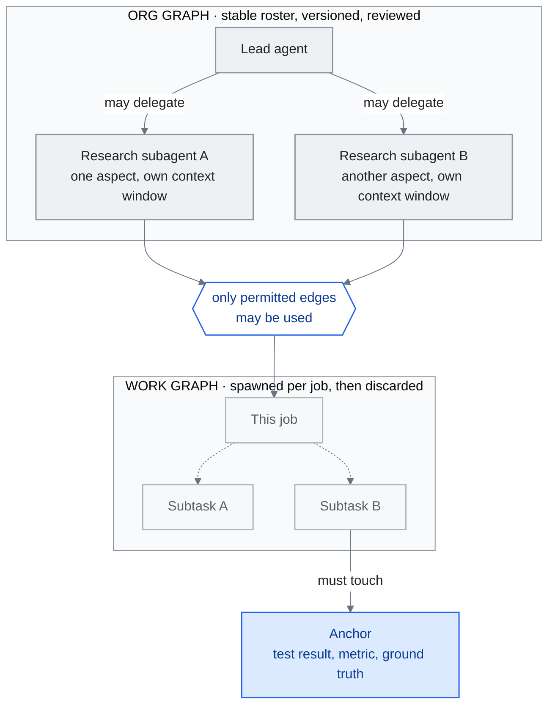

<!-- translation-sync:start -->
> 与 2026-10-31 英文版同步的机器辅助译文，已作结构与内容复核。代码和图中标签保留原文；阅读时间按英文原文估算。
> [English source](../../../chapters/14-graph-engineering.md) · [Sync record](../../SYNC.md)
<!-- translation-sync:end -->

<!-- i18n-anchor -->

# 第 14 章：Graph Engineering —— 为 Agent 组织布线

> **一句话总结：** Graph engineering 是 2026 年 七月出现的一个主张：loop engineering 之上还有一层, 就是 graph——明确接好哪些 agent 存在、谁可以把工作委派给谁, 以及它们的 loop 之间如何互相监督、互相纠正。
>
> **为什么重要：** 如果这个主张站得住脚, 它就替那一层命了名——在那一层, 多 agent 系统不再是一堆临时凑起来的 loop, 而是被设计出来的组织; 如果站不住脚, 它就是最清楚的一个活案例, 让我们看到这些世代标签是怎么被造出来、又怎么被拆掉的。
>
> **阅读时间：** ~29 分钟（按英文原文估算：6,600 个单词 / 230 wpm）

*图：第 14.2 节区分的两个对象，即由获准委派边构成的稳定组织图，以及单个任务在其中生成的临时工作图；另有 Perez 的锚点，即以外部现实为依据的检查，防止互相评审的智能体收敛于自信的一致意见。图工程一词存在争议（14.3），这些结构本身并无争议。*

本章初写于 2026 年七月下旬，术语当时约出现两周，取代第 13 章，成为本指南历史最短的概念。"Graph engineering"在 July 17-18, 2026 之后数天形成，完全存在于从业者博客与厂商文章之中，尚无学术文献支撑。它至今仍是本指南争议最大的术语。最响亮的回应来自 LangChain，一家框架名称本身就含图的厂商：实践已有三年，新的只有标签。

初稿以一个检查关口而非结论收尾：四个信号，预定在 2026 年九月检查。**检查于 September 15, 2026 执行，结果分成两部分：术语通过了关口实际规定的传播测试，但其作为独立工程层的地位仍未得到证明。** 第 14.7 节提供注明日期的评分表、各信号背后的证据，以及这次检查迫使七月初稿作出的两项更正。从这里到评分表之间的章节，记录八周内到来的证据：第二家厂商不用名称就发布相同结构；一个比术语早一年以上的生产说明；一家开源智能体公司；一个付费课程；以及围绕究竟哪个术语已死的第二轮文章。

下文有意保留限定。怀疑者与支持者获得同等篇幅；不同来源的浏览量相互冲突时，明确报告冲突；除非句子另有说明，"at the time of writing"均指 2026 年七月下旬。

本章涵盖那篇催化剂贴文与它触发的文章浪潮、这个新框架实际主张什么、对它的反驳、这个名字所必须做的与知识图谱的区分、如果它真是独立一层的话会坐落在哪里、中文生态圈的回声, 以及从业者现在该不该在乎。

---

<!-- i18n-anchor -->

## 14.1 引发一切的那条推文（2026 年 七月 17-18 日）

这套剧本很眼熟, 因为本指南才刚看着它跑过一遍。在他 六月 7 日那篇催化了 loop engineering 的贴文（第 13.1 节）之后六周, **Peter Steinberger**——OpenClaw 的创造者, 现在人在 OpenAI——又发了一次贴文。根据 [Carlos E. Perez](https://medium.com/intuitionmachine/from-loop-engineering-to-graph-engineering-d3ebeb08511c) 与 [Yash Thakker](https://explainx.ai/blog/graph-engineering-ai-agents-multi-agent-organizations-2026) 的逐字引用, 这篇贴文写道：

> 我们现在还在讲 loop, 还是已经转去讲 graph 了？

在讲别的之前, 先讲两个来源上的但书, 因为本章存在的意义正是要讲这些。第一, 这篇贴文本身没有被本指南直接抓取过, 各自独立抓取的二手来源之间的转述也不完全一致。只有 Perez 和 Thakker 逐字引用了这句确切的英文措辞。[LangChain](https://www.langchain.com/blog/3-years-of-graph-engineering-with-langgraph) 和 Perez 只链接了这篇贴文, 没有引用它的文字; [36kr](https://eu.36kr.com/en/p/3904771418867330) 和 Tony Bai 把它译成了中文, 36kr 的英文版又把中译回译成"Are we still talking about loops, or have we moved on to graphs?"; [Eigent](https://www.eigent.ai/blog/graph-engineering-ai-agents) 则是转述。上面之所以能印出这句措辞, 依据的就是这两处逐字引用。

第二, 围绕它的数字彼此不一致。每一个给这篇贴文标注日期的来源, 标的都是 七月 18 日; 本章标题里用到的 七月 17 日这个区间下限, 是一个美国时区的可能性, 而不是来源之间有记载的分歧。观看次数确实互相冲突, 不过这些是不同时刻拍下的快照, 而不是对同一时点的竞争性测量：Thakker 报的是几小时内 575K 次观看, 36kr 报的是两天内 2.6M 次（同一篇文章里, 对照六周前那篇 loop 时代贴文的 8.4M 次观看）, Tony Bai 报的是两天内大约 800K 次。这里没有把任何单一数字当作事实来陈述。

和 六月那篇一样, Steinberger 什么都没命名。"graph engineering"这个复合词, 在他的原文里完全没出现。这个复合词是在几天内的回应文章里结晶化的, 有意识地仿照了 prompt、context、harness、loop engineering 这条脉络——而且这波浪潮来得很快：

- **七月 18 日** —— [Yash Thakker 的 explainx.ai 指南](https://explainx.ai/blog/graph-engineering-ai-agents-multi-agent-organizations-2026)（持续更新到 七月 26 日）, 点名这条推文是催化剂, 提出了 org graph／work graph 的拆分。
- **七月 19 日** —— **Carlos E. Perez**（Intuition Machine）发表第一篇有分量的理论扩展。
- **七月 20 日** —— 企业厂商 **TrueFoundry** 出货一份[面向生产的指南](https://www.truefoundry.com/blog/graph-engineering-enterprise-guide), 附治理检查清单。
- **七月 21 日** —— **eigent.ai** 发表自己的厂商文章; 中国的 **Tony Bai** 与 **36kr** 同一天都报道了这场论述（14.6）。
- **七月 22 日** —— **LangChain** 由 Sydney Runkle 与 Harrison Chase 联名发表的官方回应, 在催化剂出现四天后落地（14.3）。

一个催化剂、一波文章浪潮、一个厂商的反框架, 加上一个中文生态圈的回声, 全都发生在一周之内：loop-engineering 的命名顺序, 用更快的速度重播了一遍。

---

<!-- i18n-anchor -->

## 14.2 Graph Engineering 声称是什么

把这些文章拆到最简, 会看到三个反复出现的主张。

**Agent 组织, 而非 Agent 行为。** Thakker 的框定, 是这个递进关系里最好引用的版本：

> Loop 让 agent 的行为变得可编程。Graph 让 agent 的组织变得可编程。

他的指南把 graph 拆成两个不同的对象：

- **org graph（组织图）**——一张稳定的图表, 记录哪些 agent 存在、每个 agent 是干嘛的, 以及哪些委派边是被允许的;
- **work graph（工作图）**——某个特定工作生出、执行、再丢弃的那个短命任务分解。

这里的主张是：两者现在都是需要被设计、版本化、审查的工程产物, 就像第 4 章对待 harness、第 13 章对待 loop 那样。

**Loop 监督 Loop, 被 Anchor 摁住。** [Perez 的文章](https://medium.com/intuitionmachine/from-loop-engineering-to-graph-engineering-d3ebeb08511c)——七月 19 日发表的第一篇理论扩展——把 graph 描述成一个由 loop 组成的网络, 彼此监督、彼此约束。他特有的补充是 **anchor**：一个无可争辩、扎根于外部现实的测量（一个测试结果、一个指标、一次对照真实情况的检查）, graph 里的某个节点必须触碰到它。他主张, 没有 anchor 的话, 一张互相审阅的 agent 组成的 graph, 会退化成一个回声室, 收敛到自信的一致意见, 而不是正确性——这是第 13.4 节记录过的单一 loop 自我打分失效模式的多 agent 版本。

**受治理的拓扑。** 各厂商的文章——[TrueFoundry](https://www.truefoundry.com/blog/graph-engineering-enterprise-guide)（七月 20 日）与 [Eigent](https://www.eigent.ai/blog/graph-engineering-ai-agents)（七月 21 日, 同时把功劳归给 Steinberger 的那句提示和 Perez 的「loop 网络」扩展）——都收敛到同一个操作层面的理解：graph engineering 就是对 agent 拓扑的治理与可观测性。按这个理解, 它拥有的问题是：

- agent 之间哪些转移是被允许的, 哪些在结构上根本不可能;
- 一次失败在蔓延到整个组织之前, 会在哪里被隔离;
- work graph 里失控的分支, 要怎么被侦测、被切断;
- 对一个 agent 组织做稽核, 到底该长什么样。

TrueFoundry 为这些问题出货了一份企业检查清单; 这份清单是否需要一个新的学科名字才能存在, 正是下一节要处理的问题。

**厂商出货了结构, 却没出货这个名字。** 2026 年 八月 7 日（Claude Code v2.1.224, 到 八月 23 日迭代到 v2.1.241）, Anthropic 出货了跨 session 的 agent 讯息传递：`ListAgents` 会发现具名的 session——子 agent、agent-team 队友、其他本地 session、云端 session, 以及其他机器上的 Remote Control session——而 `SendMessage` 按名字在它们之间传递纯文字, 由每个 session 各自的入站治理（接受／保留／拒绝）、一个基于权限模式的默认值, 以及大小／突发／loop 节流来把关。范围刻意收得很窄：对话历史和档案不会跨 session、没有跨 session 的权限批准, 而且这个功能在 Bedrock、AWS 上的 Claude Platform、Google Cloud Agent Platform, 或 Microsoft Foundry 上都用不了。拿它对照上面刚定义的 org graph——一份稳定的具名 agent 名单, 加上被允许的委派边——这看起来就是它的一个出货实例：具名、可寻址的 session, 加上受治理的讯息边连在它们之间。它不是的, 是词汇上的采用：Anthropic 自己的文档和更新日志, 没有任何一处用"graph engineering"这个说法来描述这个功能。这个落差——一家主要的 harness 厂商, 把本章追踪的这个模式实作出来了, 却对替它造的这个标签保持沉默——是这个基础能力存在的证据, 不是这个词存在的证据, 而这两者不是同一个主张。

**第二家厂商实际上更早发布，比名称出现早一个月。** OpenAI Codex 经另一条路线更早抵达同一位置。两个 PR，[#28792](https://github.com/openai/codex/pull/28792) 的"Expose thread-level multi-agent mode"（June 19, 2026 合并），以及 [#29324](https://github.com/openai/codex/pull/29324) 的"Simplify multi-agent mode controls"（June 22, 2026 合并），将委派行为归入一个 `multiAgentMode` 设置，包含三个状态。第二个 PR 逐字说明为：`none`，"Keep multi-agent tools available without adding mode instructions"；`explicitRequestOnly`，"Only delegate after an explicit user request"；`proactive`，"Delegate when parallel work materially improves speed or quality."。首个包含三种状态的已发布版本是 Codex `rust-v0.142.0`，June 22, 2026 发布，说明写道："App-server clients can configure multi-agent delegation as disabled, explicit-request-only, or proactive at the thread and turn level."。这比 Steinberger 帖子早一个月，比 Anthropic 跨会话消息早七周。

需要仔细读 `none` 状态，因为它决定这是何种控制：工具依然可用，改变的只是是否加入模式指令。通过改变模型收到的指令而应用的委派策略，属于*提示层策略*，不是强制授权；它并非第 4 章所区分的网关式默认拒绝检查，两个 PR 页面也没有声称如此。因此，诚实解读应比"a vendor shipped org-graph governance"更窄：厂商发布了组织图形态的*设置*，执行方式与提示相同。与 Claude Code 一样，用词信号仍为空：这些合并前后三个版本的发布说明，没有出现"graph engineering"，两个 PR 也没有这样描述工作。

**一个比名称早十三个月的生产说明。** 对实际运行的智能体组织，最详细的公开描述在术语出现前已经发布，本章初稿却遗漏了它。Anthropic 的 ["How we built our multi-agent research system"](https://www.anthropic.com/engineering/multi-agent-research-system)（June 13, 2025）描述 Claude Research 背后的编排器／工作者拓扑：主智能体"analyzes it, develops a strategy, and spawns subagents to explore different aspects simultaneously,"，每个子智能体各有上下文窗口，另有独立 CitationAgent 标注来源。披露超越架构，进入只有生产中才重要的部分：评估从"a set of about 20 queries representing real usage patterns"开始，由 LLM 评分器评价事实准确性、引用准确性、完整性、来源质量及工具效率；故障通过"that can resume from where the agent was when the errors occurred"的系统处理；发布使用"rainbow deployments to avoid disrupting running agents, by gradually shifting traffic from old to new versions while keeping both running simultaneously."。最醒目的比较来自 Anthropic 内部：Opus 4 主导、Sonnet 4 作为子智能体的多智能体系统，"outperformed single-agent Claude Opus 4 by 90.2%,"，消耗约为聊天交互 15 倍的 token。全文没有"graph engineering"。准确地说，这证明*实践*在*标签*出现前一年就有公开生产案例，相当于从 Anthropic 一侧支撑 LangChain 的论点。

**另一个来自普通独立开发者。** 这种模式不限于厂商。[`headcount`](https://github.com/cbrock84/headcount) 由 GitHub 用户 cbrock84 建立，仓库创建于 August 28, 2026，采用 MIT 许可证，为 Claude Code 封装完整智能体组织。README 描述"a chief executive over 16 departments, 172 skills in total,"，每个部门都是可单独安装的插件。值得关注的是两项治理思路：Security 与 Legal & Risk 标为 **reviewer-class**，是能停止工作、而非只增加意见的部门，汇报关系独立于被其审计的职能；智能体按"exclusive write surface, not by topic,"划分，理由是"a topic split has no checkable boundary."。这是独立开发者完全以现有子智能体及插件基础能力构建、具有明确权限模型的组织图。但成熟度证据薄弱：仓库没有任务量、可靠性或成本数据，自身 GitHub 描述仍过时地宣传"15+ departments, 125+ skills,"，README 也从未使用"graph engineering"。

有关整个组织的监控边界，参见[第 4 章](04-harness-engineering.md#48-harness-maintenance-the-stress-testing-imperative)。

---

<!-- i18n-anchor -->

## 14.3 反驳声音

怀疑者在这里该得到同等的份量, 而不只是一段礼貌性的段落, 因为在四天之内, 这场论述自己就产出了最有力的反驳——而且是来自最有资格提出它的那一方。

**LangChain：这事已经有三年了。** [《3 Years of Graph Engineering with LangGraph》](https://www.langchain.com/blog/3-years-of-graph-engineering-with-langgraph)（Sydney Runkle 与 Harrison Chase, 2026 年 七月 22 日）同时做了两件事。它替这个词赋予了合法性——这篇文章明确把 graph engineering 排在"prompt engineering, context engineering, harness engineering, and loop engineering,"之后, 这正是本指南追踪的那条世代主线, 只是多加了一级阶梯。但它同一口气里, 也把这个词的气给放掉了：

> 把 agentic 系统表示成 graph 并不新鲜, 我们已经这么做三年了。

他们的化简很干净：**一个 loop 不过就是一个有向的、有环的 graph。** LangGraph 从 2023 年起就把 agent 建模成 graph 拓扑——节点、边、条件转移、环。照这个读法, 2026 年 七月除了词汇之外什么都没变：这个实践比这个标签早了三年, 而标签只是加了一个名字, 而不是加了一个能力。

注意这对证据基础做了什么。graph engineering 目前拥有的最强的采用信号——一家主要框架厂商在四天内做出回应——同时也是它最强的怀疑来源。同一份文件两者都是, 任何诚实的说法都得把它同时当成这两者来看待。

**Tony Bai：今天的框架, 明天的废弃堆。** 这位中国开发者基础设施领域的写作者在 [七月 21 日的贴文](https://tonybai.com/2026/07/21/from-loop-engineering-to-graph-engineering/) 里, 先是同情地解释了 loop 互相监督加上 anchor 这个框架, 然后话锋一转：loop engineering 才火了不到两个月, 硅谷就又产出了下一个词, 而"graph"自己也可能是明天被丢弃的流行语。这个警告来自一位早期就认真讲解过 loop 框架的人——他的怀疑不是反射性的反炒作——所以这句话落地得更重。

**缺少证据当时说明什么，八周又改变了什么。** 术语出现两周时，也就是 2026 年七月下旬，尚无会议演讲、课程或招聘使用这个词，本指南的搜索也未找到。这既符合一个不足两周的新词，也同样符合一个不会存续的词；当时诚实的说法，是证据无法区分两种情况。九月检查时，三项中只有一项改变：确实有付费课程，而且教授组织图含义。[Graph Engineering Mastery](https://graphengineerings.com/) 出售六模块课程，终身 $6.93 或每月 $19.63；[Module 2](https://graphengineerings.com/course/module-2.html)"Orchestration and Multi-Agent Topology,"提供十一课，涉及路由、扇出／扇入、监督者／专家层级、合并逻辑及锚点，并附可做单元测试的练习，例如"Build a support-ticket router... The branch condition must be a unit-testable pure function"。这是实际教材，而非广告。但网站接近匿名：没有教师姓名，仅在"The Case006 for Justdoit.work"页脚以"© 2026 GraphEngineerings.com"自我标识，附加州 Newark 地址与电话号码，不声称认证，并明确说明所列行业人士"are not presented as formal faculty or endorsers."。另两项信号未变。AgentEng London（October 16, 2026，Everyman Cinema，Crossrail Place）列出"disciplines such as context, harness, memory, evaluation, inference, protocols, and agentic coding"，这是示例而非完整分类；其中没有图，页面其他地方也完全没有"graph"，截至九月中旬仍无公开讲者名单。招聘平台搜索仍只返回知识图数据库职位，即第 14.4 节要区分的旧类别。

**九月文章究竟在争论谁的讣告。** 最强的继承主张并非 Steinberger 的问题，而是文章标题"Loop Engineering Is Dead. Enter Graph Engineering,"。SmartScope 将其归于 Hamel Husain，日期 July 18, 2026，并称在 Steinberger 的 00:34 UTC 帖子约四个半小时后；Towards Data Science 文章点名标题和作者，但没有日期。本指南未直接取得该文，只按二手来源报告标题、日期、作者。对证据基础重要的是，九月反驳的方向很容易被读反。[SmartScope 的 September 1, 2026 文章](https://smartscope.blog/en/blog/graph-engineering-loop-engineering-logic-review/)反驳的是*那份讣告*，不是为图工程写讣告；其论点是"Graph Engineering is not the successor to Loop Engineering; it is a design lens for connecting multiple loops and agents through shared state, branches, permissions, and failure paths."。因此，九月讨论降低了世代继承说法，同时为工具辩护，既代表术语继续传播，也拒绝建立其上的世代主张。该来源还有自身限定："as of July 20, the cited posts and public materials do not provide a standard definition, a canonical reference architecture, peer-reviewed evidence of effectiveness, or a comparative benchmark against Loop Engineering."。

---

<!-- i18n-anchor -->

## 14.4 不是知识图谱

这个名字带来了一场碰撞, 本指南在结构上有义务把它解开, 因为第 2 章从本指南一开始就在讲 graph。"Knowledge graph engineering"是一个已经确立、超过十年历史的学科——语义网、本体、三元组存储——GraphRAG（第 2 章）建的是实体与关系构成的图, 好让系统能检索、推理它所知道的东西。2026 年 七月意义上的 graph engineering, 除了这个字之外, 和它没有任何共通之处。TrueFoundry 的区分是目前最干脆的一个版本, 值得当作分界线引用出来：

> Knowledge graphs structure what a system knows; graph engineering in the 2026 sense structures who the system is --- its members, mandates, and message paths.

把两者摆在一起看, 这两种 graph 除了数据结构之外, 什么共同点都没有：

| | 知识图谱／GraphRAG（第 02 章） | 图工程（本章） |
|---|---|---|
| 节点 | 实体 | Agent |
| 边 | 有标签的关系 | 被允许的委派 |
| 建立时机 | 索引阶段 | 架构阶段 |
| 使用时机 | 检索阶段 | 运行时（被遍历、也被改动） |
| 回答的问题 | 系统知道什么？ | 系统是谁？ |

从第 2 章 GraphRAG 那一节走到本章的读者, 应该把这个共用的字当成词汇上的巧合, 而不是共同的血缘。（第 2 章里有一个反向指回来的指标。）

---

<!-- i18n-anchor -->

## 14.5 它坐落在哪里——第五代, 还是第四代的重构？

如果这个框架真的站得住脚, 它在本指南的演进故事里该放在哪里？本指南的主线是从 prompt（第 1 章）到 context（第 1-3 章）到 harness（第 4 章）再到 loop（第 13 章）。支持者的答案是：再往上一层楼。LangChain 自己的排列——把 graph engineering 排在 prompt、context、harness、loop 之后——即使一边质疑它的新颖性, 一边还是把它放成了第五级阶梯。

这段时间里最有用的结构性处理, 也是最新的一篇。[MarkTechPost 七月 29 日的文章](https://www.marktechpost.com/2026/07/29/prompt-engineering-vs-loop-engineering-vs-graph-engineering-what-changes-at-each-layer/) 主张这些层不是彼此的继任者, 而是层层堆叠的控制单元：

- **harness**（第 4 章）是单一个 agent 周围的环境;
- **loop**（第 13 章）是单一个 agent 的行为循环;
- **graph** 协调多个 agent, 靠的是一张稳定的组织图, 加上一张短命的工作图。

它的主线——"graphs are built from loops, and loops are built from prompts"——是第 1 章的共存论点往外多加了一个框, 也是和本指南对待前面几层的方式最相容的读法。

但削弱独立层地位的解读同样符合事实。如果循环只是有向循环图，正如 LangChain 所说，那么循环的图不过是更大的循环系统，"graph engineering"就是把编排加循环工程用于 N 个智能体，而非一个，是第四层的重构，不是第五层。第 13 章没有解决循环工程究竟是真正层次，还是"harness engineering with a scheduler attached"；图工程继承这一未解问题，再加上自己的问题。本指南七月没有解决，九月也没有解决。

再过两个月，改变的是问题形态，不是答案。设计范围确实存在，值得命名：多个智能体共同工作时，必须有人决定谁能向谁交接、故障在哪里停止，以及哪些工作由不向被审者汇报的一方审核。如今这些决定有可读产物，从 Codex 三种委派状态，到 `headcount` 审核者部门，再到 Anthropic 主智能体加子智能体拓扑。但尚未证明这一范围*独立于*下方层次。本章能点名的每个已发布实例，都是编排层功能或循环之上的策略：Claude Code 跨会话消息是编排能力，Codex 委派模式是会话设置，Anthropic 研究系统是编排循环生成子智能体循环，`headcount` 是现有子智能体上的插件布局。九月文章在此也指向不同方向：[Towards Data Science 的 September 14 文章](https://towardsdatascience.com/graph-engineering-for-ai-agents-from-prompts-and-loops-to-workflows/)由 Nhu Hoang 撰写，将图定义为预先承诺的控制流，"you define the nodes, routing logic, and checkpoints in advance"，并且"the graph decides what happens next,"；这是工作流确定性主张，并非智能体组织主张。一个只被观察为下层配置、倡导者又有两种不兼容描述的范围，仍可成为值得关注的视角，却尚未赢得独立一层。第 1 章仍将多智能体协调放在编排层框内，这依然是有效的替代解读，而非占位。

---

<!-- i18n-anchor -->

## 14.6 中文生态圈的回声

一个框架是否已经逃出它诞生的那个泡泡, 比较强的信号之一, 就是中文开发者生态圈接住它的速度有多快——而这一次, 回声在三天之内就出现了, 而且已经带着一个定型的译名：**图工程**。

得到核实的锚点有两个。[Tony Bai 七月 21 日的贴文](https://tonybai.com/2026/07/21/from-loop-engineering-to-graph-engineering/)——标题：「Loop Engineering才火两个月，硅谷已经卷出"Graph Engineering"了」——是实质内容的解说文, 替中文基础设施受众讲解了 Perez 的 loop 互相监督加 anchor 这套说法, 并附上了 14.3 那个流行语警告。而 [36kr 的英文版报道](https://eu.36kr.com/en/p/3904771418867330)（同样是 七月 21 日）把这场论述当新闻处理：它报告了 14.1 里的观看次数比较, 并点名 Geoffrey Huntley、Boris Cherny、Addy Osmani、Luis Catacora 是这场论述的参与者。（这些归属只依据 36kr 一家, 在此也只以此为依据引用。）

除了这两个之外, 回声就只剩下标题了。中文搜寻找到两篇 CSDN 智能体开发者社区的文章——一篇标题比较克制, 叫从Loop Engineering到Graph Engineering, 一篇把整套炒作模板用满, 叫"Loop engineering is dead, graph engineering lives forever"（和第 13.8 节记录过的、loop 那波浪潮里同一个已死噱头）——还有一篇繁体中文的解说文。这三篇都没有被本指南独立抓取过; 它们只是以搜寻结果里的标题这个身份被引用, 用来证明中文内容管线已经在处理这个词, 仅此而已。

模式与第 13 章相同：将循环工程解释内容工业化生产的流水线，在七月开始处理图工程；两个催化事件相隔约六周，但从催化到中文回声仅数天。

**九月状态：未验证，不等于沉寂。** 九月检查无法确认中文回声是否延续。在本指南可访问的中文平台上搜索，没有找到日期为 2026 年九月、相关的图工程材料；但访问能力过弱，不能把这种缺失当作证据，而上文七月记录在两个已取得的锚定来源之外也已很薄弱。因此如实记录：七月报道已验证，九月延续情况未核实。不能据此解读中文回声已沉寂；任何人写出这个结论前，都应由具备原生平台访问能力的研究路线重查。

---

<!-- i18n-anchor -->

## 14.7 现在值得关注吗？检查关口与九月 15 日评分表

2026 年七月下旬的从业者，需要两个分开的答案，因为标签与问题可以分离。以下两段保留当时原貌，后面的评分表则是它们预先设定的九月检查。

**不管标签怎样, 问题都是真的。** 如果你在一个 harness 里用一个 loop 跑一个 agent, 本章的内容不会改变你的工作; 第 4 章和第 13 章仍然是在起作用的那两层。如果你已经在把多个 agent 接在一起, 这些文章点名的那些担忧——哪些委派边是被允许的、一次失败在蔓延之前会在哪里被隔离、什么东西会被观测与稽核、哪个节点触碰了 anchor 好让系统不会漂移到自说自话——不管"graph engineering"这个名字能不能撑下去, 都是你本来就有的工程问题。TrueFoundry 的检查清单和 Perez 的 anchor, 不管用哪套词汇, 现在都能用。LangChain 的反驳, 在这一点上其实是同意的：他们已经工程这些 graph 三年了, 这意味着这些问题至少已经存在了三年。

**这个标签, 是一场你不必下注的赌局。** 本指南在 loop engineering 才五周大的时候加入了第 13 章; graph engineering 在才两周大的时候就拿到了一章, 靠的是严格来说更强的早期证据（更快的文章浪潮、同一周内框架厂商的回应、更快的中文回声）, 和严格来说更弱的成熟度（没有能和 Stripe 的 minions 相提并论的生产案例研究、没有厂商课程、没有基准测试）。所以本章用一道关卡收尾, 而不是一个定论。**存活测试是：这个词到 2026 年 九月还会不会继续流通。** 具体来说, 要留意：

- 框架或厂商文档把这个词采纳进产品词汇, 而不只是部落格里的框定说法;
- 会议演讲、课程, 或职位招聘用到它（截至写作时：一个都没找到）;
- 一个具名的生产案例研究, 分量能比得上 Stripe 的 minions 给 loop engineering 带来的那种分量;
- 第二波文章浪潮, 而且不是为了回应某一篇贴文而写的。

如果这些都出现了, 本章会像第 13 章那样继续长大。如果没有出现, 本章就会作为一场为期两周的命名事件的记录留在那里, 而泄气版的读法就赢了。

<!-- i18n-anchor -->

### 评分表，检查日期 September 15, 2026

August 24, 2026 曾进行中期检查，距关口还有 22 天；两次读数一并展示，使变化可见，而非只靠声称。

| 七月原定信号 | 八月 24 日，2026 | 九月 15 日，2026 | 九月读数的证据 |
|---|---|---|---|
| 1. 框架或厂商文档在产品用语中采用该术语 | 未满足 | **未满足** | 本节直接检查的厂商界面，描述结构但不用名称，包括 Claude Code 跨会话消息文档及更新日志，以及 Codex 委派 PR 与发布说明（14.2）。LangChain 文章标题虽含这个复合词，原信号要求的却是产品用语，不是博客框架。没有对所有厂商文档进行系统、注明日期的审计，因此未满足只针对所收集证据，不是证明普遍不存在。 |
| 2. 会议演讲、课程或招聘使用该术语 | 未满足 | **满足，但较弱** | Graph Engineering Mastery 出售真实的组织图课程内容（14.3）。没有会议分轨：AgentEng London 页面没有"graph"，其领域列表是示例"disciplines such as..."，而非穷尽。招聘仍只涉及旧有知识图谱职位。 |
| 3. 具名生产案例，分量相当于 Stripe minions 对循环工程的作用 | 部分满足 | **追溯性满足** | Anthropic 六月 2025 的多智能体研究系统说明：已部署拓扑、LLM 评分器评估、故障后恢复、彩虹部署，以及 90.2% 的内部比较（14.2）。 |
| 4. 第二轮文章，且并非围绕单篇帖子回应 | 满足 | **满足** | 独立文章持续三个月至八月，随后有九月 1 日 SmartScope，以及九月 14 日包含完整示例的 Towards Data Science 教程（14.3、14.5）。 |

**关口没有说明如何汇总，因此在此明示规则，而非暗示。** 七月文本没有设法定数量、权重或汇总规则，只列四条再写"if those arrive."。严格阅读，其句子规定的测试比条目更窄：*术语在 2026 年九月是否仍然流传*。答案是肯定的：三个月并非回应最初帖子的文章、教授组织图的付费课程，以及九月教程。其余三条描述传播加机构成熟度会是什么样；原文从未规定必须全部一致满足。在证据出现后才这样解读，是移动关口，而非应用它。

**检查迫使七月初稿作出两项更正。** 第一，七月声称"no production case study comparable to Stripe's minions."，但实际有一个，而且当时已出现十三个月，即 Anthropic 研究系统说明。第 13 章虽承认 minions 早于循环工程标签，仍将其算作生产案例；此处应用相同标准，就应把 Anthropic 算入。遗漏它，使七月成熟度判断比证据支持的更苛刻。第二，九月文章起初被读为讨论图工程的讣告，本指南自身关口笔记也如此；实际上，被争论的讣告属于循环工程（14.3）。

**September 15, 2026 结论：术语通过传播测试；作为独立工程层的地位未证。** 两部分都有分量。存续不代表获得证实：信号 1 才能区分学科与话语，八周后仍为空；期间最强新证据反而不利于标签，两家厂商构建了图工程所指治理，其中一家在术语出现前一个月就开始，双方都不需要这个词。未证也不等于否定：三个月独立文章推翻了只是两周命名事件的解读，名称下的实践也有公开生产案例及教授它的课程。因此，本章如关口所述继续扩充，却不将术语提升为编号世代：图工程仍是多智能体协调的争议性名称，在此作为待检验主张追踪，而非已确立层次。Tony Bai 的警告，即今日框架可能成为明日弃用流行词，仍最公平地概括风险。

下一项足以改变结论的证据，很窄也很清楚：厂商在自身产品用语中使用该术语，或出现具名会议分轨。截至 September 15, 2026 所收集证据，两者均未确立。

<!-- i18n-anchor -->

### October 31, 2026 更新：传播扩大，含义分化

九月评分表仍是一次历史检查。十月增加了机构层面的传播，但这个名称如今更需要以下限定，而不是更不需要：

| 信号 | 十月证据 | 能够确立什么 |
|---|---|---|
| 厂商用语 | Neo4j 的[十月 6 日网络研讨会](https://neo4j.com/events/on-demand/)将图工程用于程序性记忆和带类型的 AIP 技能图。 | 厂商教育内容采用了这个词，但尚未验证产品文档采用其组织图含义。 |
| 会议演讲与教学 | [AI Engineer NYC 日程存档](https://ai.engineer/nyc/2026/schedule)列出 Zachary Blumenfeld 于十月 14 日的"Graph Engineering 101: Predictability, Governance, Portability"。O'Reilly 的[目录](https://www.oreilly.com/library/view/graph-engineering/9781808812477/)列出 Volodymyr Pavlyshyn 的 *Graph Engineering: The Loop Memory Model*，由 Packt 在 2026 年十月出版。 | 有具名的预定演讲和一本书，加强了教学信号。日程不能证明演讲实际完成、其精确含义，或存在专门的会议分轨。 |
| 生产证据 | 九月的生产实践说明，仍可作为智能体协调的证据。 | 此处没有新增主张，认为生产拓扑能够确立一个独立工程层。 |
| 持续传播 | 十月的厂商活动、会议日程与书籍，将记录延续到九月之后。 | 术语继续传播；机构层面的可见度并不能确定其定义。 |

Neo4j 的[网络研讨会说明](https://go.neo4j.com/WBR-EDU-261006-Procedural-knowledge_Registration.html?utm_campaign=dev&utm_medium=event-hub&utm_source=website)讨论过程、依赖关系与来源。它应与技能图和记忆放在一起讨论，不能自动归到允许的委派边之中。书籍目录涵盖循环、群体、DAG 和知识图谱；单凭元数据和目录，不能确立技术共识。因此，十月结论继续保留两项区别：传播证据更强，但组织图这一含义及独立第五世代的地位仍未得到证明。

---

<!-- i18n-anchor -->

## 三个要点

- **组织图与工作图是两个不同对象。** 由获准委派边构成的稳定名册，其生命周期长于单个任务在内部生成的临时图。
- **没有锚点，互相评审的智能体会收敛于一致意见，而非正确性。** Perez 的解决方式，是让某个节点必须接触无可争辩、具有外部现实依据的测量。
- **术语通过传播测试，独立层地位仍未证。** 两家厂商不使用这个词便发布相关协调功能，而且执行机制不同：Codex 委派设置属于提示层策略，不是强制授权。因此，本指南将图工程保留在编号世代之外。

---

<!-- i18n-anchor -->

## 来源

- AI Engineer NYC。日程存档，保存于 October 17, 2026；十月 14 日的场次条目：[https://ai.engineer/nyc/2026/schedule](https://ai.engineer/nyc/2026/schedule)。
- Neo4j。October 6, 2026 活动列表：[https://neo4j.com/events/on-demand/](https://neo4j.com/events/on-demand/)。网络研讨会说明：[Neo4j 注册页](https://go.neo4j.com/WBR-EDU-261006-Procedural-knowledge_Registration.html?utm_campaign=dev&utm_medium=event-hub&utm_source=website)。
- O'Reilly Learning。Packt 书目，2026 年十月：[https://www.oreilly.com/library/view/graph-engineering/9781808812477/](https://www.oreilly.com/library/view/graph-engineering/9781808812477/)。
- **Steinberger, Peter.** X 贴文, "Are we still talking loops or did we shift to graphs yet?"（2026 年 七月 18 日, 依下方每一个标注了日期的来源为准）——没有被本指南直接抓取, 只透过下方这些来源引用：Perez 与 Thakker（explainx）逐字引用; LangChain 与 Perez 只链接、没有引用文字; 36kr 与 Tony Bai 译成中文; Eigent 转述。各来源报告的观看次数互相冲突。
- **Runkle, Sydney 与 Harrison Chase（LangChain）。**"3 Years of Graph Engineering with LangGraph"（2026 年 七月 22 日）：[https://www.langchain.com/blog/3-years-of-graph-engineering-with-langgraph](https://www.langchain.com/blog/3-years-of-graph-engineering-with-langgraph) ——把 graph engineering 排在 prompt／context／harness／loop 之后; "a loop is just a directed, cyclic graph"; 这事已经三年的反驳。
- **Perez, Carlos E.（Intuition Machine）。**"From Loop Engineering to Graph Engineering?"（2026 年 七月 19 日）：[https://medium.com/intuitionmachine/from-loop-engineering-to-graph-engineering-d3ebeb08511c](https://medium.com/intuitionmachine/from-loop-engineering-to-graph-engineering-d3ebeb08511c) ——第一篇理论扩展; loop 监督 loop; anchor 作为对抗回声室的无可争辩测量。
- **Thakker, Yash（explainx.ai）。**"Graph Engineering: After Loops, This Is How You Wire Multi-Agent Orgs (2026)"（2026 年 七月 18 日, 更新至 七月 26 日）：[https://explainx.ai/blog/graph-engineering-ai-agents-multi-agent-organizations-2026](https://explainx.ai/blog/graph-engineering-ai-agents-multi-agent-organizations-2026) —— org graph 与 work graph 之分; "Loops made agent behavior programmable. Graphs make agent organizations programmable."
- **TrueFoundry.**"Graph Engineering for Multi-Agent Systems: Architecture, Governance, and Observability"（2026 年 七月 20 日）：[https://www.truefoundry.com/blog/graph-engineering-enterprise-guide](https://www.truefoundry.com/blog/graph-engineering-enterprise-guide) ——企业检查清单; 知识图谱区分引言（"what a system knows"对"who the system is"）。
- **Eigent.**"Graph Engineering for AI Agents"（2026 年 七月 21 日）：[https://www.eigent.ai/blog/graph-engineering-ai-agents](https://www.eigent.ai/blog/graph-engineering-ai-agents) ——把功劳归给 Steinberger 那句提示和 Perez 的扩展; 受治理、互相纠正的 loop 拓扑。
- **36kr（英文版）。**"Father of Lobster's One Tweet: Is the Loop Era Over?"（2026 年 七月 21 日）：[https://eu.36kr.com/en/p/3904771418867330](https://eu.36kr.com/en/p/3904771418867330) ——报告这条推文 2.6M 次观看, 对照 8.4M 次观看的 loop 时代贴文; 点名其他论述参与者; 把这个词当作正在浮现的东西处理。
- **Bai, Tony.**"Graph Engineering"（2026 年 七月 21 日）：[https://tonybai.com/2026/07/21/from-loop-engineering-to-graph-engineering/](https://tonybai.com/2026/07/21/from-loop-engineering-to-graph-engineering/) —— 图工程 解说文, 面向中文生态圈; 警告"graph"自己也可能变成被丢弃的流行语。
- **MarkTechPost.**"Prompt Engineering vs Loop Engineering vs Graph Engineering: What Changes at Each Layer"（2026 年 七月 29 日）：[https://www.marktechpost.com/2026/07/29/prompt-engineering-vs-loop-engineering-vs-graph-engineering-what-changes-at-each-layer/](https://www.marktechpost.com/2026/07/29/prompt-engineering-vs-loop-engineering-vs-graph-engineering-what-changes-at-each-layer/) ——层层堆叠的控制单元读法; org graph 加 work graph; "graphs are built from loops, and loops are built from prompts."。
- **Claude Code（Anthropic）。** 跨 session 讯息传递文档与更新日志（2026 年 八 月 7 日, v2.1.224; 到 2026 年 八 月 23 日迭代至 v2.1.241）：[https://code.claude.com/docs/en/cross-session-messaging](https://code.claude.com/docs/en/cross-session-messaging) ; [https://code.claude.com/docs/en/changelog](https://code.claude.com/docs/en/changelog) —— ListAgents／SendMessage 出货具名 agent 发现与受治理的跨 session 讯息边; "graph engineering"这个说法在两份文档里都完全没出现。
- Anthropic。"How we built our multi-agent research system"（June 13, 2025）：[https://www.anthropic.com/engineering/multi-agent-research-system](https://www.anthropic.com/engineering/multi-agent-research-system)。Claude Research 背后的编排器／工作者拓扑；从约 20 个代表性查询开始的 LLM 评分器评估；错误后恢复与彩虹部署；"outperformed single-agent Claude Opus 4 by 90.2%"；约为聊天交互 15x 的 token；从未使用"graph engineering"。这是信号 3 的追溯性生产案例。
- OpenAI Codex。"Expose thread-level multi-agent mode"，PR #28792（June 19, 2026 合并）：[https://github.com/openai/codex/pull/28792](https://github.com/openai/codex/pull/28792)；"Simplify multi-agent mode controls"，PR #29324（June 22, 2026 合并）：[https://github.com/openai/codex/pull/29324](https://github.com/openai/codex/pull/29324)。三个 `multiAgentMode` 状态及逐字描述；`none` 保留委派工具、移除指令，正因如此，这是提示层策略，而非强制授权。
- OpenAI Codex 版本 `rust-v0.142.0`（June 22, 2026 发布）：[https://github.com/openai/codex/releases/tag/rust-v0.142.0](https://github.com/openai/codex/releases/tag/rust-v0.142.0)。首个包含两个 PR 的已发布版本，说明还同时鸣谢 #28685："App-server clients can configure multi-agent delegation as disabled, explicit-request-only, or proactive at the thread and turn level."。
- cbrock84。`headcount`（仓库创建于 August 28, 2026，MIT）：[https://github.com/cbrock84/headcount](https://github.com/cbrock84/headcount)。"a chief executive over 16 departments, 172 skills in total"；Security、Legal & Risk 为 reviewer-class 部门；智能体按"exclusive write surface, not by topic"划分；没有披露运行指标；仓库自身 GitHub 描述仍过时地写为"15+ departments, 125+ skills"。
- Graph Engineering Mastery。课程网站及 Module 2，"Orchestration and Multi-Agent Topology"：[https://graphengineerings.com/](https://graphengineerings.com/)；[https://graphengineerings.com/course/module-2.html](https://graphengineerings.com/course/module-2.html)。十一课涵盖路由、扇出／扇入、监督者／专家层级、合并逻辑与锚点，附可做单元测试的练习；终身 $6.93 或每月 $19.63；未具名教师，页脚仅以"The Case006 for Justdoit.work"及加州 Newark 地址标识网站；不声称认证，所列行业人士"are not presented as formal faculty or endorsers"。这是信号 2 的证据，也是将其标为弱证据的原因。
- SmartScope。"Graph Engineering and Loop Engineering: a logic review"（September 1, 2026）：[https://smartscope.blog/en/blog/graph-engineering-loop-engineering-logic-review/](https://smartscope.blog/en/blog/graph-engineering-loop-engineering-logic-review/)。反驳七月 18 日、归于 Hamel Husain 的"Loop Engineering Is Dead. Enter Graph Engineering"框架；"Graph Engineering is not the successor to Loop Engineering; it is a design lens for connecting multiple loops and agents through shared state, branches, permissions, and failure paths"；文章将自身评估界定在七月 20 日，指出截至该日，引用帖子与公开材料没有提供标准定义、权威参考架构、经同行评审的有效性证据，或相对循环工程的比较基准。
- Hoang, Nhu（Towards Data Science）。"Graph Engineering for AI Agents: From Prompts and Loops to Workflows"（September 14, 2026）：[https://towardsdatascience.com/graph-engineering-for-ai-agents-from-prompts-and-loops-to-workflows/](https://towardsdatascience.com/graph-engineering-for-ai-agents-from-prompts-and-loops-to-workflows/)。围绕预先承诺控制流的完整示例："you define the nodes, routing logic, and checkpoints in advance"；"the graph decides what happens next"；以 Steinberger 帖子及 Husain 标题为背景。
- AgentEng London 2026（October 16, 2026，Everyman Cinema，Crossrail Place）：[https://agentengineering.world/london/](https://agentengineering.world/london/)。页面列出"disciplines such as context, harness, memory, evaluation, inference, protocols, and agentic coding"，这是示例而非穷尽；页面完全没有"graph"，截至 September 15, 2026 尚无公开讲者名单。

---

*上一章：[第 13 章：循环工程](13-loop-engineering.md)*
