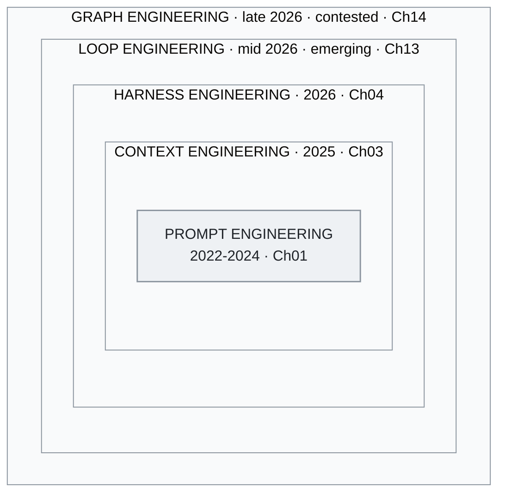

<!-- translation-sync:start -->
> 與 2026-10-31 英文版同步的機器輔助譯文，已作結構與內容覆核。程式碼和圖中標籤保留原文；閱讀時間按英文原文估算。
> [English source](../../../chapters/01-evolution.md) · [Sync record](../../SYNC.md)
<!-- translation-sync:end -->

<a id="chapter-01-the-three-generations"></a><!-- i18n-anchor -->

# 第 01 章：三個世代

> **一句話總結：** AI 工程已經從寫好 prompt 演進到圍繞 AI 模型設計整個作業系統。
>
> **為什麼重要：** 理解這個領域的走向, 幫助你挑選合適的工具, 避免過時的方法。
>
> **閱讀時間：** ~14 分鐘（按英文原文估算：3,108 個單詞 / 230 wpm）

**從 prompt engineering 到 context engineering 再到 harness engineering——以及為什麼這些邊界其實沒有你想的那麼重要。**

---

<a id="generation-1-prompt-engineering-2022-2024"></a><!-- i18n-anchor -->

## 世代 1：Prompt Engineering（2022-2024）

2022 年十一月 ChatGPT 上線時，人和大型語言模型之間唯一的介面就是一個文字框。由此誕生的學科叫做提示工程：精心設計輸入文字以獲得更好輸出的藝術與科學。

核心技術快速演進:

**Few-shot prompting**（Brown 等, 2020）證明在 prompt 內放入幾個例子就能顯著提升任務表現, 而完全不需要 fine-tuning。要讓模型分類情感, 你不再訓練模型, 而是給它三個例子, 然後問它第四個該怎麼分。

**Chain-of-thought（CoT）prompting**（Wei 等, 2022）顯示, 加一句"Let's think step by step"或在例子里加上推理過程, 能解鎖標準 prompting 看不到的多步推理能力。這可以說是首個跡象——**結構怎麼寫**和**問什麼內容**一樣重要。

**Prompt 模板** 成為標準抽象。LangChain、LlamaIndex 以及十幾個框架都提供了模板系統, 把變數注入精心設計的 prompt 結構。當時的心智模型很清楚：prompt 是程式, 模型是 runtime。

這個時代的其他技術包括:

- **ReAct**（Yao 等, 2022）: 在單一 prompt 結構內交錯推理與行動, 讓模型在一個 prompt 裡規劃並執行工具呼叫。
- **Tree of Thought**（Yao 等, 2023）: 探索多條推理路徑, 選擇最佳的一條。
- **Self-consistency**（Wang 等, 2022）: 取樣多條推理鏈, 取多數票決。

這個時代的侷限在於它的預設：LLM 互動的質量主要由 prompt 質量決定。當上下文視窗只有 4K-8K token、唯一輸入只有使用者文字時, 這是對的; 當模型可以吃下 100K+ token 並呼叫外部工具之後, 這就不再成立。

<a id="what-this-era-got-right"></a><!-- i18n-anchor -->

### 這個時代做對了什麼

Prompt engineering 確立了一件事: **結構很重要**。好 prompt 和壞 prompt 的差別不是 vibes, 而是資訊架構。這個洞察延續到了之後的一切。

<a id="what-this-era-missed"></a><!-- i18n-anchor -->

### 這個時代漏掉了什麼

它把 context window 當成靜態產物。你寫好一個 prompt, 提交, 拿到回應。Context window 本身可以**在 runtime 由多個來源動態構建**——這是下一代的洞察。

---

<a id="generation-2-context-engineering-2025"></a><!-- i18n-anchor -->

## 世代 2：Context Engineering（2025）

2025 年中, Andrej Karpathy 發了一段後來被瘋狂轉傳的話:

> "I've been thinking about this and I think the right term for what most people actually need to get good at is not 'prompt engineering' but 'context engineering.' The art and science of filling the context window with just the right information for the next step."

這次重構很重要, 因為它把焦點從**指令**（prompt）轉移到**整個資訊包**（context window）。一次現代 LLM 呼叫的 context window 遠不止使用者 prompt:

- 定義行為與限制的系統指令
- RAG 流程檢索到的檔案
- 工具定義和 schema
- 對話歷史（選擇性壓縮過）
- 動態選擇的 few-shot 例子
- 關於當前任務的結構化後設資料

Prompt 只是其中一塊元件。Context engineering 是把這些全部協同安排。

<a id="the-six-techniques"></a><!-- i18n-anchor -->

### 六大技術

[Towards AI 的分析](https://towardsai.net/) 指出 context engineering 的六大核心技術:

1. **Retrieval-Augmented Generation（RAG）**: 在查詢時拉取相關檔案
2. **工具與 API 整合**: 用結構化 schema 給模型外部能力
3. **記憶管理**: 在對話回合與 session 間維持相關資訊
4. **動態 prompt 構建**: 由模板、檢索內容和 runtime 狀態組裝 prompt
5. **Context window 最佳化**: 管理在有限 token 預算內放什麼、不放什麼
6. **指令層級**: 系統、開發者、使用者指令之間的優先序

<a id="lessons-from-manus"></a><!-- i18n-anchor -->

### 來自 Manus 的教訓

[Manus](https://manus.im/) 是 2025 年話題度最高的 AI agent 平臺之一, 分享了大規模 context engineering 的關鍵教訓:

**KV-cache 洞察**: Manus 把 context window 工程化, 維持高 KV-cache 命中率——確保之前 attention 計算出來的 key-value 對可以跨回合重用。這大幅降低 latency 和成本。原則是: 安排 context 讓**字首穩定**, 僅**字尾**在呼叫之間變。

**100:1 比率**: Manus 報告每 1 個輸出 token 大約消耗 100 個 context token。這翻轉了輸出 token 主導成本的常見假設。真正的工程挑戰不是產生文字, 而是**選擇什麼 context 給模型**。

**Context 是產品**: Manus 把 context window 構建當作核心產品功能, 不是實現細節。他們 agent 的質量直接對應 context 組裝管線的質量。

<a id="the-taxonomy-shift"></a><!-- i18n-anchor -->

### 分類的轉變

Context engineering 把 LLM 應用開發從"write good prompts"重構為"build good information pipelines."。模型變成對收到的任何 context 進行推理的引擎。工程挑戰往上游移動——到檢索、過濾、排序、壓縮與組裝。

但即使這個框架也有上限。它說明了**進入模型的是什麼**, 但沒說明**模型周圍的系統如何運作**。這需要再一次轉變。

---

<a id="generation-3-harness-engineering-2026"></a><!-- i18n-anchor -->

## 世代 3：Harness Engineering（2026）

2025 年末到 2026 年初, 兩份有影響力的內容把下一次演進正式化:

**Birgitta Böckeler**（ThoughtWorks）於 2026 年四月在 Martin Fowler 的 *Exploring Generative AI* 備忘錄系列中發表分析，主張 LLM 應用最有影響力的工程工作不是模型訓練或提示詞設計，而是*系統編排層*，即圍繞模型的工具、路由、記憶、規劃和錯誤恢復系統，將模型呼叫編排成可靠的工作流程。

**OpenAI 的 Codex 團隊**已經發布了關於智慧體編碼中系統編排層的案例資料（公開材料見 openai.com/index/introducing-codex）。廣為引用的"three engineers / ~1M lines / ~1,500 PRs"數字，在 2025-2026 年 OpenAI 的演講和文章中流傳；其核心觀察是，Codex 的質量主要取決於編排層而非模型，即決定*何時*呼叫模型、提供*什麼上下文*、開放*哪些工具*，以及*如何*驗證與從錯誤中恢復的系統。

<a id="the-phil-schmid-analogy"></a><!-- i18n-anchor -->

### Phil Schmid 的類比

[Phil Schmid](https://www.philschmid.de/)（Hugging Face）提出了讓這個概念清晰成形的類比：

- **模型是 CPU**——原始計算能力
- **Context window 是 RAM**——當前操作的工作記憶體
- **Harness 是作業系統**——排程、資源管理、I/O、錯誤處理、使用者介面

這個類比說明了為什麼 harness engineering 重要: 沒人會出貨一個沒有 OS 的 CPU。模型必要但不充分。Harness 決定模型實際能完成什麼。

<a id="the-meta-harness-paper-and-the-6x-gap"></a><!-- i18n-anchor -->

### Meta-Harness 論文與 6x 差距

2026 年初發表的研究量化了從業者此前已有的猜測：在複雜任務中，一個裸模型與一個配有良好編排層的模型，表現大約相差 **6x**。同一模型，權重相同、訓練資料相同，卻會因編排層質量不同而產生六倍的結果差距。

這意味著對大多數實際應用來說, harness engineering 比模型改進有更大槓桿。一個好 harness 配上好模型, 跑贏一個一般 harness 配頂尖模型。

<a id="the-impact-framework"></a><!-- i18n-anchor -->

### IMPACT 框架

2020s 中期的從業者討論中，IMPACT 助記詞逐漸成為評估系統編排層質量的檢查清單：

- **I**nstructions——系統指令的清晰度與完整度
- **M**emory——跨 session 的持續與檢索
- **P**lanning——任務分解與排序
- **A**ctions——工具可用性與可靠性
- **C**ontext——相關資訊的動態組裝
- **T**esting——評估與質量保證迴路

IMPACT 把 context engineering 定位為更廣 harness engineering 學科裡的**一個元件**（"C"）。這種巢狀是關鍵的結構洞察: context engineering 在 harness engineering **之內**, 不是被它取代。

<a id="meta-acquires-manus-2b"></a><!-- i18n-anchor -->

### Meta 收購 Manus（~$2B）

2026 年初，Meta 以約 $2 billion 收購 Manus。這場收購被廣泛解讀為 Meta 購買的是*編排層，而非模型*。Meta 已經擁有 Llama，缺少的是一套在生產中得到驗證、用於上下文組裝、工具編排及智慧體執行時管理的系統。

收購驗證了那個論點: LLM 生態系統裡最有價值的工程, 越來越多在編排層, 而非模型層。

---

<a id="the-key-insight-coexistence-not-replacement"></a><!-- i18n-anchor -->

## 關鍵洞察：共存而非取代

這三個世代不是清晰的歷史階段, 不是後一個取代前一個。它們是**巢狀層**, 在每個生產系統內共存:

```
+--------------------------------------------------+
|              HARNESS ENGINEERING                  |
|  +--------------------------------------------+  |
|  |          CONTEXT ENGINEERING                |  |
|  |  +--------------------------------------+  |  |
|  |  |       PROMPT ENGINEERING             |  |  |
|  |  |                                      |  |  |
|  |  |  System prompts, CoT, few-shot,      |  |  |
|  |  |  instruction formatting              |  |  |
|  |  +--------------------------------------+  |  |
|  |                                            |  |
|  |  RAG pipelines, memory, tool schemas,      |  |
|  |  context window optimization               |  |
|  +--------------------------------------------+  |
|                                                  |
|  Skill routing, planning loops, error recovery,  |
|  progressive disclosure, multi-agent coord       |
+--------------------------------------------------+
```

*圖：將同樣的巢狀關係繪製成圖。實線框是本章編號的三個世代；外側兩個框是第 13 章與第 14 章討論的爭議層，有意放在編號體系之外。*



一個 harness 工程師仍然寫 prompt, 仍然做 context engineering。但他還要建構**系統**——決定何時用哪個 prompt、為每種情境組裝哪些 context、出錯時如何恢復。

演進不是拋棄早期技術, 而是認識到它們必要但不充分——並在它們之上建構那些把原始 LLM 能力轉化為可靠、生產級應用程式的層。

上海交通大學及合作機構的 19 位作者在綜述 **"Externalization in LLM Agents: A Unified Review of Memory, Skills, Protocols and Harness Engineering"**（arXiv 2604.08224，April 9, 2026）中，獨立採用了與本章相同的三層組織方式：在其框架裡，領域從*權重*走向*上下文*，再走向*編排層*，並將記憶、技能、協議和系統編排工程視為由編排層統一整合的四個外化元件。對於來自學術文獻的讀者，這種趨同值得標註：這一框架既非從業者專屬，也非本指南獨創，2026 年四月下旬的學術綜述同樣選擇了這一組織主軸。

---

<a id="an-emerging-fourth-generation-loop-engineering-mid-2026"></a><!-- i18n-anchor -->

## 新興的第四世代？迴圈工程（2026 年中）

本章標題有意保留為*三個世代*。但在 2026 年六月，第四個候選層的成形速度值得在此記錄，儘管它還太新，尚不適合納入編號序列。一週之內，Peter Steinberger 在六月 7 日廣泛傳播的帖子指出，你"shouldn’t be prompting coding agents anymore ... You should be designing loops that prompt your agents,"，Addy Osmani 同日的文章為其命名為**迴圈工程**，Boris Cherny（Claude Code）則將自己的工作概括為"writing loops"。從業者開始描述*編排層之上*的一個層次：系統按計劃替你提示智慧體、生成輔助智慧體，並自行補充輸入。

倡導者對其與第 3 世代的關係給出了明確界定。Osmani 將迴圈工程放在"one floor above the harness"：在他的框架中，迴圈就是編排層，"but it runs on a timer, it spawns little helpers, and it feeds itself."。這延續了本章已有的巢狀邏輯：迴圈只是最外面的框，包裹編排、上下文和提示，因此迴圈工程師仍然寫提示詞、做上下文工程、構建編排層。迴圈與普通排程器的差別，是每次執行都讀取當前狀態、重新作出決定，而非按時執行固定命令。

有兩項誠實限定，使它暫時留在編號世代之外。撰寫時，這個術語約出現五週，完全存在於從業者討論之中，包括部落格、播客與 X，尚無學術文獻支撐；讀者反應也分成兩派，一派認為是真正的轉變，另一派認為只是對排程過早重新包裝。因此，本指南將迴圈工程列為*新興概念*而非定論，對其他尚未經原始來源及時間考驗的主張也採取同樣立場。[第 13 章](13-loop-engineering.md)完整介紹該框架，將每個關鍵論斷關聯到來源，並明確指出空白，而非自行補齊。

命名機器此後又執行了一輪。2026 年七月中旬，距離迴圈工程那一週六週後，第二個候選概念依照同樣路徑形成：**圖工程**，主張迴圈之上還有圖，即明確連線規定存在哪些智慧體、誰可以向誰委派，以及各個迴圈如何相互監督和糾正。另一篇 Steinberger 帖子成為催化劑（標註日期的來源寫作 July 18, 2026，也可能是美國時間七月 17 日），數天內便出現一波文章，反對意見也迅速出現：LangChain 的官方回應把圖工程列在提示、上下文、編排與迴圈工程之後，同時指出，將智慧體系統表示為圖已有三年實踐，迴圈只是有向迴圈圖，所以新出現的只有名稱。第 14 章為這個術語設定了明確的存續檢查關口，並於 September 15, 2026 執行。結果分成兩部分：圖工程仍在流傳，證據包括跨越三個月、並非回應最初帖子的文章，一個教授智慧體組織含義的付費課程，以及一篇九月教程；然而，在所檢查的文件中未發現廠商採用這個術語，兩家廠商推出了該術語所指的治理能力，卻從未使用其名稱，其中一家甚至在術語出現前一個月便已開始。記錄的結論是：這個術語作為多智慧體協調的爭議性名稱存活了下來，但其作為獨立層次的地位尚未得到證明，因此仍不納入編號世代。本章將多智慧體協調放在編排層內的處理，仍是一種有效的替代解釋，而非臨時佔位。[第 14 章](14-graph-engineering.md)附有註明日期的評分表，並給予懷疑意見同等分量。

---

<a id="three-things-to-take-away"></a><!-- i18n-anchor -->

## 三個要點

- **各世代相互巢狀，而非彼此取代。** 系統編排工程師仍然編寫提示詞、進行上下文工程，這也是 IMPACT 用"C"將上下文工程包含在內的原因。
- **Meta 花了約 $2 billion 購買編排層。** Meta 已有 Llama，缺少的是經過生產驗證的上下文組裝與工具編排系統，因此這次收購被理解為購買編排層，而非模型層。
- **命名跑在證據之前。** 迴圈工程和圖工程都由文章浪潮推動出現，而非學術浪潮，因此本章把它們保留在編號的三個世代之外。

---

<a id="sources"></a><!-- i18n-anchor -->

## 來源

- Brown, T. 等（2020）. "Language Models are Few-Shot Learners." [arXiv:2005.14165](https://arxiv.org/abs/2005.14165)
- Wei, J. 等（2022）. "Chain-of-Thought Prompting Elicits Reasoning in Large Language Models." [arXiv:2201.11903](https://arxiv.org/abs/2201.11903)
- Yao, S. 等（2022）. "ReAct: Synergizing Reasoning and Acting in Language Models." [arXiv:2210.03629](https://arxiv.org/abs/2210.03629)
- Yao, S. 等（2023）. "Tree of Thoughts: Deliberate Problem Solving with Large Language Models." [arXiv:2305.10601](https://arxiv.org/abs/2305.10601)
- Wang, X. 等（2022）. "Self-Consistency Improves Chain of Thought Reasoning in Language Models." [arXiv:2203.11171](https://arxiv.org/abs/2203.11171)
- Karpathy, A.（2025 年中）. 關於 "context engineering" 的公開發言; 在 X 與 AI engineering 社群廣為流傳, 奠定了這個領域採用的工作定義。
- Manus.（2025）. "Context Engineering Lessons from Building Manus." [manus.im/blog](https://manus.im/blog) ——KV-cache 命中率作為運營指標、append-only context、工具 logit-bias masking、滾動 todo-list 重寫。
- Böckeler, Birgitta.（2026 年四月 2 日）. "Harness engineering for coding agent users." martinfowler.com（*Exploring Generative AI* 系列）。[https://martinfowler.com/articles/harness-engineering.html](https://martinfowler.com/articles/harness-engineering.html) ——Guides vs. Sensors、Computational vs. Inferential 分類。
- OpenAI. Codex 公開材料：[https://openai.com/index/introducing-codex](https://openai.com/index/introducing-codex)。用於支撐 Codex 的編排層設計框架；廣為引用的"three engineers / ~1M lines / ~1,500 PRs"數字在 2025-2026 年 OpenAI 演講與文章中流傳，此處作為社群引述報告，而非歸於某一篇權威原文。
- Schmid, Philipp. "The New Skill in AI is Not Prompting, It's Context Engineering" 與續篇。[https://www.philschmid.de/context-engineering](https://www.philschmid.de/context-engineering); [https://www.philschmid.de/context-engineering-part-2](https://www.philschmid.de/context-engineering-part-2) ——模型 = CPU、Context = RAM、Harness = OS 類比。
- IMPACT 助記詞。Intent / Memory / Planning / Authority / Control flow / Tools，即意圖、記憶、規劃、許可權、控制流與工具，是 2020s 中期從業者討論中出現的六維編排層設計清單。本章將它用作教學框架，不歸於某一特定原始來源。
- Meta/Manus 收購報道.（2026）. 多個來源。
- Zhou, C. 等（2026 年四月）. "Externalization in LLM Agents: A Unified Review of Memory, Skills, Protocols and Harness Engineering." [arXiv:2604.08224](https://arxiv.org/abs/2604.08224) ——上海交通大學等機構 19 位作者的綜述，獨立使用權重 → 上下文 → 編排層的三層歷史框架。在本章"Coexistence, Not Replacement"一節中引用，用以說明從業者論點與學術文獻的趨同。
- Steinberger, Peter（@steipete）. 推動"design loops that prompt your agents"框架出現的帖子（2026 年六月 7 日）。[https://x.com/steipete/status/2063697162748260627](https://x.com/steipete/status/2063697162748260627) ——在"Emerging Fourth Generation"一節引用；帖子本身沒有使用"loop engineering."這個詞。
- Osmani, Addy. "Loop Engineering"（2026 年六月 7 日）。[https://addyosmani.com/blog/loop-engineering/](https://addyosmani.com/blog/loop-engineering/) ——為該實踐命名的文章；本章第四世代一節中"one floor above the harness"關係的來源。
- Cherny, Boris. Lenny's Podcast / Lenny's Newsletter 訪談（2026 年中）。[https://www.lennysnewsletter.com/p/head-of-claude-code-what-happens](https://www.lennysnewsletter.com/p/head-of-claude-code-what-happens) ——"my job is to write loops"的框架；這是一句口述引文，不同媒體轉寫並不一致。
- Runkle, Sydney 和 Chase, Harrison（LangChain）. "3 Years of Graph Engineering with LangGraph"（2026 年七月 22 日）。[https://www.langchain.com/blog/3-years-of-graph-engineering-with-langgraph](https://www.langchain.com/blog/3-years-of-graph-engineering-with-langgraph) ——將圖工程列在提示、上下文、編排與迴圈工程之後，同時主張該實踐已有三年；本章新興世代一節中可歸約為有向迴圈圖的來源。
- Perez, Carlos E. "From Loop Engineering to Graph Engineering?" Intuition Machine（2026 年七月 19 日）。[https://medium.com/intuitionmachine/from-loop-engineering-to-graph-engineering-d3ebeb08511c](https://medium.com/intuitionmachine/from-loop-engineering-to-graph-engineering-d3ebeb08511c) ——對 2026 年七月圖工程框架的首次理論擴充套件；用以支援迴圈監督迴圈的解釋。

---

*下一章：[第 02 章：RAG、長上下文與知識圖譜](02-knowledge-layer.md)*
