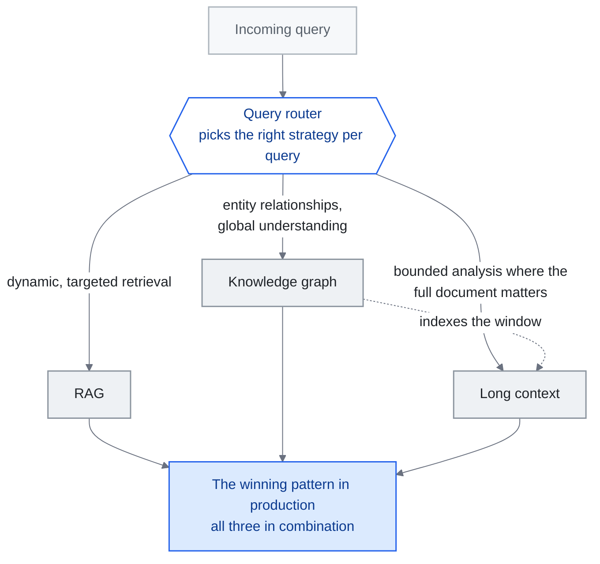

<!-- translation-sync:start -->
> 與 2026-10-31 英文版同步的機器輔助譯文，已作結構與內容覆核。程式碼和圖中標籤保留原文；閱讀時間按英文原文估算。
> [English source](../../../chapters/02-knowledge-layer.md) · [Sync record](../../SYNC.md)
<!-- translation-sync:end -->

<!-- i18n-anchor -->

# 第 02 章：RAG、長上下文與知識圖譜

> **一句話總結：** 給 AI 取得知識有三種主要方法: 搜資料庫（RAG）、喂長檔案、或在圖裡連結事實。
>
> **為什麼重要：** 如果你用 AI 處理任何關於自己資料的事情, 這章解釋哪種做法最適合你的情境。
>
> **閱讀時間：** ~16 分鐘（按英文原文估算：3,453 個單詞 / 230 wpm）

*圖："Hybrid Architectures: The Convergence" 部分的三路選擇，圍繞該部分放置在其獲勝生產模式末尾的查詢路由器繪製。路由器外的每個邊緣都會命名沿該分支傳送查詢的需求。虛線邊緣是 "KG as Semantic Backbone for Long Context" 部分的單獨宣告——該圖索引了一個它不再需要替換的視窗——並且匯聚在混合盒上的邊緣承載了本章的論點，即工程工作是路由器，而不是選擇。*

**知識檢索層——什麼有效、什麼無效, 為什麼答案几乎永遠是"hybrid."。**

---

<!-- i18n-anchor -->

## RAG 沒死

更大的上下文 windows 擴充套件了設計空間，但視窗大小本身並不能決定系統使用證據的可靠性。 [Liu et al.](https://arxiv.org/abs/2307.03172) 表明答案質量可能取決於相關資訊在長輸入中出現的位置。針對您自己的問題評估檢索和全上下文方法，包括答案質量、token使用、延遲以及當前證據如何到達模型。

RAG 沒死, 它在演化。問題從來不是"RAG or not RAG"——而是"what kind of RAG, combined with what else."。

---

<!-- i18n-anchor -->

## 成本現實

RAG 的經濟論點仍然壓倒性。

一個典型 RAG 管線檢索 5-20 個相關 chunk（約 2,000-8,000 token）, 把它們喂入模型呼叫。同樣查詢的 context-stuffing 做法可能需要載入 500K-1M token 的來原始檔。

**每查詢成本對比（約略, 2026 年中價格）:**

| 做法 | 輸入 token | 約略成本 | 相對成本 |
|------|-----------|---------|---------|
| RAG（針對性檢索） | ~5,000 | ~$0.00008 | 1x |
| Context-stuffing（全庫） | ~500,000 | ~$0.10 | 1,250x |

這不是四捨五入的誤差。在企業規模——每月數百萬查詢——每月推論成本 $80 與 $100,000 的差異決定專案是否能撐過預算審查。

檢索可以減少輸入token的使用，但總成本還包括索引、檢索、快取和任何額外的模型呼叫。將完整的管道與相同答案質量目標的完整上下文基線進行比較；更便宜的設計取決於語料庫大小、查詢量和模型定價。

---

<!-- i18n-anchor -->

## 長上下文：何時有效, 何時無效

長上下文視窗（128K、200K、1M+ token）對特定用例是真正變革性的:

**長上下文擅長的地方:**
- **靜態、有邊界的檔案分析**: 分析單一合同、codebase 檔、研究論文, 整個相關語料能放進視窗
- **交叉參照任務**: 在一組固定、一次載入的檔案中找連結
- **總結**: 把大量但有限的輸入濃縮成結構化輸出

**長上下文崩潰的地方:**

**"Lost in the middle"退化。** [Liu et al.（2023）](https://arxiv.org/abs/2307.03172) 的研究顯示, LLM 對放在長 context 中間的資訊表現, 顯著差於放在頭或尾的。後續模型改進減少但沒消除這個效應。截至 2026 年初, 當相關資訊埋在 500K+ token 的 context 中時, 模型仍顯示可衡量的準確度退化。

**動態知識庫。** 如果你的知識庫每小時更新（產品庫存、客服工單、新聞流）, 你不能在每次 context window 都重新 embed 整個語料。RAG 的檢索步驟天然處理更新——新檔案被索引並立即可檢索, 不需改 prompt 結構。

**多租戶隔離。** 長上下文在許可權控制上掙扎。當來自多個使用者或許可權級別的檔案存在同一語料中, RAG 管線能在檢索時強制過濾。Context-stuffing 需要小心（且容易出錯）的檔案分隔。

**規模擴大時的延遲。** 即使經過推理最佳化，處理 1M token 所需時間也顯著長於處理 5K token。對於要求亞秒響應的使用者應用，針對性檢索更有優勢。

<!-- i18n-anchor -->

### 2026 更新：Titans + MIRAS 重構長上下文取捨

上面所有限制都假設 Transformer 風格的上下文視窗: 一段被 attention 讀取的扁平 token, 每 token 成本不分位置都一樣, 同樣的"lost in the middle"失效模式。**Titans + MIRAS**, Google Research 2026 年 四月的架構家族, 打破這個假設。在 Titans 中, 記憶不是 attention 視窗——它是**可訓練神經模組**, 在推論期間用梯度下降更新自己的權重, 所以模型字面上把長曆史壓縮成權重更新, 而非作為 token 向前攜帶。MIRAS 提供讓這種邊推論邊學過程穩定的訓練配方。在引數量相當下, Google 報告 Titans 在長距回憶與多跳推理上優於 Mamba-2、Gated DeltaNet、Transformer++。這並不反駁原本的長上下文限制——那些對 GPT-4 Turbo、Gemini 1.5、Claude 仍在用的 attention 視窗正規化仍成立——但它確立**"attention budget is scarce"框架現在是單一架構家族的屬性, 不是普遍約束**。對從業者, 這意味著長上下文取捨不再是單一曲線。現在至少有兩條: attention 視窗曲線（迷失在中間和每 token 成本主導）與可訓練記憶曲線（成本轉向推論時權重更新, 失效模式轉向穩定性與遺忘）。RAG 在兩者中都仍是強預設, 但 RAG 勝出的*理由*在每個範疇裡不同。

<!-- i18n-anchor -->

### 2026 年注意事項：有爭議的 12M token索賠

並非每項長上下文公告都經得起審視。初創企業 **Subquadratic** 在 May 5, 2026 推出 **SubQ**，聲稱透過 **Subquadratic Selective Attention（SSA）**提供 **12-million-token 視窗**。公司引用、由 Appen 執行的基準引人注目：比 FlashAttention 快 56x，在 6-12M token 下針藏乾草堆召回率為 98%，執行 RULER-128 花費 $8，相比 Claude Opus 4.6 的 $2,600。June 19, 2026，《MIT Technology Review》的調查作出更審慎的解讀。Will Depue 等研究者反駁，公開證據尚不足以支援更強的"solved quadratic attention"表述，而且 SubQ **複用 Qwen 權重，而非從頭訓練**，因此效率數字是某個特定改造模型的性質，並非已經證明的通用結果。本倉庫不炒作的規則在此同樣適用：SSA 同時是一項有趣且未經驗證的主張；在獨立復現之前，長上下文使用者應將 12M 視為有爭議的數字。

---

<!-- i18n-anchor -->

## GraphRAG：當扁平檢索不夠

（命名說明：本章中的知識圖結構了系統*知道*的內容；2026 年 七月出現的單獨的 "graph engineering" 框架 --- 涵蓋在 [第 14 章](14-graph-engineering.md) --- 是關於多智慧體系統如何連線，而不是關於知識檢索。）

標準 RAG 把檔案當獨立的 chunk。這對事實查詢有效（"What is the return policy?"）, 但對要求*關係推理*的問題失敗（"Which suppliers are connected to both our delayed shipments and our quality complaints?"）。

[Microsoft GraphRAG](https://github.com/microsoft/graphrag)（2024-2025）引入混合做法: 從來原始檔構建知識圖, 然後用圖遍歷配合向量檢索回答查詢。

<!-- i18n-anchor -->

### GraphRAG 怎麼運作

1. **索引階段**: 檔案被處理以提取實體（人、組織、概念）和它們之間的關係。這些與傳統向量 embedding 一起形成圖結構。
2. **社群偵測**: 圖被分割成密集連線實體的社群。每個社群得到一個總結描述。
3. **查詢階段**: 給定查詢, 向量相似度*與*圖遍歷都被用來檢索相關 context。實體關係提供扁平檢索錯過的多跳推理路徑。

<!-- i18n-anchor -->

### GraphRAG 何時重要

- **多跳查詢**: "Who are the common investors between companies that went public in 2025 and companies that were acquired?"——需要遍歷關係鏈
- **以實體為中心的推理**: 關於特定實體與它們對其他實體之連結的問題
- **全域性總結**: "What are the main themes across all our customer feedback?"——社群總結提供這, 而不需處理每份檔案

<!-- i18n-anchor -->

### GraphRAG 何時過度

- 簡單事實查詢（標準 RAG 處理得很好）
- 長上下文能容納一切的小語料
- 實體提取質量低的用例（垃圾進, 垃圾出）

GraphRAG 的索引成本顯著高於標準 RAG。只在關係推理是核心需求時建圖, 不要作為預設。

<!-- i18n-anchor -->

### 2026 演化：KG 作為長上下文的語意骨幹

整個 2024 年及 2025 年的大部分時間，GraphRAG 被界定為 **RAG 的替代方案**，即為上下文視窗有限的模型換一種方式檢索文字塊。到 2026 年，這一框架已改變。隨著前沿模型將上下文視窗推至數百萬 token 的範圍，例如 Gemini 1.5 的 1M、Kimi 超過 2M 中文字元且仍在繼續擴大，問題不再是"how do we retrieve a small number of relevant chunks"，而是"how do we navigate a context that is already large enough to hold most of what we need."。

在這種情況下，知識圖譜不再是**檢索替代品**，而成為**長上下文的結構化索引層**。圖譜不負責決定載入哪些文字塊，因為文字塊已在視窗之中；它為模型提供視窗內容的語義地圖：有哪些實體、關係如何、哪些章節對應哪些主題、矛盾位於哪裡，以及哪些多跳路徑將問題連線到相關證據。GraphRAG 重新成為**語義骨架**，使智慧體能夠高效遍歷百萬 token 視窗，而不只是為其誕生時的 8K-token 視窗繞路。2026 年四月出現的可訓練記憶模組 Titans + MIRAS 不會取代這一角色；早期證據表明，知識圖譜與可訓練記憶將在生產棧中**共存，而且很可能組合使用**，圖譜在可訓練模組已壓縮排權重的內容之上提供帶型別、可查詢的結構。2026 年六月，**Agents-K1**（"Agents-K1: Towards Agent-native Knowledge Orchestration,"，arXiv 2606.13669，June 11, 2026）成為這一圖譜索引層角色的首個大規模執行案例：將 **2.46 million 篇論文**處理為智慧體原生知識圖譜，公開發布 **1-million-paper Scholar-KG**，報告圖譜用作檢索底座後，Frontierscience-Research 下游成績顯著提升，Gemini-3 從 7.9% 至 24.6%，GPT-5.2 從 25.2% 至 39.4%。2026 年九月的一項對照研究又為索引層主張增加此前缺少的論據：在 48 個合成案例中，更換底層模型後，固定模式的圖記憶幾乎不變，壓縮筆記記憶卻並非如此。因此，在模型不斷更替的系統棧裡，圖譜成為可移植的一層（[第 6 章](06-agent-memory.md)記錄完整結果及小樣本限定）。

<!-- i18n-anchor -->

### 2026 年更新：圖形工具整合，智慧體記憶分裂（2026 年七月）

2026 年中期對圖形工具格局的檢查（透過 GitHub API 驗證的 GitHub 資料，2026 年七月）顯示了三個不同的故事：

**這些框架有了新的領導者。** [HKUDS/LightRAG](https://github.com/HKUDS/LightRAG)（EMNLP 2025 論文；MIT 許可），輕量級圖+向量雙層框架，已經取代 Microsoft 成為最高星圖 RAG 框架，星數約為 38k，而 2026 年七月約為 35k -- 功能穩定增長而不是任何單一的地標。 Microsoft 的 GraphRAG 本身位於 v3.x 系列 ([v3.1.1 released 七月 18, 2026](https://github.com/microsoft/graphrag/releases)) 上，並且仍在積極開發中。

**基於圖的智慧體記憶分離為自己的類別。** 與 GraphRAG 的文件檢索譜系不同，一組專案現在使用圖作為*智慧體的記憶基礎*：[getzep/graphiti](https://github.com/getzep/graphiti)（~29k 星，2026 年七月；智慧體記憶的實時雙時態知識圖）、[Cognee](https://github.com/topoteretes/cognee) （其 [六月 26, 2026 release](https://www.cognee.ai/cognee-1-0-announcement) 公開了記憶體生命週期操作），以及 Neo4j Labs 的 [agent-memory](https://github.com/neo4j-labs/agent-memory)（["Lenny's Memory,"](https://neo4j.com/blog/developer/meet-lennys-memory-building-context-graphs-for-ai-agents/) 於 2026 年 一月推出），這標誌著圖資料庫供應商從 KG 構建直接轉向智慧體記憶。 [第 6 章](06-agent-memory.md) 涵蓋了圖儲存之外的生命週期和治理問題。

**證據基礎成熟 --- 一個旗艦產品停滯不前。** [GraphRAG-Bench](https://github.com/GraphRAG-Bench/GraphRAG-Benchmark) ("When to use Graphs in RAG: A Comprehensive Analysis for Graph Retrieval-Augmented Generation") 在 ICLR 2026 上被接受，是第一個被廣泛引用的關於基於圖的 RAG 何時實際優於普通 RAG 的中性分析 --- 對本節的直接實證答案"when GraphRAG matters / when it is overkill" 問題。與此同時，螞蟻集團的 [OpenSPG/KAG](https://github.com/OpenSPG/KAG)，中國生態系統的重要入口，卻陷入了沉寂：自 2026 年 一月 28 日以來沒有儲存庫推送，自 2025 年六月以來也沒有釋出——只是滑行而不是加速。

---

<!-- i18n-anchor -->

## 2025-2026 RAG 技術地景

RAG 本身已分支出多個專門做法。關鍵變體:

<!-- i18n-anchor -->

### Self-RAG（Asai et al., 2023）

[Self-RAG](https://arxiv.org/abs/2310.11511) 訓練模型決定 *何時* 需要檢索、*檢索什麼*、檢索內容是否真的相關。不是總是檢索, 模型生成特殊的"reflection tokens"來 gate 檢索過程。

**關鍵好處**: 減少不必要的檢索呼叫, 過濾掉不相關的檢索內容, 同時改善效率與準確度。

<!-- i18n-anchor -->

### Corrective RAG（CRAG）

[Corrective RAG](https://arxiv.org/abs/2401.15884)（Yan et al., 2024）在檢索後加一個驗證步驟。一個輕量評估器評估檢索檔案是否與查詢相關。如果信心低, 系統觸發網頁搜尋或替代檢索策略作為後備。

**關鍵好處**: 主要知識庫不含答案時優雅退化。

### Adaptive RAG

[Adaptive RAG](https://arxiv.org/abs/2403.14403)（Jeong et al., 2024）用分類器根據複雜度把查詢路由到不同檢索策略。簡單查詢直接檢索。複雜查詢多步檢索配思維鏈推理。模糊查詢多次檢索 pass 配結果融合。

**關鍵好處**: 把檢索成本與查詢複雜度匹配, 而非用一刀切管線。

### Golden-Retriever RAG

Golden-Retriever RAG 聚焦於檢索質量, 讓 LLM 自己改寫查詢再檢索。模型生成一個"ideal document"描述, 然後用作檢索查詢而非原始使用者輸入。

**關鍵好處**: 橋接使用者提問方式與檔案寫作方式之間的詞彙差距。

---

<!-- i18n-anchor -->

## RAG 作為"Context Engine"

[RAGFlow](https://github.com/infiniflow/ragflow), 開源 RAG 引擎, 2025 年底發表年度回顧, 主張"Retrieval-Augmented Generation"一詞不再捕捉現代 RAG 系統在做的事。他們提議的重構: RAG 已從檢索技術演化為 **Context Engine**——一個通用系統, 用於把異質來源的相關資訊組裝到模型 context window。

這一重新界定與[第 01 章](01-evolution.md)所述的上下文工程演進一致。RAG 不只是"retrieve and stuff."。現代 RAG 系統：

- 分類查詢意圖與複雜度
- 路由到合適的檢索策略（向量、關鍵字、圖、混合）
- 重排與過濾結果
- 壓縮檢索內容以符合 token 預算
- 用合適結構與 metadata 格式化結果
- 追蹤溯源以便引用與驗證

這是一個 context 組裝管線, 不是檢索步驟。RAG 系統*就是* context engine。

<!-- i18n-anchor -->

### 2026：RAG 成為託管雲基礎能力

Context Engine 重構在 2026 年中期產生了託管基礎設施的影響。 2026 年六月 17 日，AWS 在 GA 釋出了 **Amazon Bedrock 託管知識庫**：完全託管的 RAG 服務，具有六個內建聯結器（S3、SharePoint、Confluence、Google Drive、 OneDrive、Web Crawler）、自動同步、託管向量儲存和混合搜尋 --- 加上 **"agentic retrieval"**，可自動編排查詢計劃、臨時響應評估和多跳問題重新排名。重點不是功能列表，而是它標誌著的轉變：本章稱為上下文引擎的組裝管道正在從元件團隊手工構建轉向**商品雲基礎能力**團隊提供。與託管智慧體執行底座（第 4 章）一樣，DIY 版本並沒有消失——但 "stand up RAG over our documents" 的預設設定逐漸成為一種配置選擇，而不是一個工程專案。

---

<!-- i18n-anchor -->

## 混合架構：收斂

2025-2026 的證據清楚指向混合做法。沒有單一技術在所有維度都勝出:

| 維度 | RAG | 長上下文 | 知識圖 |
|------|-----|---------|--------|
| 每查詢成本 | 低 | 高 | 中 |
| 動態更新 | 強 | 弱 | 中 |
| 關係推理 | 弱 | 弱 | 強 |
| 設定複雜度 | 中 | 低 | 高 |
| 準確度（針對性） | 高 | 中 | 高 |
| 準確度（全域性） | 中 | 高 | 高 |

**生產中勝出的 pattern:**

1. **知識圖** 處理實體關係與全域性理解
2. **RAG** 處理特定查詢的動態、針對性檢索
3. **長上下文** 處理整份檔案重要的有界分析任務
4. **查詢路由器** 為每個查詢挑對的策略

這不是理論。規模化生產系統（企業搜尋、程式設計助手、客服 agent）三者並用。工程挑戰不是選一個——是建那個為每個查詢挑對工具的路由器。

---

<!-- i18n-anchor -->

## 關鍵專案與資源

| 專案 | 描述 | 連結 |
|------|------|------|
| Microsoft GraphRAG | 知識圖 + RAG 混合 | [github.com/microsoft/graphrag](https://github.com/microsoft/graphrag) |
| LightRAG |輕量級圖+向量 RAG 框架（星級最高，約 38k，2026 年七月）| [github.com/HKUDS/LightRAG](https://github.com/HKUDS/LightRAG) |
| RAGFlow | 配深度檔案理解的開源 RAG 引擎 | [github.com/infiniflow/ragflow](https://github.com/infiniflow/ragflow) |
| NirDiamant/RAG_Techniques | 綜合 RAG 實現集合 | [github.com/NirDiamant/RAG_Techniques](https://github.com/NirDiamant/RAG_Techniques) |
| LangChain | 含廣泛 RAG 工具的框架 | [github.com/langchain-ai/langchain](https://github.com/langchain-ai/langchain) |
| LlamaIndex | LLM 應用的資料框架 | [github.com/run-llama/llama_index](https://github.com/run-llama/llama_index) |
| Chroma | 開源 embedding 資料庫 | [github.com/chroma-core/chroma](https://github.com/chroma-core/chroma) |

---

<!-- i18n-anchor -->

## 需要帶走的三件事

- **較大的視窗並不能解決檢索選擇。** 比較系統實際服務的問題的答案質量、token使用、延遲和證據新鮮度。
- **沒有一種技術能夠在每個維度上獲勝。** 成本、關係推理和設定複雜性各自選擇不同的獲勝者，這就是生產堆疊同時執行這三個方面的原因。
- **困難的部分是路由器，而不是選擇。** 本章的獲勝模式以查詢路由器結束，該查詢路由器為每個查詢選擇正確的策略，而該路由器是工程挑戰。

---

<!-- i18n-anchor -->

## 來源

- Liu, N. F. 等（2023）. "Lost in the Middle: How Language Models Use Long Contexts." [arXiv:2307.03172](https://arxiv.org/abs/2307.03172)
- Microsoft.（2024）. "GraphRAG: Unlocking LLM discovery on narrative private datasets." [microsoft.com/research](https://www.microsoft.com/en-us/research/blog/graphrag-unlocking-llm-discovery-on-narrative-private-datasets/)
- Asai, A. 等（2023）. "Self-RAG: Learning to Retrieve, Generate, and Critique through Self-Reflection." [arXiv:2310.11511](https://arxiv.org/abs/2310.11511)
- Yan, S. 等（2024）. "Corrective Retrieval Augmented Generation." [arXiv:2401.15884](https://arxiv.org/abs/2401.15884)
- Jeong, S. 等（2024）. "Adaptive-RAG: Learning to Adapt Retrieval-Augmented Large Language Models through Question Complexity." [arXiv:2403.14403](https://arxiv.org/abs/2403.14403)
- RAGFlow.（2025）. "Year-End Review: From RAG to Context Engine." [github.com/infiniflow/ragflow](https://github.com/infiniflow/ragflow)
- NirDiamant.（2025）. "RAG Techniques." [github.com/NirDiamant/RAG_Techniques](https://github.com/NirDiamant/RAG_Techniques)
- Google Research.（2026 年 四月）. "Titans + MIRAS: Helping AI Have Long-Term Memory." [research.google/blog/titans-miras-helping-ai-have-long-term-memory/](https://research.google/blog/titans-miras-helping-ai-have-long-term-memory/) ——可訓練記憶模組在相當尺寸下優於 Mamba-2 / Gated DeltaNet / Transformer++。
- AWS。 "Amazon Bedrock Managed Knowledge Base is now generally available"（2026 年六月 17 日）。 [https://aws.amazon.com/about-aws/whats-new/2026/06/amazon-bedrock-managed-knowledge-base/](https://aws.amazon.com/about-aws/whats-new/2026/06/amazon-bedrock-managed-knowledge-base/) ---完全託管的RAG；六個聯結器；託管向量儲存；混合搜尋；智慧體檢索（查詢計劃、臨時響應評估、重新排序）。
- 麻省理工學院技術評論。 "A startup claims it broke through a bottleneck that's holding back LLMs"（2026 年六月 19 日）。 [https://www.technologyreview.com/2026/06/19/1139313/a-startup-claims-it-broke-through-a-bottleneck-thats-holding-back-llms/](https://www.technologyreview.com/2026/06/19/1139313/a-startup-claims-it-broke-through-a-bottleneck-thats-holding-back-llms/) --- Subquadratic 透過 Subquadratic Selective Attention (SSA) 獲得 SubQ 12M token；澳鵬基準；威爾·德普埃（Will Depue）表示反對； SubQ 重複使用 Qwen 權重。框架有爭議。
- "Agents-K1: Towards Agent-native Knowledge Orchestration." arXiv 2606.13669（June 11, 2026）。[https://arxiv.org/abs/2606.13669](https://arxiv.org/abs/2606.13669)：將 2.46M 篇論文處理為智慧體原生知識圖譜；公開發布含 1M 篇論文的 Scholar-KG；Frontierscience-Research 的基線提升為 Gemini-3 7.9%→24.6%、GPT-5.2 25.2%→39.4%。
- HKUDS。 "LightRAG: Simple and Fast Retrieval-Augmented Generation"（EMNLP 2025）。截至 2026 年 七月，[github.com/HKUDS/LightRAG](https://github.com/HKUDS/LightRAG) --- 約 38k 星 vs microsoft/graphrag 約 35k (GitHub API)。
- Microsoft。 GraphRAG釋出。 [github.com/microsoft/graphrag/releases](https://github.com/microsoft/graphrag/releases) --- v3.1.1（2026年七月18日）；該專案的 2026 v3.x 系列。
- GraphRAG-工作臺。 "When to use Graphs in RAG: A Comprehensive Analysis for Graph Retrieval-Augmented Generation"（ICLR 2026）。 [github.com/GraphRAG-Bench/GraphRAG-Benchmark](https://github.com/GraphRAG-Bench/GraphRAG-Benchmark)
- Cognee。 "cognee 1.0"（2026 年六月 26 日）。 [Announcement](https://www.cognee.ai/cognee-1-0-announcement)。
- Neo4j。 "Meet Lenny's Memory: Building Context Graphs for AI Agents"（2026 年一月）。 [neo4j.com/blog/developer](https://neo4j.com/blog/developer/meet-lennys-memory-building-context-graphs-for-ai-agents/) --- 圖本機智慧體記憶庫（neo4j-labs/agent-memory）。
- OpenSPG/KAG 釋出。 [github.com/OpenSPG/KAG/releases](https://github.com/OpenSPG/KAG/releases) --- 最後一次儲存庫推送 2026 年 一月 28 日；最新版本 v0.8.0（2025 年六月），透過 GitHub API 驗證。
- 戈亞爾（Ankit）和雷·賈迪普（Ray Jaideep）。 "Does Your Agent's Memory Survive a Model Upgrade? A Controlled Study of Memory Portability." arXiv 2609.05339（2026 年九月 4 日）。 [https://arxiv.org/abs/2609.05339](https://arxiv.org/abs/2609.05339) --- 跨越原始歷史、RAG、壓縮筆記和結構化知識圖的 48 個合成案例；圖形記憶體對模型交換幾乎不變 (+0.0004 ± 0.0020)，而壓縮音符擺動 +9.91 / -13.28 點。小合成樣本，兩位作者，尚未復現。第 6 章中有完整介紹。

---

*上一篇：[第 01 章 -- The Three Generations](01-evolution.md)*

*下一頁：第 03 章——上下文工程深入探討（即將推出）*
