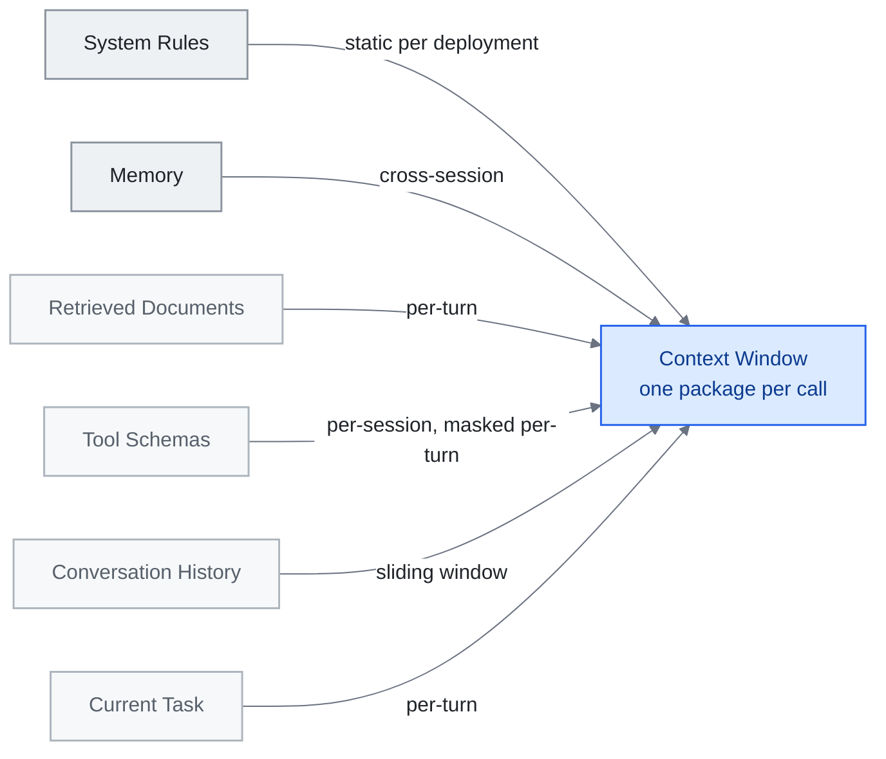

<!-- translation-sync:start -->
> 與 2026-10-31 英文版同步的機器輔助譯文，已作結構與內容覆核。程式碼和圖中標籤保留原文；閱讀時間按英文原文估算。
> [English source](../../../chapters/03-context-engineering.md) · [Sync record](../../SYNC.md)
<!-- translation-sync:end -->

<!-- i18n-anchor -->

# 第 3 章：Context Engineering —— 填充視窗的藝術

> **一句話總結：** Context engineering 是給 AI 在對的時間正好對的資訊的藝術——不多不少。
>
> **為什麼重要：** 更好的 context 意味著更好的 AI 答覆。這就是為什麼有些人從 AI 取得驚豔結果, 而其他人只得到普通回應。
>
> **閱讀時間：** ~13 分鐘（按英文原文估算：2,908 個單詞 / 230 wpm）

*圖：第 3.2 節的六層，從頂部最持久到底部最短暫，收斂於第 3.1 節定義的每次呼叫一個包上下文。箭頭標籤是每層的更新頻率——這就是每層需要自己的壓縮策略的原因。它們還爭奪相同的視窗：過度填充檢索的文件會淹沒當前任務訊號。*

> "Context engineering is the delicate art and science of filling the context window with just the right information for the next step."
> —— Andrej Karpathy, 2025 年 六月

如果 prompt engineering 是寫好一個問題, context engineering 就是建構圍繞它的整套簡報包。從一者到另一者的轉變, 標誌著從業者思考 LLM 系統方式的根本變化: 設計單元不再是單一指令, 而是*資訊環境*。

本章繪製這個地景——從理論框架到生產驗證的 pattern——並指向定義這個學科的主要來源。

---

<!-- i18n-anchor -->

## 3.1 從 Prompt 到 Context

"context engineering"一詞在 2025 年中進入主流, 當 Karpathy 在它與 prompt engineering 之間畫下清楚分界。Prompt 是靜態字串。Context 是模型所需一切的動態組裝包——指令、記憶、檢索檔案、工具定義、對話歷史、當下任務——以程式化方式組成, 每一回合都更新。

這個區分重要, 因為現代 agent 極少送兩次相同 context。每次推論呼叫都是路由邏輯、檢索管線、壓縮啟發法、工具可用性檢查的產物——這些一起決定視窗裝什麼、什麼被排除。

<!-- i18n-anchor -->

## 3.2 一個六層 Context 模型

參考 Anthropic 的 [Building Effective Agents](https://www.anthropic.com/engineering/building-effective-agents) 與相鄰從業者寫作中的 pattern, context window 可以有用地被分解為六個概念層, 由最持久到最短暫排序。這裡的標籤是本指南的教學綜合, 不是 Anthropic 自己發表的分類:

| 層 | 內容 | 典型持續 |
|----|------|---------|
| **System Rules（系統規則）** | 安全限制、角色定義、行為護欄 | 每部署靜態 |
| **Memory（記憶）** | 使用者偏好、先前 session 總結、學到的事實 | 跨 session |
| **Retrieved Documents（檢索檔案）** | RAG 結果、搜尋片段、檔案內容 | 每回合 |
| **Tool Schemas（工具 schema）** | 函式定義、API 規格、能力宣告 | 每 session 或每回合 mask |
| **Conversation History（對話歷史）** | 先前訊息、助手回應、工具呼叫結果 | 滑動視窗 |
| **Current Task（當下任務）** | 當下的使用者請求, 加上任何任務專屬注入 | 每回合 |

關鍵洞察是: 每一層有不同的更新頻率、不同的壓縮策略、不同的失效模式。把檢索檔案層塞太滿會淹沒當下任務訊號。記憶層填得不夠會迫使模型重新推導它本應已經有的 context。好的 context engineering 是六個層同時的平衡。

<!-- i18n-anchor -->

## 3.3 來自 Manus 的教訓：KV-Cache 是北極星

2025 年 七月, Yichao"Peak"Ji（Manus CTO）釋出一組生產教訓, 把 context engineering 圍繞單一運營指標重構: **KV-cache 命中率**。

Manus 在他們 agent 系統中觀察到穩定的 100:1 輸入對輸出 token 比。在那個比例下, 輸入成本主導一切。KV-cache 命中——之前算過的 key-value 對被重用而非重算——成為 latency 與成本的主要槓桿。

三個技術從這個洞察浮現:

1. **Append-only context 結構。** 永不重寫 context 的早期部分。中間的插入或編輯會讓快取的字首失效, 強制完全重算。把你的 context 設計為一份 log, 不是文件。

2. **用 logit bias 作工具 mask, 不要移除 schema。** 當一個工具暫時不可用, Manus 在 logit 層級壓制它的選擇, 而非把工具定義從 context 移除。移除定義改變 token 序列, 破壞快取。Mask 保留字首同時阻止選擇。

3. **滾動 todo-list 重寫。** 不是依賴模型從長對話早期回想目標, Manus 週期性在 context 末尾附上重寫過的 todo list。這利用 attention 中的近因偏差——最近 token 中的目標得到比埋在數千 token 之前同樣目標更強的 attention 權重。

這些是基礎設施級決策, 不是 prompt 級。它們說明為什麼"context engineering"需要系統思維。

**快取原則有了研究工具包（2026 年中）。** Manus 的規則原本是執行經驗；2026 年六月的兩篇論文將同一原則轉化為可測機制。**Still**（arXiv 2606.07878，June 5, 2026）以針對凍結基礎模型訓練的逐層 Perceiver，實現攤銷式、單遍 KV-cache 壓縮，報告在 **8k-128k 上下文中壓縮 8x-200x**，並在 **RULER 上比最強基線高 8-22 個點**。**TokenPilot**（arXiv 2606.17016，June 15, 2026）採用雙粒度設計：*攝取感知壓縮*階段在全域性穩定字首，*生命週期感知驅逐*階段在區域性追蹤各片段的效用；在 PinchBench 和 Claw-Eval 上，獨立會話設定成本減少 **61% / 56%**，連續會話設定則減少 **61% / 87%**。TokenPilot 的意義在於，以實際數字落實了本節定性描述的"append-only, don't bust the cache"原則：驅逐階段讓長期會話既保留有利於快取的字首，又不會無限增長。

**何時壓縮，怎樣壓縮（2026 年八月）。** 後續實證研究 "Practical Online KV Cache Compaction for LLM Agents"（arXiv 2608.00902，August 2, 2026），專門研究智慧體軌跡的壓縮，進一步收窄建議：立即壓縮會損害準確率；等智慧體自身未來查詢可充當代理查詢訊號時再壓縮，能恢復大部分損失。代理不理想時，按代理查詢誘發的注意力質量評分、驅逐 token 的方法（TE），比注意力匹配重建（AM）更穩健。在 BrowseComp-Plus、WideSearch 上，TE 將 KV 快取減少 80%，吞吐量還高於完全不壓縮，為本節定性描述的僅追加原則提供具體規則：等待訊號，然後驅逐，而非重建。

<!-- i18n-anchor -->

## 3.4 五種主導 Pattern

Aurimas Griciūnas 把浮現實務綜合為在生產系統中觀察到的五個反覆 pattern（標準寫作: "State of Context Engineering in 2026,", SwirlAI Newsletter, 2026 年 三月 22 日, [https://www.newsletter.swirlai.com/p/state-of-context-engineering-in-2026](https://www.newsletter.swirlai.com/p/state-of-context-engineering-in-2026); 也見"Breaking Down Context Engineering"）:

**漸進式揭露。** 不要前置載入一切。先呈現一個輕量索引; 只在模型（或路由邏輯）判定相關時展開段落。這是 context window 的 lazy loading 等價物。Anthropic 自家 agent skills 系統用這個 pattern——17 個技能在靜態時消耗約 1,700 token, 僅在呼叫時展開。

**Context 壓縮。** 在注入前總結、截斷、或蒸餾資訊。滑動視窗之外的對話歷史被壓成總結。檢索檔案被節錄成相關段落。目標是保留語意密度同時減少 token 數。

**Context 路由。** 不是所有查詢都需要相同 context。路由層檢視進來的請求, 選擇要包含哪些記憶庫、工具集、檔案集合。這是資料庫查詢規劃器的 context window 類比。

**檢索演化。** 靜態 RAG（檢索一次、注入、產生）讓位給迭代檢索, 模型可以在生成中途請求額外資訊。Context 不是一次組裝, 而是在生成過程中演化。

**工具與能力管理。** 當工具庫變大, 載入所有 schema 變得不可行。系統用 meta-tool pattern（按需返回相關工具 schema 的發現工具）或技能圖架構來保持工具層精簡。

**前沿實驗室修改了自己的規則（2026 年 七月）。** 上述五種模式是根據在許多系統中觀察到的實踐綜合得出的。 2026年七月24日，Anthropic釋出了Thariq Shihipar對其自身指南的第一方修訂版"The new rules of context engineering for Claude 5 generation models,"——標題是減法。 Claude Code 團隊為其 Claude 5 代型號刪除了超過 80% 的系統提示，編碼評估沒有明顯損失。 Anthropic 從其自己的編碼評估中報告了該數字；它沒有獨立進行基準測試。其背後的原因是旅行的部分。這篇文章主張從規則轉向判斷，給予有能力的智慧體原則和信任，而不是詳盡的指示；用於漸進式、即時上下文載入，而不是預先填充視窗；向智慧體介紹情況的方式與向個人介紹情況的方式相同，僅在他們贏得職位的情況下提供角色、限制和示例。第二個重申了上面的漸進式披露，現在有實驗室的生產證據支援。第一個削減違背了該學科建立的本能：它說，隨著模型的改進，上下文工程工作中越來越多的份額不是最佳化，而是積累的不信任，而針對該份額的正確舉措是刪除而不是調整。

**壓縮不是一項策略（2026 年八月）。** 上面的 KV-cache 工作和本節中的上下文壓縮都將視窗視為可互換token的預算。一項九位作者的研究（arXiv 2608.31057，2026 年八月 31 日）認為這是錯誤的記賬單位。透過分析 55 個存檔的編碼智慧體軌跡，它將工作記憶內容分為四類——指令、工件、工具輸出和智慧體生成的狀態——具有不同的大小、保留和表示配置檔案，並提出了一個四級評估框架，將儲存狀態、交付上下文、管理工作和任務或流程結果分開。用作者的話說，"equal token budgets do not imply equal delivered context or management cost." 他們測試了兩種語義資訊策略，即物件感知壓縮和基於檢索的策略，並警告校準增益在一個任務集上調整 "may not transfer to held-out tasks." 在 55 個軌跡上，這是一個開放的經驗發現，而不是一個固定的模式。實際後果是狹窄但尖銳的：跨視窗統一應用的單一壓縮規則已經對四種不同型別的物件做出了策略選擇，並且使該選擇變得盲目。

Compaction的監控邊界請參見[第 4 章](04-harness-engineering.md#48-harness-maintenance-the-stress-testing-imperative)。

<!-- i18n-anchor -->

## 3.5 學術地景

2025 年中帶來了 context engineering 作為正式研究領域的第一份綜合學術綜述: **"A Survey of Context Engineering for Large Language Models"**（Mei et al., arXiv 2507.13334, 2025 年 七月 17-21 日）, 它透過對 1,400+ 篇研究論文的系統分析, 為這個領域建立技術 roadmap。該綜述把設計空間沿兩個軸組織: **基礎元件**（context 檢索與生成、context 處理、context 管理）與**系統實現**（RAG、記憶系統、工具整合推理、多 agent 系統）。它的承重發現是基本能力不對稱: 當前模型在理解複雜 context 上極擅長, 但在產生同樣精緻的長篇輸出上有顯著侷限。對從業者, 這份綜述是這個領域最接近教科書的東西——它把一直在經驗上發現的事正式化: context engineering 不是單一技術而是有多個獨立維度的設計空間。

<!-- i18n-anchor -->

## 3.6 Agentic Context Engineering（ACE）

ACE 論文 **"Agentic Context Engineering: Evolving Contexts for Self-Improving Language Models"**（Zhang et al., arXiv 2510.04618, 2025 年 十月 6 日; 配套 repo 在 [github.com/ace-agent/ace](https://github.com/ace-agent/ace)）引入概念轉變: 把 context 視為不是靜態組裝而是**演化的 playbook**。在 ACE 系統中, context 是一份 agent 自己維護的活檔案——加觀察、更新計畫、修剪不相關歷史、根據任務進展重組自己的指令。報告中頭條收益: 在 agent 基準上 +10.6%, 在金融任務上 +8.6%, 配 adaptation latency 與 rollout 成本的減少; 在 AppWorld 排行榜上, ACE 在整體平均上和頂尖生產級 agent 持平, 在更難的 test-challenge split 上超越它, 即使用較小的開源模型。ACE 也命名它要工程對抗的失效模式: **簡潔偏差**（為簡潔總結丟掉領域洞察）與 **context 崩塌**（迭代重寫久了侵蝕細節）。

這把 context engineering 從純基礎設施關切（harness 在每次呼叫前組裝什麼）移到協作的（harness 準備的*以及*模型主動重塑的）。"context the system provides"與"context the model creates"之間的邊界變得流動。

ACE 系統典型在 context 內維持一個結構化 scratchpad——一個指定區域, 模型在那裡寫工作筆記、中間結果、修訂的計畫。Harness 跨回合保留這個區域, 同時按它自己的政策管理周圍的層。

<!-- i18n-anchor -->

## 3.7 實務含義

幾個原則從這個地景浮現:

- **衡量輸入 token, 不只輸出。** 在生產規模, 100:1 輸入/輸出比意味著 context 組裝成本主導。為快取命中與最少冗餘最佳化。
- **把 context 設計為分層系統。** 每一層有自己的更新政策、壓縮策略、失效模式。獨立處理它們。
- **預設用漸進式揭露。** 起步精簡。按需展開。包含不相關資訊的成本不只是 token——是退化的 attention 與增加的幻覺風險。
- **測試 context 組成, 不只 prompt。** 同樣 prompt 在不同 context 中產生不同結果。你的測試套件應該變化 context, 不只最終指令。
- **預期模型改進。** 當模型在長 context 推理上變好, 一些壓縮與路由策略變成不必要的開銷。用清楚的抽象邊界建構, 讓層可以被簡化或移除。

---

<!-- i18n-anchor -->

## 需要帶走的三件事

- **提示是字串，上下文是程式集。** 每個推理呼叫都是路由邏輯、檢索、壓縮和工具可用性檢查的產物，因此設計單元是包，而不是指令。
- **輸入token就是賬單。** 在 Manus 測量的 100:1 輸入輸出比下，KV-cache 命中率是延遲和成本的槓桿，這就是上下文構建為僅附加日誌的原因。
- **您設計的部分內容是積累的不信任。** Anthropic 為其 Claude 5 代模型刪除了超過 80% 的系統提示，沒有可測量的編碼評估損失，因此針對該部分上下文的正確做法是刪除而不是調整。

---

<!-- i18n-anchor -->

## 來源

- **Karpathy, Andrej.** 關於"context engineering"的公開發言（2025 年中）。在 X 與 AI engineering 社群廣為流傳的框架, 奠定這個領域採用的工作定義。
- **Anthropic.** "Building Effective Agents." Anthropic 工程部落格, 2024 年 十二月 19 日。[https://www.anthropic.com/engineering/building-effective-agents](https://www.anthropic.com/engineering/building-effective-agents) ——描述 orchestrator-worker pattern 與 evaluator-optimizer workflow; 本指南把第 3.2 節的六層概念框架作教學使用。
- **Ji, Yichao "Peak"**（Manus）. "Context Engineering Lessons from Building Manus." 博文, 2025 年 七月。[manus.im/blog](https://manus.im/blog) ——KV-cache 命中率作為運營指標、append-only context 結構、用 logit bias 作工具 mask、滾動 todo-list 重寫。
- **Griciūnas, Aurimas.** "State of Context Engineering in 2026." SwirlAI Newsletter, 2026 年 三月 22 日。[https://www.newsletter.swirlai.com/p/state-of-context-engineering-in-2026](https://www.newsletter.swirlai.com/p/state-of-context-engineering-in-2026)。也見 "Breaking Down Context Engineering": [https://www.newsletter.swirlai.com/p/breaking-down-context-engineering](https://www.newsletter.swirlai.com/p/breaking-down-context-engineering)
- **Mei, Lingrui et al.** "A Survey of Context Engineering for Large Language Models." arXiv 2507.13334, 2025 年 七月 17-21 日。[https://arxiv.org/abs/2507.13334](https://arxiv.org/abs/2507.13334) ——1,400+ 論文綜述, 把 context engineering 確立為正式研究領域。
- **Zhang, Qizheng et al.** "Agentic Context Engineering: Evolving Contexts for Self-Improving Language Models." arXiv 2510.04618, 2025 年 十月 6 日。[https://arxiv.org/abs/2510.04618](https://arxiv.org/abs/2510.04618)。配套 repo: [github.com/ace-agent/ace](https://github.com/ace-agent/ace)。把 context 框為演化的 playbook; 命名簡潔偏差與 context 崩塌。
- **Schmid, Philipp.** "The New Skill in AI is Not Prompting, It's Context Engineering" 與續篇。[https://www.philschmid.de/context-engineering](https://www.philschmid.de/context-engineering); [https://www.philschmid.de/context-engineering-part-2](https://www.philschmid.de/context-engineering-part-2)
- **LangChain 部落格.** Context engineering 報道在 [blog.langchain.com](https://blog.langchain.com) ——「Agent Engineer」作為從業者 pattern 的框架（無單一標準帖; 在此作為討論錨點引用）。
- **Willison, Simon.** [simonwillison.net](https://simonwillison.net) 上持續的 AI engineering 報道——把生態系串連的可親實務介紹。
- **仍然。** 攤銷單通 KV-cache 壓縮。 arXiv 2606.07878, 六月 5, 2026。 [https://arxiv.org/abs/2606.07878](https://arxiv.org/abs/2606.07878) --- 針對凍結基礎模型訓練的每層感知器； 8k-128k 上下文下的 8x-200x 壓縮；比 RULER 上最強基線高出 8-22 點。
- **TokenPilot.** 雙粒度 KV-cache 管理。 arXiv 2606.17016, 六月 15, 2026. [https://arxiv.org/abs/2606.17016](https://arxiv.org/abs/2606.17016) --- Ingestion-Aware Compaction（全域性字首穩定）+ Lifecycle-Aware Eviction（本地段實用程式跟蹤）；在 PinchBench 和 Claw-Eval 上，獨立會話成本降低 61% / 56%，連續會話成本降低 61% / 87%。
- **"Practical Online KV Cache Compaction for LLM Agents."** arXiv 2608.00902，August 2, 2026。[https://arxiv.org/abs/2608.00902](https://arxiv.org/abs/2608.00902)：智慧體軌跡壓縮的系統研究；延遲至代理查詢訊號可用，恢復立即壓縮損失的大部分準確率；代理不理想時，token 驅逐 TE 比注意力匹配重建 AM 更穩健；TE 將 KV 快取減少 80%，同時在 BrowseComp-Plus、WideSearch 上提高相對不壓縮的吞吐量。
- **Shihipar，塔裡克** (Anthropic)。 "The new rules of context engineering for Claude 5 generation models." Anthropic 部落格，2026 年 七月 24 日。[https://claude.com/blog/the-new-rules-of-context-engineering-for-claude-5-generation-models](https://claude.com/blog/the-new-rules-of-context-engineering-for-claude-5-generation-models) --- 報告 Claude 5 代模型的系統提示減少了 80% 以上，沒有測量編碼評估損失（Anthropic 自己的編碼評估，未進行獨立基準測試）；判斷規則，及時載入上下文，向智慧體提供簡報，就像對待一個人一樣。
- **Chen, Le 等人** "Measure Before You Manage: Evaluating Agent Working Memory in Coding Agents"（九位作者）。 arXiv 2608.31057，2026年八月31日。[https://arxiv.org/abs/2608.31057](https://arxiv.org/abs/2608.31057) --- 55個存檔的編碼智慧體軌跡；工作記憶物件的四類分類（指令、工件、工具輸出、智慧體生成的狀態）；四級評估框架（儲存狀態、交付上下文、管理工作、任務或流程結果）；測試了基於物件感知的壓縮和檢索策略；作者指出，"equal token budgets do not imply equal delivered context or management cost" 和校準增益 "may not transfer to held-out tasks." 小樣本，未重複。
