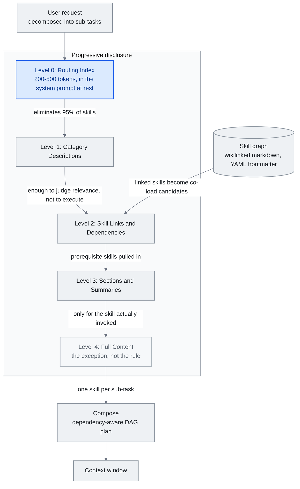

<!-- translation-sync:start -->
> 與 2026-10-31 英文版同步的機器輔助譯文，已作結構與內容覆核。程式碼和圖中標籤保留原文；閱讀時間按英文原文估算。
> [English source](../../../chapters/05-skill-systems.md) · [Sync record](../../SYNC.md)
<!-- translation-sync:end -->

<!-- i18n-anchor -->

# 第 5 章：Skill Systems —— 技能、技能圖與漸進式揭露

> **一句話總結：** Skill 是可重用的指令集, 告訴 AI 如何做特定任務; skill graph 把它們連成可導航的知識網路。
>
> **為什麼重要：** 不用每次都跟 AI 解釋同一件事, skill 讓你教一次就永遠複用那份知識。
>
> **閱讀時間：** ~22 分鐘（按英文原文估算：4,929 個單詞 / 230 wpm）

*圖：第 5.4 節的五個公開級別，第 5.5 節的技能圖提供瞭解決連結和依賴關係的級別，以及第 5.5 節組裝最終載入內容的組合計劃。 0 級的邊緣帶有這樣的論點：在讀取單個完整檔案之前，路由索引消除了 95% 的技能，這就是為什麼只有實際呼叫的一兩個技能才達到 4 級的原因。*

Skill 是預先打包的指令集——內含 prompt、工具配置、行為規則的自足束——在需要某種特定能力時被注入 agent 的 context window。它們是 agent 系統從少數內建行為擴充套件到數百上千專門能力, 同時不讓模型淹沒在不相關指令中的機制。

本章涵蓋技能系統的架構、它們造成的組合問題, 以及解決它的漸進式揭露 pattern。

---

<!-- i18n-anchor -->

## 5.1 技能概念

技能最簡單的形式是包含特定任務指令的 markdown 檔案（或結構化文字塊）。當使用者請求與技能的觸發條件匹配時，技能的內容將載入到上下文視窗中。當主體保持解除安裝狀態時，其廣告後設資料仍然需要花費token。

這與一個想涵蓋每種能力的整體系統 prompt 根本不同。一個描述 90 個工具與 50 種行為模式的系統 prompt 在使用者開始打字之前就可能消耗 50,000 token 以上。基於技能的系統只載入相關的, 讓基線 context 精簡, 把視窗容量保留給實際任務。

設計 pattern 借自軟體工程: skill 之於 agent 就像 plugin 之於應用。它們提供可擴充套件性而不臃腫。

<!-- i18n-anchor -->

## 5.2 Anthropic 技能生態系

Anthropic 在 2025 年 十月為 Claude Code 推出技能, 最初是個專案專用功能——`.claude/` 目錄下的 markdown 檔, Claude 在相關時能呼叫。格式刻意簡單: 一個含描述、觸發條件、指令的 markdown 檔。

到 2025 年 十二月，Anthropic 透過 Agentskills.io 將技能作為開放標準釋出，定義了任何智慧體系統都可以採用的可移植格式。

當前[規範](https://agentskills.io/specification)要求 `name` 與 `description`；可選欄位涵蓋許可證、相容性、任意後設資料，以及實驗性工具許可權。正則觸發器與依賴宣告屬於宿主約定，並非標準化欄位。這描述的是 October 31, 2026 檢查時的文件，不代表該日發生過規範變更。

生態系反應迅速。到 2026 年初, 官方倉庫累積超過 87,000 GitHub stars, 社群貢獻的技能超過 700,000。awesome-llm-skills、awesome-agent-skills（含來自官方平臺團隊的 1,000+ 技能）、awesome-claude-code 等收整合為主要發現頻道。

這種成長創造了技能本來要解決的問題: 太多能力爭搶有限 context 空間。

註冊規模於 2026 年中期正式建立。 2026 年六月 5 日，Vercel 將 **skills.sh API** 全面釋出——一個可查詢的登錄檔 API，索引來自開源生態系統的 **600,000 多個技能**，採用 OIDC token身份驗證（短暫、自動輪換、無長期秘密），速率限制為每分鐘**每個團隊和每個專案** 600 個請求，以及每個技能的安全稽核查詢。登錄檔附帶審計端點就隱含地承認這種規模的登錄檔也是一個攻擊面——第 5.10 節中的執行緒。

該技能基礎能力於 2026 年 八月完成了向生產基礎設施的遷移，大約是在本節開頭的 Claude Code 釋出後十個月。 Anthropic 在八月 19 日取消了 **技能 API 的測試版**，並在一天後的八月 20 日釋出了一篇配套部落格文章——Anthropic 自己的表面上存在差異，讀取為釋出滯後而不是兩個單獨的事件。 `/v1/skills` 現在是一個穩定的終點；不再需要 `skills-2025-10-02` beta 標頭，但仍被接受。這一舉措作為更廣泛的生產智慧體 GA 浪潮的一部分與計算機使用、瀏覽器使用和檔案 API 一起釋出，而 API 可透過 Claude 平臺和 Microsoft Foundry 獲得。

第二個更改於 十二 天前（即 **八月 7**）發生：GitHub 託管智慧體的託管技能。已安裝儲存庫的根 `.claude/skills` 目錄會在會話啟動時自動發現 - 無需單獨的釋出或安裝步驟。 Anthropic 自己的文件明確指出，安裝的儲存庫成為智慧體信任邊界的一部分，中間沒有審查步驟，它將實時 GitHub 儲存庫摺疊到同一類問題 §5.10 透過 AIR、Cloak-and-Detonate 和 Paperclip 事件進行跟蹤：任何可以寫入該儲存庫的人都可以新增或編輯智慧體視為生產指令的內容。

**可移植格式有了中立歸屬。** October 22, 2026，[Anthropic 將 Agent Skills 捐贈給 AAIF](https://www.anthropic.com/news/donating-agent-skills-to-the-agentic-ai-foundation)，包括名稱、標誌、GitHub 組織和域名。Anthropic 報告已有超過 70 個智慧體平臺整合。這加強了跨廠商趨同的證據，並非宣稱執行安全：版本化釋出、提案流程與面向作者和安裝者的安全指南，均屬於擬議路線圖工作，尚非已完成的標準功能。

<!-- i18n-anchor -->

## 5.3 擴充套件問題

OpenAI 的 agent 文件含一個實務指引: **保持 agent 在 20 個工具以下, 預期超過 10 個會準確度退化**。跨多個模型家族的實證測試確認這個閾值。每個額外工具定義都加 token 到 context, 加決策分支到模型選擇空間。在 90 個工具時, schema 開銷本身就可能超過 50,000 token——在任何對話、記憶、檢索檔案進入視窗之前。

退化不只是 token 數。是關於決策複雜度。當模型必須在 90 個工具間選, 機率質量分薄。模型把更多推理容量花在工具選擇上, 較少在任務執行上。工具引數構造的錯誤率上升。模型開始更頻繁選「合理但錯」的工具。

技能面對同樣的擴充套件壓力。一個有 500 個可用技能的系統不能把全部 500 個描述都載入到 context。即使只載入 500 個技能的觸發描述, 也可能消耗數千 token, 退化模型處理實際請求的能力。

解法是漸進式揭露。

<!-- i18n-anchor -->

## 5.4 漸進式揭露架構

漸進式披露是一種多級資訊架構，其中每個級別都為下一個路由決策提供足夠的詳細資訊。以下五個級別是本指南的架構綜合，而不是標準所需的載入順序：

**第 0 層: 路由索引。** 一個把類別對映到技能群組的精簡表。整個技能庫可能總共消耗 200-500 token。這是靜態時坐在系統 prompt 裡的東西。

**第 1 層: 類別描述。** 當路由索引識別相關類別, 載入該類別中技能的一段描述。每個描述為掃讀最佳化——足以判斷相關性, 不足以執行。

**第 2 層: 技能連結與依賴。** 對選中的技能, 載入它的依賴圖——它需要哪些其他技能或工具、它預期什麼 context。

**第 3 層: 段落與摘要。** 載入技能的結構大綱——段落標題、關鍵決策點、引數清單——不含完整指令內容。

**第 4 層: 完整內容。** 把完整技能指令載入到 context window。這隻對實際被呼叫的一兩個技能發生。

由 Heinrich 與 arscontexta 團隊正式化的關鍵洞察是: **大多數決策在讀到任一完整檔案之前就發生**。路由索引消除 95% 技能。類別描述消除大多數剩餘。完整內容載入是例外, 不是規則。

跨生產系統衡量, 漸進式揭露相對於前置載入所有技能定義, 把 token 開銷減少 **85-95%**。Anthropic 自家 agent skills 實現示範這一點: 17 個生產技能在靜態時消耗約 1,700 token（第 0 層 + 第 1 層）, 僅在呼叫時展開到完整內容。

<!-- i18n-anchor -->

## 5.5 技能圖

Heinrich 的 Skill Graph 架構（arscontexta, 2025-2026）把漸進式揭露延伸到網路結構。不是按類別組織的扁平技能清單, 技能圖是 **由 wikilink 連結的互聯 markdown 檔網路**, 每個節點帶:

- 含簡潔描述的 YAML frontmatter 區塊（用於第 1 層掃讀）
- 指向相關技能、前置技能、子技能的 wikilink
- 能獨立載入的結構化段落

圖結構啟用扁平技能清單不能支援的幾個能力:

**情境式導航。** 當一個技能被呼叫, 它連結的技能成為共載候選。一個"deploy"技能連結到"test,"、"rollback,"、"monitor"技能——不是因為它們在同一類別, 而是因為它們在運營上相鄰。

**依賴解析。** 技能能宣告前置條件。呼叫複雜技能自動拉入它依賴的基礎技能, 類似套件依賴解析。

**部分載入。** 因為技能用清晰段落結構化, 系統能載入特定段落（例如部署技能的"error handling"段落）而不載入完整檔案。

圖拓撲本身變成一種知識表示。密集連線的技能群指出有高內部一致性的能力領域。孤立技能可能指出系統涵蓋的差距或整合機會。

路線研究在 2026 年中期超越了單一技能選擇。 **"Compositional Skill Routing for LLM Agents: Decompose, Retrieve, and Compose"**（arXiv 2606.18051，2026年六月16日，單作者高雪平，Alibaba雲）形式化*組合*而不是路由到一個：將查詢分解為子任務，為每個子任務檢索一項技能，並組裝一個依賴項感知的DAG計劃。它的 **CompSkillBench** --- 跨 24 個類別的 2,209 個真實 MCP 伺服器技能進行 300 次組合查詢 --- 是第一個測試組合 * 多個 * 技能而不是選擇一個技能的基準。迭代技能感知分解提高了分解精度 **51.0% → 67.7%**（相對+32.7%，Wilcoxon p < 10⁻⁶），與載入庫相比，上下文視窗消耗減少了**超過 99%**，即使檢索池中不存在目標類別，仍然相對增加 +35.6%。

<!-- i18n-anchor -->

## 5.6 SkillReducer 論文

2026 年 三月發表的研究檢視跨多個 agent 平臺的 55,315 個技能, 產生挑戰對技能質量天真假設的發現:

- **26.4% 技能完全缺路由描述**。它們有完整指令內容但無後設資料幫路由系統識別何時呼叫。這些技能只能透過精確名字觸發——對任何智慧路由層都不可見。

- **超過 60% 技能 body 內容是非可行動的**。它包含背景 context、動機、注意事項、解釋性文字, 而非模型能執行的具體指令。這些內容消耗 token 而不貢獻任務效能。

- **壓縮過的技能比原版改善輸出質量 2.8%**。當研究者剝離非可行動內容並緊縮指令語言, 模型效能實際改善。少即是多——context 中減少的噪音讓模型聚焦於可行動指令。

技能撰寫的含義直接:

1. **每個技能都需要路由描述**。沒有它, 技能對漸進式揭露系統等於不可見。
2. **指令內容應密集且可行動**。背景 context 屬於文件, 不是被注入 context window 的技能 body。
3. **技能質量衡量應包含 token 效率**——不只"does it work"而是"does it work per token consumed."。

<!-- i18n-anchor -->

## 5.7 MCP 的 Meta-Tool Pattern

Model Context Protocol（MCP）引入跨供應商 agent 發現並呼叫工具的標準方式。但 MCP 原本設計在連線時載入所有可用工具 schema, 創造與技能面對的同樣擴充套件問題。

Meta-tool pattern 用兩個元件解決:

- **發現工具:** 一個接受自然語言描述、從完整登錄檔返回相關工具 schema 的單一工具。這是基線時唯一載入的工具。
- **執行工具:** 一個通用工具呼叫包裝器, 一旦工具的 schema 透過發現取得, 就能按名呼叫任何工具。

系統載入兩個工具 schema 而非數百。當模型判定需要某能力, 它呼叫發現工具, 收到相關 schema, 然後呼叫具體工具。該 pattern 用一次額外推論 round-trip 換取大量 context 節省。

這是漸進式揭露應用到工具管理: 模型拿到電話簿, 不是每個聯絡人檔案的內容。

<!-- i18n-anchor -->

## 5.8 撰寫指引

從 SkillReducer 發現與生產經驗, 一組技能撰寫最佳實務浮現:

- **以路由描述領頭。** YAML frontmatter 描述是檔案中最重要一行。它決定技能是否會被呼叫。為分類器寫, 不是為人類讀者寫。
- **前置可行動指令。** 技能 body 頭 200 token 應含核心行為指令。背景與 context 在後。
- **用結構化段落。** 標題、清單、清楚分隔啟用部分載入與段落級檢索。
- **明確宣告特定於主機的依賴關係。** 記錄消費主機可以解決的所需技能或工具。
- **包含觸發例子。** 提供 3-5 個該啟用技能的使用者訊息例子。這些既是文件也是路由層的測試案例。
- **衡量 token 成本。** 追蹤每個技能的 token 數並設預算。如果技能超過 2,000 token, 考慮它能否被拆或壓縮。

平行線使技能構建本身自動化。 **工作流到技能**（arXiv 2606.06893，2026年六月5日；張宇陽、韓新元、蔣旭東、王潤——武漢大學/南昌大學）介紹了RWSA，一種結構化中間表示，透過將異構互動軌跡（演示、軌跡、工具日誌）分解為工作流結構、執行語義和執行時附件，將異構互動軌跡（演示、軌跡、工具日誌）轉化為技能（安全、回滾、狀態）---而不是將跟蹤到技能視為總結。在他們的 70 項技能 WSASkill 資料集上，報告顯示行為重播一致性相對於基線（包括 Anthropic 的 Skill Creator）有**+10.5% 相對**改進，這是針對手動最佳實踐的自動化技能構建的第一個形式化。

另一條路線方向相反，把已完成的技能視為基礎設施，而非文字說明。Anthropic 的 **`ant apply`**（2026 年九月 3 日隨 CLI v1.30.0 釋出，後續版本繼續提供）將 Terraform 的先計劃、後應用模式用於智慧體資源：在倉庫中用檔案宣告智慧體、環境、技能、記憶儲存和部署，與實時 API 狀態比較差異，展示執行計劃，經批准後建立或更新；`claude-lock.json` 鎖檔案則記錄傳送內容與 API 返回內容的指紋。在這一模式下，技能是一個根目錄包含 `SKILL.md` 檔案的目錄，可直接從 GitHub URL 獲取，並固定在解析得到的提交上，直到執行 `--upgrade` 才更新；資源透過相對路徑互相引用，因此依賴順序和版本會在計劃階段解析。根據 Anthropic 文件，這套流程面向 CI：`--dry-run` 在拉取請求階段生成計劃，憑證則推薦使用工作負載身份聯合，而非靜態 API 金鑰。固定提交的意義不只是方便打包：它確實緩解了第 5.10 節討論的檢查時間與使用時間之間的差距，因為來自 GitHub 的技能不能再在稽核與使用之間被改寫。但這並未解決全部問題：鎖檔案固定的是檔案本身，無法固定檔案在執行時訪問的外部內容；2026 年六月的 `brand-landingpage` 技能利用的恰好就是這條通道。

<!-- i18n-anchor -->

## 5.9 行業收斂：Google Agent Skills 規格（2026 年 四月）

整個 2025 年大部分時間, 漸進式揭露主要是 Anthropic 慣例——透過 2025 年 十月 Claude Code 技能與 十二月 agentskills.io 開放標準正式化。在 **2026 年 四月**, Google Developers Blog 把它自己的 **Agent Skills 規格** 正式化, 採納並延伸同一架構。規格描述漸進式揭露的三個明確層級:

- **第 1 層 —— 後設資料（每技能約 100 token）。** 含技能名稱、單行描述、觸發提示、版本的精簡描述符。每個可用技能的第 1 層後設資料坐在 agent 的基線 context 中。載入 10 個技能, 這是約 1,000 token 的恆定開銷。
- **第 2 層 —— 指令（< 5K token）。** 一個技能的完整行為指令, 在第 1 層匹配識別該技能為相關時按需載入。第 2 層內容在技能實際被選中前永不進入 context。
- **第 3 層 —— 外部資源。** 完全住在 context window 外的資產——參考檔案、資料集、工具 schema、程式碼範例——只在技能在執行時明確需要才取。

頭條效率主張: 對一個有 10 個技能的 agent, 基線 context 用量從約 **10K token**（前置載入完整技能內容）降到約 **1K token**（僅第 1 層後設資料）, **90% 減少**。第 2 層內容一次載入一個技能, 第 3 層資源只在執行中需要時載入。

兩個細節讓 Google 規格在數字之外顯著:

1. **它用通用的 `agentskills.io` 規格**。不是分叉, Google 把它的格式與 Anthropic 在 2025 年 十二月釋出的開放標準對齊。對一個規格寫的技能, 能由另一個平臺的 agent 以最少調整消費。
2. **它把漸進式揭露從慣例提升到正式系統設計 pattern**。約一年時間, 漸進式揭露被描述為"what Anthropic does with skills."。隨 Google 的採納與正式化, 它變成有命名架構與可衡量目標的跨供應商行業 pattern——可比作"MVC"或"REST"如何從特定實現演化為通用 pattern。

實務效果是技能庫正變得跨供應商可移植, "how many tokens does your baseline agent context consume"已變成供應商競爭的一等指標。

2026 年 **五月 6 日**，當 AWS 釋出其通用版本 **AWS MCP 伺服器** 並採用 **"Skills over SOPs"** 作為規範智慧體入口點時，融合再次擴大——這是第一個釋出技能的超大規模器（ Anthropic / OpenAI / Google 從2025年十二月開始開放標準）作為生產智慧體指導。現在有四家供應商達成一致——Anthropic、OpenAI、Google和AWS——技能跨越了從"the convention three frontier labs use"到"the way agent capabilities are described across the cloud stack."的門檻。對於從業者來說，實際效果是，針對從業者編寫的技能Agentskills.io 規範現在可以跨大多數生產智慧體執行的平臺移植。

<!-- i18n-anchor -->

## 5.10 技能保障和供應鏈問題

就其效率而言，技能檔案也是一個模型將遵循的可執行指令集——到 2026 年中期，透過登錄檔傳送這些檔案的安全後果將變得具體。掃描生態系統已經出現（思科的技能掃描器、NVIDIA 的 **SkillSpector**、2026 年六月中旬開源，以及 Skills.sh 的內建安全審計），但兩項披露顯示靜態掃描存在結構性上限。

**2026 年六月 22 日**，安全公司 AIR 披露，僅憑一個名為 `brand-landingpage` 的虛假技能，它就**劫持了約 26,000 個智慧體**，其中 "including corporate accounts' agents"。該技能透過 Instagram 廣告傳播，暗中收集受害者的電子郵箱地址，並透過了接受測試的*每一個*掃描器。原因在於**檢查時間與使用時間之間的差距（TOCTOU）**：靜態掃描器評估的是提交包的快照，但這個技能指向攻擊者控制的外部 URL，其內容可在稽核後被改寫。透過稽核的快照，並不是最終執行的內容。

十天後，即 **2026 年七月 2 日**，香港科技大學的研究人員對這一漏洞作出了形式化描述。**"Cloak and Detonate: Scanner Evasion and Dynamic Detection of Agent Skill Malware"**（arXiv 2607.02357）提出 **SkillCloak**：透過重寫惡意技能來逃避靜態掃描，同時以自解壓打包保留功能；載荷在安裝時藏於掃描盲點，僅在智慧體執行時恢復。在 1,613 項實際惡意技能上針對 8 個掃描器測試，其 SFS 打包的**逃避成功率在每個掃描器上均超過 90%**，其中六個達到 99.8-99.9%。同一團隊還推出執行時行為檢查器 **SkillDetonate**，在 **2% 的誤報率下檢出 97% 的攻擊**，針對現實中的惡意技能時檢出率為 87%。

五週後出現第三波。**August 6, 2026**，安全公司 Zenity Labs 披露針對 skills.sh 本身的供應鏈攻擊：攻擊者冒充 paperclipai 與 browser-use 的 GitHub 組織，在七月 2 日註冊 `getpaperclipp.com` 並建立仿冒 `getpaperclipai` 組織，釋出的技能七月 5 日仍然無害，七月 11 日被武器化，之後升至註冊站熱門 #8。收集憑證的載荷是一條 curl→base64→node 鏈，透過四條觸發路徑瞄準 138 個憑證路徑，包括 SSH 金鑰、AWS／GCP／Azure 憑證、Kubernetes 配置、npm token 與資料庫憑證；四條路徑分別為直接技能指令、惡意 PyPI 包、npm postinstall 鉤子和 API 路由處理器。頁面安裝計數超過 **1.7 million**，這是彙總次數，不是獨立受感染智慧體數量，與 AIR 六月披露中放大標題數字的歧義相同。Vercel 與 GitHub 在披露後 12 小時內下架頁面與倉庫。（此事不同於前一天公佈的 Paperclip 產品 CVE，例如 CVE-2026-41679；後者是合法 Paperclip 產品的漏洞，而非 skills.sh 冒充攻擊。）短短六週多的三次披露中，相同的 TOCTOU／透過稽核後再武器化的失效模式，從一次號稱劫持 26,000 個智慧體的 Instagram 廣告活動，擴充套件為證明可系統規避掃描器的研究論文，再發展為註冊站規模、利用四種獨立觸發機制的熱門技能家族。

框架教訓是MCP安全一年前學到的一個（第7章的IETF安全考慮草案）：漸進式披露和登錄檔規模的生態系統使技能檔案本身成為攻擊面，因此信任必須從*釋出時掃描*轉向*執行時遏制*。在執行時獲取或解包其真實行為的技能無法透過檢查它在提交時的樣子來進行認證——合理的立場是觀察它執行時的行為。

Zenity 披露後的一個月，這一主張出現了商業市場。**September 1, 2026**，CrowdStrike 在 Fal.Con 大會上推出 **Falcon Guardian**，屬於新的 AI 檢測與響應產品線：發現並盤點 Windows 和 macOS 端點上執行的已知與未納管 AI 智慧體，記錄每個智慧體的部署者，對實際行為執行訪問控制、策略執行與執行時檢測，並在事後重建惡意執行鏈。CrowdStrike 的描述點明瞭靜態稽核無法覆蓋的情況：提示看起來合法，產生的行為卻異常；公告未提供檢測率或有效性數字，因此它證明執行時隔離已成為產品類別，不證明產品有效。同日，本節開頭六月 22 日披露背後的 AIR 結束隱身運營，公佈兩輪種子融資共 **$50 million**，其中 Sequoia 領投 $10M、Greenoaks 領投 $40M，並將此前在單個技能展示的模式擴大至生態統計：按 AIR 自報，超過 **17,800 個公共 AI 外掛、約 6.7 million 次安裝，依賴不受信任的外部指令源**；它還報告發現冒充 Anthropic 與 OpenAI 以透過平臺稽核的技能，說明品牌冒充是一種反覆出現的手法，不只發生於 Paperclip 活動。AIR 未公佈兩個數字的方法，因此兩者都是廠商對自身所售市場的測量。兩項公告共同閉合商業環：十週之內，這種失效模式從一次披露，走向證明掃描器可系統規避、註冊站規模攻擊活動，再走向獲融資廠商出售測量、端點廠商出售執行控制。

---

<!-- i18n-anchor -->

## 需要帶走的三件事

- **大多數路由決策發生在讀取單個完整檔案之前。** 路由索引消除了 95% 的技能，而類別描述消除了其餘大部分，因此 4 級完整內容僅載入實際呼叫的一兩個技能。
- **沒有路由描述的技能是不可見的。** SkillReducer 發現 55,315 項技能中有 26.4% 包含完整的教學內容，但沒有路由層可以匹配的後設資料，因此只能透過確切的名稱來觸發它們。
- **在登錄檔規模上，信任必須從釋出時掃描轉向執行時遏制。** 在執行時獲取或解壓其真實行為的技能無法透過其提交的快照進行認證，這是 AIR、Cloak-and-Detonate 和 Paperclip 披露所共享的故障模式。

---

<!-- i18n-anchor -->

## 來源

- **Agent Skills。** 格式規範（當前文件檢查日期 2026 年十月 31 日）：[https://agentskills.io/specification](https://agentskills.io/specification)。
- **Anthropic。** Agent Skills 捐贈公告（2026 年十月 22 日）：[https://www.anthropic.com/news/donating-agent-skills-to-the-agentic-ai-foundation](https://www.anthropic.com/news/donating-agent-skills-to-the-agentic-ai-foundation)。
- **Anthropic.** "Claude Code Skills." 文件與開放標準規格, 2025 年 十月（推出）, 2025 年 十二月（透過 agentskills.io 的開放標準）。2026 年初 87K+ GitHub stars。
- **OpenAI.** "Agent Design Best Practices." OpenAI 文件, 2025。建議每 agent 少於 20 個工具, 超過 10 個會準確度退化。
- **Heinrich (@arscontexta).** Skill Graphs 概念與實現。X 貼（2026）: [https://x.com/arscontexta/status/2023957499183829467](https://x.com/arscontexta/status/2023957499183829467)（Skill Graphs > SKILL.md）。GitHub: [https://github.com/agenticnotetaking/arscontexta](https://github.com/agenticnotetaking/arscontexta) ——Claude Code 外掛, 生成含 wikilink 與 YAML frontmatter 掃描的個人化 markdown-graph 知識系統。次級分析: Linas Substack, "Skill Graphs: The Architecture That Solves the AI Agent Context Window Problem." [https://linas.substack.com/p/skill-graphs](https://linas.substack.com/p/skill-graphs)
- **SkillReducer Paper.** "Less Is More: Compressing Agent Skills for Improved Performance." 2026 年 三月。分析 55,315 個技能, 26.4% 缺路由描述, 60%+ 非可行動內容, 壓縮後 2.8% 質量改善。
- **Model Context Protocol（MCP）.** Anthropic 規格, 2024-2025。標準化工具發現與呼叫協議。
- **awesome-llm-skills.** GitHub 上的社群收集。跨平臺編纂的技能庫。
- **awesome-agent-skills.** GitHub 收集, 來自官方平臺團隊的 1,000+ 技能。
- **awesome-claude-code.** GitHub 收集。Claude Code 專屬技能與配置。
- **OpenAI.** "Function Calling Best Practices." 2025。工具數量與準確度取捨的實證資料。
- **Griciūnas, Aurimas.** "State of Context Engineering in 2026." SwirlAI Newsletter, 2026 年 三月。[https://www.newsletter.swirlai.com/p/state-of-context-engineering-in-2026](https://www.newsletter.swirlai.com/p/state-of-context-engineering-in-2026) ——漸進式揭露 / 壓縮 / 滑動視窗 pattern; meta-tool pattern。也見 "Breaking Down Context Engineering": [https://www.newsletter.swirlai.com/p/breaking-down-context-engineering](https://www.newsletter.swirlai.com/p/breaking-down-context-engineering)
- **AWS.** "AWS MCP Server now generally available"（2026年五月6日）：[https://aws.amazon.com/about-aws/whats-new/2026/05/aws-mcp-server/](https://aws.amazon.com/about-aws/whats-new/2026/05/aws-mcp-server/)
- **AWS 新聞部落格。** "The AWS MCP Server is now generally available"（2026 年五月 6 日）：[https://aws.amazon.com/blogs/aws/the-aws-mcp-server-is-now-generally-available/](https://aws.amazon.com/blogs/aws/the-aws-mcp-server-is-now-generally-available/) --- "Skills over SOPs" 的採用使 AWS 成為第一個將技能作為生產智慧體指導的超大規模企業。
- **Vercel.** "The skills.sh API is now available"（2026年六月5日）：[https://vercel.com/changelog/the-skills-sh-api-is-now-available](https://vercel.com/changelog/the-skills-sh-api-is-now-available) --- 可查詢登錄檔API； OIDC-token授權；每個團隊和每個專案 600 個請求/分鐘； 600,000+ 索引技能；每項技能的安全稽核。
- **高雪平**（Alibaba 雲）。 "Compositional Skill Routing for LLM Agents: Decompose, Retrieve, and Compose." arXiv 2606.18051, 六月 16, 2026。 [https://arxiv.org/abs/2606.18051](https://arxiv.org/abs/2606.18051) --- CompSkillBench（超過 2,209 個 MCP 技能的 300 個組合查詢，24 個類別）；迭代技能感知分解51.0%→67.7%；與載入庫相比，上下文減少了 >99%。
- **Zhang, Yuyang; Han, Xinyuan; Jiang, Xudong; Wang, Run**（武漢大學／南昌大學）。"Workflow-to-Skill." arXiv 2606.06893，2026 年六月 5 日。[https://arxiv.org/abs/2606.06893](https://arxiv.org/abs/2606.06893)：RWSA 結構化中間表示（工作流結構／執行語義／執行時附件）；在含 70 項技能的 WSASkill 資料集上，相比包括 Anthropic Skill Creator 在內的基線，行為重放一致性相對提升 +10.5%。
- **AIR（Niv Hoffman 與 Or Nevo）。** "The Story of Skills --- How We Hijacked 26,000 Agents With One Instagram Ad"（2026 年六月 22 日）：[https://www.air.security/blog-posts/the-story-of-skills](https://www.air.security/blog-posts/the-story-of-skills)。偽造 `brand-landingpage` 技能，利用外部 URL 的 TOCTOU 繞過全部受測掃描器（Cisco skill-scanner、NVIDIA SkillSpector、skills.sh）。二手來源：The Hacker News（六月 23 日）：[https://thehackernews.com/2026/06/fake-ai-agent-skill-passed-security.html](https://thehackernews.com/2026/06/fake-ai-agent-skill-passed-security.html)。
- **Ji, Zimo 等**（HKUST）。"Cloak and Detonate: Scanner Evasion and Dynamic Detection of Agent Skill Malware." arXiv 2607.02357，2026 年七月 2 日 提交。[https://arxiv.org/abs/2607.02357](https://arxiv.org/abs/2607.02357)：在 1,613 項惡意技能、8 個掃描器上，SkillCloak 逃避檢測率 >90%；SkillDetonate 的執行時檢測率為 97%，誤報率為 2%。二手來源：The Hacker News（七月 6 日）：[https://thehackernews.com/2026/07/new-skillcloak-technique-lets-malicious.html](https://thehackernews.com/2026/07/new-skillcloak-technique-lets-malicious.html)。
- **NVIDIA。** SkillSpector 開源技能掃描器（2026 年六月中旬開源），是 NVIDIA 自身倉庫點名的靜態掃描器；AIR／THN 的事件報告沒有點名該工具。
- **Zenity Labs。** "Attackers Target Agents via the Skill Supply Chain"（2026 年八月 6 日）：[https://labs.zenity.io/post/attackers-target-agents-via-the-skill-supply-chain](https://labs.zenity.io/post/attackers-target-agents-via-the-skill-supply-chain)。skills.sh 上的 Paperclip 冒充攻擊活動；138 個憑證路徑；四種觸發機制；1.7M+ 的彙總安裝計數。二手來源：CSO Online：[https://csoonline.com/article/4206851/](https://csoonline.com/article/4206851/)；Business Wire：[https://businesswire.com/news/home/20260806707467/en/](https://businesswire.com/news/home/20260806707467/en/)。
- **Anthropic。** 釋出說明總覽：[https://platform.claude.com/docs/en/release-notes/overview](https://platform.claude.com/docs/en/release-notes/overview)。Skills API 於 2026 年八月 19 日 結束測試。部落格："Computer use, Skills API, and Files API"（2026 年八月 20 日）：[https://claude.com/blog/computer-use-skills-api-files-api](https://claude.com/blog/computer-use-skills-api-files-api)。Managed Agents 技能文件（GitHub 託管技能，2026 年八月 7 日）：[https://platform.claude.com/docs/en/managed-agents/skills](https://platform.claude.com/docs/en/managed-agents/skills)。
- **CrowdStrike。** Falcon Guardian 釋出公告，Fal.Con 2026（2026 年九月 1 日）：[https://www.crowdstrike.com/en-us/press-releases/crowdstrike-unveils-falcon-guardian-ai-agent-security/](https://www.crowdstrike.com/en-us/press-releases/crowdstrike-unveils-falcon-guardian-ai-agent-security/)。發現並盤點 Windows 與 macOS 端點上已知及未納管的 AI 智慧體，提供訪問控制、策略執行及智慧體行為的執行時檢測；沒有提供檢測率或有效性數字。二手來源：SiliconANGLE（九月 1 日）：[https://siliconangle.com/2026/09/01/crowdstrike-launches-falcon-guardian-to-police-ai-agents-at-the-endpoint/](https://siliconangle.com/2026/09/01/crowdstrike-launches-falcon-guardian-to-police-ai-agents-at-the-endpoint/)；SC World：[https://www.scworld.com/brief/crowdstrike-unveils-falcon-guardian-to-secure-ai-agents](https://www.scworld.com/brief/crowdstrike-unveils-falcon-guardian-to-secure-ai-agents)。
- **AIR。** 結束隱身運營，公佈 $50 million 融資及生態規模的外掛研究。TechCrunch（2026 年九月 1 日）：[https://techcrunch.com/2026/09/01/air-raises-50m-to-help-companies-vet-the-skills-and-add-ons-ai-agents-use/](https://techcrunch.com/2026/09/01/air-raises-50m-to-help-companies-vet-the-skills-and-add-ons-ai-agents-use/)；SecurityWeek（2026 年九月 3 日）：[https://www.securityweek.com/ai-agent-firewall-startup-air-security-emerges-from-stealth-with-50-million/](https://www.securityweek.com/ai-agent-firewall-startup-air-security-emerges-from-stealth-with-50-million/)。Sequoia 領投 $10M，Greenoaks 領投 $40M；17,800+ 個公共外掛、約 6.7M 次安裝依賴不受信任的外部指令源，另有冒充 Anthropic 與 OpenAI 的技能。這些均為 AIR 自報統計，方法未公開。兩家媒體相差兩天，是同一公告的刊登時差，並非兩個事件。
- **Anthropic.** `ant apply` CLI 文件（2026 年 九月 3 日釋出，CLI v1.30.0 及更高版本）：[https://platform.claude.com/docs/en/cli-sdks-libraries/cli/apply](https://platform.claude.com/docs/en/cli-sdks-libraries/cli/apply) --- 宣告為儲存庫檔案的智慧體、環境、技能、記憶體儲存和部署；計劃/應用與實時 API 狀態的差異； `claude-lock.json` 鎖定檔案； GitHub 來源的技能固定到已解決的提交，直到 `--upgrade`； `--dry-run` 計劃將 CI 和工作負載身份聯合作為推薦的 CI 憑證。 Anthropic 的文件單一來源；沒有獨立的覆蓋範圍。
