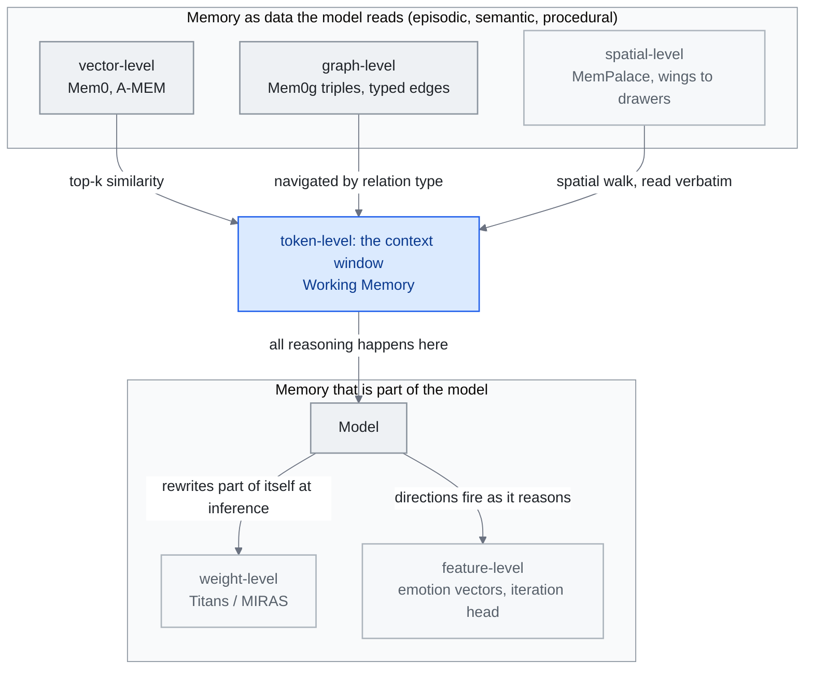

<!-- translation-sync:start -->
> 與 2026-10-31 英文版同步的機器輔助譯文，已作結構與內容覆核。程式碼和圖中標籤保留原文；閱讀時間按英文原文估算。
> [English source](../../../chapters/06-agent-memory.md) · [Sync record](../../SYNC.md)
<!-- translation-sync:end -->

<!-- i18n-anchor -->

# 第 6 章：Agent Memory —— 缺失的層

> **一句話總結：** 記憶系統讓 AI agent 跨對話記住事情——你的偏好、過去決策、專案 context。
>
> **為什麼重要：** 沒有記憶, 每次 AI 對話都從零開始。記憶讓 AI 感覺像同事而非陌生人。
>
> **閱讀時間：** ~30 分鐘（按英文原文估算：6,772 個單詞 / 230 wpm）

*圖："Feature-Level Memory Research (2026)" 命名的六個層次，按記憶所在位置排列：頂部是模型透過介面讀取的內容，底部是模型本身的組成；"Memory Taxonomy" 的四類記憶對映其上，工作記憶就是視窗，情景、語義與程式性記錄則位於儲存。各層檢索機制來自 "Major Frameworks"，權重層條目來自 "Architectural Patterns"。通往上下文視窗的連線承載論點：外部層無論如何索引，都必須先檢索入視窗，模型才能對其推理；權重層、特徵層則已在模型內部。截至 2026 年，生產棧仍主要位於前三層。*

<!-- i18n-anchor -->

## 為什麼記憶重要

每次你與 LLM 開新對話, 你從零開始。模型沒有你之前互動的回憶, 沒有你的偏好, 沒有你花數小時對話辛苦建立的 context。這不是小麻煩——這是侵蝕 AI 作為持續協作者承諾的根本架構差距。

記憶把 AI agent 從無狀態回應者轉化為會學、適應、隨時間累積理解的系統。沒有記憶, 一個 AI 助手不能記得你偏好簡潔答覆、你的專案用 TypeScript 配特定 ORM、或上週二你在認證流程中識別到關鍵 bug。每個 session 變成冷啟動。每次互動都需要從頭重建 context。

這個差距的成本不只使用者挫折。它顯化為浪費 token（重新解釋 context）、退化輸出質量（錯過個人化）、斷裂工作流程（在多 session 任務上失去連續性）。當 AI agent 從聊天玩具移到生產基礎設施, 記憶已成為原始模型能力與真實有用之間的關鍵缺失層。

<!-- i18n-anchor -->

## 記憶分類

agent 記憶研究已收斂到一個受人類認知科學啟發的分類, 區分四種基本型別:

**情節記憶（Episodic Memory）** 儲存基於經驗的紀錄——特定互動、事件與其結果。當 agent 記得"last week, the user asked me to refactor the payment module and preferred extracting a service class over using mixins,", 那是情節記憶。它為個人化與從過去成敗學習提供經驗基礎。

**語意記憶（Semantic Memory）** 裝事實知識與結構化資訊——使用者的技術堆疊、團隊成員的角色、專案架構決策、API schema。與情節記憶不同, 語意記憶從特定事件抽象出來。它代表蒸餾的理解, 非原始經驗。

**程式記憶（Procedural Memory）** 編碼 how-to 知識——工作流程、標準操作程式、學到的動作序列。當 agent 知道部署這個特定專案需要跑測試、構建 Docker 映像、推到 registry、然後觸發 Kubernetes rollout, 那是程式記憶。它讓 agent 不必每次重新推導過程就能執行復雜多步任務。

**工作記憶（Working Memory）** 代表主動推理 context——當下被操縱與綜合的資訊。這對映到模型的 context window 與任何主動檢索狀態。這是最受限也最關鍵的層, 因為它決定 agent 在任何給定時刻實際能推理什麼。

這四種型別之間的相互作用定義 agent 記憶系統的精緻度。一個樸素實現可能只存對話日誌（粗的情節記憶）。一個成熟系統分離、索引、交叉參照所有四種型別, 在對的時間檢索對的資訊。

<!-- i18n-anchor -->

## 主要框架

### Mem0

[Mem0](https://mem0.ai) 浮現為 AI 應用的領先通用記憶層。Apache 2.0 授權, 它提供跨使用者、session、agent 新增、搜尋、管理記憶的統一 API。

效能數字驚人: 相對基線系統在 LLM 評判評估上 26% 改善、相對全 context 做法 91% 較低 p95 latency, 透過僅檢索相關記憶而非重播整個對話歷史達到 90%+ token 成本減少。Mem0 透過結合向量儲存、基於圖的關係、智慧記憶固化的混合架構達成這。

2025 年, Mem0 與 AWS 取得夥伴關係, 整合進 Amazon Bedrock 生態系, 把自己定位為企業 AI 部署的預設記憶層。該平臺支援多租戶記憶隔離, 適合服務數千使用者、各有自己持續記憶空間的應用。

**Mem0ᵍ（2026）：圖作為一等公民。** 有向標籤圖變體 **Mem0ᵍ** 在 2026 年初進入生產, 把早期混合向量+圖設計取代為知識圖優先架構。管線從**實體提取器** 流向**關係生成器**, 產生形如 `(source, relation, destination)` 的標籤三元組——配 `lives_in`、`prefers`、`owns` 等型別化邊而非無型別相似度連結。**衝突偵測器** 配上 **LLM 驅動的更新解決器** 處理新事實到來時的矛盾: 當新三元組與現存的不一致, 解決器決定覆寫、合併、或帶溯源保留兩者。Mem0ᵍ 透過給記憶一個可查詢的語意結構, 關閉長久以來全 context 做法（"dump everything into the window"）與選擇性檢索（"find the top-k similar chunks"）之間的差距, 該結構能按關係型別導航, 不只按向量距離。

### A-MEM

[A-MEM](https://github.com/agiresearch/A-mem) 採取根本不同做法, 靈感來自 Zettelkasten 方法——社會學家 Niklas Luhmann 用來產出跨多元領域 70+ 本書的著名筆記系統。

A-MEM 把每個記憶視為有動態索引、連結、演化的原子筆記。記憶不只被儲存與檢索; 它們透過浮現連結連到相關記憶、沿多個維度索引、隨新資訊到來允許演化。當新記憶被加, 系統識別到現存記憶的連結, 可能合併、拆分、或更新它們。

這個做法產生有機成長的記憶結構, 形成相關知識的群集, 鏡映人類專家如何建心智模型。Zettelkasten 靈感對知識工程特別合適——它本質上是個讓知識隨時間複利的系統。

### ByteRover

[ByteRover CLI](https://github.com/campfirein/byterover-cli) 前稱 Cipher，以上下文樹組織專案知識。倉庫於 September 27, 2026 歸檔。October 31 檢查的文件描述了本地操作、可選雲同步、整理稽核，以及類似 Git 的分支與合併。程式碼採用 Elastic License 2.0，屬於原始碼可見。這一歷史案例展示了面向檔案系統的記憶組織方式；它既不能證明檢索整體更優，也不會消除模型與維護成本。

該模式首次在 2026 年七月 29 日 上得到學術研究。**"Filesystem-Based Memory for LLM Agents: Organization, Evolution, and Sustainability"**（arXiv 2607.26637；Sizhe Zhou 和來自 UIUC、UCSD 和 Adobe Research 的十位合著者）描述自己是第一個對 markdown 檔案目錄樹方法的系統研究，智慧體透過通用檔案工具讀取、寫入和重新組織的記憶，作為通用模式而非任何單一供應商的產品進行研究。該論文圍繞單一共享記憶體檔案系統定義了三個角色：一個管理智慧體，用於組織傳入內容；一個搜尋智慧體，用於透過引用來源回答查詢；一個執行智慧體，用於將任務軌跡提煉為可重用的技能。其主要發現對選擇此模式而非向量儲存的任何人來說都至關重要：一旦儲存變大，保持儲存有序可將檢索成本減少約一半。這衡量的是通用組織模式，而非 ByteRover 的實現。在增長研究中，除了最強的管理智慧體外，所有智慧體的組織性都會下降，且其測量的智慧體均未將組織性轉化為更好的答案。更便宜的搜尋，而非更好的答案，是整潔樹帶來的好處。該研究未被複制，但它將檔案系統記憶從一種已交付的慣例轉變為一種可測量的慣例。

### Cognee

[Cognee 1.0](https://www.cognee.ai/cognee-1-0-announcement)，釋出於 2026 年六月 26 日，暴露了 `remember`、`recall`、`forget` 和 `improve`，而不僅僅是攝入和搜尋階段。供應商描述了單個 Postgres 部署、託管雲和 COGX 匯出。其以反饋驅動的改進操作使記憶維護成為介面的一部分。這些是產品功能；它們的存在並不獨立確立記憶質量或可靠的遺忘。

### Nemori

[Nemori](https://github.com/nemori-ai/nemori) 聚焦在一個特定但關鍵的問題: 如何把連續對話流分段成有意義的記憶單元。

不是把每個訊息或每個對話當記憶單元, Nemori 把對話分成語意對齊的情節——代表一個完整想法、決策、工作流程的協調互動塊。這個分段關鍵, 因為"relevant past context"與"noise"之間的邊界常落在對話中間, 不在端點。

透過產生乾淨的情節段, Nemori 給下游記憶系統提供更高質量輸入, 無論那些用向量檢索、圖結構、或階層組織。

### MemPalace

[MemPalace](https://github.com/MemPalace/mempalace) 迴歸比向量檢索或知識圖古老得多的想法: **memory of loci**, 古代與中世紀學者用來記得大量目錄的空間-記憶術技巧, 透過心理走過熟悉建築物。2026 年 四 月 5 日 MIT 授權釋出, MemPalace 把記憶庫組織為四層空間階層——**Wings → Rooms → Closets → Drawers**——每個葉節點"drawer"存一個原文文字片段, 而透過階層導航本身擔任索引。

因此檢索 primitive 不是 embedding 相似度也不是圖遍歷, 而是 **空間走讀**: agent 推理哪個 wing 可能含相關記憶, 下到 rooms 與 closets, 原文讀 drawers 而非從壓縮 embedding 復原。"verbatim-first"儲存哲學是把 MemPalace 與在儲存前總結或切塊的系統區別開來的設計選擇——它主張對許多工（法律、科學、對話）, 儲存時有失真壓縮的成本超過檢索時稍慢空間走讀的成本。

基準數字是這個做法突破的原因。MemPalace 報告 **96.6% Recall@5 on LongMemEval**, agent 記憶已發表的最長 context 召回基準——在同一評估中領先僅向量與僅圖做法。社群反響一樣驚人: 專案在前三週累積約 **49,000 GitHub stars**, 是 2026 年成長最快的記憶專案, 領先一個數量級。月底前已有學術評論（arXiv 2604.21284, *"Spatial Metaphors for LLM Memory: A Critical Analysis of the MemPalace Architecture"*）在流通——本身就是專案多快進入領域中心對話的訊號。

<!-- i18n-anchor -->

## 架構 Pattern

隨著領域成熟, 幾個跨多個框架出現的架構 pattern:

**多型別階層。** MIRIX 框架（Wang and Chen, "MIRIX: Multi-Agent Memory System for LLM-Based Agents,", arXiv 2507.07957, 2025 年 七 月 10 日）以 **六種獨立記憶型別** 例示這個 pattern——Core Memory、Episodic Memory、Semantic Memory、Procedural Memory、Resource Memory、Knowledge Vault——由含六個每類 Memory Manager 與一個處理任務路由的 Meta Memory Manager 的多 agent 框架協調。每種型別有不同更新頻率、保留政策、檢索機制。這種分離防止災難性遺忘同時允許快速適應。參考應用即時監控螢幕活動以建個人化記憶庫; 在 ScreenshotVQA 多模態基準上, MIRIX 報告比 RAG 基線 35% 更高準確度, 儲存需求 99.9% 較低; 在 LOCOMO 長篇對話基準上 85.4%。

**Git 式版本控制。** 幾個系統現在像版本控制程式碼那樣版本化記憶, 維護歷史, 支援分支（用於推測推理）, 並啟用記憶更新被證明錯誤時的 rollback。這在多 agent 系統特別重要, 不同 agent 可能併發更新共享記憶。

版本控制模式獲得了一個事務邊界（2026 年七月）。Git風格的歷史記錄是一種慣例；**MemTxn**（"MemTxn: A Transaction Boundary for Source-Supported Updates and Complete-State Recovery in Agent Memory," arXiv 2607.27834, 2026 年七月 30 日；Hanshuai Cui 和五位合著者）將其作為保證提出。該層位於回答模型之外，包含三個部分：*Ordered PatchTest* 檢查所提議的更新是否確實得到其引用來源的支援，*Temporal Resolver* 決定在事實衝突時哪個版本是可見的，而持久快照日誌可以在發生故障後恢復應用程式可見狀態，而無需知道物理寫入集。在作者自己的驗證集上，它接受所有 60 來源支援的更新，並拒絕所有 179 構造的硬負樣本，並且在 LongMemEval-S 和 LoCoMo 派生狀態上注入持久多鍵故障時，它能夠完全恢復宣告的活動記憶體對映。該驗證集較小，結果未被複制，因此這只是一個提議，而不是經過生產驗證的保證。它對本章的貢獻是一個契約：它將 Mem0ᵍ 非正式指定的衝突檢測器和更新解析器轉化為一個可以失敗的接受/拒絕測試，並新增了一個恢復故事，而上述框架均未提供。另一組團隊在三天前就達成了相同的框架，並且根據作者列表，是獨立完成的 --- **MemTX**（"MemTX: Transactional Belief Commit for Stateful Agent Memory," arXiv 2607.23929, 2026 年七月 27 日）在快照隔離事務中安排寫入，透過尚未提交的信念狀態對不可逆的工具呼叫進行門控，並在信念被撤回時透過派生記錄和工具副作用進行修復。兩個不相關的團隊在同一周內都試圖採用資料庫事務語義本身就是一個訊號：記憶體寫入已經變得足夠重要，需要提交紀律。

**認知啟發分離。** 不是單一記憶儲存, 領先架構在快速存取工作記憶、中期情節緩衝、長期固化知識之間維持明確分離。記憶固化過程——類比生物系統的睡眠——週期性壓縮、去重、把情節記憶重組為語意知識。

**可訓練記憶模組。** 第四個 pattern 在 2026 年 四 月與 Google Research 的 **Titans + MIRAS** 浮現, 它把記憶完全重構為*可訓練神經模組*而非外部儲存。不是把事實寫到向量資料庫、圖、或 markdown 檔, Titans 在推論時透過梯度下降更新專用記憶模組的權重——模型字面上在處理檔案時重寫自己的部分。MIRAS 是配套訓練框架, 提供讓推論時學習率不發散的配方與穩定性保證。在引數量相當的情況下, Google Research 部落格報告 Titans 在長距離回憶與多跳推理上優於 **Mamba-2**、**Gated DeltaNet**、**Transformer++**。這個 pattern 在概念上與前三個不同: Mem0、A-MEM、ByteRover、MIRIX 都把記憶當作模型透過介面讀的資料; Titans 把記憶變成模型本身的一部分, 透過和 attention 一樣的電路讀, 但透過和訓練一樣的機器寫。對知識工程師, 它提出新設計問題: 你的記憶什麼時候值得燒進權重, 什麼時候應保持作為可查詢資料？

在 **2026 年五月 6 日** 上，Anthropic 的 **Dreaming**（研究預覽）出現了第二個商業方向：而不是在推理時將記憶體訓練到權重中，Dreaming 執行一個計劃的會話間任務，讀取最近的會話，識別重複的錯誤和收斂的工作流程，並 **以明文形式重寫智慧體的持久記憶體**。Titans 將記憶體作為模型本身的一部分（透過梯度下降更新），而 Dreaming 保持記憶體為系統編排層讀取的資料（透過 LLM 的整理過程更新）。現在，這兩種方法成為長期智慧體記憶的兩種對比商業模板：**可訓練記憶體**（推理時梯度更新，模型內部）與 **整理記憶體**（LLM 重寫明文，執行底座外部）。對於知識工程師來說，設計問題變得更加尖銳 --- 在什麼情況下，記憶體值得燒錄到權重中（Titans），在什麼情況下，記憶體值得作為模型可以讀取的儲存進行查詢（Mem0, A-MEM, ByteRover, MemPalace），以及在什麼情況下，記憶體值得作為明文進行編輯，以便整理過程可以修改（Dreaming）？

三個月後，該問題中可訓練記憶分支首次獲得了其重要的擴充套件數值。**"Memory Decoder at Scale: A Pretrained, Parametric Long-Term Memory"**（arXiv 2607.27919, 2026 年七月 30 日；Rubin Wei 等，與 Qipeng Guo、Bowen Zhou 和 Zhouhan Lin 合作）預訓練了一個引數化記憶模組，以 6.9B 引數在 300B 個標記上進行訓練，其理由是僅解碼器的大型語言模型（LLM）將記憶和推理糾纏在一個引數集中，而單獨擴充套件記憶是更好的權衡。使這一過程可行是一個基礎設施問題，而不是目標函式問題：一個分散式 Faiss 索引和檢索管道，具有稀疏的批次 kNN 載入。在 17 個基準測試中，將 6.9B 記憶模組與 410M 引數的 Pythia 基礎模型配對，使該基礎模型的平均值從 29.86 提高到 37.34 —— 超過 Pythia-12B 的 37.24，使用 39% 更少的總引數。這些數字是自我報告的，這是在現有線（原始、較小的 Memory Decoder 是 arXiv 2508.09874）上的擴充套件結果，而不是新的基礎能力。但它是對 Titans 模式開啟並懸而未決的設計問題的第一個引數效率答案：寫入權重的記憶不必寫入 *相同* 的權重，將兩者分開可以讓 410M 基礎模型與專用記憶模組配對，勝過 12B 的單一模型。

<!-- i18n-anchor -->

## 演化階段

agent 記憶的發展遵循清晰軌跡:

**階段 1: 工程整合（2023-2024）。** 記憶被當工程問題對待——如何持久化與檢索對話狀態。解法主要是向量資料庫配上 RAG 管線。功能但粗糙, 沒有有原則的做法決定記什麼、何時忘、如何組織。

**階段 2: 結構化與知識圖做法（2024 - 2025 H1）。** 領域移向結構化記憶配明確知識圖、型別化記憶儲存、有原則的檢索策略。Mem0 與 A-MEM 等框架在這段期間浮現, 示範結構戲劇性改善記憶質量。

**階段 3: 認知架構（2025 H2 - 現在）。** 當前工作高度借自認知科學, 實現生物啟發的記憶固化、干擾管理、多系統架構。在受控基準上接近人類級 90% 效能的系統已被示範, 不過真實世界效能仍有變化。

**階段 4: 特徵級、可訓練、空間隱喻記憶（2026 年 四 月 - 浮現中）。** 2026 年 四 月加上三條不乾淨適合階段 1-3 的線。第一是**可訓練記憶**（Titans + MIRAS）: 記憶變成在推論時更新的神經模組, 不是模型外的可查詢儲存。第二是**特徵級記憶**, 由同周 Anthropic 可解釋性披露開啟——情緒向量與迭代頭確立特定行為與推理 pattern 對應模型內可識別特徵方向, 這意味"what the model remembers about how to reason"原則上可在啟用級別而非 token 級別讀取與導引。第三是**空間隱喻記憶**（MemPalace）: 迴歸數字前認知人機工程學, 檢索 primitive 是走過階層空間結構, 儲存哲學是原文而非壓縮。在生產堆疊中這些不會取代 Mem0、A-MEM、階層 context tree; 它們與之共存。但它們把設計空間從"where do I store memory and how do I retrieve it"擴大到"at what level of the stack does this memory live --- token, vector, graph, weight, feature, or spatial walk."。

<!-- i18n-anchor -->

## 社群與研究

ICLR 2026 MemAgents Workshop 代表領域的里程碑, 把來自 AI、認知科學、系統工程的研究者聚在一起處理 agent 記憶中的開放問題。關鍵主題包括記憶可擴充套件性、遺忘策略、多 agent 共享記憶。

<!-- i18n-anchor -->

## 特徵級記憶研究（2026）

整個 2025 年,"agent memory"幾乎都意味 agent 能讀的資料——一個向量索引、一個知識圖、一個階層 markdown 樹、一個情節日誌。2026 年 四 月強迫一個更廣定義。Anthropic 可解釋性披露在 MIT Technology Review 突破認可的同周——**情緒向量** 與**迭代頭**——顯示前沿模型中一些最重要的"memory"住在沒有任何外部儲存而是在可識別內部特徵中。

**情緒向量** 是 Claude 殘差流中的線性特徵方向, 當被放大時, 能穩定使模型偏向情緒化行為——包括最廣引用的例子, 勒索式輸出。對記憶系統設計的相關重點不是安全含義（雖然那是真的）而是架構含義: 模型中有一個特徵方向*記得如何威脅*, 而它能獨立於任何 prompt 或檢索 context 被開大或關小。**迭代頭** 是在思維鏈推理中浮現的注意力頭, 持續關注前一推理步驟的輸出。它實際上是在 attention 權重而非程式記憶儲存中實現的*程式記憶*——模型已學到"how to keep going"的電路, 而該電路是讓 CoT 運作的東西。

對記憶系統設計的啟示是，"where the memory lives" 現在比 2025 時更是一個更豐富的問題。現代堆疊可能需要在六個不同的層次上讀取記憶：**標記級**（視窗中的轉錄片段）、**向量級**（Mem0、A-MEM 檢索）、**圖級**（Mem0ᵍ 三元組及其型別邊）、**空間級**（MemPalace 的 Wings → Rooms → Closets → Drawers 路徑）、**權重級**（Titans / MIRAS 模組在推理時更新）和 **特徵級**（模型推理時哪些可解釋的方向被啟用）。檔案系統上下文樹是一種與向量檢索不同的外部組織策略。到 2026 的生產系統將繼續主要存在於前三個層次——這些層次的工具最成熟。但其餘三個層次不再是假設，將記憶純粹視為檢索問題的系統編排工程師將越來越多地留下能力未被利用。

**記憶能否經受模型更換？（2026 年九月）** 選擇層次有一個領域此前未測量的後果：記憶儲存之下的模型會被替換，並非所有層次都能經受更換。Ankit Goyal、Jaideep Ray（arXiv 2609.05339，September 4, 2026）在 48 個合成案例上，對比原始歷史、RAG、壓縮筆記、結構化知識圖譜四種儲存。固定模式圖記憶幾乎不變，準確率變化 +0.0004 ± 0.0020；壓縮筆記強烈依賴模型，按遷移方向波動 +9.91 或 -13.28 個百分點。RAG 部分重新嵌入恢復 4.96 個點，完整重新嵌入恢復 11.90 個點。更可推廣的是提出的機制：約 80% 筆記退化來自記憶*寫入*時丟失的資訊，而非讀取時，所以只修儲存，在全部 48 案例中均未達到 90% 恢復；保留壓縮記憶對應的原始歷史，則在兩個受測遷移方向之一成功修復 34 個。設計規則直接得出：若記憶須跨越模型遷移，應偏向結構化儲存而非壓縮文字，並保留壓縮形式的原始來源。48 個合成案例、兩位作者意味著早期結果而非定論，但這是首次把模型更換可移植性視為*儲存格式*的性質，而非上層智慧體的性質。

<!-- i18n-anchor -->

## 2026：評估與治理控制

截至 H1 2026，記憶討論主要圍繞*架構*，即記憶存放及檢索方式。2026 年中，前沿轉向*治理*：一組基準不再只問 "can the system recall the right fact"，而問 "does it recall safely, forget on request, resist manipulation, and stay auditable."。其中五項結果突出。

**GateMem**（"GateMem: Benchmarking Memory Governance in Multi-Principal Shared-Memory Agents,"，arXiv 2606.18829，June 17, 2026）首次*聯合*評價共享機構記憶的效用、訪問控制與主動遺忘，涵蓋醫療、辦公、教育、家庭等多個主體向同一儲存寫入的場景。主要結果是未達標：**沒有受測方法同時滿足三個維度**，尤其檢索／外部記憶方案會跨主體邊界洩漏資訊。治理並非當前任何記憶框架天然具備的性質。

**MemSyco-Bench** ("MemSyco-Bench: Benchmarking Sycophancy in Agent Memory," arXiv 2607.01071, 2026 年七月 1 日) 識別出架構優先框架從未測量的一種失敗模式：記憶誘導的諂媚行為。注入錯誤記憶會使諂媚率從 **18.67% 提高到 32.67%**（DeepSeek-V4-Flash，完整對話條件）以及從 **27.4% 提高到 44.7%**（Qwen3-8B），而外部記憶在客觀事實判斷上使事實準確性下降 **11-23 分**，與無記憶基線相比。由於該基準測試針對 **Mem0、A-MEM 和 LightMem**——本章已涵蓋的框架——結果直接發出警告：一個提高回憶能力的記憶層可能會同時使智慧體對被要求記住的內容更加輕信。

**Decision-Aware Memory Cards** ("Decision-Aware Memory Cards: Counterfactual-Inspired Context Selection and Compression for Tool-Using LLM Agents," arXiv 2606.08151, 2026 年六月 6 日) 從另一側攻擊檢索。它不是根據查詢的語義相似性對記憶進行排序，而是根據*決策導向*、反事實啟發的實用性——給定記憶對下一步行動的影響程度——並以型別化、可審計的記憶卡形式儲存結果。在 SWE-bench 檔案檢索（50 驗證例項，Qwen3.6-Plus 重新排序 BM25 top-50）中，Hit@1 提高 **0.58 → 0.78**，MRR@10 **0.634 → 0.790**，每查詢大約 **45 個標記**。這種重新表述呼應了 CATTS（第 4 章）：下一個決策的實用性，而不是原始相似性，才是值得最佳化的訊號。

**"Are We Ready For An Agent-Native Memory System?"** (arXiv 2606.24775, 2026 年六月 23 日, SJTU / Tsinghua / MemTensor) 為該領域提供了一個共享的詞彙表——將系統分解為四個模組：*表示與儲存*、*提取*、*檢索與路由* 和 *維護*——並發現 **沒有單一架構佔據主導地位**：**Zep** 在跨會話推理中表現最佳（48.0 LLM-Judge 準確率在 LongMemEval 上），**MemOS** 在 **8.9 EM 上的 LoCoMo** 中精確錨定表現最佳，而一個長上下文基線在狀態執行上表現最佳（48.20 EM 在 DB-Bench 上）。結論與 GateMem 從架構角度的結論一致：記憶不是一個只有一個勝者的單一問題，而是一組具有不同領先者子問題的組合。

**StateMemBench／StateMem**（arXiv 2608.19652，August 20, 2026，UIUC 團隊）在訪問控制與迎合之外增加第三個治理維度：**時效性**。其 234 個跨會話場景在長互動中途修改事實、約束和決策，再檢查記憶層返回當前有效值還是被取代的舊值；透過封閉候選池評分，將狀態追蹤失效與普通檢索錯誤分離。它不同於 GateMem，不止報告未達標結果，還提出 **StateMem**，一種明確追蹤替代關係與關係依賴的狀態優先方法。論文報告，DeepSeek-V4-Flash 的當前狀態準確率提高 1.8x（0.205 至 0.363），Qwen-3.5-9B 提高 1.6x（0.149 至 0.233），分別對比同一主幹下最強基線和最強記憶系統；作為六個現有後端的包裝層時，提升 +32 至 +67 個點，其中在控制包裝層自身新增上下文 token 後，仍保留 +15 至 +32 個點。這一控制區分了"the method works"與"more context helps."。數字均為論文自報，尚未復現。值得單獨命名這一維度，因為領域通用、側重召回的基準在結構上看不見新值替代舊值：一個自信返回你*過去*相信的事實的儲存，仍會被記為命中。

另一項較早的單作者結果值得作為研究方向標記，而非已確立結論：arXiv 2606.15903（June 14, 2026）主張，*LLM 在記憶流水線中的位置*決定哪些刪除真正有效。在修改時設定鉤子，可恢復事後過濾遺漏的意圖感知刪除，目標類別為 78-85%，總體覆蓋率 91.7-93.2%。這是早期工作，但指向與上述基準相同的治理空白：遺忘是架構位置的選擇，不是一個刪除按鈕。

**TencentDB Agent Memory v2.0 的 Team Memory** 從廠商而非基準側回應治理空白。Tencent 的 MIT 許可、自託管記憶框架，倉庫建立於 April 7, 2026，截至 August 24, 2026 約有 24,000 GitHub stars；於 August 3, 2026 釋出 v2.0.0，八月 13 日再獨立公佈團隊協作功能。主要新增的 Team Memory 是跨智慧體共享的治理層：在 Chat Memory、Skill、Wiki、CodeGraph 四類帶版本的記憶資產之上，提供私有／團隊／受限／智慧體可見性層級；前端 Memory Proxy 相容 Anthropic 與 OpenAI 協議，並在預算上限內執行 L0-L3 分層蒸餾與 BM25+vector+RRF 檢索。對照上文 GateMem 的未達標結果，Team Memory 是首個已釋出、嘗試解決 GateMem 所發現沒有框架滿足訪問控制維度的生產方案。但這裡每項治理機制主張，都是 Tencent 對自身產品的描述。不同於 GateMem 的第三方對抗評估，尚無獨立基準檢驗 Team Memory 的可見性層級能否在多主體負載下真正成立。本章"evaluation grows governance axes"的線索，如今同時有測量空白的基準，以及聲稱彌合空白的已釋出基礎能力，兩者之間的評估缺口仍未填補。

**託管記憶成為雲產品類別（2026 年七月至八月）。** Tencent 並非唯一參與者，第二個例項使它成為一個類別，而非單一產品。**July 30, 2026**，Google 公佈一組 Gemini Enterprise Agent Platform 能力正式釋出，其中包括 **Agent Memory Bank**：依據模式定義，從對話上下文提取結構化內容，面向低延遲個性化，讓智慧體接續未完成的長期任務。這是更名後平臺的正式釋出里程碑，不能與七月 2025、舊 Agent Engine 品牌下 Vertex AI Memory Bank 的公開預覽混為一談。這裡的每項能力描述都來自 Google 公告部落格，尚無獨立基準評價 Memory Bank 的模式提取質量。它比上述 TencentDB v2.0 釋出早四天，二者合看才是重點：兩家大型雲廠商把託管智慧體記憶作為單獨治理的平臺基礎能力釋出，而非智慧體框架內的功能；此前，本章雖追蹤 Mem0、A-MEM、ByteRover、Nemori、MemPalace 與 Dreaming，卻尚未點名任何 Google 託管記憶服務。Memory Bank 周邊公告也從基礎設施側推動相同方向：Agent Runtime 支援智慧體連續執行最長七天，Agent Identity 則作為原生 IAM 型別，支援最小許可權訪問與緩解 token 竊取風險。第 4 章在編排層討論的持久會話與許可權問題，在這裡變為可配置開通的服務。

**持久化衝突稽核成為 API（October 29, 2026）。** [Cognee v1.6.6](https://github.com/topoteretes/cognee/releases/tag/v1.6.6) 增加持久儲存的事實衝突處理結果，並預設啟用稽核。釋出說明描述，在支撐文字塊變化、聯結器刪除或遺忘資料集後，將舊處理結果作廢，並在解決衝突時只引用仍然有效的文字塊。被治理的物件如今包括此前決定的有效性，而不僅是已儲存的事實。這些都是廠商描述的軟體行為，尚無獨立的可靠性結果，也未展示事務保證。

<!-- i18n-anchor -->

## 2026 年七月下旬：引數化原生記憶的主張

2026 年中的治理基準仍假設，記憶是*透過介面讀取*的，例如向量索引、圖或整理過程。July 29, 2026，上海 **MemTensor** 將分類法推向另一方向。這也是上文六月 23 日智慧體原生記憶綜述背後的實驗室，此次是橫跨中國人民大學、NUS、SJTU 與同濟大學、共 17 位作者的合作。**Metis**（"Metis: Memory Foundation Model,"，arXiv 2607.26760）提出**記憶基礎模型**：讓智慧體記憶作為持久、動態演進的狀態存在於 *transformer 主幹內部*，採用引數化方式，而非外部儲存。上文四模組綜述假設智慧體透過位於模型外部的表示與儲存／提取／檢索與路由／維護模組讀取記憶；Metis 原型則凍結主幹，只訓練 **hyper memory block** 和 **local memory block**，明確受 Fast Weight Programming（FWP）啟發，並在 Qwen3.5 主幹的 4B、9B 與 27B 規模上評估。

其機制應與本章已有的兩種貼近模型的記憶模式區分。上文階段 4 的 Titans + MIRAS 在*推理時*透過梯度下降更新可訓練神經模組，即模型邊讀取邊改寫自身權重。Metis 的推理階段不使用梯度：以 EMA 式前向計算更新記憶，把歷史上下文壓縮為固定大小的狀態，無需反向傳播，也不把壓縮歷史重新作為文字重放。自階段 4 以來，本章追蹤的"where does memory live"光譜由此增加第三個位置：既非向量儲存查詢，也非梯度下降更新權重，而是凍結主幹的模組按固定算術規則將狀態向前傳遞。

論文對方法目前何處失效坦率得少見，這些限定應與架構一同保留：固定大小壓縮會丟失資訊，導致長期任務表現下降；作者還明確報告"information confusion in some cases, possibly caused by the blending of semantics within the latent space."。對照上述治理基準，它們已表明沒有單一架構能同時在效用、安全與可審計性上領先，因此更適合將 Metis 理解為進入已有爭議領域的第四個候選，而非爭議的解決方案。這是一項研究預覽，為記憶提出新的存放位置；其自身失效模式又提出新問題：將記憶擠進固定大小的潛在狀態，而非可檢查的儲存，究竟會丟失什麼？

<!-- i18n-anchor -->

## 關鍵資源

- **[Awesome-AI-Memory](https://github.com/IAAR-Shanghai/Awesome-AI-Memory)**（IAAR-Shanghai）——綜合調查與論文收集, 涵蓋記憶架構、基準、應用。
- **[Agent-Memory-Paper-List](https://github.com/nuster1128/Agent-Memory-Paper-List)** ——按主題與做法組織的 agent 記憶系統研究論文精選清單。
- **[Awesome-Memory-for-Agents](https://github.com/TsinghuaC3I/Awesome-Memory-for-Agents)**（TsinghuaC3I）——清華大學綜述, 涵蓋記憶分類、架構、評估方法。

---

<!-- i18n-anchor -->

## 三個要點

- **"Where does the memory live"如今是六個問題，而非一個。** token、向量、圖、空間、權重與特徵層都已出現，而截至 2026 年的生產棧仍主要位於前三層。
- **沒有記憶框架天然具備完整治理。** GateMem 同時衡量效用、訪問控制與主動遺忘，發現沒有受測方法滿足全部三項，檢索及外部記憶方案還會跨主體邊界洩漏資訊。
- **在一項含 48 個合成案例的研究中，儲存格式決定記憶能否經受模型更換。** 固定模式的圖記憶幾乎不變，壓縮筆記卻波動高達 13 個點；作者將約 80% 的退化歸因於筆記寫入時、而非讀取時丟失的資訊。

---

<!-- i18n-anchor -->

## 來源

1. Mem0 文件與基準。https://mem0.ai
2. A-MEM: Agentic Memory with Zettelkasten-Inspired Organization. https://github.com/agiresearch/A-mem
3. ByteRover CLI。[已歸檔倉庫](https://github.com/campfirein/byterover-cli)，September 27, 2026 歸檔；October 31, 2026 檢查文件。Elastic License 2.0。
4. Nemori: Semantic Episode Segmentation for Agent Memory. https://github.com/nemori-ai/nemori
5. Wang, Yu and Chen, Xi. "MIRIX: Multi-Agent Memory System for LLM-Based Agents." arXiv 2507.07957, 2025 年 七 月 10 日。https://arxiv.org/abs/2507.07957.。配套 repo: https://github.com/Mirix-AI/MIRIX
6. ICLR 2026 MemAgents Workshop. https://iclr.cc/virtual/2026/workshop/MemAgents
7. IAAR-Shanghai. Awesome-AI-Memory. https://github.com/IAAR-Shanghai/Awesome-AI-Memory
8. TsinghuaC3I. Awesome-Memory-for-Agents. https://github.com/TsinghuaC3I/Awesome-Memory-for-Agents
9. nuster1128. Agent-Memory-Paper-List. https://github.com/nuster1128/Agent-Memory-Paper-List
10. Google Research. "Titans + MIRAS: Helping AI Have Long-Term Memory"（2026 年 四 月）。https://research.google/blog/titans-miras-helping-ai-have-long-term-memory/
11. Anthropic Interpretability Team. Emotion Vectors 與 Iteration Head 披露（2026 年 四 月）。MIT Technology Review 2026 年 一 月把 mechanistic interpretability 認作 Breakthrough Technology 的配套。
12. MIT Technology Review. "10 Breakthrough Technologies of 2026: Mechanistic Interpretability"（2026 年 一 月 12 日）。https://www.technologyreview.com/2026/01/12/1130003/mechanistic-interpretability-ai-research-models-2026-breakthrough-technologies/
13. MemPalace GitHub Repository. https://github.com/MemPalace/mempalace ——MIT 授權空間隱喻記憶系統, 首次 commit 2026 年 四 月 5 日。
14. "Spatial Metaphors for LLM Memory: A Critical Analysis of the MemPalace Architecture," arXiv 2604.21284（2026 年 四 月）。https://arxiv.org/abs/2604.21284
15. Anthropic。"New in Claude Managed Agents: dreaming, outcomes, and multiagent orchestration"（May 6, 2026）。https://claude.com/blog/new-in-claude-managed-agents ：Dreaming 是可訓練記憶 Titans 的整理式記憶對應物。
16. Simon Willison。Code w/ Claude 2026 SF 現場部落格（May 6, 2026）。https://simonwillison.net/2026/May/6/code-w-claude-2026/
17. "GateMem: Benchmarking Memory Governance in Multi-Principal Shared-Memory Agents." arXiv 2606.18829（June 17, 2026）。https://arxiv.org/abs/2606.18829 ：聯合評價效用／訪問控制／主動遺忘；沒有受測方法滿足全部三項。
18. "MemSyco-Bench: Benchmarking Sycophancy in Agent Memory." arXiv 2607.01071（July 1, 2026）。https://arxiv.org/abs/2607.01071 ：記憶引發迎合，DeepSeek-V4-Flash 全對話為 18.67%→32.67%，Qwen3-8B 為 27.4%→44.7%；事實準確率下降 11-23 個點；評估包括 Mem0、A-MEM 與 LightMem。
19. "Decision-Aware Memory Cards: Counterfactual-Inspired Context Selection and Compression for Tool-Using LLM Agents." arXiv 2606.08151（June 6, 2026）。https://arxiv.org/abs/2606.08151 ：面向決策排序、帶型別且可審計的卡片；SWE-bench 檔案檢索 Hit@1 0.58→0.78、MRR@10 0.634→0.790，每查詢約 ~45 token。
20. "Are We Ready For An Agent-Native Memory System?" arXiv 2606.24775（June 23, 2026；SJTU／清華／MemTensor）。https://arxiv.org/abs/2606.24775 ：四模組分解；沒有單一架構領先，Zep 的 LongMemEval 為 48.0，MemOS 的 LoCoMo EM 為 8.9，長上下文的 DB-Bench EM 為 48.20。
21. arXiv 2606.15903（June 14, 2026）：單作者研究，討論意圖感知刪除的控制平面位置；修改時鉤子在目標類別恢復 78-85%，總體覆蓋率 91.7-93.2%。https://arxiv.org/abs/2606.15903
22. "Metis: Memory Foundation Model." arXiv 2607.26760（July 29, 2026 提交；MemTensor／中國人民大學／NUS／SJTU／同濟大學，共 17 位作者）。https://arxiv.org/abs/2607.26760 ：凍結 transformer 主幹內的引數化原生記憶，基於 Qwen3.5 的 4B/9B/27B；受 FWP 啟發的 hyper memory block + local memory block；推理時透過無梯度 EMA 式過程更新；自報侷限包括固定大小壓縮下的長期資訊丟失，以及潛在空間中的語義混合。
23. TencentCloud。TencentDB-Agent-Memory。https://github.com/TencentCloud/TencentDB-Agent-Memory ：MIT 許可、自託管；倉庫建立於 April 7, 2026；v2.0.0 於 August 3, 2026 釋出（GitHub releases API）；約 ~24K stars（August 24, 2026 檢查）。MarkTechPost，"Tencent Cloud Open-Sources TencentDB Agent Memory v2.0"（August 7, 2026），https://www.marktechpost.com/2026/08/07/tencent-cloud-open-sources-tencentdb-agent-memory-v2-0/; ；PRNewswire 團隊協作公告（August 13, 2026），https://www.prnewswire.com/apac/news-releases/tencentdb-agent-memory-tops-20-000-github-stars-in-90-days-launches-team-memory-for-multi-agent-collaboration-302850576.html ：Team Memory 治理層，在 Chat Memory、Skill、Wiki、CodeGraph 之上提供私有／團隊／受限／智慧體可見性層級；治理機制主張均來自 Tencent，尚無獨立基準。
24. "Filesystem-Based Memory for LLM Agents: Organization, Evolution, and Sustainability." arXiv 2607.26637（July 29, 2026；Sizhe Zhou 與十位合作者，UIUC／UCSD／Adobe Research）。https://arxiv.org/abs/2607.26637 ：首個系統研究 Markdown 目錄樹記憶模式的工作；在一個共享記憶檔案系統上，區分管理／搜尋／執行三類智慧體；儲存規模擴大後，有序組織讓檢索成本大致減半，但除最強管理智慧體外，組織都會退化，所有受測智慧體也都未能把組織有序轉化為更好的答案。尚未復現。
25. "MemTxn: A Transaction Boundary for Source-Supported Updates and Complete-State Recovery in Agent Memory." arXiv 2607.27834（July 30, 2026；Hanshuai Cui 與五位合作者）。https://arxiv.org/abs/2607.27834 ：Ordered PatchTest、Temporal Resolver 與持久快照日誌；在作者自建的小型驗證集上接受 60/60 個有來源支援的更新，拒絕 179/179 個困難負例；在 LongMemEval-S 和 LoCoMo 派生狀態上注入多鍵故障後可恢復狀態。獨立並行提案："MemTX: Transactional Belief Commit for Stateful Agent Memory,"，arXiv 2607.23929（July 27, 2026），https://arxiv.org/abs/2607.23929 ：快照隔離寫入、按尚未提交的信念狀態限制動作，以及撤回時的級聯修復；與 MemTxn 沒有作者重合。
26. "Memory Decoder at Scale: A Pretrained, Parametric Long-Term Memory." arXiv 2607.27919（July 30, 2026；Rubin Wei 等）。https://arxiv.org/abs/2607.27919 ：在 300B token 上預訓練的 6.9B 記憶模組；分散式 Faiss 流水線，按批次稀疏載入 kNN；17 項基準上，410M Pythia 基礎模型的平均成績由 29.86 提升至 37.34，相比 Pythia-12B 的 37.24，總引數減少 39%。結果為自報；這是較早 Memory Decoder 的規模化版本，arXiv 2508.09874，https://arxiv.org/abs/2508.09874
27. Goyal, Ankit 與 Ray, Jaideep。"Does Your Agent's Memory Survive a Model Upgrade? A Controlled Study of Memory Portability." arXiv 2609.05339（September 4, 2026）。https://arxiv.org/abs/2609.05339 ：48 個合成案例、四種儲存方法；圖記憶幾乎不變（+0.0004 ± 0.0020），壓縮筆記波動 +9.91 / -13.28 個點；部分重新嵌入恢復 4.96 個點，完整重嵌入恢復 11.90；筆記退化的 ~80% 歸因於構建時資訊丟失；只修復儲存始終無法達到 90% 恢復率，保留原始來源則在兩個受測遷移方向之一修復 34/48 個案例。合成樣本量小、兩位作者、尚未復現。
28. "Can Agent Memory Systems Track Evolving State?"（StateMemBench／StateMem）。arXiv 2608.19652（August 20, 2026；UIUC）。https://arxiv.org/abs/2608.19652 ：234 場景的跨會話基準，以封閉候選池評分衡量時效／替代關係，並提出狀態優先包裝方法 StateMem；報告 DeepSeek-V4-Flash 當前狀態準確率相對同主幹最強基線達 1.8x（0.205 至 0.363），Qwen-3.5-9B 相對最強記憶系統達 1.6x（0.149 至 0.233）；作為六個後端的包裝層，提升 +32 至 +67 個點，控制上下文 token 後保留 +15 至 +32 個點。均為論文自報，尚未復現。
29. Google Cloud。Gemini Enterprise Agent Platform 正式釋出公告（July 30, 2026）。https://cloud.google.com/blog/products/ai-machine-learning/whats-new-in-gemini-enterprise-agent-platform ：Agent Memory Bank 正式釋出，按模式定義從對話上下文提取結構化內容；Agent Runtime 支援智慧體連續執行最長 7 天；Agent Identity 是原生 IAM 型別；另有 Agent Gateway、Agent Registry，共五項能力。不同於七月 2025 的 Vertex AI Memory Bank 公開預覽。所有能力主張均為 Google 自報，未找到獨立基準。產品文件：https://docs.cloud.google.com/gemini-enterprise-agent-platform/scale/memory-bank

30. Cognee。"cognee 1.0"（June 26, 2026）。[公告](https://www.cognee.ai/cognee-1-0-announcement)。
31. Cognee。"v1.6.6"（October 29, 2026）。[釋出說明](https://github.com/topoteretes/cognee/releases/tag/v1.6.6)。

---

*下一章：[第 7 章：MCP，勝出的標準](07-mcp.md)*
