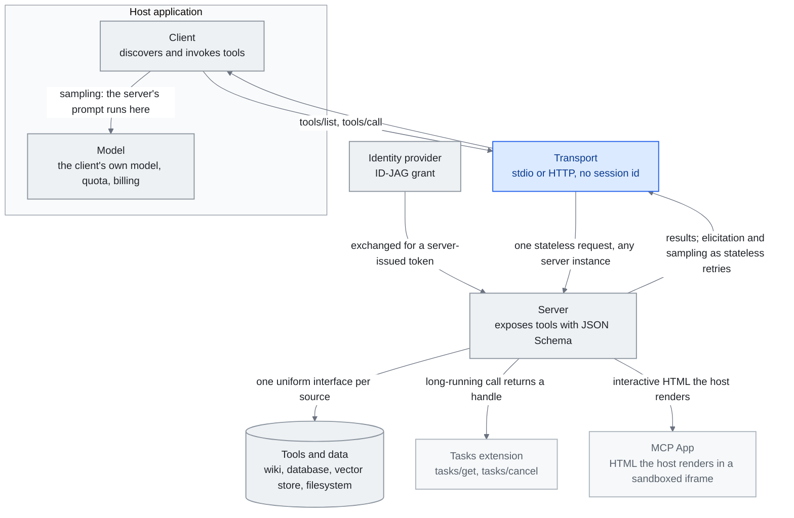

<!-- translation-sync:start -->
> 與 2026-10-31 英文版同步的機器輔助譯文，已作結構與內容覆核。程式碼和圖中標籤保留原文；閱讀時間按英文原文估算。
> [English source](../../../chapters/07-mcp.md) · [Sync record](../../SYNC.md)
<!-- translation-sync:end -->

<!-- i18n-anchor -->

# 第 7 章：MCP —— 勝出的標準

> **一句話總結：** MCP 是一個通用標準, 讓 AI 透過單一協議連線到任何外部工具或資料來源。
>
> **為什麼重要：** 把 MCP 想成 AI 的 USB——之前每個工具都需要自己的客制連線。現在有一個插頭到處通用。
>
> **閱讀時間：** ~24 分鐘（按英文原文估算：5,386 個單詞 / 230 wpm）

*圖："Why It Won"一節的三個核心概念，即客戶端、伺服器與傳輸。客戶端與其所屬模型同處宿主應用內部，傳輸與伺服器位於外部；周邊還加入 2026 規範新增的介面：作為擴充套件的 Tasks、渲染 UI 的 MCP Apps，以及透過 IdP 配置的授權。Tasks 與 MCP Apps 來自"2026-05-21: The 2026-07-28 Release Candidate"一節，ID-JAG token 交換來自"2026-06-18: Enterprise-Managed Authorization"，無會話核心來自"2026-07-28: The Specification Ships Final"。從伺服器返回的連線承載"The Stateful MCP Transition"的論點：伺服器不再只回答，也能徵求結構化輸入並請求取樣；最終的無狀態核心透過普通重試傳遞這些互動，而非維持一條持續連線。*

<!-- i18n-anchor -->

## 什麼是 MCP？

Model Context Protocol（MCP）是 Anthropic 創造的開放協議, 標準化 AI 模型如何連線到外部工具、資料來源、服務。MCP 之前, 每個 AI 整合都是客制——客制函式定義、專有工具格式、手寫認證、脆弱粘合程式碼。MCP 用通用介面取代這碎片: 任何模型都能用單一協議發現、認證、呼叫任何工具。

把 MCP 想成 AI 的 USB。USB 之前, 每個外設需要自己的聯結器、驅動、協議。USB 沒讓外設更強大——它讓它們可互操作。MCP 對 AI 工具生態系做同樣的事。一個 MCP 伺服器實現能服務 Claude、GPT、Gemini, 或任何講該協議的模型。一個 MCP 客戶端能連到數千伺服器而不需客制整合程式碼。

<!-- i18n-anchor -->

## 時間線：從推出到 Linux Foundation

**2024 年 十一 月。** Anthropic 把 MCP 作為開源規格釋出, 配 Python 與 TypeScript 的參考實現。初次釋出含一些參考伺服器（filesystem、GitHub、Slack）與建客制伺服器的 SDK 支援。反響審慎樂觀——AI 社群之前看過被提議的可互操作性標準。

**2025 年四月。** 推出六個月後，MCP 的 SDK 累計下載超過 8 百萬，社群已構建超過 5,800 個伺服器。生態增長比任何人預期都快。關鍵在於，競爭的 AI 實驗室開始採用該協議，而非另建替代方案。

**2025 年底。** MCP 被捐給 Agentic AI Foundation, Linux Foundation 旗下的新實體, 由 Anthropic、Block、OpenAI 聯合治理。這個動作中和"Anthropic controls the standard"的關切, 把 MCP 確立為真正行業標準而非供應商專屬協議。

**2026。** 截至 Q1 2026，MCP SDK 在全部包註冊站的每月下載量超過 97 million。生態包含由基金會維護的 75+ 個官方聯結器，以及數千個社群伺服器。協議已成為 AI 應用的預設整合層，正如 REST 成為網頁 API 的預設方案。

協議的整合時刻出現在 **May 6, 2026**，AWS 將 **AWS MCP Server** 正式釋出：這是首個由超大規模雲廠商託管的遠端 MCP 端點，透過一個認證伺服器開放 15,000+ 項 AWS API 操作，以 IAM 上下文鍵實現細粒度訪問，並提供沙箱化 `run_script` 工具，在伺服器端執行 Python。2025 年十二月捐贈 Linux Foundation，以及 Q1 2026 的 97M 下載量，使 MCP 成為標準；AWS 正式釋出則標誌著標準成為基礎設施。這類似 S3 對物件儲存的整合：大量自託管伺服器不會消失，但重心轉向"one managed endpoint at the cloud boundary."。

Skills 隨 MCP 一同進入 AAIF；參見[第 5 章十月更新](05-skill-systems.md#52-the-anthropic-skills-ecosystem)。

<!-- i18n-anchor -->

## 為什麼它勝出

幾個因素解釋 MCP 的快速主導:

**第一天就開放標準。** MCP 在寬鬆授權下發布, 含完整規格而非只 SDK。這意味競爭者能實現它而不依賴 Anthropic 的程式碼或善意。

**簡單架構。** 協議有三個核心概念: 客戶端（AI 模型一側）、伺服器（工具/資料一側）、傳輸層（它們如何溝通）。伺服器用 JSON Schema 描述暴露工具。客戶端發現並呼叫。傳輸層處理溝通層（stdio、HTTP+SSE、WebSocket）。這個簡單讓採納瑣碎——一位勝任開發者能在一小時內建好 MCP 伺服器。

**供應商中立治理。** 捐給 Linux Foundation, 配 OpenAI 作為聯合治理成員, 消除了最後可信反對。當你的主要競爭者聯合治理標準, 標準是真正中立的。

**網路效應。** 每個新 MCP 伺服器讓協議對每個客戶端更有價值, 反之亦然。一旦生態系跨過有用伺服器的臨界質量, 不支援 MCP 的成本變得高於採納它的成本。

<!-- i18n-anchor -->

## 關鍵採用者

MCP 採納的廣度說明它的主導:

- **OpenAI** 把 MCP 支援整合進 ChatGPT 平臺與 Agents SDK, 讓 GPT 模型能用任何 MCP 伺服器。
- **Google DeepMind** 給 Gemini 加了 MCP 客戶端支援, 引用生態系相容性為主要動機。
- **Microsoft** 走最遠, 在 Windows 的 OS 層級建 MCP 支援, 跨 Azure AI 服務、Copilot、GitHub Copilot 整合。
- **Amazon / AWS** 在 2026 年 四 月出貨 **Bedrock AgentCore Runtime**, 第一個生產級雙向 MCP runtime, 在標準協議上加 elicitation 與 sampling（見下方"The Stateful MCP Transition"）。
- **GitHub** 把 Copilot extensions 系統重建在 MCP 上, 取代它們的專有工具格式。
- **Figma、Slack、Block、Notion** 全部出貨官方 MCP 伺服器, 讓它們的平臺成為任何 AI 工作流中的一等公民。
- **Hugging Face** 在它的模型 hub 旁邊託管社群 MCP 伺服器的 registry。
- **LangChain** 與其他編排框架提供原生 MCP 客戶端支援, 讓它成為預設工具整合方法。

**MCP 作為合成維度。** 一個微妙的 2026 年發展: MCP 工具選擇開始作為自動 harness 合成系統中的*變數*之一出現, 而非固定基底。AgentFlow 論文（arXiv 2604.20801, 2026 年 四 月）把 agent 角色、prompt、*工具*、通訊拓撲、協調協議視為它合成迴路搜尋的型別化圖 DSL 的五個維度。對 MCP 覺知的 harness 設計者這是雙面刃。MCP 的標準化讓工具維度真正可搜尋——合成迴路能用一個 MCP 伺服器換另一個而不重寫整合層。但同樣的標準化讓 MCP 伺服器本身變成選擇候選: 問題不再是"which servers do I install"而是"which servers does my harness *evolve into using* under observability pressure."。

**MCP 負責工具，x402 負責價值。** **May 7, 2026**，AWS 公佈 **AgentCore Payments** 預覽，這是首個託管的自主智慧體支付基礎能力，與 Coinbase、Stripe 合作，基於 **x402** 開放協議，重新啟用 HTTP 狀態碼 402（"Payment Required"），讓機器進行帶內穩定幣支付。Coinbase 此前的 x402 進展，包括截至 2026 年四月下旬的 69,000 個活躍智慧體、165M 筆交易與約 ~$50M 累計交易量，表明協議在雲廠商支援之前已具規模。MCP 承載工具呼叫層，x402 承載價值轉移層，智慧體由此獲得跨協議技術棧：MCP 統一如何訪問 API，x402 統一如何向 API 付款。這對知識工程很重要，因為付費資源，例如優質資料、授權內容和受限 API，成為智慧體動作空間的一等成員，預算則由協議層確定性執行，而非交給 LLM 判斷規則。

<!-- i18n-anchor -->

## 與知識工程的連結

MCP 本身不是知識工程技術——它是讓知識工程可擴充套件的基礎設施層。本報告討論的每個做法——RAG 管線、知識圖、記憶系統、context engineering pattern——都需要把外部知識餵給模型。MCP 標準化這個喂法。

考慮一個實務例子: 一個增強了知識的 AI agent 需要存取公司 wiki、查詢資料庫、搜尋向量儲存、讀檔案系統。沒有 MCP, 每個整合都需要客制程式碼、客制認證、客制錯誤處理。有 MCP, 每個都是一個 MCP 伺服器, agent 透過統一介面連到它們全部。

這是 MCP 對知識工程生態系核心的原因。它不取代 RAG 或記憶——它提供讓它們跨模型與平臺可組合、可移植、可互操作的管線工事。

<!-- i18n-anchor -->

## Meta-Tool Pattern

MCP 採納浮現的最重要架構 pattern 之一是 Meta-Tool Pattern, 也叫工具的漸進式揭露。

問題: 當 MCP 生態系成長, 一個 agent 可能有數十或數百工具的存取權。把它們的 schema 全載入到 context window 是浪費的——大多數工具對任何給定任務無關。載入 29 個工具 schema, 你在模型永不會用的工具描述上燒數千 token, 你增加模型選錯工具的機會。

解法: 不是前置載入所有工具 schema, 載入兩個 meta-tool: **發現工具**讓 agent 按描述搜尋相關工具, **執行工具**透過參照呼叫已發現工具。Agent 先發現當下任務有什麼工具可用, 然後只載入它需要的 schema。

該 pattern 在工具密集環境減少 context window 消耗 80-90%, 透過減少決策空間改善工具選擇準確度。它已成為任何含 10-15 個以上可用工具部署的最佳實務。

<!-- i18n-anchor -->

## 2026 挑戰

儘管成功, MCP 面對顯著的開放挑戰:

**稽核軌跡。** 在企業環境, 每次工具呼叫需要日誌、歸屬、合規追蹤。當前 MCP 規格不規定稽核軌跡格式, 導致不一致實現。

**SSO 整合認證。** MCP 的認證故事自推出以來顯著改善, 但跨完整客戶端-伺服器-傳輸鏈整合企業 SSO 系統（SAML、OIDC）仍摩擦重。最近批准的 MCP OAuth 2.1 流程處理這一些, 但採納還在 rollout。

**Gateway 行為。** 當組織規模化部署 MCP, 它們需要 gateway 層做 rate limiting、存取控制、請求路由、監控。生態系缺少標準 MCP gateway 規格, 導致專有解法。

**配置可移植性。** MCP 伺服器配置（連哪些伺服器、用什麼憑證、按什麼順序）沒有標準化。在機器、團隊、組織間移動 MCP 設定需要手動重新配置。

**工具描述質量。** MCP 的有效性完全依賴工具描述質量。描述差的工具導致錯誤呼叫。沒有工具描述質量的標準、沒有 linting、沒有認證。

**Schema 版本控制。** 當 MCP 伺服器更新它的工具 schema, 現存客戶端可能壞。該協議缺內建版本控制與相容性協商機制。

**工具重疊。** 數千社群伺服器中, 多個伺服器常提供重疊功能。該協議沒去重或偏好表達機制。

<!-- i18n-anchor -->

## 2026：有狀態 MCP 轉變

整個頭 十八 個月, MCP 根本上是個 **無狀態 RPC 協議**: 客戶端呼叫伺服器, 伺服器返回結果, 對話繼續。這模型對簡單工具呼叫（讀檔案、查詢 API、貼訊息）運作良好, 但對任何長期或互動東西掙扎。2026 年 四 月, 兩個發展開始把 MCP 推向真正編排層。

**SEP-1686：Tasks Primitive。** 在 2026 年 四 月 MCP Dev Summit 引入, **SEP-1686** 給協議加了一個耐久任務狀態機。每個長期工具呼叫變成一個有持續 ID 的 **task**, 狀態有五種: `working`、`input_required`、`completed`、`failed`、`cancelled`。客戶端能開始任務、斷線、之後重連查狀態或取結果——一個 **call-now / fetch-later** pattern。Task ID 與伺服器送出的通知關聯, 客戶端能訂閱進度事件而不必維持開放連線。該 primitive 直接瞄準 MCP 之前強迫客制 workaround 的工作流:

- 花數分鐘到數小時完成的**資料管線**
- 跨大 repo 的**程式碼遷移**
- 完整 CI 套件的**測試執行**
- 衍生子 agent 與等外部 API 的**深度研究**
- 一個 agent 非同步把工作交給另一個的**多 agent 系統**

SEP-1686 在 2026 年 四 月 MCP 規格中作為實驗性出貨。它是從無狀態 RPC 邁向耐久、可恢復編排的第一個認真步驟。

**Amazon Bedrock AgentCore：第一個雙向 runtime。** 也在 2026 年 四 月, AWS 出貨 **Bedrock AgentCore Runtime**, 第一個實現 **雙向** 溝通的生產 MCP runtime。標準 MCP 是客戶端發起: 客戶端呼叫工具, 伺服器回應。AgentCore 加上兩個伺服器發起的能力:

- **Elicitation。** 執行中, 伺服器能暫停並按 JSON schema 向使用者請求結構化輸入。這把先前需要客制 UI 層的多步工作流變成協議級互動。一個遷移工具能停下來問"which branch should I target?"配型別化回應。
- **Sampling。** 伺服器能從客戶端請求 LLM 生成完成, 而不必持有自己的模型憑證。伺服器提供 prompt 與取樣引數; 客戶端跑自己的模型並返回完成。這讓工具伺服器做 LLM 驅動的工作（總結、分類、提取）, 同時使用者的模型、配額、計費留在客戶端。

一起, elicitation 與 sampling 完成 MCP 的雙向協議表面。伺服器現在能 **驅動** 部分對話, 不只對呼叫回應。

**含義。** 2025 年 MCP 的框架是"a uniform plug for stateless tools."。2026 年框架更廣: MCP 正變成 **有狀態、互動、雙向 agent 編排** 的協議層。工具伺服器不再被動——它們能持有耐久狀態、暫停等使用者輸入、向客戶端請求 LLM 工作。對知識工程, 這意味長期檢索管線、分階段資料豐富、人在迴路工作流終於有原生協議跑在上面。

<!-- i18n-anchor -->

## 2026-05-21：2026-07-28 釋出候選版

2026 年四月的"stateful MCP"故事，是更長演進過程的一步，而非終點。**May 21, 2026**，MCP Steering Committee 鎖定 **2026-07-28 釋出候選版**，即預定七月 28 日成為 2026 年最終基線的規範，為 SDK 維護者與宿主實現者開啟十週驗證視窗。三項變化重塑協議介面，第四組則強化基礎。

**無狀態協議核心。** 移除 `initialize`／`initialized` 握手及 `Mcp-Session-Id` 標頭，每次請求都在 `_meta` 中攜帶客戶端後設資料，因此任何 MCP 請求均可落到任意伺服器例項，無需粘性路由、共享會話儲存或預熱。這直接解除**負載均衡器後方水平擴充套件**的障礙，解決 2025 年下半年採用 Streamable HTTP 時暴露的最大生產缺口。協議最初十八個月走向*有狀態*，例如 2026 年四月 SEP-1686 Tasks、AgentCore 雙向執行時；2026-07-28 RC 則將核心本身*重新無狀態化*，推動此前有狀態轉向的持久狀態基礎能力，改為在上層以擴充套件實現，不再嵌進每個請求。

**MCP Apps。** 伺服器如今可提供互動式 HTML 介面，由宿主在沙箱 iframe 中渲染；UI 模板預先宣告，以便安全稽核與快取。這是首個**不是工具呼叫**的 MCP 原生交付物。知識庫伺服器可提供自行處理防抖與分頁的搜尋框；研究伺服器可提供結果比較檢視；採購伺服器可提供確認購買彈窗。協議獲得 UI 介面，無需另外拼接一套規範。

**Tasks 從實驗性核心移至擴充套件。** SEP-1686 的任務基礎能力，將長時間呼叫變為可恢復狀態機的現在呼叫、稍後取回模式，從協議核心移入 Extensions 框架，並重新設計為無狀態生命週期：`tools/call` 返回任務控制代碼，客戶端透過 `tasks/get`、`tasks/update` 與 `tasks/cancel` 推動進度，每次均是普通無狀態請求。能力未變，形態則與無狀態核心一致。

**強化基礎。** 同一輪還引入 **Extensions 框架**，透過反向 DNS ID 標識能力，在正式 Standards Track 中協商，使規範獲得獨立於核心演進版本的機制；**OAuth 2.0／OIDC 授權強化**，六項 SEP 涵蓋強制驗證 `iss` 引數、客戶端註冊時宣告應用型別，以及更緊密對齊當前 OAuth 最佳實踐；另有首個**正式棄用策略**，Roots、Sampling 與 Logging 棄用後，至少保留 12 個月移除視窗，再發布破壞性變化。經歷十八個月功能增長後，規範用一個釋出週期強化底層基礎。

**對知識工程的影響。** RC 在結構上同時是*收縮*，核心更小、更多能力移入擴充套件；也是*能力擴張*，新增 UI 介面。對知識編排設計者，有兩個直接影響：**水平擴充套件從部署模式問題變為部署配置問題**，協議不再與負載均衡器對抗；其次，**"tool"與"interface"的邊界開始模糊**，知識伺服器可以透過工具呼叫回答查詢，透過任務返回結果控制代碼，再用 MCP App 提出後續消歧問題，全部發生於同一對話。協議不再只是無狀態 RPC 管道，而成為**有狀態、多介面智慧體互動的底座**；同時保持克制，讓自身核心維持無狀態，即使上方承載有狀態工作。

**Beta SDK 與最終定稿視窗（六月 29 日）。** June 29, 2026，MCP 專案釋出 Python、TypeScript、Go 與 C# 的 beta SDK，在 July 28, 2026 規範定稿前開啟四周測試。TypeScript v2 SDK 將原先單一的大包拆成獨立的 `@modelcontextprotocol/server` 與 `@modelcontextprotocol/client`。Beta 還包含 **Multi Round-Trip Requests（SEP-2322，狀態 Final，建立於 2026-02-03）**，重新鋪設伺服器發起請求的傳遞方式，包括取樣與輸入徵詢：以*無狀態重試*替代持續開放的 SSE 流及伺服器端狀態；工具返回 `InputRequiredResult`，客戶端重新發起呼叫。取樣與徵詢能做什麼並未改變，SEP-2322 只改變運輸方式，使雙向能力符合無狀態核心，無需長期連線。

<!-- i18n-anchor -->

## 2026-06-01：安全考量進入 IETF

RC 強化了*授權*：六項 SEP 涵蓋強制驗證 `iss`，以及 OAuth 2.0／OIDC 對齊。但它沒有做、也明確不做的，是定義請求獲得授權後伺服器應如何行動。**June 1, 2026**，這個空白有了獨立文件：首份面向 MCP 安全的 **IETF Internet-Draft**，由 Anas Mohiuddin Syed 撰寫的 `draft-mohiuddin-mcp-security-considerations-00`。開篇第一句就是論點：*"The MCP specification does not define normative security requirements."*

草案列出六類已在實際釋出的 MCP 伺服器中公開報告的漏洞，讀來彷彿遍歷協議層留給實現者處理的各種問題：

- **SSRF**：伺服器獲取模型提供的 URL，卻不驗證解析後的 IP，智慧體由此成為訪問雲後設資料端點或私有網路的跳板。
- **工具許可權過大**：伺服器掛載的檔案系統範圍或開放的 API 範圍，超過任何單個工具所需。
- **提示注入面暴露**：夾帶在工具*輸出*而非輸入中的指令，劫持讀取它們的模型。
- **MCP 生命週期繞過**：初始化握手尚未完成就處理工具呼叫，繞過本應由握手把關的限制。
- **資訊洩漏**：錯誤訊息與工具響應返回的內部狀態，超過呼叫者應看見的範圍。
- **認證執行空白**：伺服器在 localhost 上執行，完全不認證，假設"local"就等於"trusted."。

草案為每類問題提出具體且可實現的緩解措施：連線時驗證解析後的 IP，阻止 RFC 1918、環回與鏈路本地地址；執行作業系統級出站限制；預設禁用 HTTP 重定向，並重新驗證每個重定向目標；將檔案系統訪問範圍降到最低；握手完成前不處理任何工具呼叫；為每次工具呼叫輸出結構化日誌。分析還配有開源檢測工具 **mcp-safeguard**，定位為 CI 流水線檢查（`scan --target ./my-mcp-server/`），讓審計在每次提交執行，而非只在評審時執行一次。

結構性變化不在具體發現，多數只是熟悉的 Web 安全失效模式換到智慧體場景，而在於*文件放在哪裡*。MCP 安全正從廠商部落格進入獨立、沿標準軌道開展的審視。當協議重要到維護組織之外的人認為其空白需要一份可定位、可引用的規範時，便會出現 IETF 安全考量草案。對將 MCP 伺服器接入生產的知識編排設計者，六類漏洞同時是部署前檢查表；對協議而言，草案是成熟標誌，規範有意留下空白的安全 RFC 正在被撰寫。

<!-- i18n-anchor -->

## 2026-06-18：企業託管授權

IETF 草案將認證執行空白與企業 SSO 摩擦列為未解問題；同月，MCP 維護者為企業部分給出穩定方案。核心維護者 **Paul Carleton** 於 June 18, 2026 公佈的 **Enterprise-Managed Authorization（EMA）**，讓組織透過身份提供商集中配置 MCP 伺服器訪問。使用者登入一次，即可看到組織許可的伺服器已連線，無需為每個應用、每臺伺服器分別面對 OAuth 同意螢幕。

機制是兩步 token 交換。SSO 期間，客戶端從 IdP 獲得 **Identity Assertion JWT Authorization Grant（ID-JAG）**，再用該授權交換 MCP 伺服器*自己的*授權伺服器簽發的訪問 token。使用者和客戶端都無需執行傳統逐伺服器 OAuth 同意流程；IdP 為使用者擔保，各 MCP 伺服器的授權伺服器決定這份擔保能換來什麼許可權。

值得注意的是首日覆蓋範圍，這也是實際標準與提案的區別：**Okta** 透過 Cross App Access 擴充套件擔任 IdP；**Anthropic** 的 Claude、Claude Code、Cowork 與 **VS Code** 擔任客戶端；另有 Asana、Atlassian、Canva、Figma、Granola、Linear、Supabase 七個伺服器，Slack 也在積極加入支援。對知識編排系統，EMA 彌合了本章 2026 Challenges 所指出的 *"SSO-integrated authentication remains friction-heavy"* 空白：企業 SSO 不再是逐伺服器粘合工作，而成為在 IdP 一次作出的配置決定。

不過，配置時授權並非逐呼叫授權。**September 10, 2026**，Anthropic 以 Managed Agents 的 `auto` 許可權策略回應後一半：由伺服器而非客戶端評估每次工具呼叫，然後執行、以客戶端無法覆蓋的錯誤拒絕，或暫停等待批准。按 Anthropic 文件，此策略適用於 MCP 工具集與內建智慧體工具集，將單個 MCP 工具呼叫納入平臺治理，與[第 4 章](04-harness-engineering.md)的 AWS AgentCore 確定性 Temporal Policies 並列。

<!-- i18n-anchor -->

## 2026-07-28：最終規範釋出

十週驗證視窗如期結束。**July 28, 2026**，MCP 維護者 David Soria Parra 與 Den Delimarsky 釋出最終 **2026-07-28 規範**，這是加入授權以來最大的修訂，也證實本章從五月 21 日起追蹤的候選版演進按設計落地。核心如今是**無狀態請求／響應**：`initialize`／`initialized` 握手與 `Mcp-Session-Id` 標頭永久移除；**Multi Round-Trip Requests**（SEP-2322）透過無狀態重試承載伺服器發起的互動；**擴充套件框架**正式確立，Tasks 現位於 `io.modelcontextprotocol/tasks`，而非協議核心。

授權比 RC 再強化一步。最終規範強制 **RFC 9207 簽發者驗證**，並以 **Client ID Metadata Documents（CIMD）**取代 Dynamic Client Registration：以託管的後設資料文件識別客戶端，替代逐伺服器註冊流程。Roots、Sampling、Logging 和原始 HTTP+SSE 傳輸棄用，至少保留 12 個月移除視窗。全部四個 Tier 1 SDK，即 Python、TypeScript、Go、C#，釋出配套更新，並獲 AWS、Google Cloud、Microsoft、Cloudflare 支援。

對知識工程，RC 承諾的兩項實際後果如今已釋出：遠端 MCP 伺服器可以放在普通負載均衡器之後，無需粘性路由；客戶端可以快取 `tools/list`，部署形態如普通無狀態 Web 服務。協議的 2026 演進鏈由此完整：四月走向有狀態，五月 RC 將核心重新無狀態化，六月接受獨立安全審視，最終規範刻意保持核心精簡，把有狀態、互動式或企業專屬內容都推到擴充套件中。

<!-- i18n-anchor -->

## 2026-08-22：最終定稿之後

七月 28 日最終規範，結束了本章從 2026 年四月有狀態轉向以來追蹤的演進。**August 22, 2026**，MCP 核心維護者釋出最終定稿後的路線圖，明確說明治理與重點，回答規範本身有意不回答的"what's next"問題。

**治理正式化。** 核心規範從移動目標變為固定點後，路線圖將專案決策方式常規化：定義層級的 **Contributor Ladder**；將 SEP（規範增強提案）分流從中央瓶頸移到領域專屬 **Working Groups**；正式功能生命週期與棄用策略，將七月 28 日規範為 Roots、Sampling、Logging 臨時設定的移除視窗，推廣為所有未來能力的常設流程。

**五個重點。** 維護者為下一輪基礎能力列出五個方向：（1）**智慧體訊息**，伺服器發起的 webhook、通道事件，並推動 Tasks 擴充套件成熟，重新全面納入核心規範；（2）將七月 28 日規範的 HTTP 原生傳輸統一延伸到本地部署，彌合最終定稿後仍存在的 stdio／HTTP 分裂；（3）**智慧體身份與企業安全**標準化，特別是 DPoP、Workload Identity Federation，將 EMA 在六月 18 日推出的 IdP 配置模型推向機器間身份；（4）改善工具結果處理，以及大型工具目錄的漸進式發現，這也是維護者對本章前述 Meta-Tool Pattern 的認可；（5）SDK 開發體驗及 Tier 1 SDK 一致性測試。文章同日在 Hacker News 獲得 241 points、142 條評論，對治理文件而言反響很大；此處將其作為當日快照引用，而非長期指標。

對知識工程，重點（1）最值得關注：Tasks 若從擴充套件重新進入核心規範，將使持久、可恢復的檢索與資訊豐富流水線獲得正式地位，而當前協議只暫時給予這種地位。

<!-- i18n-anchor -->

## 市場情境

行業分析師預測，2025 年 AI 工具整合市場為 $1.8 十億，其中 MCP 是主導協議；隨著企業加速採用，預計市場將顯著增長。此數字涵蓋 MCP 基礎設施、伺服器開發、閘道器服務及相關工具。

<!-- i18n-anchor -->

## 關鍵資源

- **[modelcontextprotocol.io](https://modelcontextprotocol.io)** ——官方規格、SDK、文件。
- **Anthropic MCP 課程** ——可在 [Skilljar](https://anthropic.skilljar.com) 與 [DeepLearning.AI](https://www.deeplearning.ai/short-courses/) 取得, 涵蓋協議基礎與伺服器開發。
- **The New Stack** ——MCP 架構、採納、挑戰的持續技術報道。關於 meta-tool pattern 與企業部署 pattern 的著名文章。
- **MCP SDK 下載統計** ——npm（`@modelcontextprotocol/sdk`, [https://www.npmjs.com/package/@modelcontextprotocol/sdk](https://www.npmjs.com/package/@modelcontextprotocol/sdk)）與 PyPI（`mcp`, [https://pypi.org/project/mcp/](https://pypi.org/project/mcp/)）作為第一方採納指標。

---

<!-- i18n-anchor -->

## 三個要點

- **三個概念加中立治理，是 MCP 勝出的原因。** 客戶端、伺服器與傳輸足夠簡單，合格開發者不到一小時便能釋出伺服器；將規範捐贈 Linux Foundation，並由 OpenAI 共同治理，移除了採用它的最後一個有說服力的反對理由。
- **2026 規範讓核心迴歸無狀態，使部署常規化。** 移除握手與 `Mcp-Session-Id` 標頭後，請求可到達任意伺服器例項，因此遠端伺服器可以使用普通負載均衡器，客戶端也可以快取 `tools/list`。
- **協議本身不定義規範性安全要求。** 2026 年六月 IETF 草案列出已在釋出伺服器中報告的六類漏洞：SSRF、工具許可權過大、透過工具輸出注入提示、生命週期繞過、資訊洩漏與缺失認證，均留給實現者緩解。

---

<!-- i18n-anchor -->

## 來源

1. Anthropic. "Introducing the Model Context Protocol."（2024 年 十一 月）。https://www.anthropic.com/news/model-context-protocol
2. Model Context Protocol Specification. https://modelcontextprotocol.io
3. Linux Foundation. "Agentic AI Foundation Established."（2025）。https://www.linuxfoundation.org/press/agentic-ai-foundation
4. MCP SDK 下載統計，npm：[https://www.npmjs.com/package/@modelcontextprotocol/sdk](https://www.npmjs.com/package/@modelcontextprotocol/sdk)，PyPI：[https://pypi.org/project/mcp/](https://pypi.org/project/mcp/)（Q1 2026 累計約 ~97M 次下載，二手報道廣泛引用）。
5. The New Stack. "The Meta-Tool Pattern: Progressive Disclosure for AI Tools."（2025）。
6. Anthropic. MCP Course. Skilljar. https://anthropic.skilljar.com
7. DeepLearning.AI. "Building MCP Servers." https://www.deeplearning.ai/short-courses/
8. Microsoft. "MCP Support in Windows and Azure."（2025）。https://devblogs.microsoft.com
9. OpenAI. "Agents SDK: MCP Integration."（2025）。https://openai.com/index/new-tools-for-building-agents
10. AgentFlow / "Synthesizing Multi-Agent Harnesses for Vulnerability Discovery." arXiv 2604.20801（2026 年 四 月）。[https://arxiv.org/abs/2604.20801](https://arxiv.org/abs/2604.20801)
11. AWS。"AWS MCP Server now generally available"（May 6, 2026）。[https://aws.amazon.com/about-aws/whats-new/2026/05/aws-mcp-server/](https://aws.amazon.com/about-aws/whats-new/2026/05/aws-mcp-server/) 與 [https://aws.amazon.com/blogs/aws/the-aws-mcp-server-is-now-generally-available/](https://aws.amazon.com/blogs/aws/the-aws-mcp-server-is-now-generally-available/)：首個正式釋出、由超大規模雲廠商託管的遠端 MCP 端點；透過一個認證伺服器開放 15,000+ 項 API 操作。
12. AWS。"Agents that transact: Amazon Bedrock AgentCore now includes Payments (preview)"（May 7, 2026）。[https://aws.amazon.com/about-aws/whats-new/2026/04/amazon-bedrock-agentcore-payments-preview/](https://aws.amazon.com/about-aws/whats-new/2026/04/amazon-bedrock-agentcore-payments-preview/) 與 [https://aws.amazon.com/blogs/machine-learning/agents-that-transact-introducing-amazon-bedrock-agentcore-payments-built-with-coinbase-and-stripe/](https://aws.amazon.com/blogs/machine-learning/agents-that-transact-introducing-amazon-bedrock-agentcore-payments-built-with-coinbase-and-stripe/)：URL 路徑使用 `/04/`，但釋出時間為 May 7, 2026。
13. x402 規範。[https://www.x402.org/](https://www.x402.org/) 與 Coinbase 參考實現 [https://github.com/coinbase/x402](https://github.com/coinbase/x402)。
14. Model Context Protocol 部落格。"The 2026-07-28 MCP Specification Release Candidate"（May 21, 2026 鎖定）。[https://blog.modelcontextprotocol.io/posts/2026-07-28-release-candidate/](https://blog.modelcontextprotocol.io/posts/2026-07-28-release-candidate/)：無狀態協議核心、Extensions 框架、MCP Apps、Tasks 移到擴充套件、OAuth 2.0／OIDC 授權強化（六項 SEP）、正式棄用策略。最終規範於 July 28, 2026 釋出。
15. The New Stack。"MCP's biggest growing pains for production use will soon be solved"（2026 年五月）。[https://thenewstack.io/model-context-protocol-roadmap-2026/](https://thenewstack.io/model-context-protocol-roadmap-2026/)：關於 2026-07-28 RC 重點的獨立二手報道。
16. IETF Internet-Draft。"Security Considerations for Model Context Protocol (MCP) Implementations in AI Agent Systems,"，`draft-mohiuddin-mcp-security-considerations-00`（2026 年六月；December 3, 2026 到期）。[https://datatracker.ietf.org/doc/draft-mohiuddin-mcp-security-considerations/](https://datatracker.ietf.org/doc/draft-mohiuddin-mcp-security-considerations/)：作者 Anas Mohiuddin Syed；六類漏洞與開源 `mcp-safeguard` 檢測工具。配套文章：[https://dev.to/syedanas01/i-built-the-first-security-scanner-for-mcp-servers-heres-what-i-found-2np2](https://dev.to/syedanas01/i-built-the-first-security-scanner-for-mcp-servers-heres-what-i-found-2np2)（撰寫草稿時，文中 GitHub 倉庫連結無法解析，已標記待驗證）。
17. Model Context Protocol 部落格。"Enterprise-Managed Authorization"（June 18, 2026）。[https://blog.modelcontextprotocol.io/posts/enterprise-managed-auth/](https://blog.modelcontextprotocol.io/posts/enterprise-managed-auth/) 及規範 [https://modelcontextprotocol.io/extensions/auth/enterprise-managed-authorization](https://modelcontextprotocol.io/extensions/auth/enterprise-managed-authorization)：核心維護者 Paul Carleton 公佈；ID-JAG token 交換；首日支援 Okta（IdP）、Anthropic + VS Code（客戶端）及七個伺服器。
18. Model Context Protocol 部落格。"MCP SDK betas ahead of the 2026-07-28 finalization"（June 29, 2026）。[https://blog.modelcontextprotocol.io/posts/sdk-betas-2026-07-28/](https://blog.modelcontextprotocol.io/posts/sdk-betas-2026-07-28/) 與 SEP-2322 [https://modelcontextprotocol.io/seps/2322-MRTR](https://modelcontextprotocol.io/seps/2322-MRTR)：Python／TypeScript／Go／C# beta；七月 28 日定稿前的四周測試；TypeScript v2 伺服器／客戶端包拆分；Multi Round-Trip Requests（SEP-2322，Final，建立於 2026-02-03）。
19. Model Context Protocol 部落格。"The 2026-07-28 specification"（July 28, 2026）。[https://blog.modelcontextprotocol.io/posts/2026-07-28/](https://blog.modelcontextprotocol.io/posts/2026-07-28/)：最終規範含無狀態核心、MRTR（SEP-2322）、RFC 9207 簽發者驗證、CIMD 取代 Dynamic Client Registration、擴充套件框架（`io.modelcontextprotocol/tasks`），以及 Roots／Sampling／Logging／HTTP+SSE 的 12 個月棄用視窗。
20. TechCrunch。"AI's most important protocol is getting a little bit easier to use"（July 20, 2026）。[https://techcrunch.com/2026/07/20/ais-most-important-protocol-is-getting-a-little-bit-easier-to-use/](https://techcrunch.com/2026/07/20/ais-most-important-protocol-is-getting-a-little-bit-easier-to-use/)：最終定稿前，關於無狀態核心變化的二手報道。
21. The Register。"Model Context Protocol prepares to break with its stateful past"（July 23, 2026）。[https://www.theregister.com/devops/2026/07/23/model-context-protocol-prepares-to-break-with-its-stateful-past/5276722](https://www.theregister.com/devops/2026/07/23/model-context-protocol-prepares-to-break-with-its-stateful-past/5276722)
22. WorkOS。"MCP 2026 spec: agent authentication"（2026 年七月）。[https://workos.com/blog/mcp-2026-spec-agent-authentication](https://workos.com/blog/mcp-2026-spec-agent-authentication)：關於 CIMD 與授權強化的二手報道。
23. Model Context Protocol 部落格。"The MCP Roadmap"（August 22, 2026）。[https://blog.modelcontextprotocol.io/posts/mcp-roadmap/](https://blog.modelcontextprotocol.io/posts/mcp-roadmap/)：最終定稿後的重點，含智慧體訊息（webhook／通道、Tasks 走向核心）、本地部署的 HTTP 原生傳輸、智慧體身份／企業安全（DPoP、Workload Identity Federation）、工具結果處理／漸進式發現，以及 SDK 開發體驗／一致性；治理包含 Contributor Ladder、Working Group SEP 分流、正式功能生命週期策略。同日 Hacker News 討論為 241 points／142 條評論，屬當日快照。
24. Anthropic。Managed Agents 文件的許可權策略（按平臺釋出說明，`auto` 策略日期為 September 10, 2026）。[https://platform.claude.com/docs/en/managed-agents/permission-policies](https://platform.claude.com/docs/en/managed-agents/permission-policies) 與釋出說明 [https://platform.claude.com/docs/en/release-notes/overview](https://platform.claude.com/docs/en/release-notes/overview)：伺服器端逐呼叫評估，返回執行、拒絕或暫停等待批准；透過 `agent.tool_use` 與 `agent.mcp_tool_use` 事件的 `evaluation` 物件報告，原因碼包括 `high_risk`、`indeterminate`；適用於 MCP 工具集，除非明確覆蓋，策略預設 `always_ask`。僅依據 Anthropic 自身文件，未找到獨立報道。

---

*上一章：[第 6 章：智慧體記憶，缺失的一層](06-agent-memory.md) | 下一章：[第 8 章：工具全景，AI 原生知識管理](08-tools-landscape.md)*
