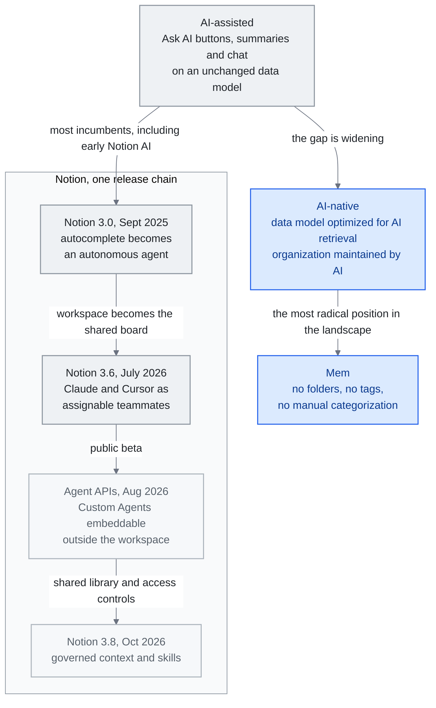

<!-- translation-sync:start -->
> 與 2026-10-31 英文版同步的機器輔助譯文，已作結構與內容覆核。程式碼和圖中標籤保留原文；閱讀時間按英文原文估算。
> [English source](../../../chapters/08-tools-landscape.md) · [Sync record](../../SYNC.md)
<!-- translation-sync:end -->

<!-- i18n-anchor -->

# 第 8 章：工具地景 —— AI 原生知識管理

> **一句話總結：** AI 驅動知識管理的工具地景從 AI 增強的筆記應用一路到完全 AI 原生的平臺。
>
> **為什麼重要：** 如果你做筆記、管理知識、組織資訊, AI 正在改變這個空間內每個工具的運作方式。
>
> **閱讀時間：** ~13 分鐘（按英文原文估算：2,912 個單詞 / 230 wpm）

*圖："The AI-Assisted vs. AI-Native Gap"一節的光譜，早期 Notion AI 位於輔助端，Mem 無需手動組織的設計位於原生端。Notion 的釋出鏈遵循本章敘述：3.0 引入智慧體，3.6 接納外部隊友，八月 Agent APIs 支援嵌入，十月 3.8 增加受治理的共享上下文與技能。當工具仍然繫結於為純人工工作流設計的資料模型時，差距會擴大；共享庫的連線則顯示程式性知識如何進入工作區。*

<!-- i18n-anchor -->

## 地景

人們用來組織、檢索、推理自己知識的工具正圍繞 AI 重建。本章調查 AI 驅動知識管理的主要平臺——不是產品評測, 而是本報告通篇討論的知識工程原則的實現。每個工具對人類與 AI 應如何在知識工作上協作下不同的架構賭注。

## Notion AI

Notion 佔協作知識管理市場約 25%, 讓它的 AI 策略對整個空間有重大影響。

**Notion 3.0**（2025 年 九 月）標誌根本轉變: Notion 把 AI 層從自動完成功能重建為自主 agent。不是建議續寫或回答關於你 workspace 的查詢, Notion 的 AI agent 現在能獨立導覽你的 workspace、建並修改頁面、更新資料庫、執行多步工作流。它理解你的 workspace 結構、跨頁面交叉參照資訊、維持關於你組織 pattern 的 context。

2026 年 一 月, Notion 引入多模型支援, 讓使用者把不同任務路由到不同模型: GPT-5.2 用於創意寫作、Claude Opus 4.6 用於分析任務、Gemini 3 用於多模態工作。這種模型路由做法反映成熟的理解: 沒有單一模型在每件事上都頂尖, 知識管理層應該是模型無關的。

Notion 的強項是它結合結構化資料（資料庫、關聯、rollup）與非結構化內容（頁面、block）。這種混合結構給 AI agent 豐富的後設資料可用——不只是文字搜尋, 還有型別化屬性、實體之間關聯、明確階層。

**Notion 3.6** (2026 年七月 1 日) 將工作空間轉變為 *其他供應商* 智慧體的協調執行底座。其 **外部智慧體** 功能使 **Claude** 和 **Cursor** 成為首批在共享 Notion 任務看板上以可見、可分配隊友身份執行的外部智慧體——可在人類協作者使用的介面上進行 @ 提及、監視和問責。這與之前 **3.5 開發者平臺** 的 2026 年五月 13 日 釋出不同，後者將 Codex 和 Decagon 作為外部智慧體 API 合作伙伴。同一版本還增加了 **Notion 工作者**（現在可以構建和部署自定義程式碼，包括在 Windows 上）、五個新的 MCP 聯結器（Mercury、Mixpanel、Miro、Box、ClickHouse）、原生 PPTX / XLSX / DOCX 讀寫功能，以及自定義智慧體操作的審計日誌；Notion 報告其 MCP "usage has 10×'d in the past month." 節奏是反轉：之前 Notion AI 是在 Notion 內部執行的智慧體，現在 Notion 成為了其他智慧體產品作為隊友插入的共享看板。

在 **2026 年八月 20 日** 上，Notion 將基於會話的 **智慧體 API**（與自定義智慧體開始聊天、流式傳輸其回覆、提交操作、瀏覽會話事件歷史記錄）從私有 alpha 階段轉為公開 beta。其目的是嵌入：現在自定義智慧體可以嵌入在 Slack 機器人、內部工具或移動應用中，而不僅僅侷限於 Notion 工作空間本身。所有使用 Alpha 路由整合的使用者必須在 2026 年九月 30 日 之前遷移到新的會話/事件模型。參考 3.5 (五月 13 日, 外部智慧體 API 合作伙伴) 和 3.6 (七月 1 日, Claude/Cursor 作為可分配看板隊友)，這是同一弧線的第三步：向其他供應商的智慧體開放工作空間，使 Notion 自己的自定義智慧體成為可分配隊友，然後透過公開的 API 介面使這些智慧體可以嵌入到任何地方。

**Notion 3.8**（[October 13, 2026](https://www.notion.com/releases/2026-10-13)）將這一演進擴充套件到受治理的共享上下文。其 Skills API 透過 GitHub 釋出由 Notion 管理的技能庫。該版本增加按使用者撤銷 MCP 授權、帶修改者歸屬且可恢復的修訂歷史，以及資料庫屬性許可權。這些都是廠商描述的控制措施，尚無獨立證據證明每個智慧體都能正確保留這些控制。

## Obsidian

Obsidian 佔整體知識管理市場約 8%, 但那個數字戲劇性低估它的影響力。在開發者、研究者、技術知識工作者——最積極實驗 AI 增強知識系統的人口——Obsidian 主導個人知識管理（PKM）利基。

截至 2026 年二月，Obsidian 有超過 1.5 百萬活躍使用者，同比增長 22%，以及 2,700+ 個社群外掛。其架構選擇使它特別適合 AI 整合：

**本地優先 markdown。** 每個筆記是你檔案系統上的一個純文字 markdown 檔。沒有專有資料庫、沒有云端依賴、沒有供應商鎖定。這意味任何能讀寫檔案的 AI 工具都能與 Obsidian vault 一起運作。無 API 金鑰、無 OAuth 流程、無 rate limit——只有檔案。

**雙向連結。** Obsidian 的 `[[wikilink]]` 語法隱含創造一個知識圖。每個連結是一個關係。結果的圖結構正是增強 AI 檢索與推理的那種結構化知識。

**外掛可擴充套件性。** 外掛生態系產生幾個突出的 AI 整合:

- **[Copilot for Obsidian](https://github.com/logancyang/obsidian-copilot)**（6,500+ GitHub stars）——用任何 LLM 與你的 vault 聊天。為基於 RAG 的檢索索引你的筆記, 支援多個 embedding 供應商, 跨 session 維持對話 context。

- **[Smart Connections](https://github.com/brianpetro/obsidian-smart-connections)**（4,700+ GitHub stars, $25/月 Pro 層）——AI 驅動的筆記發現, 你寫作時浮現語意相關筆記。用本地 embedding 跨你的 vault 建相似度索引, 不送資料到外部服務。

- **[Claudian](https://github.com/claudian-ai/claudian)**（5,800+ GitHub stars）——Claude 與 Obsidian 之間的深度整合, 讓 Claude 能讀、寫、推理 vault 內容, 配完整 context 覺知。

Obsidian 的本地優先架構讓它對隱私意識使用者、對知識庫本身敏感（研究筆記、專有分析、個人日記）的工作流是天然適合。取捨是協作功能落後雲端原生工具如 Notion。

## Mem

[Mem](https://mem.ai) 在地景中採取最激進立場: 知識管理應該需要零手動組織。沒有資料夾、沒有標籤、沒有手動分類。你寫筆記, Mem 的 AI 處理其他一切——把相關內容群集、在你需要時浮現相關資訊、維持連貫知識庫而不需使用者做任何組織勞動。

這個做法直接押注 AI 檢索已變得夠好可以取代人類策展。對覺得傳統 PKM 系統太苛刻的使用者, Mem 提供有說服力的替代。風險是沒有人類可讀組織, 使用者失去稽核、debug、理解自己知識庫的能力。

<!-- i18n-anchor -->

## 浮現平臺

幾個較新平臺正探索替代做法:

**[Heptabase](https://heptabase.com)** 使用視覺畫布模型，其中筆記以卡片的形式存在於無限空間表面上。使用者可以視覺化地排列、連線和聚類筆記，建立補充文字連結的空間關係。這種空間維度增加了文字系統無法複製的組織層次。截至 **v1.98.0** (2026 年六月 2 日)，其 AI 智慧體可以直接編輯標籤資料庫，並可透過快照撤銷這些編輯。

**[Capacities](https://capacities.io)** 引入了基於物件的知識管理，其中每一塊內容都是一個型別化的物件（人、專案、會議、概念），具有定義的屬性和關係。這種強型別方法為 AI 提供了比自由形式筆記更乾淨的結構化資料。截至 **AI Chat Connectors 2.0** (2026 年六月)，外部 AI 應用（任何 MCP 客戶端）可以對型別化物件圖進行完整的 CRUD 操作（建立頁面和任務、例項化型別化物件、更新屬性）。

**[Tana Outliner](https://outliner.tana.inc)** 實現了超標籤——一個系統，其中任何節點都可以用定義其結構、欄位和行為的型別進行標記。超標籤在大綱器上建立了一個使用者定義的模式層，使結構化資料捕獲不會犧牲自由形式筆記的靈活性。*命名說明：* 在 2026 年三月，Tana Inc. 將 **"Tana"** 品牌和 `tana.inc` 重新分配給一個新的智慧體會議產品（在視訊通話期間實時執行的 AI 智慧體，填充一個持久的上下文圖）；此處描述的超標籤大綱器現在位於 **Tana Outliner** (`outliner.tana.inc`)。根據 Tana 自己的說明，"web content describing 'Tana' as a note-taking app, PKM, or outliner refers to this product, Tana Outliner."

<!-- i18n-anchor -->

## AI 輔助 vs. AI 原生差距

地景中浮現一個關鍵區分: 把 AI 功能栓在現有架構上的工具, 與從零圍繞 AI 設計的工具之間的差異。

**AI 輔助工具** 在現存知識庫上加"Ask AI"按鈕、AI 生成總結、聊天介面等功能。底層資料模型、組織正規化、使用者體驗根本不變。大多數現有者——包括早期版 Notion AI——屬於這類。

**AI 原生工具** 把 AI 作為知識工作的一等參與者來設計核心架構。它們的資料模型為 AI 檢索最佳化。組織結構被設計為由 AI 而非人類維護。使用者體驗假設 AI 處理知識管理的繁瑣部分（分類、連結、浮現）, 人類聚焦在創造與決策。

這兩種做法的差距在擴大。AI 輔助工具永遠會被為只人類工作流設計的資料模型限制。AI 原生工具能為越來越定義知識工作的人類-AI 協作最佳化。

<!-- i18n-anchor -->

## 這些工具如何連到生態系

本章工具不與本報告描述的知識工程生態系分離——它們是它的消費者面實現。每個概念都直接對映:

**RAG** 是當你問 Copilot for Obsidian 一個問題, 它從你 vault 檢索相關筆記時發生的事。第 3 章的切塊策略、embedding 模型、檢索演算法在底下跑。

**第 6 章的記憶系統** 驅動 Notion AI 與 Mem 的個人化——學你的偏好、記你的專案、隨時間適應的能力。

**第 5 章的 context engineering** 決定這些工具產生回應時如何決定包含什麼資訊。視窗管理、優先化、壓縮技術讓 AI 功能感覺智慧而非通用。

**第 7 章的 MCP** 越來越是這些工具用來連到外部資料來源的協議, 讓你的知識庫能透過標準化介面從 GitHub、Slack、email、資料庫拉取。

這些工具是知識工程的抽象原則變成具體每日實務的地方。它們是個人為他們的個人與專業知識實現 RAG、記憶、context engineering 的 harness。

<!-- i18n-anchor -->

## AI 速度悖論

伴隨 *個人* 知識管理的工具地景, 平行故事在開發者工具中上演——2026 年 四 月它產生年內最受討論的資料點之一。Harness.io 與 Infosys 聯合發表 **"State of DevOps 2026"** 報告, 頭條發現變得叫做 **AI 速度悖論**:

> **69% 團隊報告部署瓶頸, 即使 AI 輔助編碼快了 45%。**

機制直接。AI 程式設計助手（Copilot、Cursor、Claude Code、Codex）讓程式碼生成戲劇性更快。更多 PR 開、更多 diff 到、更多候選實現堆在審查與部署階段。但生成下游的系統——程式碼審查、測試基礎設施、安全掃描、合規檢查、部署管線、事件回應——沒以同樣速度擴充套件。生成不再是約束。**評估與治理是新約束。**

報告給從業者私下叫了一打不同名字的 pattern 一個名字: **"Harness Fatigue."**。它描述團隊試圖為 AI 生成程式碼建自動化護欄, 速度跟生成本身一樣的掙扎。每個新模型釋出讓問題更糟, 讓產生需要審查的更多程式碼更容易。

這個框架從相反方向落到本報告從第 4 章起就在做的同一論點: 當行業整個 2025 年講"the harness is the moat", 潛文是建好 harness 的工程團隊會拉開領先。2026 年, 速度悖論把同觀察轉成警告: 不擴充套件評估與治理層就擴充套件生成的團隊發現自己整體走得更慢, 不更快。瓶頸移了, 但總吞吐量未必改善。

對知識工程的實務收穫:"harness"不再只是為生產用包模型的東西。它也是必須與生成速度同步擴充套件的東西——否則部署吞吐量沉默地飽和, 而每個人都堅稱 AI 讓他們更快。

**底座本身如今也可移植。** April 27, 2026，Microsoft 與 OpenAI 公佈修訂後的合作協議，結束 OpenAI 對 Azure 的雲獨佔安排，OpenAI 如今可透過 AWS、Google Cloud 或任何提供商開放 API 訪問；協議對收益分成設定不對稱上限，並移除長期爭議的 AGI 條款，後者原本允許 OpenAI 單方面宣佈實現 AGI 後退出財務義務。對知識工程團隊，這不是商業新聞，而是底座變化：最大的封閉權重前沿模型不再鎖於單一雲平臺。"Which cloud do you run on"不再限制"which models do you have access to"，至少 GPT 家族如今獲得開放權重生態早已享有的條件。結合 DeepSeek V4 釋出首日的 Ascend-NPU 支援（第 11 章，四月 24 日），2026 年下半年開始，可移植底座成為預設預期，而非例外。

**託管底座如今也會學習與自我糾正。** **May 6, 2026**，Anthropic 為 Managed Agents 增加三項基礎能力：**Dreaming**，定期在會話間整理記憶；**Outcomes**，按評分準則迭代、由獨立評分器評估的迴圈；**Multiagent Orchestration**，主智慧體扇出、共享檔案系統。同日 AWS 的 **MCP Server** 正式釋出，並首次提供超大規模雲廠商認可的 **Skills** 部署。結合 Velocity Paradox，含義直接：報告指出的瓶頸是評估與治理，而非生成，新託管基礎能力恰在這些介面競爭。2025 年擴充套件生成的自託管編排層，如今面對 2026 年擴充套件*學習與評分*的託管競爭者。Velocity Paradox 不是由更快程式碼生成解決，而由能學習自身錯誤反覆出現位置的基礎設施解決；這就是 Anthropic、AWS 剛釋出的底座。

---

<!-- i18n-anchor -->

## 三個要點

- **差距在資料模型，而非功能。** AI 輔助工具仍受制於為純人工工作流設計的資料模型，因此增加再多 Ask AI 按鈕，也無法彌合差距。
- **Notion 不只成為智慧體，也成為看板。** 到 3.6，它讓 Claude、Cursor 等其他廠商智慧體作為可分配、可觀察的隊友，與自家 Custom Agents 一同工作；2026 年八月 Agent APIs 又讓這些自家智慧體可嵌入工作區之外。
- **生成不再是瓶頸。** State of DevOps 2026 發現，儘管 AI 輔助編碼速度提高 45%，69% 團隊仍報告部署瓶頸；這意味著編排層必須與生成同步擴充套件，否則吞吐量會悄然達到上限。

---

<!-- i18n-anchor -->

## 來源

1. Notion. "Introducing Notion 3.0."（2025 年 九 月）。https://www.notion.so/blog
2. Notion. "Multi-Model AI."（2026 年 一 月）。https://www.notion.so/blog
3. Obsidian 使用統計（2026 年 二 月）。https://obsidian.md
4. Copilot for Obsidian. https://github.com/logancyang/obsidian-copilot
5. Smart Connections. https://github.com/brianpetro/obsidian-smart-connections
6. Claudian. https://github.com/claudian-ai/claudian
7. Mem. https://mem.ai
8. Heptabase。https://heptabase.com ：更新日誌（v1.98.0，June 2, 2026）：https://wiki.heptabase.com/changelog （AI Agent 獲得可透過快照撤銷的標籤資料庫編輯訪問）。
9. Capacities。https://capacities.io ："What's new: release 66"（2026 年六月）：https://capacities.io/whats-new/release-66 （AI Chat Connectors 2.0，MCP 客戶端對帶型別物件圖執行 CRUD）。
10. Tana Outliner。https://outliner.tana.inc ：supertag 大綱工具；"Tana as it is now"（2026 年三月）：https://outliner.tana.inc/articles/tana-current-march-2026 ，以及 Tana Inc. 更新日誌 https://tana.inc/changelog/2026-06-26-transcription-language （`tana.inc` 品牌在 2026 年三月被重新分配給一款新的智慧體會議產品）。
11. Microsoft. "The next phase of the Microsoft-OpenAI partnership."（2026 年 四 月 27 日）。[https://blogs.microsoft.com/blog/2026/04/27/the-next-phase-of-the-microsoft-openai-partnership/](https://blogs.microsoft.com/blog/2026/04/27/the-next-phase-of-the-microsoft-openai-partnership/)
12. OpenAI. "The next phase of the Microsoft partnership."（2026 年 四 月 27 日）。[https://openai.com/index/next-phase-of-microsoft-partnership/](https://openai.com/index/next-phase-of-microsoft-partnership/)
13. Anthropic. "New in Claude Managed Agents: dreaming, outcomes, and multiagent orchestration." 2026 年五月 6 日. [https://claude.com/blog/new-in-claude-managed-agents](https://claude.com/blog/new-in-claude-managed-agents)
14. AWS. "The AWS MCP Server is now generally available." 2026 年五月 6 日. [https://aws.amazon.com/blogs/aws/the-aws-mcp-server-is-now-generally-available/](https://aws.amazon.com/blogs/aws/the-aws-mcp-server-is-now-generally-available/)
15. Notion. "Release notes"（2026 年七月 1 日)：[https://www.notion.com/releases/2026-07-01](https://www.notion.com/releases/2026-07-01) 和（2026 年五月 13 日)：[https://www.notion.com/releases/2026-05-13](https://www.notion.com/releases/2026-05-13)--- 3.6 外部智慧體（Claude、Cursor）；3.5 開發者平臺（Codex、Decagon 作為 API 合作伙伴）；Notion 工作者；五個新的 MCP 聯結器；原生 PPTX/XLSX/DOCX；自定義智慧體審計日誌；MCP "usage has 10×'d in the past month."
16. Notion Developers。"Changelog"（August 20, 2026 條目）：[https://developers.notion.com/page/changelog](https://developers.notion.com/page/changelog)。基於會話的 Agent APIs，包括與 Custom Agent 開始聊天、流式接收回復、提交操作、分頁瀏覽會話事件歷史，從私有 alpha 轉為公開 beta；alpha 路由整合須於 September 30, 2026 前遷移至 sessions/events 模型。

17. Notion。"Notion 3.8: Context for your agents"（October 13, 2026）。[釋出說明](https://www.notion.com/releases/2026-10-13)。

---

*上一章：[第 7 章 -- MCP：贏得勝利的標準](07-mcp.md)*
