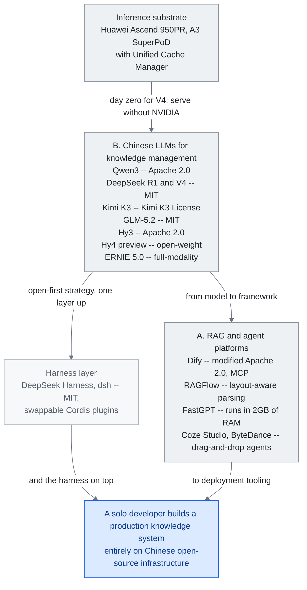
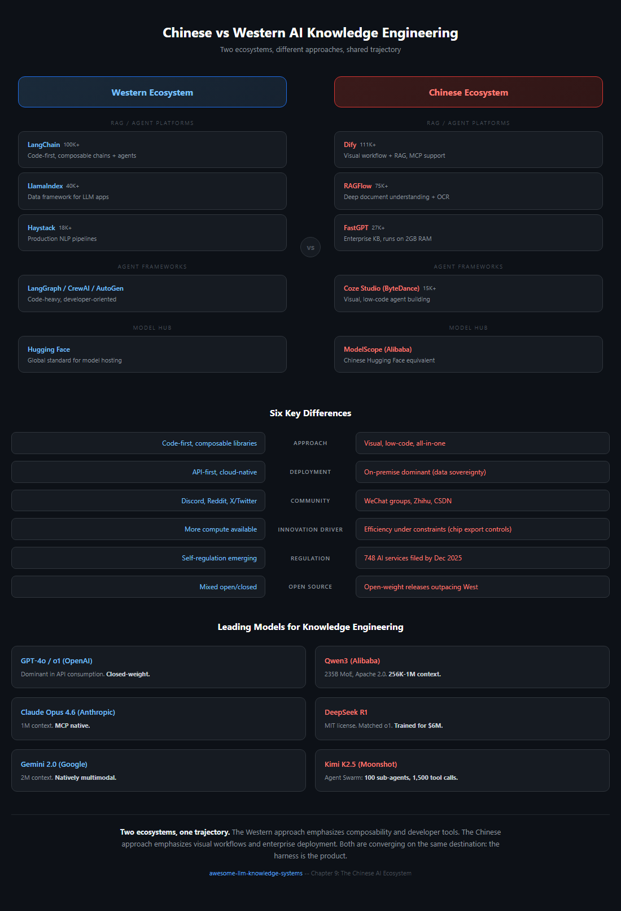

<!-- translation-sync:start -->
> 與 2026-10-31 英文版同步的機器輔助譯文，已作結構與內容覆核。程式碼和圖中標籤保留原文；閱讀時間按英文原文估算。
> [English source](../../../chapters/09-china-ecosystem.md) · [Sync record](../../SYNC.md)
<!-- translation-sync:end -->

<!-- i18n-anchor -->

# 第 9 章：中國 AI 知識工程地景

> **一句話總結：** 中國建出一套平行 AI 生態系, 配自己的開源平臺、模型、社群——常常朝與西方不同的方向創新。
>
> **為什麼重要：** 全球一半的 AI 研究者在中國。忽略這個生態系意味錯過一半的創新。
>
> **閱讀時間：** ~27 分鐘（按英文原文估算：6,092 個單詞 / 230 wpm）

*圖：A、B 兩節描述的技術棧，自上而下閱讀：國產推理晶片支撐中國模型家族，模型再進入兩條並行分支，一條是執行於其上的已釋出編排層，另一條是企業實際部署的視覺化優先平臺。許可證寫在節點標籤中，因為授權方式就是 C 節"Open-Source as Strategic Imperative"所說的戰略。兩組連線承載論點：釋出首日適配 Ascend，支援的是"serve without NVIDIA"，而非"train without NVIDIA"；底部兩條分支重新匯合，形成一個端到端建立在中國開源基礎設施上的生產知識系統。*

關於 LLM 知識工程的全球對話, 不檢視中國生態系就不完整。截至 2025 年 十二 月已向監管機構申報超過 748 項 AI 服務, 中國發展出一套平行——某些領域且發散——的方法來用大型語言模型建知識系統。本章繪製塑造中國開發者與企業如何處理知識工程的關鍵平臺、模型、文化差異。

<!-- i18n-anchor -->

## A. 開源 RAG 與 Agent 平臺

中國開源 AI 生態系產生幾個在 GitHub 流行度上匹敵或超越西方對手的平臺。這些專案的特徵是它們對視覺化工作流、企業部署就緒度、深度檔案理解的強調——反映中國企業客戶的實務需求。

<!-- i18n-anchor -->

### Dify（136K+ GitHub Stars）

[Dify](https://github.com/langgenius/dify) 是全球 GitHub stars 最多的智慧體 AI 平臺，提供可視畫布，用於構建 RAG 流水線、智慧體工作流與多步推理鏈。自 1.0 版起，Dify 支援 Model Context Protocol（MCP），可無縫整合外部工具伺服器。其優勢在於連線兩類使用者：以可視方式設計工作流的無程式碼使用者，以及需要程式化控制的開發者。企業可以自託管整個技術棧，這在中國市場尤為關鍵，因為資料主權要求經常排除僅提供雲服務的方案。

Dify 採用**修改版 Apache 2.0**，對多租戶運營、前端標誌／版權修改附加條件。允許自託管不等於可以不受限制地以 SaaS 再分發；部署團隊必須按自身場景檢查實際許可證。這為本章的開放基礎設施論點在平臺層增加了限定。

<!-- i18n-anchor -->

### RAGFlow（62-75K+ GitHub Stars）

[RAGFlow](https://github.com/infiniflow/ragflow) 透過深度檔案理解差異化。不是把檔案當扁平文書處理, RAGFlow 跨 20+ 檔案格式（包括掃描 PDF、試算表、投影片）應用版面感知解析、OCR、表格提取。它的"agentic RAG"做法意味系統能根據查詢型別自主決定要應用哪種檢索策略。對處理遺留檔案庫的企業——中國國營企業與製造公司常見的情境——這能力不是 nice-to-have 而是要求。

<!-- i18n-anchor -->

### FastGPT（27K+ GitHub Stars）

[FastGPT](https://github.com/labring/FastGPT) 瞄準企業知識庫 Q&A, 聚焦在資源效率。它的 QA 對提取管線自動把檔案轉成 question-answer 對, 然後能用於檢索與微調。該平臺被設計成能在低至 2GB RAM 的機器上跑, 讓請不起專用 GPU 基礎設施的中小企業能存取。這個節儉反映中國生態系的更廣 pattern: 在約束下的最佳化。

<!-- i18n-anchor -->

### MaxKB（18K+ GitHub Stars）

[MaxKB](https://github.com/1Panel-dev/MaxKB) 把自己定位為配一鍵部署的企業 agent 平臺。它支援 MCP 做工具整合, 併為常見企業情境提供預建模板: 客服、內部知識檢索、檔案總結。它的吸引力在於把"we want an AI assistant"到"we have one running"的時間從數週縮到數小時。

<!-- i18n-anchor -->

### Coze Studio（15K+ GitHub Stars, ByteDance）

[Coze Studio](https://github.com/coze-dev/coze-studio) 是 ByteDance 的開源視覺 agent 開發平臺。原本是閉源產品, ByteDance 在 2025 年 七 月開源它, 三天內累積 10,000 GitHub stars——既證明壓抑需求也證明 ByteDance 的分發力。Coze Studio 提供拖放介面建 agent, 含內建記憶、工具使用、多輪對話管理。它與 ByteDance 的豆包模型家族整合給它在中文任務上原生優勢。

這種獨立產品定位正被整合。36kr 在 **August 24, 2026** 報道，位元組跳動完成內部合併，將 TRAE 編碼平臺與 Coze 納入豆包聊天機器人的辦公工具組織。TRAE IDE 與 CLI 保持獨立產品，TRAE Work、Coze 則與豆包辦公功能合為即將推出的統一品牌"Doubao Work."。同一報道說，整合應用最快"as soon as this week"推出；位元組跳動自身回應只涉及重組，因此日期屬於媒體報道，未經公司確認。其方向與西方常見做法相反：不是將 IDE、智慧體構建工具與消費者聊天產品分開，而是讓開發工具被超級應用吸收，而非環繞其執行。

<!-- i18n-anchor -->

### DB-GPT（17K+ GitHub Stars）

[DB-GPT](https://github.com/eosphoros-ai/DB-GPT) 專精在 AI 原生資料互動。它的核心能力是自然語言轉 SQL 轉換, 讓非技術使用者能對話式查詢資料庫。它用視覺化生成與多 agent 資料分析管線延伸這。對坐擁大型結構化資料集的企業——這描述大多數中國金融、物流、製造公司——DB-GPT 提供 AI 增強分析的可親入口。

<!-- i18n-anchor -->

## B. 中國 LLM 的知識管理

中國基礎模型地景已快速成熟, 幾個模型現在在特定基準上與西方對手競爭或勝過。

<!-- i18n-anchor -->

### Qwen3（阿里雲）

Qwen3 是 Alibaba 的旗艦模型家族。最大變體是 235-billion-parameter 混合專家（MoE）模型，以 Apache 2.0 釋出。專注編碼的 Qwen3-Coder-480B 支援從 256K 到 1M token 的上下文視窗。Apache 2.0 許可具有戰略意義：允許無限制商業使用，推動了無力承擔專有 API 成本的中國初創企業採用。Qwen 在中文、日文與韓文上的多語言能力尤其強，而西方模型在這些語言上歷史表現較弱。

<!-- i18n-anchor -->

### Qwen-Scope（Alibaba，2026 年五月）

Alibaba Qwen 團隊將同樣的開放釋出立場，從權重延伸到可解釋性工具。**Qwen-Scope**（arXiv 預印本於 **May 12, 2026** 提交）是一套開放的**稀疏自編碼器，共 14 組**，在**七個 Qwen3、Qwen3.5 變體**上訓練，涵蓋稠密與 MoE，引數從 **1.7B 到 35B**，即 Qwen3-1.7B 至 Qwen3.5-35B-A3B；SAE 寬度與稀疏度按各主幹列出，而非彙總成一個特徵總數。它區別於普通研究產物的地方在於封裝：論文將 SAE 特徵作為四類開發工具，包括無需提示工程、透過操縱內部特徵實現推理時引導；以啟用特徵反映基準冗餘與能力覆蓋的評估分析；資料分類與組織；以及監督微調、RL 的訓練後支援。對本章而言，意義在於來源：訓練前沿開放權重模型家族的實驗室，自己開放釋出其可解釋性基礎設施，說明中國生態也在貢獻一個通常被描述為只消費成果的研究維度；這與下文 mHC 等架構主張不同，交付物是工具，而非結果。

### DeepSeek R1

DeepSeek R1 在數學與科學推理基準上匹敵 OpenAI o1，同時以 MIT 許可證釋出。常被關聯的低於 $6 million 數字，屬於 **DeepSeek-V3**，而非 R1：技術報告以每 H800 GPU 小時 $2 為假設，估算正式訓練成本 **$5.576 million**，不含前期研究與消融實驗。這是廠商估算，不是 R1 的全部開發預算。R1 的架構意義在於讓前沿推理以開放權重方式可用。

2026 年 四 月, DeepSeek 用 **流形受限超連線（mHC）** 延伸它的架構貢獻, 這是 Transformer++ 風格模型用的殘差連線的泛化。當標準殘差流跨層向前攜帶單一通道資訊, mHC 攜帶 **多個內部流**, 每個被約束在一個學到的低維流形上。這個構造被設計來給後期層更豐富存取早期表示, 而不受簡單多流殘差在規模上承受的維度崩塌。DeepSeek 的部落格在引數量相當下報告長程推理基準上的增益, 在資訊必須跨許多中間層攜帶的任務上有最大改進。截至 2026 年 四 月, 該結果應被 **標記為等獨立複製**——這是單一實驗室對單一實驗室模型的披露, 而該領域在沒經過第三方再現的架構主張上吃過虧。如果結果成立, mHC 加入 MoE、MLA、DeepSeek 早期 multi-token prediction 工作, 成為在中國開源權重生態系起源後跨入主流使用的第三或第四個架構 primitive。

<!-- i18n-anchor -->

### DeepSeek V4（2026 年 四 月）

DeepSeek **V4 預覽**（April 24, 2026）在經濟性、能力與**推理底座**三個維度同時延伸 R1 的故事。它在 Hugging Face 以 MIT 許可證釋出兩個開放權重混合專家模型：**V4-Pro 為 1.6 萬億總引數／49B 活躍**，**V4-Flash 為 284B／13B 活躍**，預設而非分檔提供 1-million-token 上下文。API 定價是 2026 年前沿級模型中最激進的：**V4-Flash 每百萬輸出 token $0.28**，V4-Pro 為 $3.48，反映相對 V3 **每 token 推理 FLOPs 減少 73%**，由架構變化推動，而不只是硬體最佳化。在 R1 最初建立信譽的編碼基準上，V4-Pro 登頂，**LiveCodeBench 為 93.5%**，高於 Gemini 3.1 Pro 的 91.7%、Claude Opus 4.6 的 88.8%；**Codeforces 評分 3206**，超過 GPT-5.4 的 3168。

但對本章最重要的結構細節, 不是定價或基準, 而是 **推論基底**。訓練 V4 用了含 NVIDIA A100 與 H20 硬體的混合叢集——前沿*訓練*能否完全在 NVIDIA 堆疊外發生的問題仍困難。但模型 **day-zero 適配 Huawei Ascend 950PR**, DeepSeek 與 Huawei 聯合報告在為模型生產服務上 Ascend NPU 與 NVIDIA H20 GPU 之間的 **推論對等——在這個架構上, 約 2.8 倍運算吞吐**。這是主權矽論點的微妙形式: 不是"we trained without NVIDIA"而是 **"we serve without NVIDIA."**。對面對美國出口管制的中國企業客戶, V4 是首次有前沿級開源權重模型在 day-one 就有可信的國產矽服務路徑——對本章一直在描述的部署重的中國生態系, 這比訓練可選性更接近承重約束。讀在 R1 2025 年 一 月拐點旁邊, V4 關閉一個一年的故事弧線: 中國開源權重生態系現在能在同一天釋出前沿程式設計模型 **與** 為它服務的基底。

**June 29-30, 2026**，DeepSeek 宣佈 V4 預覽將於 **2026 年七月中旬正式釋出**，全系列具備 1M-token 上下文，並伴隨結構性定價變化：**高峰時段 API 價格**，北京時間 9:00-12:00、14:00-18:00，為**非高峰價的 2x**，非高峰基線不變；V4-Pro 快取未命中的每百萬輸入 token 為 $0.435、輸出 $0.87，V4-Flash 為 $0.14 / $0.28。前沿開放權重推理 API 按需求與時段定價，讓*價格成為排程基礎能力*：執行批次智慧體任務的中國企業，可將任務移到非高峰視窗，把推理成本減半，正如雲現貨市場十年來為算力提供的槓桿。

<!-- i18n-anchor -->

### 電信運營商規模的自主晶片（Huawei + 中國移動，2026 年六月）

"serve without NVIDIA"論點在六月首次獲得電信行業驗證。MWC 上海（June 24, 2026）上，**Huawei 與中國移動湖北**在中國首次對 Huawei **AI Inference Acceleration Solution** 進行現網驗證：**Ascend A3 SuperPoD** 配合 **OceanStor A800** 儲存，以及管理 PB 級 KV 快取的 **Unified Cache Manager（UCM）**。結果是在*真實運營商商用網路上，以模擬的 8K-190K-token 長上下文工作負載驗證*，不是實際電信業務流量：GLM-5.1 首 token 延遲減少 **51-93%**，128K 序列長度下吞吐量最高 **+372%**。對知識工程的意義在於，DeepSeek 在模型釋出時展示的國產晶片服務路徑，如今有基礎設施廠商與運營商共同開展、獨立於該模型釋出的生產規模演示；KV-cache 管理層（第 3 章）成為自主晶片經濟效益成敗的戰場。

同一論點背後可能正在形成更大規模的投入，但所有細節均未確認。Bloomberg 於 **September 4, 2026** 引述知情人士報道，DeepSeek 計劃在內蒙古烏蘭察布約 1GW 的資料中心部署至少 **160,000 個 Huawei Ascend 950DT 加速器**，目標是 2027 年末或 2028 年初部分投運。晶片用於推理，訓練繼續使用 DeepSeek 現有 NVIDIA 硬體；這是 V4 已在模型規模展示的"serve without NVIDIA, train with it"分工，如今擬議擴大至園區規模。交付可能超過一年：報道指記憶體元件供應將 Huawei 950DT 在 2026 全年的產量限制在數十萬臺較低區間。DeepSeek 與 Huawei 均未確認訂單，報道依據匿名來源而非任何一方宣告，因此本章將其列作表達出的意向，而非已部署容量。

<!-- i18n-anchor -->

### DeepSeek Harness（dsh）：開源智慧體編排層（2026 年八月）

**August 13, 2026**，DeepSeek 以 MIT 許可證釋出 **DeepSeek Harness（dsh）**開發者預覽（github.com/deepseek-ai/deepseek-harness）。設計圍繞 DeepSeek 所稱的 **"Cordis"外掛正規化**，在配套白皮書"A Programming Paradigm for Spatiotemporal Composability"中說明：模型介面卡、工具登錄檔、會話日誌、沙箱、儲存、排程迴圈與 UI 層，均為可替換外掛，而非固定接入執行時的元件。僅追加會話日誌記錄智慧體每次上下文注入，包括系統提示、推理軌跡、工具呼叫及結果，以及子智慧體排程決策。在自身排程迴圈內，將 Claude Code 或 Codex 作為單次子智慧體呼叫，是第一方功能，不是媒體說法：倉庫提供專門的 `@deepseek-ai/dsh-subagent-claude-code` 與 `@deepseek-ai/dsh-subagent-codex` 包，呼叫官方 Claude Agent SDK 與 Codex `app-server`，按倉庫 August 4, 2026 的設計說明實現，媒體報道再從程式碼中取得這一能力。倉庫增長按任何標準都很快：釋出 11 天內有 190,630 stars、21,319 forks，三週後達到 224,004 stars、26,637 forks，分別於 August 24、September 15, 2026 透過 GitHub API 驗證。以後再引用前須重查，因為數字會變化；媒體定性描述其為開發工具有記錄以來最快的採用曲線之一。

<!-- i18n-anchor -->

### Kimi K2.5（Moonshot AI）

Kimi K2.5 引入"Agent Swarm"能力，單次查詢最多生成 100 個子智慧體，透過約 1,500 次工具呼叫協調。這不是研究演示，而是用於複雜研究任務的生產功能；系統讓數十個併發智慧體並行開展網頁搜尋、文件分析與綜合。更早時，Kimi 已達到 2-million 中文字元上下文視窗，約在 2025 年三月，成為專為中文最佳化的最長上下文模型。

<!-- i18n-anchor -->

### Kimi K3（Moonshot AI，2026 年七月）

**July 17, 2026**，Moonshot 釋出 **Kimi K3**，**2.8 萬億引數**（MoE），是迄今釋出過的最大開放權重模型，具備 1M-token 上下文與原生視覺。它以開放權重模型身份登頂 Arena 前端編碼榜，在 Artificial Analysis Intelligence Index 的 189 個模型中位列第 4，分數 57，僅落後於 Fable 5 與 GPT-5.6 Sol 的若干配置。完整權重於 **七月 27 日**隨後釋出，適用 Moonshot 自訂的 **Kimi K3 License**；公司自身說法是"open weight,"而非"open source,"，超過營收門檻的商業使用須另與公司訂立協議，走在 Qwen 的 Apache 2.0 與封閉釋出之間。Fortune 將其描述為市場的"new DeepSeek shock"，釋出時間恰與 WAIC 2026 在上海開幕同周，成為生態七月浪潮的重心。從業者需注意一項限定：2.8T 引數的 K3 僅適合伺服器級部署，向上擴大開放權重前沿的規模，卻未改變本地部署情況。

<!-- i18n-anchor -->

### ERNIE 5.0（百度）

ERNIE 5.0 是百度的 2.4 萬億引數模型, 配原生全模態支援——單一模型內的文字、影象、聲音、影片理解與生成。2026 年 一 月推出, 它代表百度的賭注: 知識系統的未來從地基起就是多模態, 不是把多模態附加到文字模型作為事後想法。

<!-- i18n-anchor -->

### GLM-4.5/5（Zhipu AI）

智譜 AI 的 GLM 系列，以 744-billion-parameter MoE GLM-5 為代表，專門面向智慧體編排層。架構包含原生工具使用 token 與結構化輸出保證，減少構建可靠智慧體所需的支架程式碼。這種"agent-native"設計理念，讓 GLM 接入生產流水線時減少提示工程與重試。**June 13, 2026**，智譜釋出 **GLM-5.2**，在 Hugging Face 採用 MIT 許可證；其 **IndexShare** 讓每四個稀疏注意力層共用同一索引器，在完整 **1M-token 上下文中將每 token FLOPs 降低 2.9x**，另有改進的多 token 預測層，將推測解碼接受長度**提高最多 20%**。按 Hugging Face 模型卡，GLM-5.2 的 HLE 為 40.5，帶工具 54.7；SWE-Bench Pro 62.1；AIME 2026 為 99.2。

<!-- i18n-anchor -->

### Hunyuan 3.0／Hy3（Tencent，2026 年七月）

**July 6, 2026**，Tencent 釋出完整 **Hunyuan 3.0（"Hy3"）**，為 **295B 引數 MoE**，活躍引數 21B、192 個專家採用 top-8 路由，另有 3.8B 多 token 預測層，上下文 256K。對本章更重要的是，它從 2026 年四月預覽的受限許可證改為**無限制 Apache 2.0**，取消此前對歐盟、英國及韓國的地域排除。Tencent 模型卡報告，相較預覽版，幻覺率從 **12.5% 降至 5.4%**，專家盲評為 **2.67/4，對比 GLM-4 的 2.51/4**。戰略解讀與下文"open-source as strategic imperative"一致：Hy3 標誌最後一家主要、原本封閉的中國前沿實驗室，轉向預設採用*全面無限制的開放權重*，完成跨廠商趨同，讓開放權重從挑戰者戰術變為生態基線。

Tencent 在 **August 28, 2026** 以開放權重 **Hy4 預覽**延續節奏，**770B 總引數、49B 活躍**，1M+ token 上下文，透過 Tencent Cloud TokenHub 與 OpenRouter 提供。按版本升級測試，它是 Hy3 的延伸，而非新基礎能力，但有一項例外值得記錄：Tencent 稱 Hy4 參與自身開發，"participating for the first time in the automated optimization of training methods, data strategies, evaluation frameworks, and low-level operators,"，自主最佳化推理瓶頸，據報吞吐提升 **31.8%**。模型最佳化自己的訓練、資料、評估與運算元流水線，屬於不同於基準分數的自我改進主張，與第 13 章迴圈工程落在同一領域。Tencent 自建專家盲評包含 163 位專家、203 項工程任務，Hy4 為 **2.99/4.00**，GLM-5.3 為 2.92，Kimi K3 為 2.94。全部數字，特別是自我最佳化主張，均為 Tencent 自報，適用本章對 DeepSeek mHC 的同樣限定：單一實驗室對自身單一模型的披露，等待獨立復現。

<!-- i18n-anchor -->

## C. 與西方生態系的關鍵差異

理解中國知識工程地景需要不只編纂工具與模型。生態系在根本不同的約束與誘因下運作, 這些從第一天起就塑造架構決策。

<!-- i18n-anchor -->

### 工具偏好：視覺優先 vs. 程式碼優先

最受歡迎中國平臺——Dify、Coze Studio、FastGPT——是視覺優先。使用者透過在畫布上拖放節點建知識管線。相反, 西方生態系的主導框架（LangChain、LlamaIndex、Haystack）是程式碼優先, 視覺工具是次要附加。這個發散反映不同使用者人口統計: 中國 AI 採納大量由企業 IT 部門與可能不寫 Python 的"citizen developers"推動, 而西方早期採用者傾向是擅長程式碼的軟體工程師。

<!-- i18n-anchor -->

### 部署：On-premise vs. API 優先

On-premise 部署在中國主導。這由兩個相互加強因素驅動: 資料主權的監管要求（特別在金融、醫療、政府）和實務約束自美國晶片出口管制讓大規模雲端 GPU 存取更貴。結果是中國平臺大量投資量化、蒸餾、效率——讓模型在可用硬體上跑得好, 而非假設無限雲端運算。西方平臺相反預設 API 優先架構, 模型跑在供應商基礎設施上。

<!-- i18n-anchor -->

### 監管架構

到 2025 年 十二 月, 已有 748 個 AI 服務在《生成式 AI 管理辦法》下向中國監管機構申報。合規不是可選或抱負——它從設計階段塑造技術架構。內容過濾、稽核日誌、使用者身分驗證作為核心功能內建在平臺中, 不是釋出前栓上的。這個監管壓力悖論地創造了更標準化架構: 當每個人都必須實現同樣合規要求, 讓合規容易的平臺勝出。

**《人工智慧擬人化互動服務管理暫行辦法》**於 **April 10, 2026** 公佈、**七月 15 日**施行，其邊界比一般智慧體監管更窄。第 2 條涵蓋模擬人類特徵、持續開展情感互動的服務，並明確排除不具備此類互動的知識問答、工作助手及類似服務。對涵蓋的服務，第 16 條要求提供互動資料複製／刪除選項，第 19 條要求提供便捷退出。因此，持久化陪伴記憶與普通企業知識助手有不同合規邊界；後者仍受其他適用規則約束。

監管故事在 2026 年七月增加國際層面。**World AI Conference（WAIC）2026** 與全球人工智慧治理高階別會議，於七月 17-20 日在上海舉行，100+ 個國家參與，聯合國秘書長古特雷斯出席，最終簽署建立**世界人工智慧合作組織（WAICO）**的協議。這是首個專門面向 AI 的政府間國際組織，總部設於上海。不論 WAICO 未來實際如何運作，其成立已將本節所述模式從國內備案制度擴充套件到國際機構建設，新機構仍設在中國。

<!-- i18n-anchor -->

### 社群與知識分享

中國開發者社群在根本不同平臺上運作。微信群組（不是 Slack 或 Discord）是即時討論的主要頻道。知乎擔任長技術 Q&A 的 Stack Overflow 角色。CSDN（中國軟體開發網路）託管教程與博文。GitHub 用於程式碼, 但討論在別處發生。這個碎片化意味西方開發者搜 GitHub Issues 或 Discord 求中國工具的幫助常找到稀疏的英文支援, 而中文社群充滿活力——只是對非中文使用者不可見。

<!-- i18n-anchor -->

### 透過約束創新

美國晶片出口管制帶來了意外的創新動力。中國 AI 實驗室無法單純擴大算力規模，因此對演算法效率投入更大比重。DeepSeek-V3 自報的正式訓練成本，在上文所述核算邊界內展示這一模式。整個生態都有類似現象：更小模型配合更強推理最佳化、更激進的量化，以及以每 FLOP 能力最大化為目標的架構。西方生態擁有更多算力，往往透過規模創新。兩條路線都產生前沿結果，但路徑不同。

<!-- i18n-anchor -->

### 開源作為策略性必要

中國開源權重模型釋出在數量上現已超越西方。這不是利他——是策略。開源建生態系鎖定（開發者基於你的模型建）、吸引人才（研究者想做人們用的模型）、在全球開發者社群創造外交善意。Alibaba 的 Apache 2.0 授權 Qwen、DeepSeek 的 MIT 授權、ByteDance 的 Coze Studio 開源都遵循這 pattern。結果是任何地方的 solo 開發者現在能完全在中國開源基礎設施上建生產知識系統, 從模型到框架到部署工具。

這一邏輯如今向上延伸一層，從權重到執行其上的編排層。上文 DeepSeek Harness（dsh）將同樣的開放優先策略用於智慧體執行時本身，而非模型。時間對比尤其鮮明：數天後，太平洋另一側的 OpenAI 以 Apache 2.0 開源 Codex 背後的執行引擎（第 4 章），同時繼續保持模型專有。兩岸編排層相隔數天走向開源，儘管兩項行動服務於不同戰略目的。

**July 29, 2026** 出現最清晰的使用側證據：中國開發的模型首次包攬 OpenRouter 全球每週 token 使用排名前五，小米 MiMo-V2.5 居首，隨後是 DeepSeek、MiniMax、Alibaba Qwen 家族與 Moonshot Kimi；該路由平臺當時每週處理超過 20 萬億 token。當週釋出的分析將中國來源模型在轉送流量中的比例列為超過 **60%**。領先地位延續至九月：2026 年九月初的另一組報道將中國來源實驗室佔 OpenRouter 每週轉送 token 的比例列為 **46.4%**，美國來源模型為 **35.7%**。兩組比例應分別閱讀，不能連成趨勢線：它們來自不同二手分析，對"Chinese-origin"及 token 總體的定義不同，也沒有任何一組宣告是對另一組的修訂。OpenRouter 榜單是實時滾動檢視，沒有公開歷史檔案，因此兩組數字均依據當時快照的二手報道，而非可引用的原始時間序列。

<!-- i18n-anchor -->

### 蒸餾爭議

2026 年九月，這一戰略解讀出現對抗性的另一面。**September 10, 2026**，Anthropic 釋出"Detecting and countering misuse of AI: September 2026,"，威脅情報報告涵蓋其聲稱在 2025 年十二月至 2026 年八月阻斷的七類濫用，其中包括非法蒸餾。Anthropic 指控 Moonshot AI 透過 **5,380 個被 Anthropic 標記為欺詐的賬戶**，將部分 Kimi 客戶請求轉送至 Claude，在一個十天叢集中轉送**約 300,000 次請求**，把 Claude 回答作為 Kimi 輸出返回給使用者，並保留互動作為訓練資料；它將 2026 年五月至七月**超過 23 million 次 Claude 互動**歸於 Moonshot。本節最大的數字屬於另一家實驗室：報告記錄，同一五月至七月視窗觀察到"over 151 million exchanges observed"，歸於 **Alibaba**，約為 Moonshot 總量的六倍半。同一節還點名 **DeepSeek、Z.ai（智譜）、小米、MiniMax 與 SenseTime**，並描述 DeepSeek 採用跨會話重放技術提取 Claude 推理軌跡。

有一項限定決定這些數字能承擔多大證據分量：以上全部都是 **Anthropic 的指控**，由具名實驗室的商業競爭對手釋出，未獲任何第三方裁定；本章記錄指控了什麼，不判斷是否確實發生。數字直接取自報告自身的蒸餾章節。不論最終哪方說法成立，爭議都確立了一點："the weights are open"與"how the model behind them was trained"已是兩個可分離的問題。上文生態鎖定邏輯並不回答訓練來源，而來源如今成為兩大前沿生態公開爭論的維度。

<!-- i18n-anchor -->

## D. 關於 Bilibili 內容的註記

Bilibili（B 站）託管大量 AI 教程, 但從業者應注意許多是英文 YouTube 內容的重新上傳或翻譯。Bilibili AI 內容的原創價值在於中文專屬工具教程: Dify 步步部署指南、Qwen 整合走讀、英文不存在的企業部署案例研究。在 Bilibili 上研究時, 永遠把內容追溯到原始來源。如果一個教程示範英文敘述配中文配音的 LangChain, 原始 YouTube 版本可能更新。

---

<!-- i18n-anchor -->

## 三個要點

- **開放權重是一種戰略，並非利他。** Qwen 的 Apache 2.0、DeepSeek 的 MIT，以及位元組跳動開源 Coze Studio，都換取生態鎖定、人才與好感；組合起來，讓任何人都能端到端用中國基礎設施構建生產系統。
- **自主晶片是服務推理的主張，不是訓練主張。** V4 在混合 NVIDIA 叢集訓練，但首日已適配 Huawei Ascend 950PR；另一場 2026 年六月的 Huawei 與中國移動演示，在真實運營商網路上以模擬長上下文負載，使 GLM-5.1 首 token 延遲減少 51-93%。
- **來源如今是爭議維度。** Anthropic 在 2026 年九月關於非法蒸餾的指控，不論最終哪方正確，都表明"the weights are open"與"how the model behind them was trained"是可以分開的兩個問題。

---

<!-- i18n-anchor -->

## 來源

- Dify GitHub Repository: [https://github.com/langgenius/dify](https://github.com/langgenius/dify)
- Dify。許可證（October 31, 2026 閱讀）。[https://raw.githubusercontent.com/langgenius/dify/main/LICENSE](https://raw.githubusercontent.com/langgenius/dify/main/LICENSE)：修改版 Apache 2.0，對多租戶及前端附加條件。
- DeepSeek-AI。"DeepSeek-V3 Technical Report"（December 27, 2024；February 18, 2025 修訂），引言與表 1。[https://arxiv.org/html/2412.19437v2](https://arxiv.org/html/2412.19437v2)：正式訓練估算 $5.576M，不含前期研究與消融。這不是 R1 的全部開發成本。
- 中國國家網際網路資訊辦公室及其他四部門。"Interim Measures for Anthropomorphic AI Interaction Services"（April 10, 2026；July 15, 2026 施行），第 2、16、19 條。[https://www.cac.gov.cn/2026-04/10/c_1777558395078289.htm](https://www.cac.gov.cn/2026-04/10/c_1777558395078289.htm)：範圍為持續情感互動，排除不具備此類互動的其他服務。
- RAGFlow GitHub Repository: [https://github.com/infiniflow/ragflow](https://github.com/infiniflow/ragflow)
- FastGPT GitHub Repository: [https://github.com/labring/FastGPT](https://github.com/labring/FastGPT)
- MaxKB GitHub Repository: [https://github.com/1Panel-dev/MaxKB](https://github.com/1Panel-dev/MaxKB)
- Coze Studio GitHub Repository: [https://github.com/coze-dev/coze-studio](https://github.com/coze-dev/coze-studio)
- DB-GPT GitHub Repository: [https://github.com/eosphoros-ai/DB-GPT](https://github.com/eosphoros-ai/DB-GPT)
- Qwen3 技術報告與模型卡, 阿里雲（2025）——主要入口: [https://huggingface.co/Qwen](https://huggingface.co/Qwen) 與 Qwen 團隊的 Hugging Face 文章。Apache 2.0 授權細節透過倉庫 LICENSE 檔確認。
- DeepSeek R1 論文："DeepSeek-R1: Incentivizing Reasoning Capability in LLMs via Reinforcement Learning"（2025 年一月）。[https://github.com/deepseek-ai/DeepSeek-R1](https://github.com/deepseek-ai/DeepSeek-R1) 託管模型，並連結至技術報告 PDF。
- Moonshot AI. Kimi K2.5 Agent Swarm 報道在 2026 年初跨 Moonshot 部落格與科技媒體流通; 這裡引用的 100 子 agent / 約 1500 工具呼叫數字從次級科技媒體總結報告。主要存取透過 [https://platform.moonshot.ai](https://platform.moonshot.ai)。
- 百度. ERNIE 5.0 推出（2026 年 一 月）; 2.4T 引數 / 原生全模態主張透過百度官方頻道與中國科技媒體流通。這裡沒引用單一主要 URL; 把模態與引數數字當作廣為報告但次級。
- Zhipu AI. GLM-4/5 模型卡在 Hugging Face 與官方 ZhipuAI 部落格;"744B MoE GLM-5"+ agent 原生工具 token 跨模型卡與部落格報道報告。主要入口: [https://www.zhipuai.cn](https://www.zhipuai.cn)。
- Cyberspace Administration of China,"Generative AI Service Filing"披露（2025 年 十二 月）——748 服務數字在中國科技媒體廣為複製; 底層 registry 透過 CAC 官方網站分批發布。
- 編輯說明：此前引用的 R1 後企業採用增長，沒有鎖定可驗證的原始調查，因此本章不使用數值化採用主張。
- DeepSeek. "DeepSeek mHC: Manifold-Constrained Hyper-Connections"（2026 年 四 月）。[https://deepseek.ai/blog/deepseek-mhc-manifold-constrained-hyper-connections](https://deepseek.ai/blog/deepseek-mhc-manifold-constrained-hyper-connections) ——標記為等獨立複製。
- DeepSeek。Hugging Face 的 V4 模型釋出（April 24, 2026）。MIT 許可證；V4-Pro 1.6T（49B 活躍）／V4-Flash 284B（13B 活躍）；預設 1M-token 上下文。
- Fortune。"DeepSeek unveils V4 model, with rock-bottom prices and close integration with Huawei's chips"（2026 年四月 24 日）。[https://fortune.com/2026/04/24/deepseek-v4-ai-model-price-performance-china-open-source/](https://fortune.com/2026/04/24/deepseek-v4-ai-model-price-performance-china-open-source/)
- South China Morning Post. "DeepSeek unveils next-gen AI model as Huawei vows 'full support' with new chips"（2026 年 四 月 24 日）。[https://www.scmp.com/tech/big-tech/article/3351239/deepseek-releases-next-gen-ai-model-world-leading-efficiency](https://www.scmp.com/tech/big-tech/article/3351239/deepseek-releases-next-gen-ai-model-world-leading-efficiency)
- Phemex News。"DeepSeek V4 Matches NVIDIA on Huawei Ascend, Dispels Rumors"（2026 年四月）。[https://phemex.com/news/article/deepseek-v4-matches-nvidia-performance-on-huawei-ascend-dispels-delay-rumors-75616](https://phemex.com/news/article/deepseek-v4-matches-nvidia-performance-on-huawei-ascend-dispels-delay-rumors-75616)：推理效能相當的主張；在 Ascend 950PR 上，計算吞吐約為 NVIDIA H20 的 ~2.8x。
- TechNode。"DeepSeek to launch V4 in mid-July with new peak-time API pricing"（June 30, 2026）。[https://technode.com/2026/06/30/deepseek-to-launch-v4-in-mid-july-with-new-peak-time-api-pricing/](https://technode.com/2026/06/30/deepseek-to-launch-v4-in-mid-july-with-new-peak-time-api-pricing/) 與 ExplainX [https://explainx.ai/blog/deepseek-v4-official-release-peak-pricing-mid-july-2026](https://explainx.ai/blog/deepseek-v4-official-release-peak-pricing-mid-july-2026)：七月中旬正式釋出；高峰價格為非高峰的 2x，公告日期六月 29-30 日。
- Zhipu AI。Hugging Face 的 GLM-5.2 模型卡（June 13, 2026）。[https://huggingface.co/zai-org/GLM-5.2](https://huggingface.co/zai-org/GLM-5.2)：IndexShare 在 1M 上下文下將每 token FLOPs 降低 2.9x；MTP 接受長度最高 +20%；HLE 40.5，帶工具 54.7；SWE-Bench Pro 62.1；AIME 2026 為 99.2。
- Tencent。Hugging Face 的 Hy3（Hunyuan 3.0）模型卡（July 6, 2026）。[https://huggingface.co/tencent/Hy3](https://huggingface.co/tencent/Hy3)：295B MoE，21B 活躍，256K 上下文，Apache 2.0；幻覺率 12.5%→5.4%；專家盲評 2.67/4，對比 GLM-4 的 2.51/4。二手來源：LetsDataScience [https://letsdatascience.com/news/tencent-open-sources-hy3-295b-moe-model-c3d05258](https://letsdatascience.com/news/tencent-open-sources-hy3-295b-moe-model-c3d05258)。
- Huawei。"MWC Shanghai 2026: China Mobile and Huawei on the token economy"（June 24, 2026）。[https://www.huawei.com/en/news/2026/6/mwcs-cmcc-token-economy](https://www.huawei.com/en/news/2026/6/mwcs-cmcc-token-economy)：Ascend A3 SuperPoD + OceanStor A800 + Unified Cache Manager；真實運營商網路，模擬 8K-190K-token 負載；GLM-5.1 首 token 延遲減少 51-93%，128K 下吞吐最高 +372%。
- PureAI。"China's Moonshot AI Releases Kimi K3"（July 17, 2026）。[https://pureai.com/articles/2026/07/17/china-moonshot-ai-releases-kimi-k3.aspx](https://pureai.com/articles/2026/07/17/china-moonshot-ai-releases-kimi-k3.aspx)：2.8T MoE，1M 上下文，原生視覺；Artificial Analysis Intelligence Index 的 189 個模型中排第 4，分數 57；七月 27 日釋出權重。
- The New Stack。"Kimi K3 tops Arena's coding leaderboard --- and it's open-weight"（2026 年七月）。[https://thenewstack.io/kimi-k3-open-weight-coding/](https://thenewstack.io/kimi-k3-open-weight-coding/)：開放權重模型登頂編碼榜的結果。
- Reeve, Jonas（Unite.AI）。"Moonshot Opens Kimi K3 Weights Under a Revenue-Tiered License"（July 27, 2026）。[https://www.unite.ai/moonshot-opens-kimi-k3-weights-under-a-revenue-tiered-license/](https://www.unite.ai/moonshot-opens-kimi-k3-weights-under-a-revenue-tiered-license/)；Willison, Simon。"moonshotai/Kimi-K3"（July 27, 2026）。[https://simonwillison.net/2026/Jul/27/kimi-k3/](https://simonwillison.net/2026/Jul/27/kimi-k3/)：點名自訂的"Kimi K3 License"、按營收門檻限制的商業條款，以及 Moonshot 自身"open weight"而非"open source"的定位。
- Bloomberg。"China's Powerful New Moonshot AI Model Closes Gap With US Rivals"（July 17, 2026）。[https://www.bloomberg.com/news/articles/2026-07-17/china-s-powerful-new-moonshot-ai-model-closes-gap-with-us-rivals](https://www.bloomberg.com/news/articles/2026-07-17/china-s-powerful-new-moonshot-ai-model-closes-gap-with-us-rivals)
- Fortune。"China's Moonshot Kimi K3 and the markets"（July 17, 2026）。[https://fortune.com/2026/07/17/china-moonshot-kimi-k3-markets-china-ai/](https://fortune.com/2026/07/17/china-moonshot-kimi-k3-markets-china-ai/)："new DeepSeek shock"的框架。
- Xinhua。"World AI Conference opens in Shanghai"（July 17, 2026）。[https://english.news.cn/20260717/7691cc6c17d249089fdcd7afd840c3ba/c.html](https://english.news.cn/20260717/7691cc6c17d249089fdcd7afd840c3ba/c.html)：WAIC 2026／WAICO 成立協議；古特雷斯出席。
- 中國外交部。WAICO 成立情況通報（July 17, 2026）。[https://www.mfa.gov.cn/mfa_eng/xw/zyxw/202607/t20260717_11984715.html](https://www.mfa.gov.cn/mfa_eng/xw/zyxw/202607/t20260717_11984715.html)
- DeepSeek。DeepSeek Harness（dsh）GitHub 倉庫（開發者預覽，August 13, 2026）。[https://github.com/deepseek-ai/deepseek-harness](https://github.com/deepseek-ai/deepseek-harness) 與 [https://deepseek.com/harness/en/](https://deepseek.com/harness/en/)：MIT 許可證、"Cordis"外掛正規化、僅追加會話日誌。透過 GitHub API 驗證的 stars／forks：2026-08-24 為 190,630 stars／21,319 forks；2026-09-15 為 224,004 stars／26,637 forks。Claude Code／Codex 子智慧體包 `@deepseek-ai/dsh-subagent-claude-code`、`@deepseek-ai/dsh-subagent-codex` 隨倉庫本身釋出。二手報道的採用曲線框架：[https://cryptobriefing.com/deepseek-harness-open-source-developer-preview/](https://cryptobriefing.com/deepseek-harness-open-source-developer-preview/)；[https://www.mindstudio.ai/blog/deepseek-harness-agentic-coding](https://www.mindstudio.ai/blog/deepseek-harness-agentic-coding)；[https://www.digitalapplied.com/blog/deepseek-harness-open-source-agent-framework-2026](https://www.digitalapplied.com/blog/deepseek-harness-open-source-agent-framework-2026)；[https://flowtivity.ai/blog/deepseek-harness-open-source-agent-explained/](https://flowtivity.ai/blog/deepseek-harness-open-source-agent-explained/)。
- Deng, Boyi 等。"Qwen-Scope: Turning Sparse Features into Development Tools for Large Language Models,"，arXiv:2605.11887（May 12, 2026 提交）。[https://arxiv.org/abs/2605.11887](https://arxiv.org/abs/2605.11887)：在七個 Qwen3／Qwen3.5 變體上提供 14 組 SAE，1.7B 至 35B、稠密與 MoE；按主幹列出 SAE 寬度與稀疏度，而非特徵總數；用於引導、評估分析、資料分類和訓練後階段。無法取得 Qwen 團隊的 X 公告，因此唯一鎖定日期是 arXiv 提交日期。
- Tencent。"Tencent releases and open-sources Tencent Hy4 preview"（August 28, 2026）。[https://www.tencent.com/tencent-releases-and-open-sources-tencent-hy4-preview/](https://www.tencent.com/tencent-releases-and-open-sources-tencent-hy4-preview/)：770B 總引數／49B 活躍，1M+ 上下文；163 位專家、203 項工程任務盲評為 2.99/4.00，對比 GLM-5.3 的 2.92、Kimi K3 的 2.94；31.8% 吞吐提升及自我最佳化主張均來自 Tencent。二手來源：TechNode [https://technode.com/2026/08/28/tencent-open-sources-hy4-preview-with-770b-parameters-and-a-1m-token-context/](https://technode.com/2026/08/28/tencent-open-sources-hy4-preview-with-770b-parameters-and-a-1m-token-context/)。
- 36kr 英文版。"Exclusive ByteDance AI Productivity Integration: TRAE & Coze Merged into Doubao, Unified Office Brand 'Doubao Work' to Launch"（August 24, 2026）。[https://eu.36kr.com/en/p/3953230805876099](https://eu.36kr.com/en/p/3953230805876099)：組織調整報道；文中稱 Doubao Work 最快"as soon as this week"推出，屬於報道時間視窗，非位元組跳動確認日期。
- Bloomberg。"DeepSeek Plans Big Huawei AI Chip Order to Power New Data Center"（September 4, 2026）。[https://www.bloomberg.com/news/articles/2026-09-04/deepseek-plans-big-huawei-ai-chip-order-to-power-new-data-center](https://www.bloomberg.com/news/articles/2026-09-04/deepseek-plans-big-huawei-ai-chip-order-to-power-new-data-center)：依據知情人士。原文有付費牆，本條目未獨立取得，因此上述數字來自二手轉述：TechPowerUp [https://www.techpowerup.com/352416/huawei-prepares-160-000-ascend-950dt-accelerators-for-deepseek-data-centar](https://www.techpowerup.com/352416/huawei-prepares-160-000-ascend-950dt-accelerators-for-deepseek-data-centar)；TFTC [https://www.tftc.io/deepseek-huawei-ascend-160000-chips-inner-mongolia-nvidia-sanctions](https://www.tftc.io/deepseek-huawei-ascend-160000-chips-inner-mongolia-nvidia-sanctions)。DeepSeek 與 Huawei 均未確認訂單。
- Anthropic。"Detecting and countering misuse of AI: September 2026"（September 10, 2026）。[https://www.anthropic.com/threat-intelligence-report-september-2026](https://www.anthropic.com/threat-intelligence-report-september-2026)：原始來源；蒸餾章節包含 Moonshot 的 5,380 賬戶、~300,000 請求、23M 互動數字，以及歸於 Alibaba 的"over 151 million exchanges observed"，均直接讀取原文。二手來源：CNBC [https://www.cnbc.com/2026/09/11/chinese-ai-labs-moonshot-deepseek-alibaba-anthropic.html](https://www.cnbc.com/2026/09/11/chinese-ai-labs-moonshot-deepseek-alibaba-anthropic.html)；Dealroom [https://dealroom.co/news/150366-anthropic-alleges-moonshot-routed-some-kimi-user-requests-to-claude-then/](https://dealroom.co/news/150366-anthropic-alleges-moonshot-routed-some-kimi-user-requests-to-claude-then/)；TechNode Global [https://technode.global/2026/09/11/anthropic-ai-orchestrated-cyberattacks-model-distillation/](https://technode.global/2026/09/11/anthropic-ai-orchestrated-cyberattacks-model-distillation/)。全部數字均為 Anthropic 自身的指控。
- OpenRouter 模型排名：[https://openrouter.ai/rankings](https://openrouter.ai/rankings)。這是實時滾動檢視，沒有公開歷史檔案，因此上文註明日期的數字依賴當時快照的二手報道。July 29, 2026 中國模型包攬前五，以及"above 60% of routed traffic"的數字：Dataconomy [https://dataconomy.com/2026/07/29/chinese-ai-models-openrouter-top-five/](https://dataconomy.com/2026/07/29/chinese-ai-models-openrouter-top-five/)；TechBriefly [https://techbriefly.com/2026/07/29/chinese-ai-models-lead-openrouter-for-first-time/](https://techbriefly.com/2026/07/29/chinese-ai-models-lead-openrouter-for-first-time/)。九月初 46.4%／35.7% 分佈：Yahoo Finance [https://finance.yahoo.com/technology/ai/articles/chinese-ai-models-now-capture-020440715.html](https://finance.yahoo.com/technology/ai/articles/chinese-ai-models-now-capture-020440715.html)。兩組份額來自不同分析，並非同一種測量。

---

*下一章：[第 10 章：構建真實世界的知識編排系統](10-case-study.md)*
