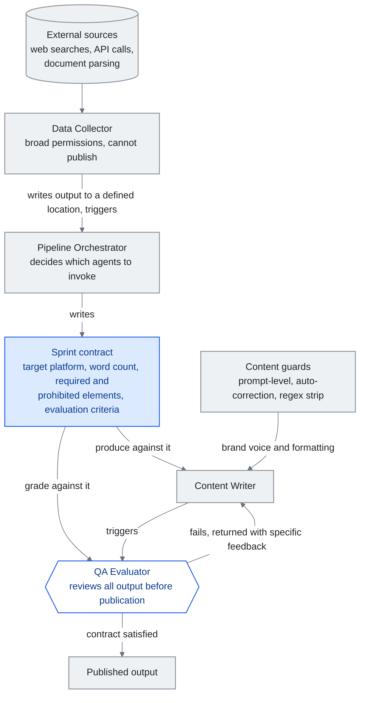

<!-- translation-sync:start -->
> 與 2026-10-31 英文版同步的機器輔助譯文，已作結構與內容覆核。程式碼和圖中標籤保留原文；閱讀時間按英文原文估算。
> [English source](../../../chapters/10-case-study.md) · [Sync record](../../SYNC.md)
<!-- translation-sync:end -->

<!-- i18n-anchor -->

# 第 10 章：構建一個真實世界的知識 Harness

> **一句話總結：** 一位開發者用 4 個 agent 團隊、漸進式揭露路由和自動化內容管線, 建出完整的 AI 知識系統。
>
> **為什麼重要：** 這證明一個人配上對的架構, 就能做到過去要一個團隊才能做的事。本指南里的概念不是理論。
>
> **閱讀時間：** ~11 分鐘（按英文原文估算：2,476 個單詞 / 230 wpm）

*圖：本章"Harness Engineering: The Agent Team"一節的四智慧體團隊，圖中將衝刺契約畫成其中三個智慧體共享的一份文件。編排器編寫契約，寫作智慧體按契約產出，質量評估器在任何內容釋出之前依照同一標準評分。圖中支撐論點的邊，是從評估器返回寫作智慧體的路徑：這不是一次重試，因此四個智慧體構成的是迴圈，而非流水線。*

本章呈現一個匿名的 solo 開發者案例研究——下文稱為"the builder"——他在數月迭代開發中, 構建了一個完整的知識 harness。這裡描述的系統是真實的, 每天都在生產使用。它示範了前面章節討論的概念——context engineering、漸進式揭露、技能系統、agent 編排——如何在實務中整合起來。

<!-- i18n-anchor -->

## 起點

構建者從一個簡單的問題開始: 知識太多, 沒有結構。一個個人知識 vault 累積超過 300 篇筆記, 涵蓋在做的專案、技術參考、會議記錄和散落的想法。標準做法——「需要時去搜」——隨著 vault 變大就崩潰了。筆記被遺忘, 洞察被重新發現而非被檢索, 工作 session 之間 context 流失。

最初的解法很樸素: 用 LLM 助手訪問 vault。但對 300+ 筆記的原始訪問意味著把 context window 灌滿。真正的工程挑戰不是"can the LLM read my notes", 而是"how do I give the LLM the right notes at the right time."。

<!-- i18n-anchor -->

## 知識層: Vault 作為隱式知識圖

系統的基礎是一個 Obsidian vault, 組織為刻意的資料夾層級:

- **Inbox** 用於捕捉（所有新筆記落在這裡）
- **Active** 用於日常使用的筆記（保持 5-10 項）
- **Projects** 用於有截止期限的限期工作
- **Areas** 用於無截止期限的持續職責
- **Notes** 用於原子知識（每個筆記一個想法, 標題作為斷言）
- **Daily** 用於日記和回顧報告
- **Archive** 用於完成或過時的材料

每個筆記都用 wikilink 連線到相關筆記, 不需要正式圖資料庫就能形成隱式知識圖。連結慣例簡單但嚴格: 如果筆記 A 提到筆記 B 詳細闡述的概念, A 必須連結到 B。久了之後, 這產生一個可導航的知識網, 任何入口點都通往相關 context。

Vault 透過回顧迴圈來維護: 每日回顧處理 inbox 並分類新筆記; 每週回顧分析知識累積趨勢, 重新浮現有價值的舊筆記; 每月回顧檢查矛盾、合併重疊筆記、歸檔完成的專案。這個維護不是可選的。沒有它, 知識層會在數週內退化, 筆記變得陳舊、重複或孤立。

<!-- i18n-anchor -->

## Context engineering: 系統 prompt 作為索引

構建者的 context engineering 把系統 prompt 當作**深層資源的索引**, 而不是單一的指令集。一箇中央配置檔（類比 AI 的 README）包含:

- **環境細節**: OS、shell、要避免的已知怪癖
- **語言偏好**: 構建者的工作語言和格式約定
- **路由表**: 一份按優先序排列的技能類別清單, 列出觸發關鍵詞與指向路由檔的指標

這個配置檔總是被載入。它很精簡——少於 2,000 token——因為它只裝指標, 不裝載荷。當 LLM 收到使用者請求, 它對照路由表匹配, 只載入相關的路由檔, 路由檔再指向所需的具體技能。

另有獨立的記憶系統處理跨 session 持續。它儲存:

- 在做專案的位置與結構
- 從使用者回饋學到的偏好
- 各專案特有的技術 pattern 與約定
- 複雜主題的詳細子檔參照

記憶檔有機增長。當構建者更正助手的行為, 那項更正被記錄為偏好。當一個專案的結構被建立, 它被文件化一次, 之後就被引用。這消除了讓無狀態 LLM 互動飽受困擾的"let me re-explain my project"問題。

<!-- i18n-anchor -->

## Harness engineering: Agent 團隊

系統採用四個 agent 團隊, 每個有明確角色:

1. **Data Collector**: 從外部來源收集資訊（網頁搜尋、API 呼叫、檔案解析）。擁有廣泛許可權但不能釋出。
2. **Pipeline Orchestrator**: 協調工作流程, 決定呼叫哪些 agent, 管理順序。撰寫"sprint contracts"——為每個任務規定預期輸出標準的文件。
3. **Content Writer**: 產出輸出（報告、社群媒體貼文、技術文件）。在內容守衛之下運作, 強制品牌語調和格式標準。
4. **QA Evaluator**: 在內容能釋出前對照 sprint 合約審查所有輸出。檢查事實準確度、格式合規、品牌對齊。

衝刺契約機制值得進一步說明。編排器啟動內容任務時，不會只說"write a post about X."。它會編寫一份契約，規定目標平臺、字數範圍、必需元素（例如必須包含一項統計資料，必須以行動號召結尾）、禁止元素（例如不得使用最高階形容詞，不得作出未經驗證的主張）和評估標準。內容寫作智慧體依照契約產出，質量評估智慧體據此評分。如果輸出未透過評估，就會附上引用契約標準的具體反饋退回寫作智慧體。這不是一次重試，迴圈會持續到滿足契約或有人介入。

內容守衛在三個層級運作:

- **Prompt-level guards**: 嵌入系統 prompt 的指令, 定義 agent 必須做和不能做什麼
- **Auto-correction**: 後置處理, 抓出並修復常見問題（例如移除不要的格式 pattern、強制一致術語）
- **Regex strip**: 最後一關, 移除特定不該出現在輸出裡的 pattern（例如某些會破壞下游系統的字元、模型外漏的後設資料 token）

Agent 間通訊是觸發式的。Agent 不互相輪詢。Data collector 完成收集後, 把輸出寫到指定位置並觸發 orchestrator。Writer 產出內容後, 觸發 evaluator。這種事件驅動架構讓系統反應迅速而不做不必要的計算。

<!-- i18n-anchor -->

## 技能系統的演化

技能系統經歷了四個清晰的演化階段, 每個都由生產中發現的實際限制驅動。

**階段 1: 平面技能檔。** 每項技能是一個含指令的獨立 markdown 檔。LLM 在 session 開始時載入所有技能檔。在 5-10 項技能時還行, 但當庫變大就難以為繼。Context window 被技能定義灌滿, 留給實際工作的空間所剩無幾。

**階段 2: 豐富的 YAML frontmatter。** 技能獲得結構化後設資料: 觸發條件、所需 context、依賴、版本號。這讓系統可以按相關性過濾技能, 但過濾邏輯本身消耗 token 又增加 latency。

**階段 3: 技能間的 wikilink。** 技能開始互相連結, 形成技能圖。一個"deploy"技能會連線到"run tests"作為前置條件。這使系統能載入技能鏈而非單個技能, 但導覽這張圖仍需要載入圖索引。

**階段 4: 路由檔配漸進式揭露。** 最終架構使用一份在系統 prompt 中的精簡索引（路由表）, 指向七個分類專屬的路由檔。每個路由檔列出該類別的技能與觸發條件。LLM 只載入匹配類別的路由檔, 然後只載入所需的具體技能。任何時刻, 系統載入的是: 系統 prompt 索引（約 2K token）+ 一個路由檔（約 500 token）+ 一個技能檔（約 1-2K token）。無論系統中有多少技能, 總開銷都在 4K token 以下。

構建者用 85 個測試查詢測試這套路由架構, 涵蓋所有類別, 達到 85/85 正確路由——100% 準確度。邊角情境（可能匹配多個類別的模糊查詢）由路由表中的明確消歧規則處理。

<!-- i18n-anchor -->

## 成果

這個架構可衡量的成果:

- **65% token 縮減**, 來自相對於平面檔做法的漸進式揭露。同樣的任務過去消耗 8-12K token 的技能 context, 現在不到 4K。
- **自動化內容管線** 在多個平臺每日產出有一致質量的內容, 由一個人管理。
- **知識維護** 透過自動化 vault linting, 檢測矛盾、孤立筆記和過時資訊——這些過去需要手動回顧 session 處理。
- **跨 session 持續** 消除"cold start"問題。記憶系統讓助手每次都從上次離開的地方接起。

<!-- i18n-anchor -->

## 學到的教訓

**先簡單, 再疊加複雜度。** 構建者第一天沒有設計四 agent 加 sprint 合約系統。它從單個 agent 配一個指令文字檔開始。每一層複雜度都是為回應特定故障模式而加的: agent 產生幻覺（加 QA evaluator）、輸出不一致（加內容守衛）、context window 溢位（加漸進式揭露）。過早的架構會產生為想象問題最佳化、而非真問題最佳化的系統。

**漸進式揭露值得花的設定成本。** 建構與維護路由表、七個路由檔以及個別技能檔需要持續工夫。但 65% 的 token 縮減讓它在每次互動中都付清自己。更重要的是, 系統可擴充套件: 加新技能意味著在一個路由檔加一行, 不是重構整個 prompt。

**Less is more。** 壓縮、精確的技能定義勝過冗長的。一個寫"search the vault for notes matching the query, return file paths and relevant excerpts, suggest connections"的技能檔, 比同樣指令的 500 字闡釋更好。LLM 不需要被牽著走; 它需要清晰意圖。

**Harness 就是產品。** 構建者的競爭優勢不是任何單一技能或 agent。是 harness——路由邏輯、sprint 合約、內容守衛、回顧迴圈、記憶系統。各別元件都很直接。整合才是價值所在。這呼應一個關於知識工程的更廣真理: 模型在商品化, 但編排它們的系統不是。

<!-- i18n-anchor -->

## 邊欄: Claude Code 作為參考實現

在構建者系統演化的大部分時期，Anthropic 自己的內部工具一直是黑盒。從業者可以從 Claude Code 的行為推斷其運作方式，但 Anthropic 之外沒人見過原始碼。**2026 年三月 31 日**，情況發生了變化：Anthropic 意外在 npm 包 `@anthropic-ai/claude-code` v2.1.88 中釋出了一份 59.8MB 的源對映檔案，約含 513,000 行未經混淆的 TypeScript，分佈在 1,906 個檔案中（完整經過見第 4 章）。這次洩露讓社群首次得以實證觀察前沿實驗室的生產級系統編排層，其中數種模式與構建者獨立摸索出的模式十分相似：

- **Self-Healing Memory, 不是一個大檔。** Claude Code 外洩出來的架構組織成三層"Self-Healing Memory"系統, 層之間有明確的修復邏輯。構建者的 vault + 記憶檔 + sprint 合約迴路是同一概念的較粗版本: 短期工作狀態（當前 session）、中期壓縮狀態（記憶檔）、長期持久知識（vault）。兩個系統中,"memory"都不是一個地點; 它是一組層加上層之間的轉換。
- **MEMORY.md 是索引, 不是倉庫。** Claude Code 內部的 `MEMORY.md` 是輕量級的指標式索引, 指向更詳細的筆記——不是單一的 transcript。構建者的配置檔扮演完全相同角色: 它裝路由表與指標, 不裝載荷, 這正是基線 context 保持在 2K token 以下的原因。
- **`KAIROS` 與自主 daemon 模式。** Claude Code 原始碼中提到一個 `KAIROS` feature flag 超過 150 次。它把守一個自主 daemon 模式——一個無人看管的長時間執行迴路, 遠超大多數使用者熟悉的互動 REPL。構建者的觸發式、事件驅動 agent 間通訊是同一概念的手工版本: 在事件上喚醒、做工、傳遞, 不需要人類每步介入。

這個邊欄的重點不是構建者的系統秘密就是 Claude Code。這兩個系統在工程投入上差了幾個數量級，構建者的版本用數百份 Markdown 檔案完成了 Anthropic 用五十萬行 TypeScript 完成的事。重點是**兩個系統獨立收斂到同一種形態**，即帶索引的分層記憶、以路由替代直接載入全部內容、事件驅動的編排，這說明這些模式並非純粹的風格選擇。它們是生產級編排層經受真實工作負載考驗並存活下來後呈現的形態。

<!-- i18n-anchor -->

## 對從業者的啟示

這個案例研究說明, 一個 solo 開發者在數月迭代下, 可以建出兩年前需要一個工程師團隊才能建的知識 harness。關鍵啟動條件是: 足以遵循複雜多步指令的 LLM、用於工具整合的開放協議（MCP）、提供這些系統設計 pattern 的新興 context engineering 學科。

構建者的系統不是要被複制的模板。它是一個概念證明, 顯示本指南中的原則——漸進式揭露、context engineering、技能圖、agent 編排——在生產中產生可衡量的成果。你的 harness 看起來會不一樣。架構應該一樣。

---

<!-- i18n-anchor -->

## 三個要點

- **契約讓寫作智慧體與評估器擁有共同目標。** 編排器預先規定目標平臺、字數、必需和禁止元素，評估器依照同一份文件評分，直到滿足要求或有人介入。
- **漸進式披露將上下文開銷限制為常量。** 無論存在多少項技能，索引加上一個路由檔案和一個技能檔案始終低於 4K token，相比被替代的平面檔案方案減少了 65%。
- **系統編排層就是產品。** 各個元件本身並不複雜；價值來自整合，包括路由邏輯、衝刺契約、內容防護、複查週期和記憶系統。

---

*下一章: [第 11 章 —— LLM 知識工程的關鍵時刻](11-timeline.md)*
