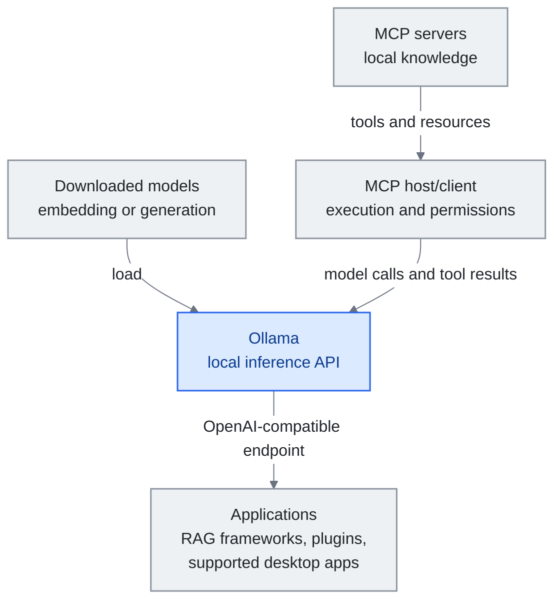

<!-- translation-sync:start -->
> 與 2026-10-31 英文版同步的機器輔助譯文，已作結構與內容覆核。程式碼和圖中標籤保留原文；閱讀時間按英文原文估算。
> [English source](../../../chapters/12-local-models.md) · [Sync record](../../SYNC.md)
<!-- translation-sync:end -->

<a id="chapter-12-local-models-for-knowledge-engineering"></a><!-- i18n-anchor -->

# 第 12 章：本地模型與知識工程

> **一句話總結：** 本地模型把推理移到自己的硬體，降低對提供商的資料暴露及按 token 支付的 API 費用，同時增加本地執行成本。
>
> **為什麼重要：** 敏感知識與個人微調，使推理邊界成為架構選擇；工具、日誌及同步仍需各自的控制措施。
>
> **閱讀時間：** ~14 分鐘（按英文原文估算：3,052 個單詞 / 230 wpm）

*圖：Ollama 透過推理 API 嚮應用提供已下載的模型。MCP 宿主／客戶端獨立執行工具並強制落實許可權，將模型呼叫與工具結果交給 Ollama。只有端點相容性，並不等於提供 MCP 編排。具體模型與應用整合見下文。*

*窄屏下可橫向滾動圖表，以完整尺寸閱讀。*



前幾章描述的知識工程堆疊基本假設雲端 API 存取——把你的 context window 送給 Anthropic、OpenAI 或 Google, 拿回回應。這對大多數使用者運作良好。但有越來越多的從業者, 雲端推論對他們要麼不切實際, 要麼不可取: 處理敏感企業資料的、所在司法管轄區有嚴格資料駐地要求的、以及想透過在自己編纂知識上微調模型來完全閉環的。

本章涵蓋本地模型與知識工程的交集。它不涵蓋 GPU 採購指南、基準比較、或量化技術——那些主題有其他資源專門處理。相反, 它聚焦於把模型帶進你自己基礎設施時真正重要的架構決策。

---

<a id="why-local-matters-for-knowledge-engineering"></a><!-- i18n-anchor -->

## 為什麼本地對知識工程重要

三股力量推動本地模型在知識系統中的採用:

**隱私是一種架構，而非政策。** 雲端 RAG 可以將檢索到的文件片段傳送給提供商。只有整條路徑都留在本地時，本地推理才消除向模型提供商的這一傳輸。工具呼叫、遙測、日誌和同步仍需審查。某些法律、醫療及政府工作負載要求這種邊界，具體要求取決於部署。

**規模化成本。** 持續進行後臺處理的知識系統，例如筆記庫檢查、自動筆記編譯、定期重建索引，每天可產生數千次 API 呼叫。本地執行消除按 token 支付給提供商的賬單，但電費、硬體容量與維護仍有成本。對持續執行的知識維護，即 Karpathy 架構中的 Lint 操作，應將這些成本與 API 使用費比較，而非假設推理免費。

**微調的最終用途。** 這或許是最有說服力的理由。一旦知識庫達到足夠質量，即透過 Ingest 操作編整出數百篇結構良好、互相連結的筆記，它就成為高質量、經過整理的合成資料集。你可以用它微調一個小型本地模型，使模型本身就 "knows" 你的領域，無需在執行時檢索。知識存於權重中，而非上下文視窗中。

---

<a id="architecture-where-local-models-fit"></a><!-- i18n-anchor -->

## 架構：本地模型適合哪裡

不是知識 harness 的每個元件都同等受益於本地推論。這裡是本地模型提供最大價值的地方:

<a id="embedding-models-high-value"></a><!-- i18n-anchor -->

### Embedding 模型（高價值）

Embedding 是任何 RAG 管線的基礎。每次你加筆記到 vault, 它需要被轉成向量做相似度搜尋。這是高量、低複雜度的操作——本地推論的完美物件。

熱門選擇:
- **nomic-embed-text**（137M 引數）: 強健的通用 embedding, 在 CPU 上跑
- **mxbai-embed-large**（335M）: 更高質量, 在普通硬體上仍可管理
- **bge-m3**（568M）: 多語言, 對混合語言內容的 vault 極佳

這些模型夠小, 能在任何現代筆電跑而不需 GPU。本地與雲端 embedding（OpenAI 的 text-embedding-3、Cohere 的 embed）之間的質量差距已顯著縮窄——對大多數知識管理用例, 本地 embedding 夠用。

透過 Ollama 在本地跑:
```
ollama pull nomic-embed-text
```

<a id="query-and-reasoning-medium-value"></a><!-- i18n-anchor -->

### 查詢與推理（中等價值）

用本地模型回答關於你 vault 的問題——Query 操作——是取捨變得更微妙的地方。雲端模型（Claude Opus、GPT-4o）在複雜推理、多步綜合、微妙指令遵循上仍有意義地更好。但對直接的檢索式 Q&A（"what did I write about X last month?"）, 7-14B 引數範圍的本地模型表現良好。

實務選項:
- **Qwen3-14B**: 強健多語言效能, Apache 2.0 授權
- **Llama 3.1-8B-Instruct**：8B 指令微調選項；Llama 3.3 是另一個 70B 模型
- **DeepSeek-R1-Distill-Qwen-7B**：從完整 R1 蒸餾的推理能力，採用 MIT 許可證
- **Gemma 3-12B**: Google 的高效架構, 擅長結構化輸出

最有效的 pattern 是 **分層做法**: 用本地模型處理日常查詢與 vault 維護, 升級到雲端 API 處理複雜綜合與創意任務。這呼應漸進式揭露的 harness engineering 原則如何應用到模型選擇——為每個任務用最低能幹模型。

<a id="knowledge-compilation-high-value"></a><!-- i18n-anchor -->

### 知識編纂（高價值）

Ingest 操作——讀原始來源並把它們編纂成結構化 wiki 頁面——出乎意料地適合本地模型。這個任務定義良好: 讀文章、提取關鍵點、生成含 wikilink 的結構化筆記。一個 14B 模型配良好指令遵循能可靠處理這個, 特別在系統 prompt 精確指定輸出格式時。

這是經濟性論據最強的場景。如果 Web Clipper 每天捕獲 5-10 篇文章，本地編譯可以在不產生按 token 計費 API 賬單的情況下持續擴充知識庫，但仍受可用算力與執行成本約束。

<a id="vault-maintenance-high-value"></a><!-- i18n-anchor -->

### Vault 維護（高價值）

Lint 操作掃描矛盾、過時內容與孤立筆記，是能從本地推理受益的批處理過程。它可以在機器算力預算內每小時、每天或持續執行。本地模型掃描筆記庫並生成健康報告；要讓這條工作流保持私密，還需要本地工具與儲存。

---

<a id="the-fine-tuning-endgame"></a><!-- i18n-anchor -->

## 微調終局

Andrej Karpathy 概述了一個許多從業者現在在追求的願景: 一旦你的 LLM 維護 wiki 達到足夠質量, 用它微調一個個人小型語言模型（SLM）。

工作流程:

1. **編纂** 你的知識庫, 透過數月 Ingest 操作。Wiki 成長到數百份結構良好、互相連結的筆記。
2. **提取** wiki 的訓練對: 每份筆記變成一個（問題, 答覆）對, 或一個（context, 續寫）對。
3. **微調** 一個小模型（1-3B 引數）在這個資料集上, 用 LoRA 或 QLoRA。
4. **部署** 微調後的模型在本地。它現在從權重回答關於你領域的問題, 不需檢索。

這不會完全取代 RAG——微調後的模型對最近資訊與具體細節仍受益於檢索。但它戲劇性減少檢索負擔。模型"knows"你領域的基礎概念、關係、pattern。RAG 只需補充新或高度特定的資訊。

這個管線的工具已成熟:
- **Unsloth** 用於高效微調（快 2 倍, 記憶少 60%）
- **Axolotl** 用於託管訓練配置
- **MLX**（Apple Silicon）或 **llama.cpp** 用於微調後模型的本地推論

---

<a id="integration-patterns"></a><!-- i18n-anchor -->

## 整合 Pattern

<a id="pattern-1-ollama-as-universal-backend"></a><!-- i18n-anchor -->

### Pattern 1: Ollama 作為通用後端

Ollama 提供一個用相容 OpenAI API 跑本地模型的統一介面。這意味著任何與 OpenAI API 一起運作的工具能透過改 base URL 指向本地模型:

```
base_url: http://localhost:11434/v1
model: qwen3:14b
```

這與 LangChain、LlamaIndex、Dify、大多數 RAG 框架一起運作。對 Obsidian 使用者, Smart Connections 等外掛能配置成用本地 Ollama 模型而非雲端 API。

到 2026 年下旬，這一模式出現反向形式：不再只是第三方工具指向 Ollama，封閉模型廠商自己的第一方桌面應用也開始指向它。Ollama **v0.33.0**（August 21, 2026）支援配置 Claude Desktop，將 Ollama 作為第三方閘道器提供商；**v0.34.0**（September 5, 2026）加入 ChatGPT Desktop 整合，可透過 Ollama macOS 應用配置，在 ChatGPT Desktop 內直接選擇 Ollama 模型。同一 v0.34.0 還加入 OpenAI 相容的客戶端工具搜尋、響應壓縮及 Apple Silicon 上更快的結構化輸出。對本地知識編排系統，後果有限卻真實：消費者聊天客戶端不再構成將查詢送離機器的理由，因為客戶端可以改指向機器上執行的模型。這是下文作業系統級 `LanguageModel` 協議在廠商應用側的對應物，同樣讓本地後端成為一等支援物件，只是此次來自封閉模型廠商，而非平臺所有者。

<a id="pattern-2-hybrid-cloud-local"></a><!-- i18n-anchor -->

### Pattern 2: 混合雲端-本地

對大多數使用者最實用的架構:
- **本地**: Embedding、vault 維護、日常查詢、知識編纂
- **雲端**: 複雜推理、創意綜合、多步 agent 工作流

這給你高量操作的隱私與成本優勢, 同時保留對真正需要的任務存取前沿模型能力。

<a id="pattern-3-mcp-with-local-models"></a><!-- i18n-anchor -->

### Pattern 3: MCP 配本地模型

如[第 7 章](07-mcp.md)所示，這種整合需要 **MCP 宿主／客戶端**。宿主發現伺服器工具，透過模型 API 傳遞工具定義和結果，執行獲授權的呼叫，並落實許可權。Ollama 提供推理，僅有相容 OpenAI 的端點，並不是 MCP 宿主。只要宿主、伺服器、模型與儲存都在本地，編排層便可以保持本地執行。

---

<a id="2026-local-models-get-an-os-native-api-and-vendor-qat"></a><!-- i18n-anchor -->

## 2026：本地模型獲得作業系統原生 API 與廠商 QAT

2026 年的三次釋出，改變了本章所描述的本地推理格局。

**Apple 向任意提供商開放 Foundation Models（WWDC26，六月 8 日）。** Apple Foundation Models 框架，即支撐 Apple Intelligence、提供流式輸出、工具呼叫與 `@Generable` 結構化輸出的 Swift API，釋出公共 **`LanguageModel`／`LanguageModelExecutor` 協議**；Apple 同時提供參考 **`MLXLanguageModel`** 後端，在執行時從 Hugging Face 載入任意 mlx-community 模型，並快取到磁碟。對本地知識工程，這意味著本地開源模型成為*一等、作業系統原生後端*，而不只是第三方整合。macOS 或 iOS 知識應用可以對接一個 Swift API，在 Apple 裝置端模型與下載的開放權重模型之間切換，無需重寫推理層；Anthropic 與 Google 也在釋出符合協議的 Swift 包。上文 Ollama 通用後端模式，由此獲得 Apple 原生的對應方案。

**Gemma 4 QAT（六月 5 日）。** Google 為 Gemma 4 全部五種規模，即 E2B、E4B、12B、26B-A4B 與 31B，釋出**量化感知訓練檢查點**，在訓練*期間*模擬 4-bit 精度，讓量化權重恢復大部分 BF16 質量，而非在事後壓縮時損失質量。釋出首日，**llama.cpp（GGUF）、Ollama、LM Studio、MLX 同時提供產物**；vLLM 首日支援 E2B、E4B、12B、31B。26B-A4B MoE 被排除在 vLLM w4a16-ct QAT 格式之外，因為其 704 寬的專家維度，在 4-bit 下質量損失過大。記憶體方面，Google 自身部落格沒有給出百分比；第三方分析估算，相比 BF16，**VRAM 減少約 72%**，Google 自報的數字只有 E2B 透過移動格式降至 1GB 以下。值得關注的是*釋出模式本身*：廠商原生 QAT，加上多執行時首日同步分發，正在成為嚴肅開放權重發布的預設形態，降低本章所主張的"run it locally"決策摩擦。

**Meta 釋出專為本地智慧體構建的開放權重模型（Muse Glimmer，八月 10 日）。** Meta Superintelligence Labs 以 Apache 2.0 釋出 **Muse Glimmer**，從封閉 Muse Spark 蒸餾而來的 30B 稠密模型，明確定位為裝置端開放智慧體模型，而非縮小的研究產物。4-bit 量化後低於 20GB，刻意適配單張消費級 GPU、Mac 或 PC 的 24-32GB 記憶體預算。Meta 自建基準報告，**DFlash** 推測解碼在 **RTX 5090 上加速 3.1x**、**M5-Max 為 1.8x**、**M4-Max 為 1.5x**，基準也優於 Gemma4-31B 與 Qwen3.6-27B；這些均為 Meta 自報，未經獨立復現。區別於普通權重發布的是分發：Hugging Face、Ollama、llama.cpp、MLX、ExecuTorch、LM Studio、Unsloth、vLLM、SGLang、Together AI、Fireworks AI 與 OpenRouter，幾乎都在釋出首日支援。本書此前在本地部署語境下討論的開放權重模型，均只適合伺服器級部署，例如第 9 章 2.8T 引數的 Kimi K3 明確不屬於本地部署；Muse Glimmer 則是美國前沿實驗室首個從設計和基準之初，便面向單張消費級 GPU 本地智慧體的模型，並採用上文 Gemma 4 QAT 示範的廠商原生 QAT、多執行時首日同步模式。本章原先在 Google 身上標記的模式，不再是 Google 專屬。（Meta 另稱以後會發布 Muse Spark 1.2 權重，那是另一個未註明日期的事件，此處不涵蓋。）

---

<a id="local-context-and-decision-services"></a><!-- i18n-anchor -->

## 本地上下文與決策服務

**裝置上的共享上下文（September 23, 2026）。** Liquid AI 公佈面向 Qualcomm Hexagon NPU 最佳化的 **Liquid Context**：在本地維護、具有許可權控制的上下文層，可供嵌入式、雲端和混合智慧體使用。上下文維護與使用它的智慧體成為兩個獨立元件，將[第 6 章的記憶架構](06-agent-memory.md)擴充套件到各智慧體專屬儲存之外。公告面向 OEM，例子僅作說明，不能證明消費裝置已廣泛出貨。本地記憶層也不會使連線的雲端智慧體變成本地智慧體。

**帶型別的本地決策（September 29, 2026）。** Ollama 0.35 引入 **`/v1/systemone`**，接收狀態及具名、帶型別的問題，並返回有界決策及機率。Nimble 9B 與實驗性 Tev1 模型，使路由、分流和內容稽核可透過本地決策介面完成，而非生成文字回答。架構上的變化在於介面，不是基準排名。機率仍需按實際工作負載驗證；許可權與升級規則應由確定性的宿主程式碼強制執行。

**October 1**，Cloudflare 公佈 Apache 2.0 **Clef/Clef-flash**，支援相容 Jev 的帶型別輸出，跨廠商趨同隨之出現；Ollama 在 **October 19** 公佈本地和雲端 Clef 支援。這使同一套決策約定跨越不同部署位置。這些是廠商釋出公告，不是決策已經校準、或自主執行安全的獨立證據。

---

<a id="what-this-chapter-does-not-cover"></a><!-- i18n-anchor -->

## 本章不涵蓋什麼

本章刻意省略:
- **硬體建議**: GPU 選擇、VRAM 要求、雲端 GPU 租賃在 r/LocalLLaMA 的 wiki 與 Ollama 文件等資源中廣泛涵蓋。
- **模型基準**: 排名每月變。最新排名見 [Open LLM Leaderboard](https://huggingface.co/spaces/open-llm-leaderboard/open_llm_leaderboard)。
- **量化細節**: GGUF 格式、INT4 vs INT8、質量/速度取捨在 llama.cpp 與 Ollama 社群中有良好文件。
- **訓練基礎設施**: 多 GPU 設定、分散式訓練、雲端訓練平臺都在知識工程範圍之外。

這裡的焦點是架構問題: 本地模型在你的知識 harness 中適合哪裡, 它們如何改變什麼是可能的？

---

<a id="key-takeaways"></a><!-- i18n-anchor -->

## 關鍵要點

1. **本地嵌入是值得評估的有力預設方案。** 它減少對模型提供商的資料暴露與按 token 賬單，但硬體及執行成本仍須計入預算。

2. **分層推論是務實選擇。** 本地處理日常操作, 雲端處理複雜推理。不要強迫 7B 模型做前沿模型做得更好的事。

3. **編譯場景的重要性被低估。** 本地執行 Ingest，將重複工作從提供商賬單移入自己的算力預算。

4. **微調是終局, 不是起點。** 先建 wiki。編纂數百份質量筆記。然後微調。訓練資料的質量——你的 wiki——決定結果模型的質量。

5. **隱私是一項架構決定。** 敏感知識需要明確的推理、工具、儲存與同步邊界；本地推理只控制路徑中的一部分。

---

<a id="three-things-to-take-away"></a><!-- i18n-anchor -->

## 三個要點

- **本地推理控制一條資料邊界。** 只有工具、日誌與同步也遵守預定邊界時，它才會減少對提供商的資料暴露。
- **持續執行的工作會改變經濟性。** 嵌入、知識編譯與 Lint 檢查，以本地硬體和執行成本，換掉按 token 支付的 API 賬單。
- **本地服務如今也包括上下文與決策。** Liquid Context 公佈的共享記憶層，以及 Ollama 帶型別的決策端點，將重複上下文維護、有界判斷，與一般文字生成分離。

---

<a id="sources"></a><!-- i18n-anchor -->

## 來源

- Ollama: [https://ollama.ai](https://ollama.ai)
- Ollama。FAQ（2026 年十月 31 日 閱讀）。[https://docs.ollama.com/faq](https://docs.ollama.com/faq)：本地與雲端處理的區別；`OLLAMA_NO_CLOUD=1` 禁用雲模型及網頁搜尋。
- Liquid AI。"Liquid AI, in Collaboration with Qualcomm Technologies, Brings Personal AI Context to Devices Powered by Snapdragon"（2026 年九月 23 日）。[https://www.liquid.ai/blog/liquid-context-qualcomm](https://www.liquid.ai/blog/liquid-context-qualcomm)：廠商公佈面向 OEM、有許可權控制的本地上下文層；體驗示例僅作說明，並非消費部署普查。
- Ollama。"Ollama now supports Jev-style decision models"（2026 年九月 29 日）。[https://ollama.com/blog/ollama-now-supports-jev-style-decision-models](https://ollama.com/blog/ollama-now-supports-jev-style-decision-models)：Ollama 0.35 `/v1/systemone` 介面及首發本地模型。
- Cloudflare。"Introducing Clef: our open-source decision models, and new RL fine-tuning platform"（2026 年十月 1 日）。[https://blog.cloudflare.com/clef-decision-models](https://blog.cloudflare.com/clef-decision-models)：Apache 2.0 權重與相容 Jev 的決策 API；基準主張來自廠商。
- Ollama。"Clef is available on Ollama's cloud"（2026 年十月 19 日）。[https://registry.ollama.com/blog/clef](https://registry.ollama.com/blog/clef)：廠商託管的文章也記錄了本地執行支援。
- Meta。Llama 模型卡：[https://huggingface.co/meta-llama/Llama-3.1-8B-Instruct](https://huggingface.co/meta-llama/Llama-3.1-8B-Instruct)（2024 年七月 23 日）與 [https://huggingface.co/meta-llama/Llama-3.3-70B-Instruct](https://huggingface.co/meta-llama/Llama-3.3-70B-Instruct)（2024 年十二月 6 日）：區分 8B 指令微調示例與 Llama 3.3 的 70B 釋出。
- DeepSeek。DeepSeek-R1 倉庫及蒸餾模型清單（2025 年一月）。[https://github.com/deepseek-ai/DeepSeek-R1](https://github.com/deepseek-ai/DeepSeek-R1)：精確模型標識為 `DeepSeek-R1-Distill-Qwen-7B`。
- Ollama。v0.33.0 釋出（2026 年八月 21 日）。[https://github.com/ollama/ollama/releases/tag/v0.33.0](https://github.com/ollama/ollama/releases/tag/v0.33.0)：Claude Desktop 可配置 Ollama 為第三方閘道器提供商。
- Ollama。v0.34.0 釋出（2026 年九月 5 日）。[https://github.com/ollama/ollama/releases/tag/v0.34.0](https://github.com/ollama/ollama/releases/tag/v0.34.0)：透過 Ollama macOS 應用整合 ChatGPT Desktop；相容 OpenAI 的客戶端工具搜尋、響應壓縮，以及 Apple Silicon 上更快的結構化輸出。
- llama.cpp: [https://github.com/ggml-org/llama.cpp](https://github.com/ggml-org/llama.cpp)
- Unsloth: [https://github.com/unslothai/unsloth](https://github.com/unslothai/unsloth)
- Karpathy, Andrej. "LLM Wiki" pattern——本章引用的 raw → wiki → schema 分層架構與 Ingest / Compile / Lint / Query 操作所定義的 Gist。[https://gist.github.com/karpathy/442a6bf555914893e9891c11519de94f](https://gist.github.com/karpathy/442a6bf555914893e9891c11519de94f)
- Open LLM Leaderboard: [https://huggingface.co/spaces/open-llm-leaderboard](https://huggingface.co/spaces/open-llm-leaderboard)
- Nomic Embed: [https://huggingface.co/nomic-ai/nomic-embed-text-v1.5](https://huggingface.co/nomic-ai/nomic-embed-text-v1.5)
- r/LocalLLaMA: [https://reddit.com/r/LocalLLaMA](https://reddit.com/r/LocalLLaMA)
- Apple。"Bring an LLM provider to the Foundation Models framework,"，WWDC26 Session 339（2026 年六月 8 日）。[https://developer.apple.com/videos/play/wwdc2026/339/](https://developer.apple.com/videos/play/wwdc2026/339/) 與 Session 241 [https://developer.apple.com/videos/play/wwdc2026/241/](https://developer.apple.com/videos/play/wwdc2026/241/)：公共 `LanguageModel`／`LanguageModelExecutor` Swift 協議；面向 Hugging Face mlx-community 模型的參考 `MLXLanguageModel` 後端。
- Google。"Quantization-Aware Training for Gemma 4"（2026 年六月 5 日）。[https://blog.google/innovation-and-ai/technology/developers-tools/quantization-aware-training-gemma-4/](https://blog.google/innovation-and-ai/technology/developers-tools/quantization-aware-training-gemma-4/)：五種規模全有 QAT 檢查點；llama.cpp／Ollama／LM Studio／MLX 首日支援；vLLM 首日支援除 26B-A4B MoE 以外的變體。第三方 VRAM 分析為相比 BF16 約減少 ~72%；Google 自報數字僅為 E2B 透過移動格式降至 1GB 以下：[https://runaihome.com/blog/gemma-4-qat-local-ai-hardware-update-2026/](https://runaihome.com/blog/gemma-4-qat-local-ai-hardware-update-2026/)。
- Meta Superintelligence Labs。"Introducing Muse Glimmer: an open agentic model"（2026 年八月 10 日）。[https://research.meta.ai/blog/introducing-muse-glimmer-open-agentic-model](https://research.meta.ai/blog/introducing-muse-glimmer-open-agentic-model)：30B 稠密、Apache 2.0、從 Muse Spark 蒸餾；DFlash 加速與基準數字均為 Meta 自報。二手來源：Phoronix [https://phoronix.com/news/Meta-Muse-Glimmer](https://phoronix.com/news/Meta-Muse-Glimmer)；CNBC [https://www.cnbc.com/2026/08/10/meta-muse-glimmer-open-weight-ai.html](https://www.cnbc.com/2026/08/10/meta-muse-glimmer-open-weight-ai.html)；Ghacks（2026 年八月 11 日）[https://www.ghacks.net/2026/08/11/meta-releases-muse-glimmer-a-30-billion-parameter-open-weight-ai-model-that-runs-on-a-single-consumer-gpu/](https://www.ghacks.net/2026/08/11/meta-releases-muse-glimmer-a-30-billion-parameter-open-weight-ai-model-that-runs-on-a-single-consumer-gpu/)。

---

*上一章：[第 11 章：LLM 知識工程的關鍵時刻](11-timeline.md)*

*下一章：[第 13 章：迴圈工程](13-loop-engineering.md)*
