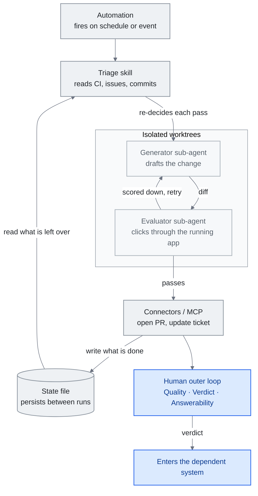

<!-- translation-sync:start -->
> 與 2026-10-31 英文版同步的機器輔助譯文，已作結構與內容覆核。程式碼和圖中標籤保留原文；閱讀時間按英文原文估算。
> [English source](../../../chapters/13-loop-engineering.md) · [Sync record](../../SYNC.md)
<!-- translation-sync:end -->

<!-- i18n-anchor -->

# 第 13 章：Loop Engineering —— 設計提示 Agent 的系統

> **一句話總結：** Loop engineering 是建構那套替你提示 agent 的系統的實踐——讓你不再每一回合都親手駕駛, 而是開始設計一個會自己執行、自我檢查、自我餵養的 loop。
>
> **為什麼重要：** 這是本指南演進故事裡最新、也最未定型的一層, 也最可能在接下來一年裡, 形塑自主 agent 工作實際上要怎麼被排程、驗證、審查。
>
> **閱讀時間：** ~18 分鐘（按英文原文估算：4,035 個單詞 / 230 wpm）

*圖：迴圈的一輪，由第 13.3 節的五個部分及第 13.3 節單獨區分的外部狀態組裝，最終通向人的外迴圈與第 13.7 節的判斷。兩條連線承載論點：執行在作出任何決定之前先讀狀態檔案（13.2）；負責草擬的智慧體不是負責評分的智慧體（13.4）。*

這是本指南目前壽命最短的一個概念。（它保住這個頭銜只有六週：2026 年 七月下旬, 同一套劇本又產出了一個loop 之上還有更高一層的主張, 也就是 graph engineering, 詳見[第 14 章](14-graph-engineering.md)。）"loop engineering"這個詞在寫作當下大約只有五週歷史：它在 2026 年 六月初被命名, 幾天內就透過從業者部落格、播客、X 傳開, 目前背後還沒有任何學術文獻。以下內容刻意保持保留的態度。如果某個論述只靠一句被三種不同方式轉錄的播客口述引言撐住, 或者只靠一篇什麼都沒命名的病毒式貼文撐住, 本章會明寫出來。目標是準確描述一個正在浮現的框架, 而不是把它認證成一個已經定型的世代。

這個框架值得描述, 因為它在從業者論述裡確實起著作用：它替一個轉變命了名——這個轉變是 harness engineering（第 4 章）暗示過、但沒有單獨挑出來講的——從*提示一個 agent*, 轉移到*設計那個替你提示 agent 的系統*。這到底該不該算獨立一層, 還是不過是「harness engineering 加一個排程器」, 正是本章刻意留白的開放問題。

本章涵蓋這個詞從哪裡來、支持者怎麼把它和 harness 連起來、一個 loop 由什麼組成、讓 loop 保持誠實的 generator-evaluator split、一個大型生產案例、堆疊 loop 的框架、人類被交代要保留的判斷力, 以及早期的採用訊號——爭議的部分會全程標出。

---

<!-- i18n-anchor -->

## 13.1 得名的那一週（2026 年 六月）

催化劑是一篇貼文。2026 年 六月 7 日, **Peter Steinberger**（@steipete）——**OpenClaw** 的創造者, Y Combinator 形容它"from a weekend project to the most-starred software repo on GitHub in under 5 months, with 346k+ stars,", 超越 React, 他現在人在 OpenAI——寫道：

> 這是你每個月的例行提醒：你不該再手動提示程式設計 agent 了。
>
> 你該做的是設計出會提示你的 agent 的 loop。

截至 2026 年 七月中, 這篇貼文已獲得 **8.4M+ 曝光次數**。它什麼都沒命名：Steinberger 沒有用"loop engineering,"這個說法, 這幾個字在他的原文裡完全沒出現。命名是其他人在回應他所催化的想法時給出的。

同一天, **Addy Osmani**（Google）發表了那篇替這個實踐命名的文章（《Loop Engineering》, addyosmani.com/blog/loop-engineering/, 六月 7 日; 六月 22 日在 O'Reilly Radar 轉載）。他的定義, 就是後續論述裡被反覆引用的那個版本：

> Loop engineering is replacing yourself as the person who prompts the agent. You design the system that does it instead.

同一個轉變, 也從一間前沿實驗室內部冒出來。**Boris Cherny**, Claude Code 的創造者兼 Anthropic 的 Claude Code 負責人, 在 2026 年中的一次播客裡, 用同樣的說法框定了自己的工作流。根據 Lenny's Podcast 那場訪談被引用最多的轉錄版本：

> I don't prompt Claude anymore. I have loops running that prompt Claude and figuring out what to do. My job is to write loops.

這句引言需要一個但書, 而這正是本章存在的意義所在。這是一句*口述*的話, 不同媒體的轉錄版本並不一致（有些引用的是 Acquired 播客, 而不是 Lenny's）, 也沒有權威的逐字文字或完整轉錄稿可查。但其*實質內容*——Cherny 不再親手提示, 而是寫會提示 Claude、決定下一步動作的 loop——在多個二手來源裡都得到印證; 只是確切措辭沒有定案。

合起來看, 六月 7 日那一週產出了一個催化劑（Steinberger）、一個名字和定義（Osmani）, 以及一個來自內部人士的回聲（Cherny）。它沒有產出的, 是共識。這個詞在幾周內就在從業者論述中結晶化, 但接受度是分裂的：一部分讀者稱它是真正的轉變, 另一部分讀者稱它為時過早——不過是排程的改名, 或者"the harness with a cron job."。目前沒有任何同行評審的著作使用這個詞。本指南把 loop engineering 當作一個正在浮現、有爭議的框架來處理（見第 1 章的第四代那一節）, 這也是為什麼以下每一個有分量的論述都綁著一手來源, 而空白之處會被明寫出來, 而不是被填滿。

---

<!-- i18n-anchor -->

## 13.2 編排層之上的一層

倡導者最清晰的定義方式，是將迴圈直接放在第 4 章編排層上方。Osmani 明確指出這種關係：

> Loop engineering sits one floor above the harness.

在他關於迴圈*是什麼*的心智模型中，編排層仍是構建基礎：迴圈就是一個"runs on a timer, it spawns little helpers, and it feeds itself."的編排系統。他明確表示，這延伸而非取代此前工作，他"wrote before about the cousin of this, agent harness engineering, which is making the environment one single agent runs inside."。

中國開發者**程式設計師魚皮**（liyupi）給出最具結構性的解釋。在六月 16 日的 codefather.cn 指南中，他將提示技巧、上下文管理、編排構建與迴圈排為**層層包含**，即逐層巢狀：

> 這四者是層層包含的關係。提示詞技巧、上下文管理、Harness 搭建，這些能力在 Loop 裡面全都要用上。

（四者相互巢狀，提示技巧、上下文管理與編排構建，全都在迴圈*內部*使用。）這延續第 1 章將提示 → 上下文 → 編排層相互巢狀的邏輯，只增加一個外框。歸屬必須說清楚：魚皮是為中國開發者受眾重新包裝、組織已有術語，並非創造它們；"harness engineering"與"loop engineering"可追溯至 Claude Code 與 Cherny 的相關討論。

他的馬匹比喻，將編排層與迴圈的界線劃分得格外清晰：

> 如果把 AI 比作一匹馬，Harness 就是你給馬裝上的韁繩、馬鞍和圍欄，然後你騎在馬上手動駕馭它。

（如果 AI 是一匹馬，編排層就是給它裝上的韁繩、馬鞍與圍欄，然後你騎上去手動駕馭。）

> 而 Loop 呢，是你設定好一條巡邏路線後，不用上馬，讓馬自己按路線一圈一圈地跑。

（迴圈則是設好巡邏路線，然後*不騎上去*，讓馬自行沿路線一圈圈跑。）

這個比喻包含一個關鍵區別，讓迴圈工程不會被歸結為"cron for agents"：**迴圈不是排程器。** 排程器按時觸發；迴圈按時觸發，*然後讀取當前狀態，決定本輪做什麼*。執行時決策者，會在選動作前檢視 CI 狀態、未解決問題或上一輪遺留事項，這恰是 cron 條目所不具備的部分。迴圈等於排程器，加上讀取狀態、每輪重新決策的智慧體。（交叉參考第 1 章"The Key Insight: Coexistence, Not Replacement."。）

---

<!-- i18n-anchor -->

## 13.3 一個 Loop 由什麼組成

Osmani 的文章給出了最具體的清單。他那一節的標題是 **「五個元件, 外加一些補充」（"The five pieces, and then notes"）**——數量很重要, 因為很容易被灌水。實際上是*五個元件加外部狀態*, 而不是六個平起平坐的構件：

- **Automations（自動化觸發）** —— 讓 loop 啟動的觸發器（排程、事件）。
- **Worktrees（工作樹）** —— 隔離的工作副本, 讓並行的 agent 不會互相碰撞。
- **Skills（技能）** —— 第 5 章裡那些可重用的能力包。
- **Connectors（MCP, 聯結器）** —— 第 7 章講的工具與資料觸及範圍。
- **Sub-agents（子 agent）** —— 一次執行會生出的那些小幫手。

"then notes"指的是**外部狀態／記憶**——一份 markdown 檔案, 或一塊 Linear 看板, 在各次執行之間把進度持久儲存下來。它不是第六個平起平坐的構件; 它是那五個元件讀寫所在的底層基質。

他給出的實作範例是一個晨間分診 loop, 它之所以有用, 正是因為每個環節都能對應回那五個元件裡的一個。一個 **automation** 每天早上觸發。一個分診 **skill** 讀取 CI 失敗記錄、開著的 issue、最近的 commit。隔離的 **worktrees** 各自容納一個起草修復的 **sub-agent**, 和另一個審查它的 sub-agent。**Connectors** 負責開 PR、更新工單。沒處理完的專案會浮現在分診收件匣裡, 而一份 **狀態檔** 會把進度持久儲存下來, 讓隔天早上的執行是接續而非重來。狀態檔是承重的那部分：沒有它, loop 就不記得昨天發生過什麼, 每一次執行都從零開始。

---

<!-- i18n-anchor -->

## 13.4 Generator 對 Evaluator

一個會自己提示自己的 loop, 天生就繼承了一個難題：*誰來檢查這份工作？* 如果產出變更的 agent 同時也是打分的那個, loop 就會朝著自我恭維的方向最佳化。被引用最多的一手論述, 其實早於命名的那一週就存在了, 這本身就很說明問題——實踐跑在標籤前面。**Prithvi Rajasekaran** 的"Harness design for long-running application development"（anthropic.com/engineering/harness-design-long-running-apps, 2026 年 三月 24 日）直接記錄了這個失效模式：被要求評估自己的產出時, agent"tend to respond by confidently praising the work", 而且"reliably skew positive when grading their own work."。

他的解法, 借用了對抗式訓練的結構：

> Taking inspiration from Generative Adversarial Networks (GANs), I designed a multi-agent structure with a generator and evaluator agent.

這個不對稱性就是全部的洞見所在, 也是為什麼值得多養一個 agent 去做這個拆分：

> Tuning a standalone evaluator to be skeptical turns out to be far more tractable than making a generator critical of its own work.

關鍵在於, evaluator 驗證的是*行為*, 而不是 diff。在 Rajasekaran 的設計裡, 它"used the Playwright MCP to click through the running application the way a user would, testing UI features, API endpoints, and database states,", 而且它會"would navigate the page on its own, screenshotting and carefully studying the implementation before scoring each criterion and writing a detailed critique."。讀程式碼不算驗證; 真正把它跑起來才算。

這個 generator-evaluator 的拆分, 現在已經能在出貨的 loop 控制基礎能力裡看到, 而它們之間重要的區別在於：*一個 loop 怎麼知道該在什麼時候停下來*：

- **`/loop`**（Claude Code v2.1.71）以固定間隔重跑一個 prompt 或斜線命令——changelog 上的說明是"Added `/loop` command to run a prompt or slash command on a recurring interval (e.g. `/loop 5m check the deploy`)."。重複性任務在建立後七天到期; 任務最後再觸發一次, 然後自我刪除。
- **`/goal`**（Claude Code v2.1.139+）執行*直到條件成立*："a small fast model checks whether the condition holds"，預設使用 Haiku。獨立評估器會檢查條件："after every turn, so completion is decided by a fresh model rather than the one doing the work."。底層的 `/goal` 是 "a wrapper around a session-scoped prompt-based Stop hook."。
- **Cloud Routines** 執行"on Anthropic-managed cloud infrastructure, so they keep working when your laptop is closed"; 最短間隔是一小時, 每次執行都從一個全新的 clone 開始。
- **Codex 排程自動化** 支援每日和每週排程, 或者透過 RFC 5545 重複規則（RRULE）設定客製化的節奏。

`/loop` 和 `/goal` 之間的對比, 就是 generator-evaluator 拆分浮現成產品設計的樣子。`/loop` 是*按間隔重跑*——按時鐘再次觸發, 不管狀態如何。`/goal` 是*由條件判斷終止*——由第二個獨立的模型來決定工作是否已經完成。一個負責重複; 另一個負責裁決。一個正經的 loop 通常兩者都需要：一個用來觸發執行的觸發器, 和一個知道何時該停下來的 evaluator。

---

<!-- i18n-anchor -->

## 13.5 生產案例：Stripe 的「Minions」（2026 年 三月）

目前公開披露、規模最大的生產環境 loop, 是 Stripe 的 **"minions."**。Stripe 工程師 **Steve Kaliski**, 在 2026 年 三月的 *"How I AI"* 播客（由 Claire Vo 主持）上描述了這套系統; Stripe 自己的開發者部落格用兩篇 *Minions* 文章記錄了內部細節。（這一集的確切播出日期在各二手來源之間有出入, 所以這裡只寫出月份。）

最引人注目的數字, 是無人看管產出的量。Kaliski 說 Stripe "landing about 1,300 PRs that have no human assistance besides review per week."。Stripe 的部落格用比較保守的說法給出同一個數字："over a thousand pull requests merged each week at Stripe are completely minion-produced,", 儘管它們"human-reviewed,", 但"contain no human-written code."。

一個 minion 是從 Slack 觸發的——方法是加上一個特定的表情符號反應, 或者 tag 那個 Slack app。用 Stripe 自己的話說, "by tagging our Slack app, engineers can kick off a minion directly from the thread discussing a change."。

對本指南來說, 這裡承重的細節是 *Stripe 把確定性與機率性的邊界劃在哪裡。* Context 組裝發生在模型執行**之前**, 而且是確定性的："We deterministically run relevant MCP tools over likely-looking links before a minion run even starts, to better hydrate the context."只有到了這一步之後, 機率性的部分才開始。核心 agent loop 是 Block 開源的 **Goose** 的一個 fork——"the core agent loop runs on a fork of Block's coding agent goose ... which we forked early on."。執行是在 Stripe 的 **devbox** 裡沙盒化的; 根據 Stripe 的開發者部落格（不是播客裡說的）, "a Stripe devbox is an AWS EC2 instance,", 被當成"cattle, not pets"來對待——標準化、可丟棄, 而不是量身訂做、長期存活。

這個框架的重點是：可靠性不是來自更聰明的模型。它來自*邊界的擺放位置*——在機率性生成之前先做確定性的 context 補給——也來自人類從寫程式碼的路徑, 挪到了審查的路徑上。每一個 minion PR 仍然由工程師審查。loop 把寫程式碼這件事規模化了; 它沒有移除人類, 只是把人類挪了位置。

---

<!-- i18n-anchor -->

## 13.6 堆疊 Loop

**LangChain** 的 *"The Art of Loop Engineering"*（Sydney Runkle, 2026 年 六月 16 日）, 是替這一層賦予內部結構最清楚的一次嘗試。它從最基本的情況講起：

> The core agent algorithm is simple: give the LLM context and let it call tools in a loop until it's done.

從這裡開始, 它往上堆疊了四級階梯。原文的標題本身就混用了"Loop"和"Level"兩種標法, 這裡照原文重現——**"Loop 1: The Agent,""Level 2: Verification loop,""Level 3: Event driven loop,""Level 4: Hill climbing loop."**。這個遞進過程是：

1. **Loop 1: The Agent** —— 最基本的工具呼叫 loop, context 輸進去, 呼叫工具直到完成。
2. **Level 2: Verification loop** —— 對 agent 產出的獨立檢查, 是 §13.4 的 generator-evaluator split 被套用成的一級階梯。
3. **Level 3: Event driven loop** —— loop 由真實世界的事件觸發, 而不只是靠間隔或人類的推動。
4. **Level 4: Hill climbing loop** —— 一個自我改進的 loop, 系統會隨著連續執行而變得更好。

有一點需要講精確, 因為二手報道把它講得過頭了：原文把第四級階梯框定為*連續執行間的自我改進*, 而不是一個會改寫自己 harness 的系統。這個更強的說法並不在原始來源裡。Runkle 也借用了 **"loopcraft"** 這個詞——但把它歸功於 Swyx, 引用的是他那篇講"loopcraft: the art of stacking loops."的文章。這個造詞是 Swyx 的, 被 LangChain 引用, 而不是 LangChain 自己造的。

**已披露的多日外層編排系統。** OpenAI 的 October 14, 2026 [Third Moment Research 案例](https://openai.com/index/third-moment-research/)報告 10,000 個併發智慧體和 36-48 小時的調查。Codex 執行在另一套編排系統內部，外層檢查未完成的軌跡，選擇重試、終止或升級交由人類處理。這將上文的堆疊迴圈模式投入實際執行。這些是廠商／客戶披露，完成率未經獨立驗證；執行多天不等於持續取得有用進展。

---

<!-- i18n-anchor -->

## 13.7 Outer Loop：人類保留的東西

如果說 §13.1 到 §13.6 描述的是 agent 執行的那個 loop, Osmani 的後續文章描述的, 就是人類被交代要保留的那個 loop。*"Own the Outer Loop"*（addyo.substack.com/p/own-the-outer-loop）在 2026 年 七月 8 日於 X 上公佈（Substack 版本的落款日期是 七月 9 日）。它的拆分是：agent 現在負責執行**內層執行 loop**——調查、實作、測試／驗證、報告——而工程師握著 **outer loop**。他的核心論點講得很直白：

> 工程師擁有 outer loop。

outer loop 就是那個沒有被委派出去的判斷力, 用他的原話架構成三根支柱——**Quality**、**Verdict**、**Answerability**。Quality 是在 agent 行動之前執行的那些檢查所形成的反壓力。**Verdict** 是"the final decision we make before work enters our dependent system."。**Answerability** 是"the guarantee that if someone asks, I can explain why."的那個保證。（他用的詞是單數的 *Verdict*, "quality bar"不是他的原話——那根支柱就單純叫 *Quality*。）把這些留給人類的理由是：

> An agent can write it. But before it reaches users, someone must explain why it should exist, why it's safe enough to be part of production, and what they will do when it is wrong.

他點名了過度委派 outer loop 的三種失效模式：**cognitive debt（認知負債）**（"erosion of your understanding and memory of how to solve problems"）、**cognitive surrender（認知投降）**（"blindly accepting what AI gives you"）, 以及 **orchestration tax（編排稅）**（生出比你的判斷力實際能覆蓋還多的 agent, 所拖累的成本）。這些都是按下"go"、卻沒有繼續當那個工程師所要付出的代價。

回扣到 六月 7 日那篇文章的這條主線, 體現在它結尾的指示裡, 讀起來正是在警告這件事：

> Build the loop. But build it like someone who intends to stay the engineer, not just the person who presses go.

還有這一句, 打掉了「loop 自己就能證明自己合理」的任何假設：

> 兩個人可以建出一模一樣的 loop, 卻得到完全相反的結果。

loop 的好壞, 取決於圍著它的那個 outer loop 有多好。這就是整個框架裡最誠實的核心。

---

<!-- i18n-anchor -->

## 13.8 採用訊號

三個標記顯示這個框架正在擴散到最初提出者之外。每一個都只講能核實的部分, 和它們一起流傳的誇大說法都被排除在外。

**廠商。** Anthropic 的官方開發者賬號 **@ClaudeDevs** 在 2026 年 七月 6 日釋出了 X Article"Getting started with loops"（截至 七月中大約 **6.0M 曝光次數、38K+ 收藏**）。這篇材料直接教授 agentic loop 本身——"Every prompt you send starts a manual loop with you directing each turn. Claude gathers context, takes action, checks its work, repeats if needed, and responds"——並且走過了按回合、按目標（`/goal`）、按時間（`/loop`、`/schedule`）這三種 loop。有一個編輯上的細微差別值得保留：X article 自己的標題講的是 *"loops,"*, 而不是 *"loop engineering."*。"loop engineering"這個標籤, 只出現在權威的 Claude 部落格映象版本的框定文字裡（claude.com/blog/getting-started-with-loops）, 而不在產品詞彙本身。廠商教 loop 是個比廠商採用這個詞更弱的訊號——而目前得到核實的, 只有這個較弱的訊號。

**中國。** 魚皮六月 16 日的保姆級（"nanny-level"）指南，是中文開發者討論的入口。標題為「提示詞工程已死，Loop Engineering 稱王！保姆級教程 + 專案實戰」（"Prompt engineering is dead, Loop Engineering reigns! Nanny-level tutorial + project practice"），以已死（"is dead"）為引子；但正文收回了這個炒作式開頭：指南自身的層層包含論述（§13.2），主張提示技巧*用於迴圈內部*，而非被它殺死。作為粗略傳播指標，其 GitHub 賬號顯示 **23.9k 關注者**。（外界流傳更大的總關注數字，但無法與原始來源核實，因此省略。）

**記憶與評測。** loop 最依賴的那個子問題——能在各次執行之間存活的跨 session 狀態——現在有了獨立的基準測試。Snorkel 的 **Continual Learning Bench**（arXiv 2606.05661; Snorkel AI / UC Berkeley SkyRL / UW-Madison）把結果按 agent、記憶系統、任務這三個維度拆解。在這個基準上, 使用 **Fable 作記憶骨幹的 agent 系統, 表現優於建在 Opus 或 Sonnet 上的系統**（出自 Snorkel 的 Benchtalks 訪談, 是一個定性發現——arXiv 論文裡的模型名單是 Opus 4.7 / Sonnet 4.6 / Gemini 3.1 Pro / Gemini 3 Flash / GPT-5.4, 並沒有給 Fable 附上具體數值分數）。釋出當時, 最佳系統大約達到 **25% 的標準化增益**, in-context learning 排在排行榜首位。這裡的訊號不是那個數字; 而是*哪個記憶撐著這個 loop*, 現在成了一個被測量的維度。

得名五週之後, loop engineering 有了一個定義、一段和 harness 的關係陳述、一個大型生產案例、一個框架廠商的課程、一份中文主流教程, 以及一份廠商自己的 loops 材料。它沒有的, 是學術文獻、定型的接受度, 或者「它是真正的第四代, 而不只是配了排程器和狀態檔的 harness engineering」這件事上的共識。本指南把它當作正在浮現、尚未定型的東西來追蹤——而 Osmani 自己的那句提醒, 兩個人可以建出一樣的 loop 卻得到相反的結果, 是對原因最公道的總結。

---

<!-- i18n-anchor -->

## 三個要點

- **迴圈不是排程器。** 它按時觸發，再讀當前狀態，重新決定本輪該做什麼。
- **寫作者不能兼任評分者。** 讓智慧體評價自己的工作，會產生正向偏差；解決方法是獨立且持懷疑態度的評估器。
- **Stripe 的可靠性來自邊界位置，而非更聰明的模型。** 迴圈擴充套件寫作規模，並將人類移到稽核位置。

---

<!-- i18n-anchor -->

## 來源

- OpenAI。Third Moment Research 案例研究（October 14, 2026）：[https://openai.com/index/third-moment-research/](https://openai.com/index/third-moment-research/)。
- **Steinberger, Peter（@steipete）。** 催化"loops, not prompts"這個框定的貼文（2026 年 六月 7 日）：[https://x.com/steipete/status/2063697162748260627](https://x.com/steipete/status/2063697162748260627) ——截至 2026 年 七月中已有 8.4M+ 曝光次數; 貼文字身並沒有用"loop engineering."這個說法。
- Osmani, Addy。"Loop Engineering"（June 7, 2026）：[https://addyosmani.com/blog/loop-engineering/](https://addyosmani.com/blog/loop-engineering/)；O'Reilly Radar 轉載版（June 22, 2026）：[https://www.oreilly.com/radar/loop-engineering/](https://www.oreilly.com/radar/loop-engineering/)。為實踐命名的文章；定義、"one floor above the harness,"、五個元件，以及晨間分流的完整示例。
- **Osmani, Addy.**"Own the Outer Loop"（2026 年 七月 8 日於 X 公佈; Substack 落款日期 2026 年 七月 9 日）：[https://addyo.substack.com/p/own-the-outer-loop](https://addyo.substack.com/p/own-the-outer-loop) ——內層 loop 與 outer loop 之分; Quality / Verdict / Answerability; cognitive debt、cognitive surrender、orchestration tax。
- **Cherny, Boris.**"Head of Claude Code: what happens next"訪談, Lenny's Podcast / Lenny's Newsletter（2026 年中）：[https://www.lennysnewsletter.com/p/head-of-claude-code-what-happens](https://www.lennysnewsletter.com/p/head-of-claude-code-what-happens) ——"I don't prompt Claude anymore ... my job is to write loops"這句話; 一句在各媒體轉錄不一致的口述引言, 在此附上這個但書引用。
- **Rajasekaran, Prithvi.**"Harness design for long-running application development,", Anthropic Engineering（2026 年 三月 24 日）：[https://www.anthropic.com/engineering/harness-design-long-running-apps](https://www.anthropic.com/engineering/harness-design-long-running-apps) ——generator/evaluator（受 GAN 啟發）的拆分; 保持懷疑的獨立 evaluator; Playwright-MCP 行為驗證。
- **Runkle, Sydney.**"The Art of Loop Engineering,", LangChain 部落格（2026 年 六月 16 日）：[https://www.langchain.com/blog/the-art-of-loop-engineering](https://www.langchain.com/blog/the-art-of-loop-engineering) ——四級堆疊階梯（"Loop 1: The Agent"/"Level 2/3/4"）;"loopcraft"歸功於 Swyx。
- Kaliski, Steve。Stripe"minions,"，出自與 Claire Vo 的 *How I AI* 對談（2026 年三月）；Stripe 開發者部落格 *Minions*（第 1、2 部分）：[https://stripe.dev/blog/minions-stripes-one-shot-end-to-end-coding-agents](https://stripe.dev/blog/minions-stripes-one-shot-end-to-end-coding-agents)。每週約 ~1,300 個 minion PR，人工稽核、沒有人工編寫的程式碼；確定性 MCP 預填充；Goose 分支；devbox = EC2，開發部落格稱"cattle, not pets"。
- **程式設計師魚皮（liyupi）。**「提示詞工程已死，Loop Engineering 稱王！保姆級教程 + 專案實戰」, codefather.cn（2026 年 六月 16 日）：[https://www.codefather.cn/post/2066793761979092994](https://www.codefather.cn/post/2066793761979092994) —— 層層包含 巢狀; 馬匹與騎手的比喻; GitHub @liyupi 23.9k 關注者。
- **Anthropic（@ClaudeDevs）。** X Article"Getting started with loops"（2026 年 七月 6 日）：[https://x.com/ClaudeDevs/status/2074208949205881033](https://x.com/ClaudeDevs/status/2074208949205881033); 權威映象：[https://claude.com/blog/getting-started-with-loops](https://claude.com/blog/getting-started-with-loops) ——約 6.0M 曝光次數／38K+ 收藏（七月中）; 教的是"loops,", "loop engineering"這個標籤是部落格映象自己的框定說法。
- Claude Code 產品文件：`/loop` 與計劃任務 [https://code.claude.com/docs/en/scheduled-tasks](https://code.claude.com/docs/en/scheduled-tasks)（v2.1.71；迴圈任務 7 天后到期）；`/goal` [https://code.claude.com/docs/en/goal](https://code.claude.com/docs/en/goal)（v2.1.139+；由全新模型檢查條件；基於提示的 Stop hook 包裝）；Cloud Routines [https://code.claude.com/docs/en/routines](https://code.claude.com/docs/en/routines)（Anthropic 託管基礎設施；最短 1 小時；每次執行全新克隆）。
- **Codex 排程自動化**（ChatGPT/Codex 文件）：[https://learn.chatgpt.com/docs/automations](https://learn.chatgpt.com/docs/automations) ——每日／每週排程, 外加透過 RFC 5545 RRULE 設定的客製化節奏。
- **Snorkel AI / UC Berkeley SkyRL / UW-Madison。**"Continual Learning Bench,", arXiv 2606.05661（2026 年 六月）：[https://arxiv.org/abs/2606.05661](https://arxiv.org/abs/2606.05661) ——拆解 agent／記憶系統／任務; 出自 Snorkel Benchtalks 訪談的定性 Fable-骨幹發現; 釋出時最佳系統標準化增益約 25%, in-context learning 領先。

---

*上一章：[第 12 章：知識工程的本地模型](12-local-models.md)*

*下一章：[第 14 章：圖工程](14-graph-engineering.md)*
