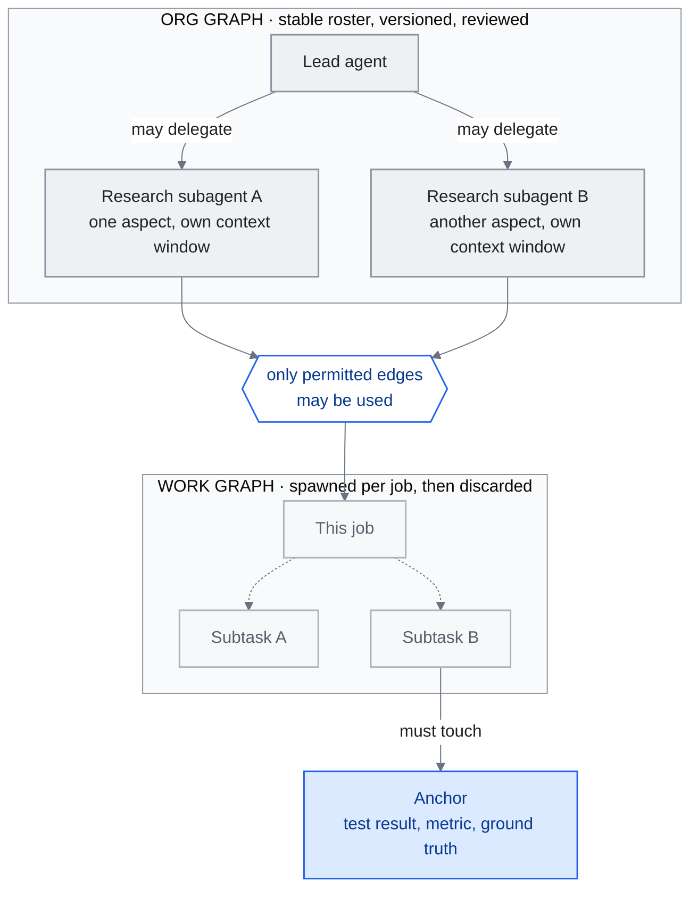

<!-- translation-sync:start -->
> 與 2026-10-31 英文版同步的機器輔助譯文，已作結構與內容覆核。程式碼和圖中標籤保留原文；閱讀時間按英文原文估算。
> [English source](../../../chapters/14-graph-engineering.md) · [Sync record](../../SYNC.md)
<!-- translation-sync:end -->

<!-- i18n-anchor -->

# 第 14 章：Graph Engineering —— 為 Agent 組織布線

> **一句話總結：** Graph engineering 是 2026 年 七月出現的一個主張：loop engineering 之上還有一層, 就是 graph——明確接好哪些 agent 存在、誰可以把工作委派給誰, 以及它們的 loop 之間如何互相監督、互相糾正。
>
> **為什麼重要：** 如果這個主張站得住腳, 它就替那一層命了名——在那一層, 多 agent 系統不再是一堆臨時湊起來的 loop, 而是被設計出來的組織; 如果站不住腳, 它就是最清楚的一個活案例, 讓我們看到這些世代標籤是怎麼被造出來、又怎麼被拆掉的。
>
> **閱讀時間：** ~29 分鐘（按英文原文估算：6,600 個單詞 / 230 wpm）

*圖：第 14.2 節區分的兩個物件，即由獲准委派邊構成的穩定組織圖，以及單個任務在其中生成的臨時工作圖；另有 Perez 的錨點，即以外部現實為依據的檢查，防止互相評審的智慧體收斂於自信的一致意見。圖工程一詞存在爭議（14.3），這些結構本身並無爭議。*

本章初寫於 2026 年七月下旬，術語當時約出現兩週，取代第 13 章，成為本指南歷史最短的概念。"Graph engineering"在 July 17-18, 2026 之後數天形成，完全存在於從業者部落格與廠商文章之中，尚無學術文獻支撐。它至今仍是本指南爭議最大的術語。最響亮的回應來自 LangChain，一家框架名稱本身就含圖的廠商：實踐已有三年，新的只有標籤。

初稿以一個檢查關口而非結論收尾：四個訊號，預定在 2026 年九月檢查。**檢查於 September 15, 2026 執行，結果分成兩部分：術語透過了關口實際規定的傳播測試，但其作為獨立工程層的地位仍未得到證明。** 第 14.7 節提供註明日期的評分表、各訊號背後的證據，以及這次檢查迫使七月初稿作出的兩項更正。從這裡到評分表之間的章節，記錄八週內到來的證據：第二家廠商不用名稱就釋出相同結構；一個比術語早一年以上的生產說明；一家開源智慧體公司；一個付費課程；以及圍繞究竟哪個術語已死的第二輪文章。

下文有意保留限定。懷疑者與支持者獲得同等篇幅；不同來源的瀏覽量相互衝突時，明確報告衝突；除非句子另有說明，"at the time of writing"均指 2026 年七月下旬。

本章涵蓋那篇催化劑貼文與它觸發的文章浪潮、這個新框架實際主張什麼、對它的反駁、這個名字所必須做的與知識圖譜的區分、如果它真是獨立一層的話會坐落在哪裡、中文生態圈的回聲, 以及從業者現在該不該在乎。

---

<!-- i18n-anchor -->

## 14.1 引發一切的那條推文（2026 年 七月 17-18 日）

這套劇本很眼熟, 因為本指南才剛看著它跑過一遍。在他 六月 7 日那篇催化了 loop engineering 的貼文（第 13.1 節）之後六週, **Peter Steinberger**——OpenClaw 的創造者, 現在人在 OpenAI——又發了一次貼文。根據 [Carlos E. Perez](https://medium.com/intuitionmachine/from-loop-engineering-to-graph-engineering-d3ebeb08511c) 與 [Yash Thakker](https://explainx.ai/blog/graph-engineering-ai-agents-multi-agent-organizations-2026) 的逐字引用, 這篇貼文寫道：

> 我們現在還在講 loop, 還是已經轉去講 graph 了？

在講別的之前, 先講兩個來源上的但書, 因為本章存在的意義正是要講這些。第一, 這篇貼文字身沒有被本指南直接抓取過, 各自獨立抓取的二手來源之間的轉述也不完全一致。只有 Perez 和 Thakker 逐字引用了這句確切的英文措辭。[LangChain](https://www.langchain.com/blog/3-years-of-graph-engineering-with-langgraph) 和 Perez 只連結了這篇貼文, 沒有引用它的文字; [36kr](https://eu.36kr.com/en/p/3904771418867330) 和 Tony Bai 把它譯成了中文, 36kr 的英文版又把中譯回譯成"Are we still talking about loops, or have we moved on to graphs?"; [Eigent](https://www.eigent.ai/blog/graph-engineering-ai-agents) 則是轉述。上面之所以能印出這句措辭, 依據的就是這兩處逐字引用。

第二, 圍繞它的數字彼此不一致。每一個給這篇貼文標註日期的來源, 標的都是 七月 18 日; 本章標題裡用到的 七月 17 日這個區間下限, 是一個美國時區的可能性, 而不是來源之間有記載的分歧。觀看次數確實互相沖突, 不過這些是不同時刻拍下的快照, 而不是對同一時點的競爭性測量：Thakker 報的是幾小時內 575K 次觀看, 36kr 報的是兩天內 2.6M 次（同一篇文章裡, 對照六週前那篇 loop 時代貼文的 8.4M 次觀看）, Tony Bai 報的是兩天內大約 800K 次。這裡沒有把任何單一數字當作事實來陳述。

和 六月那篇一樣, Steinberger 什麼都沒命名。"graph engineering"這個複合詞, 在他的原文裡完全沒出現。這個複合詞是在幾天內的回應文章裡結晶化的, 有意識地仿照了 prompt、context、harness、loop engineering 這條脈絡——而且這波浪潮來得很快：

- **七月 18 日** —— [Yash Thakker 的 explainx.ai 指南](https://explainx.ai/blog/graph-engineering-ai-agents-multi-agent-organizations-2026)（持續更新到 七月 26 日）, 點名這條推文是催化劑, 提出了 org graph／work graph 的拆分。
- **七月 19 日** —— **Carlos E. Perez**（Intuition Machine）發表第一篇有分量的理論擴充套件。
- **七月 20 日** —— 企業廠商 **TrueFoundry** 出貨一份[面向生產的指南](https://www.truefoundry.com/blog/graph-engineering-enterprise-guide), 附治理檢查清單。
- **七月 21 日** —— **eigent.ai** 發表自己的廠商文章; 中國的 **Tony Bai** 與 **36kr** 同一天都報道了這場論述（14.6）。
- **七月 22 日** —— **LangChain** 由 Sydney Runkle 與 Harrison Chase 聯名發表的官方回應, 在催化劑出現四天後落地（14.3）。

一個催化劑、一波文章浪潮、一個廠商的反框架, 加上一個中文生態圈的回聲, 全都發生在一週之內：loop-engineering 的命名順序, 用更快的速度重播了一遍。

---

<!-- i18n-anchor -->

## 14.2 Graph Engineering 聲稱是什麼

把這些文章拆到最簡, 會看到三個反覆出現的主張。

**Agent 組織, 而非 Agent 行為。** Thakker 的框定, 是這個遞進關係裡最好引用的版本：

> Loop 讓 agent 的行為變得可程式設計。Graph 讓 agent 的組織變得可程式設計。

他的指南把 graph 拆成兩個不同的物件：

- **org graph（組織圖）**——一張穩定的圖表, 記錄哪些 agent 存在、每個 agent 是幹嘛的, 以及哪些委派邊是被允許的;
- **work graph（工作圖）**——某個特定工作生出、執行、再丟棄的那個短命任務分解。

這裡的主張是：兩者現在都是需要被設計、版本化、審查的工程產物, 就像第 4 章對待 harness、第 13 章對待 loop 那樣。

**Loop 監督 Loop, 被 Anchor 摁住。** [Perez 的文章](https://medium.com/intuitionmachine/from-loop-engineering-to-graph-engineering-d3ebeb08511c)——七月 19 日發表的第一篇理論擴充套件——把 graph 描述成一個由 loop 組成的網路, 彼此監督、彼此約束。他特有的補充是 **anchor**：一個無可爭辯、紮根於外部現實的測量（一個測試結果、一個指標、一次對照真實情況的檢查）, graph 裡的某個節點必須觸碰到它。他主張, 沒有 anchor 的話, 一張互相審閱的 agent 組成的 graph, 會退化成一個回聲室, 收斂到自信的一致意見, 而不是正確性——這是第 13.4 節記錄過的單一 loop 自我打分失效模式的多 agent 版本。

**受治理的拓撲。** 各廠商的文章——[TrueFoundry](https://www.truefoundry.com/blog/graph-engineering-enterprise-guide)（七月 20 日）與 [Eigent](https://www.eigent.ai/blog/graph-engineering-ai-agents)（七月 21 日, 同時把功勞歸給 Steinberger 的那句提示和 Perez 的「loop 網路」擴充套件）——都收斂到同一個操作層面的理解：graph engineering 就是對 agent 拓撲的治理與可觀測性。按這個理解, 它擁有的問題是：

- agent 之間哪些轉移是被允許的, 哪些在結構上根本不可能;
- 一次失敗在蔓延到整個組織之前, 會在哪裡被隔離;
- work graph 裡失控的分支, 要怎麼被偵測、被切斷;
- 對一個 agent 組織做稽核, 到底該長什麼樣。

TrueFoundry 為這些問題出貨了一份企業檢查清單; 這份清單是否需要一個新的學科名字才能存在, 正是下一節要處理的問題。

**廠商出貨了結構, 卻沒出貨這個名字。** 2026 年 八月 7 日（Claude Code v2.1.224, 到 八月 23 日迭代到 v2.1.241）, Anthropic 出貨了跨 session 的 agent 訊息傳遞：`ListAgents` 會發現具名的 session——子 agent、agent-team 隊友、其他本地 session、雲端 session, 以及其他機器上的 Remote Control session——而 `SendMessage` 按名字在它們之間傳遞純文字, 由每個 session 各自的入站治理（接受／保留／拒絕）、一個基於許可權模式的預設值, 以及大小／突發／loop 節流來把關。範圍刻意收得很窄：對話歷史和檔案不會跨 session、沒有跨 session 的許可權批准, 而且這個功能在 Bedrock、AWS 上的 Claude Platform、Google Cloud Agent Platform, 或 Microsoft Foundry 上都用不了。拿它對照上面剛定義的 org graph——一份穩定的具名 agent 名單, 加上被允許的委派邊——這看起來就是它的一個出貨例項：具名、可定址的 session, 加上受治理的訊息邊連在它們之間。它不是的, 是詞彙上的採用：Anthropic 自己的文件和更新日誌, 沒有任何一處用"graph engineering"這個說法來描述這個功能。這個落差——一家主要的 harness 廠商, 把本章追蹤的這個模式實作出來了, 卻對替它造的這個標籤保持沉默——是這個基礎能力存在的證據, 不是這個詞存在的證據, 而這兩者不是同一個主張。

**第二家廠商實際上更早釋出，比名稱出現早一個月。** OpenAI Codex 經另一條路線更早抵達同一位置。兩個 PR，[#28792](https://github.com/openai/codex/pull/28792) 的"Expose thread-level multi-agent mode"（June 19, 2026 合併），以及 [#29324](https://github.com/openai/codex/pull/29324) 的"Simplify multi-agent mode controls"（June 22, 2026 合併），將委派行為歸入一個 `multiAgentMode` 設定，包含三個狀態。第二個 PR 逐字說明為：`none`，"Keep multi-agent tools available without adding mode instructions"；`explicitRequestOnly`，"Only delegate after an explicit user request"；`proactive`，"Delegate when parallel work materially improves speed or quality."。首個包含三種狀態的已釋出版本是 Codex `rust-v0.142.0`，June 22, 2026 釋出，說明寫道："App-server clients can configure multi-agent delegation as disabled, explicit-request-only, or proactive at the thread and turn level."。這比 Steinberger 帖子早一個月，比 Anthropic 跨會話訊息早七週。

需要仔細讀 `none` 狀態，因為它決定這是何種控制：工具依然可用，改變的只是是否加入模式指令。透過改變模型收到的指令而應用的委派策略，屬於*提示層策略*，不是強制授權；它並非第 4 章所區分的閘道器式預設拒絕檢查，兩個 PR 頁面也沒有聲稱如此。因此，誠實解讀應比"a vendor shipped org-graph governance"更窄：廠商釋出了組織圖形態的*設定*，執行方式與提示相同。與 Claude Code 一樣，用詞訊號仍為空：這些合併前後三個版本的釋出說明，沒有出現"graph engineering"，兩個 PR 也沒有這樣描述工作。

**一個比名稱早十三個月的生產說明。** 對實際執行的智慧體組織，最詳細的公開描述在術語出現前已經發布，本章初稿卻遺漏了它。Anthropic 的 ["How we built our multi-agent research system"](https://www.anthropic.com/engineering/multi-agent-research-system)（June 13, 2025）描述 Claude Research 背後的編排器／工作者拓撲：主智慧體"analyzes it, develops a strategy, and spawns subagents to explore different aspects simultaneously,"，每個子智慧體各有上下文視窗，另有獨立 CitationAgent 標註來源。披露超越架構，進入只有生產中才重要的部分：評估從"a set of about 20 queries representing real usage patterns"開始，由 LLM 評分器評價事實準確性、引用準確性、完整性、來源質量及工具效率；故障透過"that can resume from where the agent was when the errors occurred"的系統處理；釋出使用"rainbow deployments to avoid disrupting running agents, by gradually shifting traffic from old to new versions while keeping both running simultaneously."。最醒目的比較來自 Anthropic 內部：Opus 4 主導、Sonnet 4 作為子智慧體的多智慧體系統，"outperformed single-agent Claude Opus 4 by 90.2%,"，消耗約為聊天互動 15 倍的 token。全文沒有"graph engineering"。準確地說，這證明*實踐*在*標籤*出現前一年就有公開生產案例，相當於從 Anthropic 一側支撐 LangChain 的論點。

**另一個來自普通獨立開發者。** 這種模式不限於廠商。[`headcount`](https://github.com/cbrock84/headcount) 由 GitHub 使用者 cbrock84 建立，倉庫建立於 August 28, 2026，採用 MIT 許可證，為 Claude Code 封裝完整智慧體組織。README 描述"a chief executive over 16 departments, 172 skills in total,"，每個部門都是可單獨安裝的外掛。值得關注的是兩項治理思路：Security 與 Legal & Risk 標為 **reviewer-class**，是能停止工作、而非只增加意見的部門，彙報關係獨立於被其審計的職能；智慧體按"exclusive write surface, not by topic,"劃分，理由是"a topic split has no checkable boundary."。這是獨立開發者完全以現有子智慧體及外掛基礎能力構建、具有明確許可權模型的組織圖。但成熟度證據薄弱：倉庫沒有任務量、可靠性或成本資料，自身 GitHub 描述仍過時地宣傳"15+ departments, 125+ skills,"，README 也從未使用"graph engineering"。

有關整個組織的監控邊界，參見[第 4 章](04-harness-engineering.md#48-harness-maintenance-the-stress-testing-imperative)。

---

<!-- i18n-anchor -->

## 14.3 反駁聲音

懷疑者在這裡該得到同等的份量, 而不只是一段禮貌性的段落, 因為在四天之內, 這場論述自己就產出了最有力的反駁——而且是來自最有資格提出它的那一方。

**LangChain：這事已經有三年了。** [《3 Years of Graph Engineering with LangGraph》](https://www.langchain.com/blog/3-years-of-graph-engineering-with-langgraph)（Sydney Runkle 與 Harrison Chase, 2026 年 七月 22 日）同時做了兩件事。它替這個詞賦予了合法性——這篇文章明確把 graph engineering 排在"prompt engineering, context engineering, harness engineering, and loop engineering,"之後, 這正是本指南追蹤的那條世代主線, 只是多加了一級階梯。但它同一口氣裡, 也把這個詞的氣給放掉了：

> 把 agentic 系統表示成 graph 並不新鮮, 我們已經這麼做三年了。

他們的化簡很乾淨：**一個 loop 不過就是一個有向的、有環的 graph。** LangGraph 從 2023 年起就把 agent 建模成 graph 拓撲——節點、邊、條件轉移、環。照這個讀法, 2026 年 七月除了詞彙之外什麼都沒變：這個實踐比這個標籤早了三年, 而標籤只是加了一個名字, 而不是加了一個能力。

注意這對證據基礎做了什麼。graph engineering 目前擁有的最強的採用訊號——一家主要框架廠商在四天內做出回應——同時也是它最強的懷疑來源。同一份檔案兩者都是, 任何誠實的說法都得把它同時當成這兩者來看待。

**Tony Bai：今天的框架, 明天的廢棄堆。** 這位中國開發者基礎設施領域的寫作者在 [七月 21 日的貼文](https://tonybai.com/2026/07/21/from-loop-engineering-to-graph-engineering/) 裡, 先是同情地解釋了 loop 互相監督加上 anchor 這個框架, 然後話鋒一轉：loop engineering 才火了不到兩個月, 矽谷就又產出了下一個詞, 而"graph"自己也可能是明天被丟棄的流行語。這個警告來自一位早期就認真講解過 loop 框架的人——他的懷疑不是反射性的反炒作——所以這句話落地得更重。

**缺少證據當時說明什麼，八週又改變了什麼。** 術語出現兩週時，也就是 2026 年七月下旬，尚無會議演講、課程或招聘使用這個詞，本指南的搜尋也未找到。這既符合一個不足兩週的新詞，也同樣符合一個不會存續的詞；當時誠實的說法，是證據無法區分兩種情況。九月檢查時，三項中只有一項改變：確實有付費課程，而且教授組織圖含義。[Graph Engineering Mastery](https://graphengineerings.com/) 出售六模組課程，終身 $6.93 或每月 $19.63；[Module 2](https://graphengineerings.com/course/module-2.html)"Orchestration and Multi-Agent Topology,"提供十一課，涉及路由、扇出／扇入、監督者／專家層級、合併邏輯及錨點，並附可做單元測試的練習，例如"Build a support-ticket router... The branch condition must be a unit-testable pure function"。這是實際教材，而非廣告。但網站接近匿名：沒有教師姓名，僅在"The Case006 for Justdoit.work"頁尾以"© 2026 GraphEngineerings.com"自我標識，附加州 Newark 地址與電話號碼，不聲稱認證，並明確說明所列行業人士"are not presented as formal faculty or endorsers."。另兩項訊號未變。AgentEng London（October 16, 2026，Everyman Cinema，Crossrail Place）列出"disciplines such as context, harness, memory, evaluation, inference, protocols, and agentic coding"，這是示例而非完整分類；其中沒有圖，頁面其他地方也完全沒有"graph"，截至九月中旬仍無公開講者名單。招聘平臺搜尋仍只返回知識圖資料庫職位，即第 14.4 節要區分的舊類別。

**九月文章究竟在爭論誰的訃告。** 最強的繼承主張並非 Steinberger 的問題，而是文章標題"Loop Engineering Is Dead. Enter Graph Engineering,"。SmartScope 將其歸於 Hamel Husain，日期 July 18, 2026，並稱在 Steinberger 的 00:34 UTC 帖子約四個半小時後；Towards Data Science 文章點名標題和作者，但沒有日期。本指南未直接取得該文，只按二手來源報告標題、日期、作者。對證據基礎重要的是，九月反駁的方向很容易被讀反。[SmartScope 的 September 1, 2026 文章](https://smartscope.blog/en/blog/graph-engineering-loop-engineering-logic-review/)反駁的是*那份訃告*，不是為圖工程寫訃告；其論點是"Graph Engineering is not the successor to Loop Engineering; it is a design lens for connecting multiple loops and agents through shared state, branches, permissions, and failure paths."。因此，九月討論降低了世代繼承說法，同時為工具辯護，既代表術語繼續傳播，也拒絕建立其上的世代主張。該來源還有自身限定："as of July 20, the cited posts and public materials do not provide a standard definition, a canonical reference architecture, peer-reviewed evidence of effectiveness, or a comparative benchmark against Loop Engineering."。

---

<!-- i18n-anchor -->

## 14.4 不是知識圖譜

這個名字帶來了一場碰撞, 本指南在結構上有義務把它解開, 因為第 2 章從本指南一開始就在講 graph。"Knowledge graph engineering"是一個已經確立、超過十年曆史的學科——語義網、本體、三元組儲存——GraphRAG（第 2 章）建的是實體與關係構成的圖, 好讓系統能檢索、推理它所知道的東西。2026 年 七月意義上的 graph engineering, 除了這個字之外, 和它沒有任何共通之處。TrueFoundry 的區分是目前最乾脆的一個版本, 值得當作分界線引用出來：

> Knowledge graphs structure what a system knows; graph engineering in the 2026 sense structures who the system is --- its members, mandates, and message paths.

把兩者擺在一起看, 這兩種 graph 除了資料結構之外, 什麼共同點都沒有：

| | 知識圖譜／GraphRAG（第 02 章） | 圖工程（本章） |
|---|---|---|
| 節點 | 實體 | Agent |
| 邊 | 有標籤的關係 | 被允許的委派 |
| 建立時機 | 索引階段 | 架構階段 |
| 使用時機 | 檢索階段 | 執行時（被遍歷、也被改動） |
| 回答的問題 | 系統知道什麼？ | 系統是誰？ |

從第 2 章 GraphRAG 那一節走到本章的讀者, 應該把這個共用的字當成詞彙上的巧合, 而不是共同的血緣。（第 2 章裡有一個反向指回來的指標。）

---

<!-- i18n-anchor -->

## 14.5 它坐落在哪裡——第五代, 還是第四代的重構？

如果這個框架真的站得住腳, 它在本指南的演進故事裡該放在哪裡？本指南的主線是從 prompt（第 1 章）到 context（第 1-3 章）到 harness（第 4 章）再到 loop（第 13 章）。支持者的答案是：再往上一層樓。LangChain 自己的排列——把 graph engineering 排在 prompt、context、harness、loop 之後——即使一邊質疑它的新穎性, 一邊還是把它放成了第五級階梯。

這段時間裡最有用的結構性處理, 也是最新的一篇。[MarkTechPost 七月 29 日的文章](https://www.marktechpost.com/2026/07/29/prompt-engineering-vs-loop-engineering-vs-graph-engineering-what-changes-at-each-layer/) 主張這些層不是彼此的繼任者, 而是層層堆疊的控制單元：

- **harness**（第 4 章）是單一個 agent 周圍的環境;
- **loop**（第 13 章）是單一個 agent 的行為迴圈;
- **graph** 協調多個 agent, 靠的是一張穩定的組織圖, 加上一張短命的工作圖。

它的主線——"graphs are built from loops, and loops are built from prompts"——是第 1 章的共存論點往外多加了一個框, 也是和本指南對待前面幾層的方式最相容的讀法。

但削弱獨立層地位的解讀同樣符合事實。如果迴圈只是有向迴圈圖，正如 LangChain 所說，那麼迴圈的圖不過是更大的迴圈系統，"graph engineering"就是把編排加迴圈工程用於 N 個智慧體，而非一個，是第四層的重構，不是第五層。第 13 章沒有解決迴圈工程究竟是真正層次，還是"harness engineering with a scheduler attached"；圖工程繼承這一未解問題，再加上自己的問題。本指南七月沒有解決，九月也沒有解決。

再過兩個月，改變的是問題形態，不是答案。設計範圍確實存在，值得命名：多個智慧體共同工作時，必須有人決定誰能向誰交接、故障在哪裡停止，以及哪些工作由不向被審者彙報的一方稽核。如今這些決定有可讀產物，從 Codex 三種委派狀態，到 `headcount` 稽核者部門，再到 Anthropic 主智慧體加子智慧體拓撲。但尚未證明這一範圍*獨立於*下方層次。本章能點名的每個已釋出例項，都是編排層功能或迴圈之上的策略：Claude Code 跨會話訊息是編排能力，Codex 委派模式是會話設定，Anthropic 研究系統是編排迴圈生成子智慧體迴圈，`headcount` 是現有子智慧體上的外掛佈局。九月文章在此也指向不同方向：[Towards Data Science 的 September 14 文章](https://towardsdatascience.com/graph-engineering-for-ai-agents-from-prompts-and-loops-to-workflows/)由 Nhu Hoang 撰寫，將圖定義為預先承諾的控制流，"you define the nodes, routing logic, and checkpoints in advance"，並且"the graph decides what happens next,"；這是工作流確定性主張，並非智慧體組織主張。一個只被觀察為下層配置、倡導者又有兩種不相容描述的範圍，仍可成為值得關注的視角，卻尚未贏得獨立一層。第 1 章仍將多智慧體協調放在編排層框內，這依然是有效的替代解讀，而非佔位。

---

<!-- i18n-anchor -->

## 14.6 中文生態圈的回聲

一個框架是否已經逃出它誕生的那個泡泡, 比較強的訊號之一, 就是中文開發者生態圈接住它的速度有多快——而這一次, 回聲在三天之內就出現了, 而且已經帶著一個定型的譯名：**圖工程**。

得到核實的錨點有兩個。[Tony Bai 七月 21 日的貼文](https://tonybai.com/2026/07/21/from-loop-engineering-to-graph-engineering/)——標題：「Loop Engineering才火兩個月，矽谷已經卷出"Graph Engineering"了」——是實質內容的解說文, 替中文基礎設施受眾講解了 Perez 的 loop 互相監督加 anchor 這套說法, 並附上了 14.3 那個流行語警告。而 [36kr 的英文版報道](https://eu.36kr.com/en/p/3904771418867330)（同樣是 七月 21 日）把這場論述當新聞處理：它報告了 14.1 裡的觀看次數比較, 並點名 Geoffrey Huntley、Boris Cherny、Addy Osmani、Luis Catacora 是這場論述的參與者。（這些歸屬只依據 36kr 一家, 在此也只以此為依據引用。）

除了這兩個之外, 回聲就只剩下標題了。中文搜尋找到兩篇 CSDN 智慧體開發者社群的文章——一篇標題比較剋制, 叫從Loop Engineering到Graph Engineering, 一篇把整套炒作模板用滿, 叫"Loop engineering is dead, graph engineering lives forever"（和第 13.8 節記錄過的、loop 那波浪潮裡同一個已死噱頭）——還有一篇繁體中文的解說文。這三篇都沒有被本指南獨立抓取過; 它們只是以搜尋結果裡的標題這個身份被引用, 用來證明中文內容管線已經在處理這個詞, 僅此而已。

模式與第 13 章相同：將迴圈工程解釋內容工業化生產的流水線，在七月開始處理圖工程；兩個催化事件相隔約六週，但從催化到中文回聲僅數天。

**九月狀態：未驗證，不等於沉寂。** 九月檢查無法確認中文回聲是否延續。在本指南可訪問的中文平臺上搜尋，沒有找到日期為 2026 年九月、相關的圖工程材料；但訪問能力過弱，不能把這種缺失當作證據，而上文七月記錄在兩個已取得的錨定來源之外也已很薄弱。因此如實記錄：七月報道已驗證，九月延續情況未核實。不能據此解讀中文回聲已沉寂；任何人寫出這個結論前，都應由具備原生平臺訪問能力的研究路線重查。

---

<!-- i18n-anchor -->

## 14.7 現在值得關注嗎？檢查關口與九月 15 日評分表

2026 年七月下旬的從業者，需要兩個分開的答案，因為標籤與問題可以分離。以下兩段保留當時原貌，後面的評分表則是它們預先設定的九月檢查。

**不管標籤怎樣, 問題都是真的。** 如果你在一個 harness 裡用一個 loop 跑一個 agent, 本章的內容不會改變你的工作; 第 4 章和第 13 章仍然是在起作用的那兩層。如果你已經在把多個 agent 接在一起, 這些文章點名的那些擔憂——哪些委派邊是被允許的、一次失敗在蔓延之前會在哪裡被隔離、什麼東西會被觀測與稽核、哪個節點觸碰了 anchor 好讓系統不會漂移到自說自話——不管"graph engineering"這個名字能不能撐下去, 都是你本來就有的工程問題。TrueFoundry 的檢查清單和 Perez 的 anchor, 不管用哪套詞彙, 現在都能用。LangChain 的反駁, 在這一點上其實是同意的：他們已經工程這些 graph 三年了, 這意味著這些問題至少已經存在了三年。

**這個標籤, 是一場你不必下注的賭局。** 本指南在 loop engineering 才五週大的時候加入了第 13 章; graph engineering 在才兩週大的時候就拿到了一章, 靠的是嚴格來說更強的早期證據（更快的文章浪潮、同一周內框架廠商的回應、更快的中文回聲）, 和嚴格來說更弱的成熟度（沒有能和 Stripe 的 minions 相提並論的生產案例研究、沒有廠商課程、沒有基準測試）。所以本章用一道關卡收尾, 而不是一個定論。**存活測試是：這個詞到 2026 年 九月還會不會繼續流通。** 具體來說, 要留意：

- 框架或廠商文件把這個詞采納進產品詞彙, 而不只是部落格里的框定說法;
- 會議演講、課程, 或職位招聘用到它（截至寫作時：一個都沒找到）;
- 一個具名的生產案例研究, 分量能比得上 Stripe 的 minions 給 loop engineering 帶來的那種分量;
- 第二波文章浪潮, 而且不是為了回應某一篇貼文而寫的。

如果這些都出現了, 本章會像第 13 章那樣繼續長大。如果沒有出現, 本章就會作為一場為期兩週的命名事件的記錄留在那裡, 而洩氣版的讀法就贏了。

<!-- i18n-anchor -->

### 評分表，檢查日期 September 15, 2026

August 24, 2026 曾進行中期檢查，距關口還有 22 天；兩次讀數一併展示，使變化可見，而非只靠聲稱。

| 七月原定訊號 | 八月 24 日，2026 | 九月 15 日，2026 | 九月讀數的證據 |
|---|---|---|---|
| 1. 框架或廠商文件在產品用語中採用該術語 | 未滿足 | **未滿足** | 本節直接檢查的廠商介面，描述結構但不用名稱，包括 Claude Code 跨會話訊息文件及更新日誌，以及 Codex 委派 PR 與釋出說明（14.2）。LangChain 文章標題雖含這個複合詞，原訊號要求的卻是產品用語，不是部落格框架。沒有對所有廠商文件進行系統、註明日期的審計，因此未滿足只針對所收集證據，不是證明普遍不存在。 |
| 2. 會議演講、課程或招聘使用該術語 | 未滿足 | **滿足，但較弱** | Graph Engineering Mastery 出售真實的組織圖課程內容（14.3）。沒有會議分軌：AgentEng London 頁面沒有"graph"，其領域列表是示例"disciplines such as..."，而非窮盡。招聘仍只涉及舊有知識圖譜職位。 |
| 3. 具名生產案例，分量相當於 Stripe minions 對迴圈工程的作用 | 部分滿足 | **追溯性滿足** | Anthropic 六月 2025 的多智慧體研究系統說明：已部署拓撲、LLM 評分器評估、故障後恢復、彩虹部署，以及 90.2% 的內部比較（14.2）。 |
| 4. 第二輪文章，且並非圍繞單篇帖子回應 | 滿足 | **滿足** | 獨立文章持續三個月至八月，隨後有九月 1 日 SmartScope，以及九月 14 日包含完整示例的 Towards Data Science 教程（14.3、14.5）。 |

**關口沒有說明如何彙總，因此在此明示規則，而非暗示。** 七月文字沒有設法定數量、權重或彙總規則，只列四條再寫"if those arrive."。嚴格閱讀，其句子規定的測試比條目更窄：*術語在 2026 年九月是否仍然流傳*。答案是肯定的：三個月並非回應最初帖子的文章、教授組織圖的付費課程，以及九月教程。其餘三條描述傳播加機構成熟度會是什麼樣；原文從未規定必須全部一致滿足。在證據出現後才這樣解讀，是移動關口，而非應用它。

**檢查迫使七月初稿作出兩項更正。** 第一，七月聲稱"no production case study comparable to Stripe's minions."，但實際有一個，而且當時已出現十三個月，即 Anthropic 研究系統說明。第 13 章雖承認 minions 早於迴圈工程標籤，仍將其算作生產案例；此處應用相同標準，就應把 Anthropic 算入。遺漏它，使七月成熟度判斷比證據支援的更苛刻。第二，九月文章起初被讀為討論圖工程的訃告，本指南自身關口筆記也如此；實際上，被爭論的訃告屬於迴圈工程（14.3）。

**September 15, 2026 結論：術語透過傳播測試；作為獨立工程層的地位未證。** 兩部分都有分量。存續不代表獲得證實：訊號 1 才能區分學科與話語，八週後仍為空；期間最強新證據反而不利於標籤，兩家廠商構建了圖工程所指治理，其中一家在術語出現前一個月就開始，雙方都不需要這個詞。未證也不等於否定：三個月獨立文章推翻了只是兩週命名事件的解讀，名稱下的實踐也有公開生產案例及教授它的課程。因此，本章如關口所述繼續擴充，卻不將術語提升為編號世代：圖工程仍是多智慧體協調的爭議性名稱，在此作為待檢驗主張追蹤，而非已確立層次。Tony Bai 的警告，即今日框架可能成為明日棄用流行詞，仍最公平地概括風險。

下一項足以改變結論的證據，很窄也很清楚：廠商在自身產品用語中使用該術語，或出現具名會議分軌。截至 September 15, 2026 所收集證據，兩者均未確立。

<!-- i18n-anchor -->

### October 31, 2026 更新：傳播擴大，含義分化

九月評分表仍是一次歷史檢查。十月增加了機構層面的傳播，但這個名稱如今更需要以下限定，而不是更不需要：

| 訊號 | 十月證據 | 能夠確立什麼 |
|---|---|---|
| 廠商用語 | Neo4j 的[十月 6 日網路研討會](https://neo4j.com/events/on-demand/)將圖工程用於程式性記憶和帶型別的 AIP 技能圖。 | 廠商教育內容採用了這個詞，但尚未驗證產品文件採用其組織圖含義。 |
| 會議演講與教學 | [AI Engineer NYC 日程存檔](https://ai.engineer/nyc/2026/schedule)列出 Zachary Blumenfeld 於十月 14 日的"Graph Engineering 101: Predictability, Governance, Portability"。O'Reilly 的[目錄](https://www.oreilly.com/library/view/graph-engineering/9781808812477/)列出 Volodymyr Pavlyshyn 的 *Graph Engineering: The Loop Memory Model*，由 Packt 在 2026 年十月出版。 | 有具名的預定演講和一本書，加強了教學訊號。日程不能證明演講實際完成、其精確含義，或存在專門的會議分軌。 |
| 生產證據 | 九月的生產實踐說明，仍可作為智慧體協調的證據。 | 此處沒有新增主張，認為生產拓撲能夠確立一個獨立工程層。 |
| 持續傳播 | 十月的廠商活動、會議日程與書籍，將記錄延續到九月之後。 | 術語繼續傳播；機構層面的可見度並不能確定其定義。 |

Neo4j 的[網路研討會說明](https://go.neo4j.com/WBR-EDU-261006-Procedural-knowledge_Registration.html?utm_campaign=dev&utm_medium=event-hub&utm_source=website)討論過程、依賴關係與來源。它應與技能圖和記憶放在一起討論，不能自動歸到允許的委派邊之中。書籍目錄涵蓋迴圈、群體、DAG 和知識圖譜；單憑後設資料和目錄，不能確立技術共識。因此，十月結論繼續保留兩項區別：傳播證據更強，但組織圖這一含義及獨立第五世代的地位仍未得到證明。

---

<!-- i18n-anchor -->

## 三個要點

- **組織圖與工作圖是兩個不同物件。** 由獲准委派邊構成的穩定名冊，其生命週期長於單個任務在內部生成的臨時圖。
- **沒有錨點，互相評審的智慧體會收斂於一致意見，而非正確性。** Perez 的解決方式，是讓某個節點必須接觸無可爭辯、具有外部現實依據的測量。
- **術語透過傳播測試，獨立層地位仍未證。** 兩家廠商不使用這個詞便釋出相關協調功能，而且執行機制不同：Codex 委派設定屬於提示層策略，不是強制授權。因此，本指南將圖工程保留在編號世代之外。

---

<!-- i18n-anchor -->

## 來源

- AI Engineer NYC。日程存檔，儲存於 October 17, 2026；十月 14 日的場次條目：[https://ai.engineer/nyc/2026/schedule](https://ai.engineer/nyc/2026/schedule)。
- Neo4j。October 6, 2026 活動列表：[https://neo4j.com/events/on-demand/](https://neo4j.com/events/on-demand/)。網路研討會說明：[Neo4j 註冊頁](https://go.neo4j.com/WBR-EDU-261006-Procedural-knowledge_Registration.html?utm_campaign=dev&utm_medium=event-hub&utm_source=website)。
- O'Reilly Learning。Packt 書目，2026 年十月：[https://www.oreilly.com/library/view/graph-engineering/9781808812477/](https://www.oreilly.com/library/view/graph-engineering/9781808812477/)。
- **Steinberger, Peter.** X 貼文, "Are we still talking loops or did we shift to graphs yet?"（2026 年 七月 18 日, 依下方每一個標註了日期的來源為準）——沒有被本指南直接抓取, 只透過下方這些來源引用：Perez 與 Thakker（explainx）逐字引用; LangChain 與 Perez 只連結、沒有引用文字; 36kr 與 Tony Bai 譯成中文; Eigent 轉述。各來源報告的觀看次數互相沖突。
- **Runkle, Sydney 與 Harrison Chase（LangChain）。**"3 Years of Graph Engineering with LangGraph"（2026 年 七月 22 日）：[https://www.langchain.com/blog/3-years-of-graph-engineering-with-langgraph](https://www.langchain.com/blog/3-years-of-graph-engineering-with-langgraph) ——把 graph engineering 排在 prompt／context／harness／loop 之後; "a loop is just a directed, cyclic graph"; 這事已經三年的反駁。
- **Perez, Carlos E.（Intuition Machine）。**"From Loop Engineering to Graph Engineering?"（2026 年 七月 19 日）：[https://medium.com/intuitionmachine/from-loop-engineering-to-graph-engineering-d3ebeb08511c](https://medium.com/intuitionmachine/from-loop-engineering-to-graph-engineering-d3ebeb08511c) ——第一篇理論擴充套件; loop 監督 loop; anchor 作為對抗回聲室的無可爭辯測量。
- **Thakker, Yash（explainx.ai）。**"Graph Engineering: After Loops, This Is How You Wire Multi-Agent Orgs (2026)"（2026 年 七月 18 日, 更新至 七月 26 日）：[https://explainx.ai/blog/graph-engineering-ai-agents-multi-agent-organizations-2026](https://explainx.ai/blog/graph-engineering-ai-agents-multi-agent-organizations-2026) —— org graph 與 work graph 之分; "Loops made agent behavior programmable. Graphs make agent organizations programmable."
- **TrueFoundry.**"Graph Engineering for Multi-Agent Systems: Architecture, Governance, and Observability"（2026 年 七月 20 日）：[https://www.truefoundry.com/blog/graph-engineering-enterprise-guide](https://www.truefoundry.com/blog/graph-engineering-enterprise-guide) ——企業檢查清單; 知識圖譜區分引言（"what a system knows"對"who the system is"）。
- **Eigent.**"Graph Engineering for AI Agents"（2026 年 七月 21 日）：[https://www.eigent.ai/blog/graph-engineering-ai-agents](https://www.eigent.ai/blog/graph-engineering-ai-agents) ——把功勞歸給 Steinberger 那句提示和 Perez 的擴充套件; 受治理、互相糾正的 loop 拓撲。
- **36kr（英文版）。**"Father of Lobster's One Tweet: Is the Loop Era Over?"（2026 年 七月 21 日）：[https://eu.36kr.com/en/p/3904771418867330](https://eu.36kr.com/en/p/3904771418867330) ——報告這條推文 2.6M 次觀看, 對照 8.4M 次觀看的 loop 時代貼文; 點名其他論述參與者; 把這個詞當作正在浮現的東西處理。
- **Bai, Tony.**"Graph Engineering"（2026 年 七月 21 日）：[https://tonybai.com/2026/07/21/from-loop-engineering-to-graph-engineering/](https://tonybai.com/2026/07/21/from-loop-engineering-to-graph-engineering/) —— 圖工程 解說文, 面向中文生態圈; 警告"graph"自己也可能變成被丟棄的流行語。
- **MarkTechPost.**"Prompt Engineering vs Loop Engineering vs Graph Engineering: What Changes at Each Layer"（2026 年 七月 29 日）：[https://www.marktechpost.com/2026/07/29/prompt-engineering-vs-loop-engineering-vs-graph-engineering-what-changes-at-each-layer/](https://www.marktechpost.com/2026/07/29/prompt-engineering-vs-loop-engineering-vs-graph-engineering-what-changes-at-each-layer/) ——層層堆疊的控制單元讀法; org graph 加 work graph; "graphs are built from loops, and loops are built from prompts."。
- **Claude Code（Anthropic）。** 跨 session 訊息傳遞文件與更新日誌（2026 年 八 月 7 日, v2.1.224; 到 2026 年 八 月 23 日迭代至 v2.1.241）：[https://code.claude.com/docs/en/cross-session-messaging](https://code.claude.com/docs/en/cross-session-messaging) ; [https://code.claude.com/docs/en/changelog](https://code.claude.com/docs/en/changelog) —— ListAgents／SendMessage 出貨具名 agent 發現與受治理的跨 session 訊息邊; "graph engineering"這個說法在兩份文件裡都完全沒出現。
- Anthropic。"How we built our multi-agent research system"（June 13, 2025）：[https://www.anthropic.com/engineering/multi-agent-research-system](https://www.anthropic.com/engineering/multi-agent-research-system)。Claude Research 背後的編排器／工作者拓撲；從約 20 個代表性查詢開始的 LLM 評分器評估；錯誤後恢復與彩虹部署；"outperformed single-agent Claude Opus 4 by 90.2%"；約為聊天互動 15x 的 token；從未使用"graph engineering"。這是訊號 3 的追溯性生產案例。
- OpenAI Codex。"Expose thread-level multi-agent mode"，PR #28792（June 19, 2026 合併）：[https://github.com/openai/codex/pull/28792](https://github.com/openai/codex/pull/28792)；"Simplify multi-agent mode controls"，PR #29324（June 22, 2026 合併）：[https://github.com/openai/codex/pull/29324](https://github.com/openai/codex/pull/29324)。三個 `multiAgentMode` 狀態及逐字描述；`none` 保留委派工具、移除指令，正因如此，這是提示層策略，而非強制授權。
- OpenAI Codex 版本 `rust-v0.142.0`（June 22, 2026 釋出）：[https://github.com/openai/codex/releases/tag/rust-v0.142.0](https://github.com/openai/codex/releases/tag/rust-v0.142.0)。首個包含兩個 PR 的已釋出版本，說明還同時鳴謝 #28685："App-server clients can configure multi-agent delegation as disabled, explicit-request-only, or proactive at the thread and turn level."。
- cbrock84。`headcount`（倉庫建立於 August 28, 2026，MIT）：[https://github.com/cbrock84/headcount](https://github.com/cbrock84/headcount)。"a chief executive over 16 departments, 172 skills in total"；Security、Legal & Risk 為 reviewer-class 部門；智慧體按"exclusive write surface, not by topic"劃分；沒有披露執行指標；倉庫自身 GitHub 描述仍過時地寫為"15+ departments, 125+ skills"。
- Graph Engineering Mastery。課程網站及 Module 2，"Orchestration and Multi-Agent Topology"：[https://graphengineerings.com/](https://graphengineerings.com/)；[https://graphengineerings.com/course/module-2.html](https://graphengineerings.com/course/module-2.html)。十一課涵蓋路由、扇出／扇入、監督者／專家層級、合併邏輯與錨點，附可做單元測試的練習；終身 $6.93 或每月 $19.63；未具名教師，頁尾僅以"The Case006 for Justdoit.work"及加州 Newark 地址標識網站；不聲稱認證，所列行業人士"are not presented as formal faculty or endorsers"。這是訊號 2 的證據，也是將其標為弱證據的原因。
- SmartScope。"Graph Engineering and Loop Engineering: a logic review"（September 1, 2026）：[https://smartscope.blog/en/blog/graph-engineering-loop-engineering-logic-review/](https://smartscope.blog/en/blog/graph-engineering-loop-engineering-logic-review/)。反駁七月 18 日、歸於 Hamel Husain 的"Loop Engineering Is Dead. Enter Graph Engineering"框架；"Graph Engineering is not the successor to Loop Engineering; it is a design lens for connecting multiple loops and agents through shared state, branches, permissions, and failure paths"；文章將自身評估界定在七月 20 日，指出截至該日，引用帖子與公開材料沒有提供標準定義、權威參考架構、經同行評審的有效性證據，或相對迴圈工程的比較基準。
- Hoang, Nhu（Towards Data Science）。"Graph Engineering for AI Agents: From Prompts and Loops to Workflows"（September 14, 2026）：[https://towardsdatascience.com/graph-engineering-for-ai-agents-from-prompts-and-loops-to-workflows/](https://towardsdatascience.com/graph-engineering-for-ai-agents-from-prompts-and-loops-to-workflows/)。圍繞預先承諾控制流的完整示例："you define the nodes, routing logic, and checkpoints in advance"；"the graph decides what happens next"；以 Steinberger 帖子及 Husain 標題為背景。
- AgentEng London 2026（October 16, 2026，Everyman Cinema，Crossrail Place）：[https://agentengineering.world/london/](https://agentengineering.world/london/)。頁面列出"disciplines such as context, harness, memory, evaluation, inference, protocols, and agentic coding"，這是示例而非窮盡；頁面完全沒有"graph"，截至 September 15, 2026 尚無公開講者名單。

---

*上一章：[第 13 章：迴圈工程](13-loop-engineering.md)*
